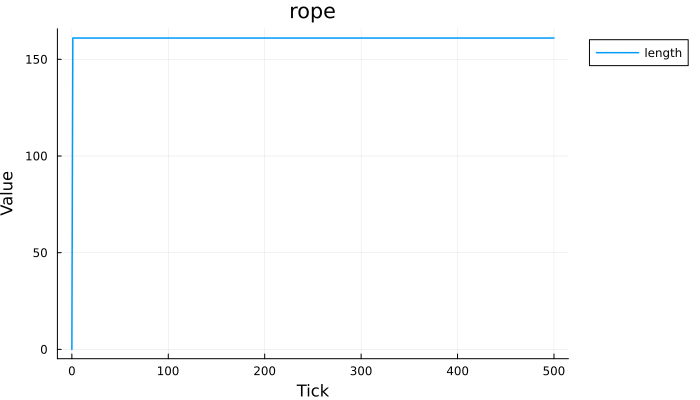

## Overview

### WHAT IS IT?

This project simulates a wave moving along a rope.  The right end of the rope (shown in blue) is fixed to a wall.  The left end of the rope (shown in green) provides an input, moving up and down in a sinusoidal motion.  This creates a wave that travels along the rope.

### HOW IT WORKS

The rope is made up of a line of turtles.  The turtle are fixed horizontally, but can move up and down.  Each turtle acts as it were connected to its two neighboring turtles with springs.  When a neighboring turtle is farther away, it exerts a stronger force.

When the left end of the rope (the green turtle) moves up, it "pulls up" the turtle to its right, which in turn pulls up the turtle to its right, and so on. In that way, a wave moves down the rope. When the wave reaches the right end of the rope (the blue turtle), the wave is reflected back to the left.

### THINGS TO NOTICE

There's a connection between the frequency with which the left end of the rope goes up and down and the number of peaks that emerge.

### THINGS TO TRY

Change the values on the sliders and observe what happens to the waves on the rope.

Try to create a "standing wave", in which some points on the rope do not move at all.

Change the blue turtle to green, so that there are two driving forces. Then change one of the red turtles in the middle of the rope to blue, so that there is a fixed point in the middle. What happens to the waves?

### EXTENDING THE MODEL

Change the right end of the rope so that it moves freely, rather than being fixed. How does that change the behavior of waves in the rope?

### NETLOGO FEATURES

For this project, it does not make sense for the turtles to "wrap" when they get to the top or bottom of the world.  So the real y-position of the turtles is kept in a new variable (`ypos`), and the turtle is hidden if `ycor`, its true position, is beyond the boundaries of the world.

### HOW TO CITE

If you mention this model or the NetLogo software in a publication, we ask that you include the citations below.

For the model itself:

* Wilensky, U. (1997).  NetLogo Rope model.  http://ccl.northwestern.edu/netlogo/models/Rope.  Center for Connected Learning and Computer-Based Modeling, Northwestern University, Evanston, IL.

Please cite the NetLogo software as:

* Wilensky, U. (1999). NetLogo. http://ccl.northwestern.edu/netlogo/. Center for Connected Learning and Computer-Based Modeling, Northwestern University, Evanston, IL.

### COPYRIGHT AND LICENSE

Copyright 1997 Uri Wilensky.


This model is licensed under the Creative Commons Attribution-NonCommercial-ShareAlike 3.0 License.  To view a copy of this license, visit https://creativecommons.org/licenses/by-nc-sa/3.0/ or send a letter to Creative Commons, 559 Nathan Abbott Way, Stanford, California 94305, USA.

NetLogo itself is free software for non-commercial use under the terms of the GNU General Public License ([see full license information here](https://ccl.northwestern.edu/netlogo/docs/copyright.html)).

To inquire about commercial licenses for either NetLogo or specific models from the models library, please contact netlogo-commercial-admin@ccl.northwestern.edu.

This model was created as part of the project: CONNECTED MATHEMATICS: MAKING SENSE OF COMPLEX PHENOMENA THROUGH BUILDING OBJECT-BASED PARALLEL MODELS (OBPML).  The project gratefully acknowledges the support of the National Science Foundation (Applications of Advanced Technologies Program) -- grant numbers RED #9552950 and REC #9632612.

This model was developed at the MIT Media Lab using CM StarLogo.  See Resnick, M. (1994) "Turtles, Termites and Traffic Jams: Explorations in Massively Parallel Microworlds."  Cambridge, MA: MIT Press.  Adapted to StarLogoT, 1997, as part of the Connected Mathematics Project.

This model was converted to NetLogo as part of the projects: PARTICIPATORY SIMULATIONS: NETWORK-BASED DESIGN FOR SYSTEMS LEARNING IN CLASSROOMS and/or INTEGRATED SIMULATION AND MODELING ENVIRONMENT. The project gratefully acknowledges the support of the National Science Foundation (REPP & ROLE programs) -- grant numbers REC #9814682 and REC-0126227. Converted from StarLogoT to NetLogo, 2001.

<!-- 1997 2001 MIT -->

## Parameters

| Parameter | Type | Default | Description |
|-----------|------|---------|-------------|
| `world_width` | `Int` | `161` | number of points (0..160) |
| `y_min` | `Int` | `-80` | y min |
| `y_max` | `Int` | `80` | y max |
| `friction` | `Int` | `24` | friction |
| `frequency` | `Int` | `10` | frequency |
| `amplitude` | `Int` | `30` | amplitude |
| `max_ticks` | `Int` | `500` | max ticks |

## Source Code

The Julia code to run this model:

```julia
using ArkModelZoo
_, trajectory = run_rope()
```

## Time Series

{width=100%}


## Appendix: Source Code

This model is implemented in the [Ark.jl](https://github.com/sdwfrost/Ark.jl) Entity-Component-System (ECS) framework. The code is split into five files, each with a distinct role:

- **Parameters**: a mutable struct holding all configurable values.
- **Components**: lightweight data types attached to individual entities (agents).
- **Resources**: world-level shared state accessible to all systems.
- **Systems**: functions that operate on entities each tick, defining model behavior.
- **Model**: wiring that assembles the world, registers resources and systems, and provides the run entry point.

### Parameters (`parameters.jl`)

The parameter struct uses `@kwdef` so that every field has a default value and can be overridden by keyword. These defaults match the original NetLogo model's slider settings.

```julia
Base.@kwdef mutable struct RopeParams
    world_width::Int = 161      # number of points (0..160)
    y_min::Int = -80
    y_max::Int = 80
    friction::Int = 24
    frequency::Int = 10
    amplitude::Int = 30
    max_ticks::Int = 500
end
```

### Components (`components.jl`)

Components are lightweight data types attached to individual entities (agents). Mutable structs hold per-entity state, while empty tag structs act as markers for the ECS query system to efficiently filter entities.

```julia
# Rope model has no entity components — purely array-based
struct RopeDummy end
```

### Resources (`resources.jl`)

Resources are world-level singletons shared across all systems, used for global state and aggregate statistics.

```julia
mutable struct RopeState
    n::Int              # number of points (world_width = 161)
    ypos::Vector{Float64}
    yvel::Vector{Float64}
    visible::Vector{Bool}
end
RopeState(n::Int) = RopeState(n, zeros(Float64, n), zeros(Float64, n), trues(n))

mutable struct RopeStats
    n_visible::Int
end
RopeStats() = RopeStats(0)
```

### Systems (`systems.jl`)

Systems contain the model logic and execute in a defined order each tick. Each system struct implements either `initialize!` (run once at setup) or `update!` (run every tick).

```julia
# --- Initialization ---

struct InitRopeSystem <: System end

function initialize!(::InitRopeSystem, world::World)
    params = get_resource(world, RopeParams)
    state = get_resource(world, RopeState)
    stats = get_resource(world, RopeStats)
    # All ypos/yvel start at 0, all visible
    fill!(state.ypos, 0.0)
    fill!(state.yvel, 0.0)
    fill!(state.visible, true)
    # NetLogo doesn't set n-visible in setup; defaults to 0 until first go.
    stats.n_visible = 0
    return nothing
end

# --- Wave Update ---

struct RopeUpdateSystem <: System end

function update!(::RopeUpdateSystem, world::World)
    params = get_resource(world, RopeParams)
    state = get_resource(world, RopeState)
    tick = get_resource(world, Tick)

    n = state.n
    t = tick.tick
    friction = params.friction
    frequency = params.frequency
    amplitude = params.amplitude
    y_min = Float64(params.y_min)
    y_max = Float64(params.y_max)
    damping = (1000 - friction) / 1000.0

    # Green turtle (index 1): driver
    if t > 100
        state.ypos[1] = amplitude * sind(frequency * t)
    else
        state.ypos[1] = (t / 100.0) * amplitude * sind(frequency * t)
    end
    # NetLogo visibility: patch-at 0 (ypos - ycor) != nobody
    # In a non-wrapping world the valid y-range is [min_pycor - 0.5, max_pycor + 0.5]
    state.visible[1] = (y_min - 0.5) <= state.ypos[1] <= (y_max + 0.5)

    # Red turtles (indices 2:n-1): compute yvel from neighbors
    for i in 2:(n - 1)
        state.yvel[i] += (state.ypos[i - 1] - state.ypos[i]) +
                          (state.ypos[i + 1] - state.ypos[i])
        state.yvel[i] *= damping
    end

    # Red turtles: update ypos and visibility
    for i in 2:(n - 1)
        state.ypos[i] += state.yvel[i]
        state.visible[i] = (y_min - 0.5) <= state.ypos[i] <= (y_max + 0.5)
    end

    # Blue turtle (index n) stays at ypos=0, always visible
    return nothing
end

# --- Stats ---

struct RopeStatsSystem <: System end

function update!(::RopeStatsSystem, world::World)
    state = get_resource(world, RopeState)
    stats = get_resource(world, RopeStats)
    stats.n_visible = count(state.visible)
    return nothing
end

# --- Termination ---

struct RopeTerminationSystem <: System end

function update!(::RopeTerminationSystem, world::World)
    params = get_resource(world, RopeParams)
    tick = get_resource(world, Tick)
    # tick.tick is the count before this step's increment; after the step
    # it becomes tick.tick + 1.  Stop so that exactly max_ticks updates run.
    if tick.tick + 1 >= params.max_ticks
        get_resource(world, Terminate).stop = true
    end
    return nothing
end
```

### Model (`model.jl`)

The model file assembles all pieces: it creates the ECS `World` with the required component types, registers resources, builds the `Scheduler` with systems in execution order, and exposes the public `run` entry point. The observer pattern records the trajectory each tick.

```julia
function rope_world(; initial_capacity::Int = 128)
    return World(
        RopeDummy;
        initial_capacity = initial_capacity,
        allow_mutable = true,
    )
end

function rope_systems()
    return (
        InitRopeSystem(),
        RopeUpdateSystem(),
        RopeStatsSystem(),
        RopeTerminationSystem(),
    )
end

function rope_model(params::RopeParams = RopeParams())
    world = rope_world()
    _add_standard_resources!(world, params)
    add_resource!(world, RopeState(params.world_width))
    add_resource!(world, RopeStats())
    scheduler = Scheduler(world, rope_systems())
    initialize!(scheduler)
    return scheduler
end

struct RopeObserver end

function rope_headers(::RopeObserver)
    return ["NVisible"]
end

function rope_values(::RopeObserver, world::World)
    stats = get_resource(world, RopeStats)
    return Float64[stats.n_visible]
end

function run_rope(; params::RopeParams = RopeParams(), observe::Bool = true)
    return _run_model(rope_model, RopeObserver(), rope_values; params, observe)
end
```
