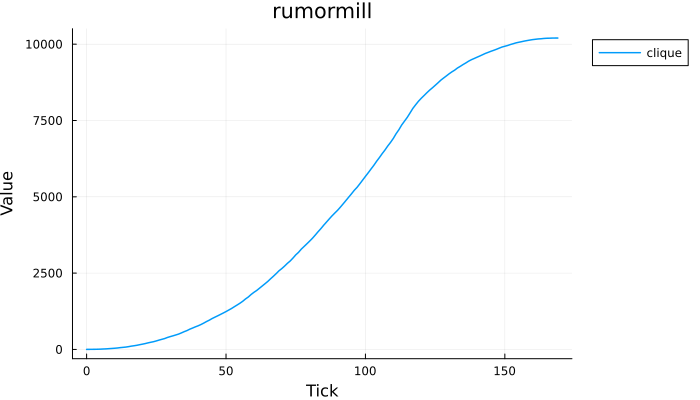
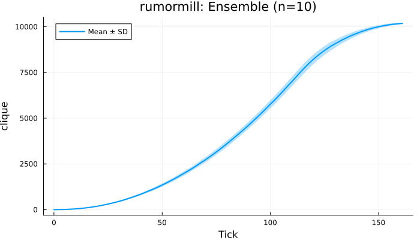
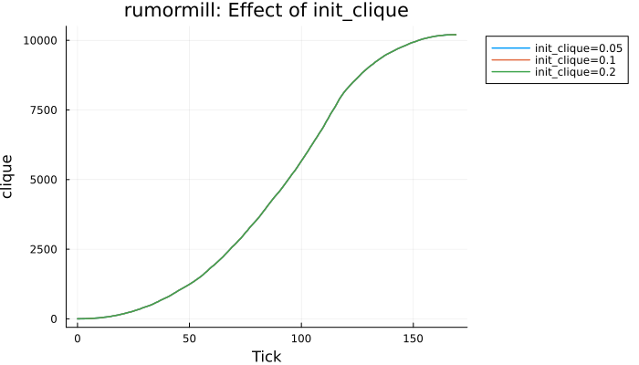

## Overview

### WHAT IS IT?

This program models the spread of a rumor.  The rumor spreads when a person who knows the rumor tells one of their neighbors.  In other words, spatial proximity is a determining factor as to how soon (and perhaps how often) a given individual will hear the rumor.

The neighbors can be defined as either the four adjacent people or the eight adjacent people.  At each time step, every person who knows the rumor randomly chooses a neighbor to tell the rumor to.  The simulation keeps track of who knows the rumor, how many people know the rumor, and how many "repeated tellings" of the rumor occur.

### THINGS TO NOTICE

The most interesting models to run are those where only a small number of individuals who initially know the rumor.  Use the SPREAD-RUMOR-WITH-MOUSE button to make an initial setup where only three or four patches know the rumor, and all of these patches are in the left half of the world.  Run your model once with "Wrap" off and then again with "Wrap" on.  notice the difference in how the rumor is spread.  Which version seems more realistic to you?

Similarly, run the same model in eight-mode and then in four-mode.  Before you run the model, try to decide, will this make a difference in the spread of the rumor?  Why or why not?

An interesting thing to notice about the spread of the rumor is that the "speed" with which the rumor spreads slows down as more and more people know the rumor.  Why is that? How is that related to the number of "repeated" or "wasted" tellings of the rumor?  How do the two "differences" plot windows help you to understand the dynamics of the rumor spread?

### THINGS TO TRY

Change the shape of the world (by changing the wrap settings in edit World & View) and see how the spread of the rumor changes in a box or a cylinder.

Use SPREAD-RUMOR-WITH-MOUSE to place four "seeds" for the rumor centered in each of the four quadrants of the grid.  Notice the pattern of "repeated tellings."  Move the four "seeds" closer into the center of the grid.  How does the pattern or "repeated tellings" change?  Move the "seeds" away from the center of the grid.  How does the pattern of repeated tellings change?  How will it change if  you turn "wrap" on or off?

Explore other patterns of seeding the rumor and its impact on the pattern of repeated tellings.

### EXTENDING THE MODEL

Here are some suggestions for ways to extend the model.

- Introduce physical barriers into the simulation.  These spatial barriers would be obstacles around which the rumor would have to spread.  One could imagine a room where there was only a one cell entry.  How long would it take to reach the entire population in this case?  And how would that curve (the function of the number of people who know the rumor versus time) compare to the spread of the rumor when there was no such barrier?

- Assign a probability with which the rumor is told.  In the current model, each time a person meets his/her neighbor, s/he tells the neighbor the rumor.  How would the spread of the rumor change if the telling of the rumor took place only 50% of the time? or 30% of the time?

- Currently, person A might keep telling person B the rumor over and over again.  Does the rumor spread differently if no one tells the rumor to someone they've already told or someone who told them?

- Can you make a rumor model that does not spread the rumor through spatial proximity?

### NETLOGO FEATURES

Note the use of the `neighbors` and `neighbors4` primitives to implement 8-mode and 4-mode, respectively.

### RELATED MODELS

Virus, HIV

### CREDITS AND REFERENCES

This model is itself an extension of a physical experiment where spatial proximity was not a factor in the spread of the rumor.  Contact Helen M. Doerr at hmdoerr@syr.edu regarding papers in preparation.  Thanks to Dr. Doerr for inspiration for this model.

### HOW TO CITE

If you mention this model or the NetLogo software in a publication, we ask that you include the citations below.

For the model itself:

* Wilensky, U. (1997).  NetLogo Rumor Mill model.  http://ccl.northwestern.edu/netlogo/models/RumorMill.  Center for Connected Learning and Computer-Based Modeling, Northwestern University, Evanston, IL.

Please cite the NetLogo software as:

* Wilensky, U. (1999). NetLogo. http://ccl.northwestern.edu/netlogo/. Center for Connected Learning and Computer-Based Modeling, Northwestern University, Evanston, IL.

### COPYRIGHT AND LICENSE

Copyright 1997 Uri Wilensky.


This model is licensed under the Creative Commons Attribution-NonCommercial-ShareAlike 3.0 License.  To view a copy of this license, visit https://creativecommons.org/licenses/by-nc-sa/3.0/ or send a letter to Creative Commons, 559 Nathan Abbott Way, Stanford, California 94305, USA.

NetLogo itself is free software for non-commercial use under the terms of the GNU General Public License ([see full license information here](https://ccl.northwestern.edu/netlogo/docs/copyright.html)).

To inquire about commercial licenses for either NetLogo or specific models from the models library, please contact netlogo-commercial-admin@ccl.northwestern.edu.

This model was created as part of the project: CONNECTED MATHEMATICS: MAKING SENSE OF COMPLEX PHENOMENA THROUGH BUILDING OBJECT-BASED PARALLEL MODELS (OBPML).  The project gratefully acknowledges the support of the National Science Foundation (Applications of Advanced Technologies Program) -- grant numbers RED #9552950 and REC #9632612.

This model was converted to NetLogo as part of the projects: PARTICIPATORY SIMULATIONS: NETWORK-BASED DESIGN FOR SYSTEMS LEARNING IN CLASSROOMS and/or INTEGRATED SIMULATION AND MODELING ENVIRONMENT. The project gratefully acknowledges the support of the National Science Foundation (REPP & ROLE programs) -- grant numbers REC #9814682 and REC-0126227. Converted from StarLogoT to NetLogo, 2001.

<!-- 1997 2001 -->

## Parameters

| Parameter | Type | Default | Description |
|-----------|------|---------|-------------|
| `grid_width` | `Int` | `101` | -50..50 |
| `grid_height` | `Int` | `101` | grid height |
| `eight_mode` | `Bool` | `false` | false = neighbors4, true = neighbors8 |
| `seed_one` | `Bool` | `true` | true = seed center, false = seed random |
| `init_clique` | `Float64` | `0.1` | % for random seeding |
| `max_ticks` | `Int` | `300` | max ticks |

## Source Code

The Julia code to run this model:

```julia
using ArkModelZoo
_, trajectory = run_rumormill()
```

## Time Series

{width=100%}

## Ensemble Runs

Ten replicates with different random seeds, showing mean ± standard deviation.

{width=100%}

## Parameter Sensitivity

Varying `init_clique`.

{width=100%}


## Appendix: Source Code

This model is implemented in the [Ark.jl](https://github.com/sdwfrost/Ark.jl) Entity-Component-System (ECS) framework. The code is split into five files, each with a distinct role:

- **Parameters**: a mutable struct holding all configurable values.
- **Components**: lightweight data types attached to individual entities (agents).
- **Resources**: world-level shared state accessible to all systems.
- **Systems**: functions that operate on entities each tick, defining model behavior.
- **Model**: wiring that assembles the world, registers resources and systems, and provides the run entry point.

### Parameters (`parameters.jl`)

The parameter struct uses `@kwdef` so that every field has a default value and can be overridden by keyword. These defaults match the original NetLogo model's slider settings.

```julia
Base.@kwdef mutable struct RMParams
    grid_width::Int = 101         # -50..50
    grid_height::Int = 101
    eight_mode::Bool = false      # false = neighbors4, true = neighbors8
    seed_one::Bool = true         # true = seed center, false = seed random
    init_clique::Float64 = 0.1   # % for random seeding
    max_ticks::Int = 300
    seed::Int = 42
end
```

### Components (`components.jl`)

Components are lightweight data types attached to individual entities (agents). Mutable structs hold per-entity state, while empty tag structs act as markers for the ECS query system to efficiently filter entities.

```julia
struct RMDummy end
```

### Resources (`resources.jl`)

Resources are world-level singletons shared across all systems, used for global state and aggregate statistics.

```julia
mutable struct RMGrid
    width::Int
    height::Int
    times_heard::Matrix{Int}
    first_heard::Matrix{Int}
    just_heard::Matrix{Bool}
end

function RMGrid(w::Int, h::Int)
    RMGrid(w, h, zeros(Int, w, h), fill(-1, w, h), falses(w, h))
end

mutable struct RMStats
    clique::Int
    previous_clique::Int
end
RMStats() = RMStats(0, 0)
```

### Systems (`systems.jl`)

Systems contain the model logic and execute in a defined order each tick. Each system struct implements either `initialize!` (run once at setup) or `update!` (run every tick).

```julia
# --- Neighbor offsets ---

const RM_NEIGHBORS4 = ((0, 1), (0, -1), (1, 0), (-1, 0))
const RM_NEIGHBORS8 = (
    (-1, -1), (-1, 0), (-1, 1),
    (0, -1),           (0, 1),
    (1, -1),  (1, 0),  (1, 1),
)

# --- hear-rumor patch procedure ---

@inline function rm_hear_rumor!(grid::RMGrid, x::Int, y::Int, when::Int)
    if grid.first_heard[x, y] == -1
        grid.first_heard[x, y] = when
        grid.just_heard[x, y] = true
    end
    grid.times_heard[x, y] += 1
    return nothing
end

# --- update procedure: process just_heard patches, count clique ---

function rm_update!(grid::RMGrid, stats::RMStats, tick::Int)
    w, h = grid.width, grid.height
    for x in 1:w, y in 1:h
        if grid.just_heard[x, y]
            grid.just_heard[x, y] = false
            rm_hear_rumor!(grid, x, y, tick)
        end
    end
    stats.previous_clique = stats.clique
    n = 0
    for i in eachindex(grid.times_heard)
        if grid.times_heard[i] > 0
            n += 1
        end
    end
    stats.clique = n
    return nothing
end

# --- Initialization ---

struct InitRMSystem <: System end

function initialize!(::InitRMSystem, world::World)
    params = get_resource(world, RMParams)
    rng = get_resource(world, RNGResource).rng
    grid = get_resource(world, RMGrid)
    stats = get_resource(world, RMStats)

    if params.seed_one
        # Seed center patch: patch 0 0 → (ceil(w/2), ceil(h/2))
        cx = ceil(Int, grid.width / 2)
        cy = ceil(Int, grid.height / 2)
        rm_hear_rumor!(grid, cx, cy, 0)
    else
        # Seed random: each unheard patch hears if rand*100 < init_clique
        for x in 1:grid.width, y in 1:grid.height
            if grid.times_heard[x, y] == 0
                if rand(rng) * 100.0 < params.init_clique
                    rm_hear_rumor!(grid, x, y, 0)
                end
            end
        end
    end

    # Run initial update to process just_heard and count clique
    rm_update!(grid, stats, 0)
    return nothing
end

# --- Go step ---

struct RMGoSystem <: System end

function update!(::RMGoSystem, world::World)
    params = get_resource(world, RMParams)
    rng = get_resource(world, RNGResource).rng
    grid = get_resource(world, RMGrid)
    stats = get_resource(world, RMStats)
    tick = get_resource(world, Tick)
    w, h = grid.width, grid.height

    # Stop if all patches have heard the rumor
    all_heard = true
    for i in eachindex(grid.times_heard)
        if grid.times_heard[i] == 0
            all_heard = false
            break
        end
    end
    if all_heard
        get_resource(world, Terminate).stop = true
        return nothing
    end

    # Collect patches with times_heard > 0 and shuffle (NetLogo ask patches)
    heard_patches = Tuple{Int,Int}[]
    for x in 1:w, y in 1:h
        if grid.times_heard[x, y] > 0
            push!(heard_patches, (x, y))
        end
    end
    # Fisher-Yates shuffle
    n = length(heard_patches)
    for i in n:-1:2
        j = rand(rng, 1:i)
        heard_patches[i], heard_patches[j] = heard_patches[j], heard_patches[i]
    end

    neighbors = params.eight_mode ? RM_NEIGHBORS8 : RM_NEIGHBORS4

    # spread-rumor: each heard patch picks one random neighbor
    for (x, y) in heard_patches
        idx = rand(rng, 1:length(neighbors))
        dx, dy = neighbors[idx]
        nx = mod1(x + dx, w)
        ny = mod1(y + dy, h)
        grid.just_heard[nx, ny] = true
    end

    # Update: process just_heard, count clique
    # tick.tick is 0-based; NetLogo ticks is the current tick value after tick
    rm_update!(grid, stats, tick.tick + 1)
    return nothing
end

# --- Termination ---

struct RMTerminationSystem <: System end

function update!(::RMTerminationSystem, world::World)
    params = get_resource(world, RMParams)
    tick = get_resource(world, Tick)
    if tick.tick + 1 >= params.max_ticks
        get_resource(world, Terminate).stop = true
    end
    return nothing
end
```

### Model (`model.jl`)

The model file assembles all pieces: it creates the ECS `World` with the required component types, registers resources, builds the `Scheduler` with systems in execution order, and exposes the public `run` entry point. The observer pattern records the trajectory each tick.

```julia
function rumormill_world(; initial_capacity::Int = 128)
    return World(
        RMDummy;
        initial_capacity = initial_capacity,
        allow_mutable = true,
    )
end

function rumormill_systems()
    return (
        InitRMSystem(),
        RMGoSystem(),
        RMTerminationSystem(),
    )
end

function rumormill_model(params::RMParams = RMParams())
    world = rumormill_world()
    _add_standard_resources!(world, params)
    add_resource!(world, RMGrid(params.grid_width, params.grid_height))
    add_resource!(world, RMStats())
    scheduler = Scheduler(world, rumormill_systems())
    initialize!(scheduler)
    return scheduler
end

struct RMObserver end

function rumormill_headers(::RMObserver)
    return ["clique"]
end

function rumormill_values(::RMObserver, world::World)
    stats = get_resource(world, RMStats)
    return Float64[stats.clique]
end

function run_rumormill(; params::RMParams = RMParams(), observe::Bool = true)
    return _run_model(rumormill_model, RMObserver(), rumormill_values; params, observe)
end
```
