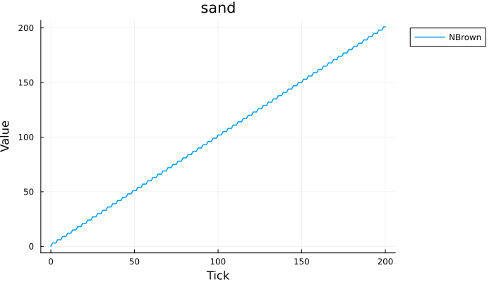
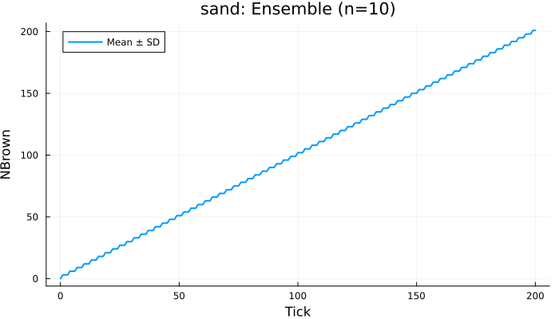
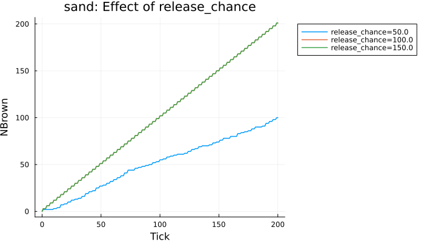

# Sand


- [Overview](#overview)
  - [WHAT IS IT?](#what-is-it)
  - [THINGS TO NOTICE](#things-to-notice)
  - [THINGS TO TRY](#things-to-try)
  - [EXTENDING THE MODEL](#extending-the-model)
  - [NETLOGO FEATURES](#netlogo-features)
  - [HOW TO CITE](#how-to-cite)
  - [COPYRIGHT AND LICENSE](#copyright-and-license)
- [Parameters](#parameters)
- [Source Code](#source-code)
- [Time Series](#time-series)
- [Ensemble Runs](#ensemble-runs)
- [Parameter Sensitivity](#parameter-sensitivity)
- [Appendix: Source Code](#appendix-source-code)
  - [Parameters (`parameters.jl`)](#parameters-parametersjl)
  - [Components (`components.jl`)](#components-componentsjl)
  - [Resources (`resources.jl`)](#resources-resourcesjl)
  - [Systems (`systems.jl`)](#systems-systemsjl)
  - [Model (`model.jl`)](#model-modeljl)

## Overview

### WHAT IS IT?

This is a model of how sand particles interact with each other. In this
environment, all sand particles try to move down if any of the following
four rules apply. The four rules are:

1.  If there is nothing directly beneath you, move down.
2.  If there is something beneath you and to the lower right, move down
    and to the left.
3.  if there is something beneath you and to your lower left, move down
    and to the right.
4.  If there is only something directly beneath you, move down and
    either left or right at random.

### THINGS TO NOTICE

Observe how sand will roll down a “mountain” of sand particles. Consider
how this phenomenon is supported by the rules. Notice the patterns that
form when two “mountains” of sand grow into each other.

### THINGS TO TRY

Observe how the spouts will form uniform pyramids of sand. Try DUMP SAND
at a low density once you have a relatively large pyramid shape. How
does this effect the shape of the pyramid? Does the pyramid ever return
to its original shape?

Try decreasing RELEASE-CHANCE. What effect does this have on the growth
rate of sand “mountains”?

Set the SPACING to 1. (You’ll have to edit the slider, since the normal
minimum is 2.) What happens? Is this just a limitation of the model
rules, or does it have some plausible physical interpretation?

### EXTENDING THE MODEL

In the Code tab, notice the variable `spout-space`. Try changing the
number of spouts at the top of the view by changing `spout-space`.

Does this model accurately reflect how sand behaves? If not what rules
could you devise to more accurately model sand’s behavior? How could
they be incorporated into the model?

What effect does weight have on sand particles? Should particles with
lots of particles above them behave differently? If so, how would this
change the rules?

Try simulating erosion with this model. How could you simulate wind?
What effect would this have on the shape of the piles? How could you
simulate rain? What effect would this have on the shape of the piles?

### NETLOGO FEATURES

Notice how the model stores an agentset in a variable, `spout-patches`.
It is initialized with the agentset of the patches where the spouts are
located. Subsequently this variable can be used in an `ask` command just
like the default agentsets of `turtles` and `patches`. Since the
agentset is built once, ahead of time, the models runs faster than if
the agentset were rebuilt at every step.

### HOW TO CITE

If you mention this model or the NetLogo software in a publication, we
ask that you include the citations below.

For the model itself:

- Wilensky, U. (1996). NetLogo Sand model.
  http://ccl.northwestern.edu/netlogo/models/Sand. Center for Connected
  Learning and Computer-Based Modeling, Northwestern University,
  Evanston, IL.

Please cite the NetLogo software as:

- Wilensky, U. (1999). NetLogo. http://ccl.northwestern.edu/netlogo/.
  Center for Connected Learning and Computer-Based Modeling,
  Northwestern University, Evanston, IL.

### COPYRIGHT AND LICENSE

Copyright 1996 Uri Wilensky.


This model is licensed under the Creative Commons
Attribution-NonCommercial-ShareAlike 3.0 License. To view a copy of this
license, visit https://creativecommons.org/licenses/by-nc-sa/3.0/ or
send a letter to Creative Commons, 559 Nathan Abbott Way, Stanford,
California 94305, USA.

NetLogo itself is free software for non-commercial use under the terms
of the GNU General Public License ([see full license information
here](https://ccl.northwestern.edu/netlogo/docs/copyright.html)).

To inquire about commercial licenses for either NetLogo or specific
models from the models library, please contact
netlogo-commercial-admin@ccl.northwestern.edu.

This model was created as part of the project: CONNECTED MATHEMATICS:
MAKING SENSE OF COMPLEX PHENOMENA THROUGH BUILDING OBJECT-BASED PARALLEL
MODELS (OBPML). The project gratefully acknowledges the support of the
National Science Foundation (Applications of Advanced Technologies
Program) – grant numbers RED \#9552950 and REC \#9632612.

This model was converted to NetLogo as part of the projects:
PARTICIPATORY SIMULATIONS: NETWORK-BASED DESIGN FOR SYSTEMS LEARNING IN
CLASSROOMS and/or INTEGRATED SIMULATION AND MODELING ENVIRONMENT. The
project gratefully acknowledges the support of the National Science
Foundation (REPP & ROLE programs) – grant numbers REC \#9814682 and
REC-0126227. Converted from StarLogoT to NetLogo, 2001.

<!-- 1996 2001 -->

## Parameters

| Parameter        | Type      | Default | Description    |
|------------------|-----------|---------|----------------|
| `release_chance` | `Float64` | `100.0` | release chance |
| `density`        | `Int`     | `10`    | density        |
| `spacing`        | `Int`     | `3`     | spacing        |
| `grid_width`     | `Int`     | `81`    | grid width     |
| `grid_height`    | `Int`     | `81`    | grid height    |
| `max_ticks`      | `Int`     | `200`   | max ticks      |

## Source Code

The Julia code to run this model:

``` julia
using ArkModelZoo
_, trajectory = run_sand()
```

## Time Series



## Ensemble Runs

Ten replicates with different random seeds, showing mean ± standard
deviation.



## Parameter Sensitivity

Varying `release_chance`.



## Appendix: Source Code

This model is implemented in the
[Ark.jl](https://github.com/sdwfrost/Ark.jl) Entity-Component-System
(ECS) framework. The code is split into five files, each with a distinct
role:

- **Parameters**: a mutable struct holding all configurable values.
- **Components**: lightweight data types attached to individual entities
  (agents).
- **Resources**: world-level shared state accessible to all systems.
- **Systems**: functions that operate on entities each tick, defining
  model behavior.
- **Model**: wiring that assembles the world, registers resources and
  systems, and provides the run entry point.

### Parameters (`parameters.jl`)

The parameter struct uses `@kwdef` so that every field has a default
value and can be overridden by keyword. These defaults match the
original NetLogo model’s slider settings.

``` julia
Base.@kwdef mutable struct SandParams
    release_chance::Float64 = 100.0
    density::Int = 10
    spacing::Int = 3
    grid_width::Int = 81
    grid_height::Int = 81
    max_ticks::Int = 200
    seed::Int = 42
end
```

### Components (`components.jl`)

Components are lightweight data types attached to individual entities
(agents). Mutable structs hold per-entity state, while empty tag structs
act as markers for the ECS query system to efficiently filter entities.

``` julia
struct SandDummy end
```

### Resources (`resources.jl`)

Resources are world-level singletons shared across all systems, used for
global state and aggregate statistics.

``` julia
mutable struct SandGrid
    width::Int
    height::Int
    colors::Matrix{Int}       # 0=black, 1=brown, 2=gray, 3=blue
    next_colors::Matrix{Int}
    spout_patches::Vector{Tuple{Int,Int}}  # grid coords of spout patches
end

function SandGrid(w::Int, h::Int)
    SandGrid(w, h, zeros(Int, w, h), zeros(Int, w, h), Tuple{Int,Int}[])
end

mutable struct SandStats
    n_brown::Int
end
SandStats() = SandStats(0)
```

### Systems (`systems.jl`)

Systems contain the model logic and execute in a defined order each
tick. Each system struct implements either `initialize!` (run once at
setup) or `update!` (run every tick).

``` julia
# --- Initialization ---

struct InitSandSystem <: System end

function initialize!(::InitSandSystem, world::World)
    params = get_resource(world, SandParams)
    grid = get_resource(world, SandGrid)
    stats = get_resource(world, SandStats)
    w, h = grid.width, grid.height

    # NetLogo coords: pxcor = x - (w+1)/2, pycor = y - (h+1)/2
    # max_pycor = (h-1)/2 = 40
    # max_pxcor = (w-1)/2 = 40
    half_h = (h - 1) ÷ 2  # 40
    half_w = (w - 1) ÷ 2  # 40
    cx = half_w + 1  # center x in grid = 41
    cy = half_h + 1  # center y in grid = 41

    # surface_ycor = round(-0.8 * max_pycor) in NetLogo coords
    surface_ycor = round(Int, -0.8 * half_h)  # -32
    surface_y = surface_ycor + cy  # grid y = 9

    # Patches below surface are gray
    for x in 1:w, y in 1:h
        if y < surface_y
            grid.colors[x, y] = 2  # gray
        else
            grid.colors[x, y] = 0  # black
        end
    end

    # Spout patches
    spout_ycor = round(Int, 0.9 * half_h)  # 36
    spout_y = spout_ycor + cy  # grid y = 77
    spout_space = round(Int, 0.6 * half_w)  # 24

    empty!(grid.spout_patches)
    for x in 1:w
        pxcor = x - cx
        # NetLogo: pxcor mod spout_space == 0
        if spout_space > 0 && mod(pxcor, spout_space) == 0
            push!(grid.spout_patches, (x, spout_y))
            grid.colors[x, spout_y] = 3  # blue
        end
    end

    stats.n_brown = 0
    return nothing
end

# --- Update ---

struct SandUpdateSystem <: System end

@inline function wrap_x(x::Int, w::Int)
    return mod1(x, w)
end

function update!(::SandUpdateSystem, world::World)
    params = get_resource(world, SandParams)
    rng = get_resource(world, RNGResource).rng
    grid = get_resource(world, SandGrid)
    stats = get_resource(world, SandStats)
    tick = get_resource(world, Tick)
    w, h = grid.width, grid.height
    colors = grid.colors
    next_colors = grid.next_colors

    # --- Spout ---
    if mod(tick.tick, params.spacing) == 0
        for (sx, sy) in grid.spout_patches
            if rand(rng) * 100.0 <= params.release_chance
                # Release sand one below the spout
                below_y = sy - 1
                if below_y >= 1
                    colors[sx, below_y] = 1  # brown
                end
            end
        end
    end

    # --- Move all sand ---
    # Copy colors to next_colors
    copyto!(next_colors, colors)

    # Iterate brown patches in random order
    perm = randperm(rng, w * h)
    for idx in perm
        y = (idx - 1) ÷ w + 1
        x = (idx - 1) % w + 1
        colors[x, y] != 1 && continue  # only brown patches (using original colors)

        if y - 1 < 1
            # At bottom edge, can't fall (non-wrapping y)
            continue
        end

        below = colors[x, y - 1]
        if below == 0  # black below → fall straight down
            next_colors[x, y] = 0
            next_colors[x, y - 1] = 1
        else
            # Check diagonals
            left_x = wrap_x(x - 1, w)
            right_x = wrap_x(x + 1, w)
            left_below = colors[left_x, y - 1]
            right_below = colors[right_x, y - 1]

            if left_below == 1 && right_below == 0
                # Left-below is brown, right-below is black → move right
                next_colors[x, y] = 0
                next_colors[right_x, y - 1] = 1
            elseif left_below == 0 && right_below == 1
                # Left-below is black, right-below is brown → move left
                next_colors[x, y] = 0
                next_colors[left_x, y - 1] = 1
            elseif left_below == 0 && right_below == 0
                # Both black → random
                if rand(rng, Bool)
                    next_colors[x, y] = 0
                    next_colors[right_x, y - 1] = 1
                else
                    next_colors[x, y] = 0
                    next_colors[left_x, y - 1] = 1
                end
            end
            # else: both occupied or out-of-bounds, sand stays
        end
    end

    # Apply next_colors
    copyto!(colors, next_colors)

    # Count brown
    n_brown = 0
    for i in eachindex(colors)
        if colors[i] == 1
            n_brown += 1
        end
    end
    stats.n_brown = n_brown

    return nothing
end

# --- Termination ---

struct SandTerminationSystem <: System end

function update!(::SandTerminationSystem, world::World)
    params = get_resource(world, SandParams)
    tick = get_resource(world, Tick)
    if tick.tick + 1 >= params.max_ticks
        get_resource(world, Terminate).stop = true
    end
    return nothing
end
```

### Model (`model.jl`)

The model file assembles all pieces: it creates the ECS `World` with the
required component types, registers resources, builds the `Scheduler`
with systems in execution order, and exposes the public `run` entry
point. The observer pattern records the trajectory each tick.

``` julia
function sand_world(; initial_capacity::Int = 128)
    return World(SandDummy; initial_capacity=initial_capacity, allow_mutable=true)
end

function sand_systems()
    return (
        InitSandSystem(),
        SandUpdateSystem(),
        SandTerminationSystem(),
    )
end

function sand_model(params::SandParams = SandParams())
    world = sand_world()
    _add_standard_resources!(world, params)
    add_resource!(world, SandGrid(params.grid_width, params.grid_height))
    add_resource!(world, SandStats())
    scheduler = Scheduler(world, sand_systems())
    initialize!(scheduler)
    return scheduler
end

struct SandObserver end

function sand_headers(::SandObserver)
    return ["NBrown"]
end

function sand_values(::SandObserver, world::World)
    stats = get_resource(world, SandStats)
    return Float64[stats.n_brown]
end

function run_sand(; params::SandParams = SandParams(), observe::Bool = true)
    return _run_model(sand_model, SandObserver(), sand_values; params, observe)
end
```
