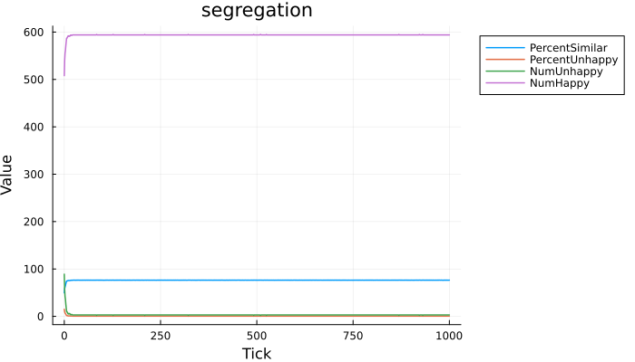
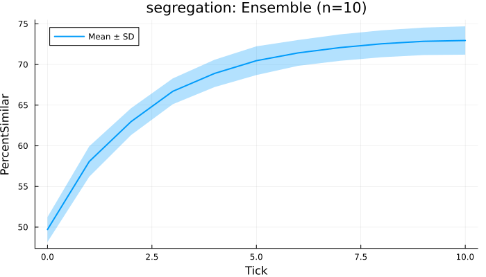
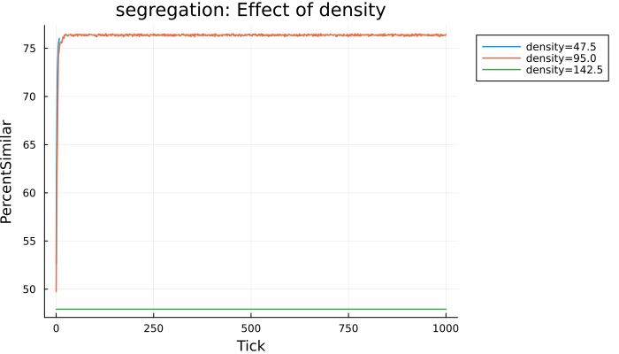

## Overview

### WHAT IS IT?

This project models the behavior of two types of agents in a neighborhood. The orange agents and blue agents get along with one another. But each agent wants to make sure that it lives near some of "its own." That is, each orange agent wants to live near at least some orange agents, and each blue agent wants to live near at least some blue agents. The simulation shows how these individual preferences ripple through the neighborhood, leading to large-scale patterns.

This project was inspired by Thomas Schelling's writings about social systems (such as housing patterns in cities).

### THINGS TO NOTICE

When you execute SETUP, the orange and blue agents are randomly distributed throughout the neighborhood. But many agents are "unhappy" since they don't have enough same-color neighbors. The unhappy agents move to new locations in the vicinity. But in the new locations, they might tip the balance of the local population, prompting other agents to leave. If a few  agents move into an area, the local blue agents might leave. But when the blue agents move to a new area, they might prompt orange agents to leave that area.

Over time, the number of unhappy agents decreases. But the neighborhood becomes more segregated, with clusters of orange agents and clusters of blue agents.

In the case where each agent wants at least 30% same-color neighbors, the agents end up with (on average) 70% same-color neighbors. So relatively small individual preferences can lead to significant overall segregation.

### THINGS TO TRY

Try different values for %-SIMILAR-WANTED. How does the overall degree of segregation change?

If each agent wants at least 40% same-color neighbors, what percentage (on average) do they end up with?

Try different values of DENSITY. How does the initial occupancy density affect the percentage of unhappy agents? How does it affect the time it takes for the model to finish?

Can you set sliders so that the model never finishes running, and agents keep looking for new locations?

### EXTENDING THE MODEL

The `find-new-spot` procedure has the agents move locally till they find a spot. Can you rewrite this procedure so the agents move directly to an appropriate new spot?

Incorporate social networks into this model.  For instance, have unhappy agents decide on a new location based on information about what a neighborhood is like from other agents in their network.

Change the rules for agent happiness.  One idea: suppose that the agents need some minimum threshold of "good neighbors" to be happy with their location.  Suppose further that they don't always know if someone makes a good neighbor. When they do, they use that information.  When they don't, they use color as a proxy -- i.e., they assume that agents of the same color make good neighbors.

The two different visualizations emphasize different aspects of the model. The SQUARE-X visualization shows whether an agent is happy or not. Can you design a different visualization that emphasizes different aspects?

### NETLOGO FEATURES

`sprout` is used to create agents while ensuring no patch has more than one agent on it.

When an agent moves, `move-to` is used to move the agent to the center of the patch it eventually finds.

Note two different methods that can be used for find-new-spot, one of them (the one we use) is recursive.

### CREDITS AND REFERENCES

Schelling, T. (1978). Micromotives and Macrobehavior. New York: Norton.

See also: Rauch, J. (2002). Seeing Around Corners; The Atlantic Monthly; April 2002;Volume 289, No. 4; 35-48. https://www.theatlantic.com/magazine/archive/2002/04/seeing-around-corners/302471/

### HOW TO CITE

If you mention this model or the NetLogo software in a publication, we ask that you include the citations below.

For the model itself:

* Wilensky, U. (1997).  NetLogo Segregation model.  http://ccl.northwestern.edu/netlogo/models/Segregation.  Center for Connected Learning and Computer-Based Modeling, Northwestern University, Evanston, IL.

Please cite the NetLogo software as:

* Wilensky, U. (1999). NetLogo. http://ccl.northwestern.edu/netlogo/. Center for Connected Learning and Computer-Based Modeling, Northwestern University, Evanston, IL.

### COPYRIGHT AND LICENSE

Copyright 1997 Uri Wilensky.


This model is licensed under the Creative Commons Attribution-NonCommercial-ShareAlike 3.0 License.  To view a copy of this license, visit https://creativecommons.org/licenses/by-nc-sa/3.0/ or send a letter to Creative Commons, 559 Nathan Abbott Way, Stanford, California 94305, USA.

NetLogo itself is free software for non-commercial use under the terms of the GNU General Public License ([see full license information here](https://ccl.northwestern.edu/netlogo/docs/copyright.html)).

To inquire about commercial licenses for either NetLogo or specific models from the models library, please contact netlogo-commercial-admin@ccl.northwestern.edu.

This model was created as part of the project: CONNECTED MATHEMATICS: MAKING SENSE OF COMPLEX PHENOMENA THROUGH BUILDING OBJECT-BASED PARALLEL MODELS (OBPML).  The project gratefully acknowledges the support of the National Science Foundation (Applications of Advanced Technologies Program) -- grant numbers RED #9552950 and REC #9632612.

This model was converted to NetLogo as part of the projects: PARTICIPATORY SIMULATIONS: NETWORK-BASED DESIGN FOR SYSTEMS LEARNING IN CLASSROOMS and/or INTEGRATED SIMULATION AND MODELING ENVIRONMENT. The project gratefully acknowledges the support of the National Science Foundation (REPP & ROLE programs) -- grant numbers REC #9814682 and REC-0126227. Converted from StarLogoT to NetLogo, 2001.

<!-- 1997 2001 -->

## Parameters

| Parameter | Type | Default | Description |
|-----------|------|---------|-------------|
| `density` | `Float64` | `95.0` | percent of patches occupied |
| `pct_similar_wanted` | `Float64` | `30.0` | pct similar wanted |
| `grid_width` | `Int` | `25` | -12..12 = 25 patches |
| `grid_height` | `Int` | `25` | grid height |
| `max_ticks` | `Int` | `1000` | max ticks |

## Source Code

The Julia code to run this model:

```julia
using ArkModelZoo
_, trajectory = run_segregation()
```

## Time Series

{width=100%}

## Ensemble Runs

Ten replicates with different random seeds, showing mean ± standard deviation.

{width=100%}

## Parameter Sensitivity

Varying `density`.

{width=100%}


## Appendix: Source Code

This model is implemented in the [Ark.jl](https://github.com/sdwfrost/Ark.jl) Entity-Component-System (ECS) framework. The code is split into five files, each with a distinct role:

- **Parameters**: a mutable struct holding all configurable values.
- **Components**: lightweight data types attached to individual entities (agents).
- **Resources**: world-level shared state accessible to all systems.
- **Systems**: functions that operate on entities each tick, defining model behavior.
- **Model**: wiring that assembles the world, registers resources and systems, and provides the run entry point.

### Parameters (`parameters.jl`)

The parameter struct uses `@kwdef` so that every field has a default value and can be overridden by keyword. These defaults match the original NetLogo model's slider settings.

```julia
Base.@kwdef mutable struct SegregationParams
    density::Float64 = 95.0         # percent of patches occupied
    pct_similar_wanted::Float64 = 30.0
    grid_width::Int = 25            # -12..12 = 25 patches
    grid_height::Int = 25
    max_ticks::Int = 1000
    seed::Int = 42
end
```

### Components (`components.jl`)

Components are lightweight data types attached to individual entities (agents). Mutable structs hold per-entity state, while empty tag structs act as markers for the ECS query system to efficiently filter entities.

```julia
# Grid position component
mutable struct GridPosition
    x::Int
    y::Int
end
GridPosition() = GridPosition(0, 0)

# Agent color: true = red, false = green
mutable struct AgentColor
    red::Bool
end
AgentColor() = AgentColor(true)

# Happiness state (computed each tick)
mutable struct Happiness
    similar_nearby::Int
    other_nearby::Int
    total_nearby::Int
    happy::Bool
end
Happiness() = Happiness(0, 0, 0, false)
```

### Resources (`resources.jl`)

Resources are world-level singletons shared across all systems, used for global state and aggregate statistics.

```julia
mutable struct SegregationGrid
    width::Int
    height::Int
    cells::Matrix{Entity}
end

function SegregationGrid(width::Int, height::Int)
    SegregationGrid(width, height, fill(zero_entity, width, height))
end

function is_empty(grid::SegregationGrid, x::Int, y::Int)
    return is_zero(grid.cells[x, y])
end

function set_cell!(grid::SegregationGrid, x::Int, y::Int, eid::Entity)
    grid.cells[x, y] = eid
end

function clear_cell!(grid::SegregationGrid, x::Int, y::Int)
    grid.cells[x, y] = zero_entity
end

mutable struct SegregationStats
    percent_similar::Float64
    percent_unhappy::Float64
    num_unhappy::Int
    num_happy::Int
end
SegregationStats() = SegregationStats(0.0, 0.0, 0, 0)
```

### Systems (`systems.jl`)

Systems contain the model logic and execute in a defined order each tick. Each system struct implements either `initialize!` (run once at setup) or `update!` (run every tick).

```julia
# --- Initialization ---

struct InitSegregationSystem <: System end

function initialize!(::InitSegregationSystem, world::World)
    params = get_resource(world, SegregationParams)
    rng = get_resource(world, RNGResource).rng
    grid = get_resource(world, SegregationGrid)

    # Density-based initialization: each patch has density% chance of an agent
    # Color is random per agent (one-of [red green]), matching NetLogo one-of [105 27]
    for x in 1:grid.width, y in 1:grid.height
        if rand(rng, 0:99) < round(Int, params.density)
            is_red = rand(rng, Bool)
            eid = new_entity!(world, (
                GridPosition(x, y),
                AgentColor(is_red),
                Happiness(),
            ))
            set_cell!(grid, x, y, eid)
        end
    end

    # Match NetLogo setup: compute initial happiness + stats (update-turtles; update-globals)
    update!(UpdateHappinessSystem(), world)
    return nothing
end

# --- Update Happiness ---

struct UpdateHappinessSystem <: System end

function update!(::UpdateHappinessSystem, world::World)
    params = get_resource(world, SegregationParams)
    grid = get_resource(world, SegregationGrid)
    stats = get_resource(world, SegregationStats)

    total_similar = 0
    total_neighbors = 0
    num_unhappy = 0
    num_happy = 0

    for (_, positions, colors, happinesses) in Query(world, (GridPosition, AgentColor, Happiness))
        @inbounds for i in eachindex(positions)
            pos = positions[i]
            color = colors[i]
            h = happinesses[i]

            similar = 0
            other = 0
            # Check Moore neighborhood (8 surrounding cells)
            for dx in -1:1, dy in -1:1
                (dx == 0 && dy == 0) && continue
                nx = pos.x + dx
                ny = pos.y + dy
                # Wrap around (toroidal)
                nx = mod1(nx, grid.width)
                ny = mod1(ny, grid.height)
                neighbor_eid = grid.cells[nx, ny]
                is_zero(neighbor_eid) && continue
                neighbor_color = get_components(world, neighbor_eid, (AgentColor,))[1]
                if neighbor_color.red == color.red
                    similar += 1
                else
                    other += 1
                end
            end

            total = similar + other
            h.similar_nearby = similar
            h.other_nearby = other
            h.total_nearby = total
            h.happy = total == 0 || (similar / total * 100.0 >= params.pct_similar_wanted)

            if h.happy
                num_happy += 1
            else
                num_unhappy += 1
            end
            total_similar += similar
            total_neighbors += total
        end
    end

    stats.num_happy = num_happy
    stats.num_unhappy = num_unhappy
    stats.percent_unhappy = (num_happy + num_unhappy) > 0 ?
        num_unhappy / (num_happy + num_unhappy) * 100.0 : 0.0
    stats.percent_similar = total_neighbors > 0 ?
        total_similar / total_neighbors * 100.0 : 0.0
    return nothing
end

# --- Move Unhappy Agents ---
# NetLogo: ask turtles with [not happy?] [find-new-spot]
# find-new-spot: rt random-float 360; fd random-float 10;
#                if any? other turtles-here [ find-new-spot ]; move-to patch-here
# Note: recursive — does random walk from current position until empty patch found

struct MoveUnhappySystem <: System end

function update!(::MoveUnhappySystem, world::World)
    rng = get_resource(world, RNGResource).rng
    grid = get_resource(world, SegregationGrid)

    # Collect unhappy agents
    unhappy = Tuple{Entity, Int, Int}[]
    for (eids, positions, _, happinesses) in Query(world, (GridPosition, AgentColor, Happiness))
        @inbounds for i in eachindex(positions)
            if !happinesses[i].happy
                push!(unhappy, (eids[i], positions[i].x, positions[i].y))
            end
        end
    end

    # NetLogo `ask` shuffles agentset each time
    Random.shuffle!(rng, unhappy)

    # Move each unhappy agent using random walk (matching NetLogo's recursive find-new-spot)
    # Clear old cell BEFORE walking so the turtle's spot is available (like NetLogo fd)
    for (eid, ox, oy) in unhappy
        clear_cell!(grid, ox, oy)
        nx, ny = _find_new_spot(rng, ox, oy, grid)
        set_cell!(grid, nx, ny, eid)
        pos = get_components(world, eid, (GridPosition,))[1]
        pos.x = nx
        pos.y = ny
    end
    return nothing
end

function _find_new_spot(rng, x::Int, y::Int, grid::SegregationGrid; max_tries::Int=500)
    w, h = grid.width, grid.height
    # Start from continuous position at patch center
    cx, cy = Float64(x), Float64(y)
    heading = 0.0
    for _ in 1:max_tries
        # NetLogo: rt random-float 360 (relative turn); fd random-float 10
        heading += rand(rng) * 360.0
        dist = rand(rng) * 10.0
        θ = deg2rad(heading)
        cx += sin(θ) * dist
        cy += cos(θ) * dist
        # Snap to nearest patch (toroidal)
        gx = mod1(round(Int, cx), w)
        gy = mod1(round(Int, cy), h)
        if is_zero(grid.cells[gx, gy])
            return gx, gy
        end
        # Continue walk from new continuous position (don't reset to patch center)
    end
    return x, y  # fallback: stay put
end

# --- Termination ---

struct SegregationTerminationSystem <: System end

function update!(::SegregationTerminationSystem, world::World)
    stats = get_resource(world, SegregationStats)
    params = get_resource(world, SegregationParams)
    tick = get_resource(world, Tick)

    if stats.num_unhappy == 0 || tick.tick + 1 >= params.max_ticks
        get_resource(world, Terminate).stop = true
    end
    return nothing
end
```

### Model (`model.jl`)

The model file assembles all pieces: it creates the ECS `World` with the required component types, registers resources, builds the `Scheduler` with systems in execution order, and exposes the public `run` entry point. The observer pattern records the trajectory each tick.

```julia
function segregation_world(; initial_capacity::Int = 4096)
    return World(
        GridPosition,
        AgentColor,
        Happiness;
        initial_capacity = initial_capacity,
        allow_mutable = true,
    )
end

function segregation_systems()
    return (
        InitSegregationSystem(),
        MoveUnhappySystem(),          # Move first (using happiness from previous tick)
        UpdateHappinessSystem(),       # Then recompute happiness after moves
        SegregationTerminationSystem(),
    )
end

function segregation_model(params::SegregationParams = SegregationParams())
    world = segregation_world()
    _add_standard_resources!(world, params)
    add_resource!(world, SegregationGrid(params.grid_width, params.grid_height))
    add_resource!(world, SegregationStats())
    scheduler = Scheduler(world, segregation_systems())
    initialize!(scheduler)
    return scheduler
end

struct SegregationObserver end

function segregation_headers(::SegregationObserver)
    return ["PercentSimilar", "PercentUnhappy", "NumUnhappy", "NumHappy"]
end

function segregation_values(::SegregationObserver, world::World)
    stats = get_resource(world, SegregationStats)
    return Float64[stats.percent_similar, stats.percent_unhappy,
                    stats.num_unhappy, stats.num_happy]
end

function run_segregation(; params::SegregationParams = SegregationParams(), observe::Bool = true)
    return _run_model(segregation_model, SegregationObserver(), segregation_values; params, observe)
end
```
