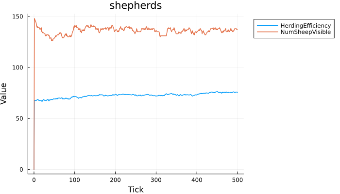
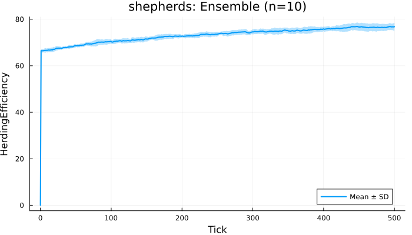
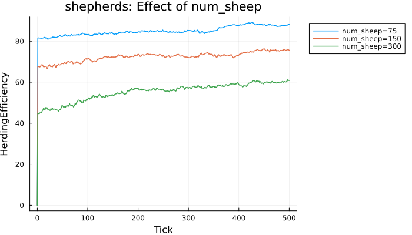

## Overview

### WHAT IS IT?

This project is inspired by two simpler models: one of termites gathering wood chips into piles and one of moving sheep.  In this project, sheep wander randomly while shepherds circulate trying to herd them.  Whether or not the sheep eventually end up in a single herd depends on the number of shepherds and how fast they move compared to the sheep.

### HOW IT WORKS

The shepherds follow a set of simple rules.  Each shepherd starts wandering randomly.  If it bumps into a sheep, it picks the sheep up, and continues to wander randomly. When it bumps into another sheep, it finds a nearby empty space, puts its sheep down, and looks for another one.

### THINGS TO NOTICE

As small herds of sheep begin to form, the herds are not "protected" in any way.  That is, shepherds sometimes take sheep away from existing herds.  That strategy might seem counter-productive. But if the herds were "protected", you would end up with lots of little herds, not several big ones.   Why is this?

In general, if there are enough shepherds and/or the shepherds move much faster than the sheep, the number of herds decreases with time. Why?  One explanation is as follows: some herds disappear, when shepherds carry away all of the sheep.  If sheep never moved, it would not be possible for a new herd to start from scratch, since shepherds always put their sheep near other sheep.  So the number of herds would necessarily decrease over time.  (The only way a "new" herd would start is when an existing herd splits into two.) However, since sheep move, they can form new herds. If they move too fast relative to the shepherds, the herding will break down.

If there are not enough shepherds, or if the sheep move fast enough relative to the shepherds, the shepherds cannot keep up with the wanderings of their sheep, and the sheep will disperse.

Are the final herds roughly round?  What other physical situations also produce round things?

This project is a good example of a probabilistic and decentralized strategy.  There is no shepherd in charge, and no special pre-designated site for the herds. The movement of the shepherds and sheep and thus their behavior is probabilistic. Each shepherd follows a set of simple rules, but the group as a whole accomplishes a rather sophisticated task.

### THINGS TO TRY

Can you find the minimum number of shepherds needed to herd a given number of sheep?  Which helps more, doubling the number of shepherds or doubling the speed of the existing shepherds (by cutting the SHEEP-SPEED in half)?

How many sheep can one individual shepherd keep in a group?

Start with a SHEEP-SPEED of zero (the sheep stay put), let the shepherd gather them into herds, and then slowly increase the SHEEP-SPEED.   How is the herding efficiency affected?   How high does SHEEP-SPEED need to be for the shepherds to be useless, that is, for the herding efficiency returns to its initial value?  This is the same as saying that the distribution of sheep is no better than random.

When there are just two or three herds left, which of them is most  likely to "win" as the single, final herd?  How often does  the larger of the two herds win?  If one herd has only a  single sheep, and the other herd has the rest of the sheep, what are the chances that the first herd will win?

Compare this model to "Termites".  It runs slower, but aside from that, are the results the same?

In both the Termites and the Shepherds models, if the turtles don't jump away from the piles/herds they make, piling/herding happens more slowly and to a lesser extent.  Does this make sense?  Experiment with different search commands that you might give the shepherds besides "fd 1" and "jump 20".

### EXTENDING THE MODEL

Can you find other ways to measure herding efficiency?

Can you extend the model so that sheep follow each other, tending to cluster?

Can you extend the model to have the shepherds sort white sheep from black sheep?

Can you change the model so that there's only ever one sheep on a patch?  Does it change the behavior of the model?

The way the model is currently written, multiple sheep are allowed to occupy the same physical location.  And, since all shepherds search for a sheep to pick up before any of them actually take their sheep away, a shepherd may come to a location with several sheep and, examining one at random, find that another shepherd has already laid a hold of that sheep.  Currently shepherds give up on all sheep at that location when this happens, rather than seeing if there are other sheep there which are still unattended.  (If shepherds did not check to see whether a sheep was attended, multiple shepherds might each pick up the same sheep and take it away, thereby cloning it!)  Can you find a way to make shepherds check all sheep at a location before leaving?

Real shepherds often use sheepdogs to help them with their herding.  A sheepdog in this context might put down some chemical which "scares" the sheep, i.e., wandering sheep try to avoid it and move down gradient.  Can you implement sheepdogs and see how helpful they are?  Can you come up with a rough equivalence of how many shepherds a sheepdog can replace (to maintain the same herding efficiency), or how many sheepdogs are needed to replace a single shepherd?

Since it would be difficult to force sheep-turtles to follow shepherd-turtles which have "picked them up", the mechanics of picking a sheep up actually involve "killing" the sheep and creating a sheep-shepherd collective which wanders around following shepherd rules until it finds a place to put the sheep down, at which point another sheep is "created" at that location, and the collective reverts to being a normal shepherd again. Can you change the model so the shepherds actually herd the sheep rather than killing them and recreating them?

### NETLOGO FEATURES

Compare this code to that of "Termites".  It's similar, except that sheep and shepherds are both turtles here, and active, while in Termites the wood chips are patches and remain passive.  As a result, the Termites model runs faster.

The two models are coded somewhat differently, however.  Termites uses a loops-within-GO structure that is worth noting.  GO is a turtle forever button, so each turtle executes the code in the GO function in parallel and independently of each other.  Since each turtle moves through the GO function at its own pace, it's OK for functions like search-for-chip to be written as loops, which execute repeatedly until a certain condition is satisfied.  Then each turtle goes on to the next loop.

But in this model, GO is an observer forever button, because we want to have separate "ask" blocks for the sheeps and the shepherds, and because we want to update the plot every so often.  Since the observer waits for all of the turtles to finish the "ask" before moving on to the next line of code, it wouldn't be OK for a turtle to take more than one step inside the "ask" -- because then all the other turtles would have to wait for it.  So instead of using loops, this model uses the boolean variables carrying-sheep? and found-herd? to keep track of whether each turtle is in sheep-finding mode, herd-finding mode, or empty-spot-finding mode.

### RELATED MODELS

* Termites
* Painted Desert Challenge
* State Machine Example

### CREDITS AND REFERENCES

Thanks to Christopher Kribs Zaleta for his help with converting the model from StarLogoT to NetLogo.

### HOW TO CITE

If you mention this model or the NetLogo software in a publication, we ask that you include the citations below.

For the model itself:

* Wilensky, U. (1998).  NetLogo Shepherds model.  http://ccl.northwestern.edu/netlogo/models/Shepherds.  Center for Connected Learning and Computer-Based Modeling, Northwestern University, Evanston, IL.

Please cite the NetLogo software as:

* Wilensky, U. (1999). NetLogo. http://ccl.northwestern.edu/netlogo/. Center for Connected Learning and Computer-Based Modeling, Northwestern University, Evanston, IL.

### COPYRIGHT AND LICENSE

Copyright 1998 Uri Wilensky.


This model is licensed under the Creative Commons Attribution-NonCommercial-ShareAlike 3.0 License.  To view a copy of this license, visit https://creativecommons.org/licenses/by-nc-sa/3.0/ or send a letter to Creative Commons, 559 Nathan Abbott Way, Stanford, California 94305, USA.

NetLogo itself is free software for non-commercial use under the terms of the GNU General Public License ([see full license information here](https://ccl.northwestern.edu/netlogo/docs/copyright.html)).

To inquire about commercial licenses for either NetLogo or specific models from the models library, please contact netlogo-commercial-admin@ccl.northwestern.edu.

This model was created as part of the project: CONNECTED MATHEMATICS: MAKING SENSE OF COMPLEX PHENOMENA THROUGH BUILDING OBJECT-BASED PARALLEL MODELS (OBPML).  The project gratefully acknowledges the support of the National Science Foundation (Applications of Advanced Technologies Program) -- grant numbers RED #9552950 and REC #9632612.

This model was converted to NetLogo as part of the projects: PARTICIPATORY SIMULATIONS: NETWORK-BASED DESIGN FOR SYSTEMS LEARNING IN CLASSROOMS and/or INTEGRATED SIMULATION AND MODELING ENVIRONMENT. The project gratefully acknowledges the support of the National Science Foundation (REPP & ROLE programs) -- grant numbers REC #9814682 and REC-0126227. Converted from StarLogoT to NetLogo, 2001.

<!-- 1998 2001 -->

## Parameters

| Parameter | Type | Default | Description |
|-----------|------|---------|-------------|
| `num_sheep` | `Int` | `150` | num sheep |
| `num_shepherds` | `Int` | `30` | num shepherds |
| `sheep_speed` | `Float64` | `0.02` | sheep speed |
| `grid_width` | `Int` | `51` | -25..25 = 51 |
| `grid_height` | `Int` | `51` | grid height |
| `max_ticks` | `Int` | `500` | max ticks |

## Source Code

The Julia code to run this model:

```julia
using ArkModelZoo
_, trajectory = run_shepherds()
```

## Time Series

{width=100%}

## Ensemble Runs

Ten replicates with different random seeds, showing mean ± standard deviation.

{width=100%}

## Parameter Sensitivity

Varying `num_sheep`.

{width=100%}


## Appendix: Source Code

This model is implemented in the [Ark.jl](https://github.com/sdwfrost/Ark.jl) Entity-Component-System (ECS) framework. The code is split into five files, each with a distinct role:

- **Parameters**: a mutable struct holding all configurable values.
- **Components**: lightweight data types attached to individual entities (agents).
- **Resources**: world-level shared state accessible to all systems.
- **Systems**: functions that operate on entities each tick, defining model behavior.
- **Model**: wiring that assembles the world, registers resources and systems, and provides the run entry point.

### Parameters (`parameters.jl`)

The parameter struct uses `@kwdef` so that every field has a default value and can be overridden by keyword. These defaults match the original NetLogo model's slider settings.

```julia
Base.@kwdef mutable struct SHParams
    num_sheep::Int = 150
    num_shepherds::Int = 30
    sheep_speed::Float64 = 0.02
    grid_width::Int = 51    # -25..25 = 51
    grid_height::Int = 51
    max_ticks::Int = 500
    seed::Int = 42
end
```

### Components (`components.jl`)

Components are lightweight data types attached to individual entities (agents). Mutable structs hold per-entity state, while empty tag structs act as markers for the ECS query system to efficiently filter entities.

```julia
mutable struct SHSheepPos
    x::Float64
    y::Float64
    heading::Float64
    hidden::Bool
end
SHSheepPos() = SHSheepPos(0.0, 0.0, 0.0, false)

mutable struct SHShepherdState
    x::Float64
    y::Float64
    heading::Float64
    carried_sheep::Entity
    found_herd::Bool
end
SHShepherdState() = SHShepherdState(0.0, 0.0, 0.0, zero_entity, false)
```

### Resources (`resources.jl`)

Resources are world-level singletons shared across all systems, used for global state and aggregate statistics.

```julia
mutable struct SHGrid
    width::Int
    height::Int
    sheep_count::Matrix{Int}  # count of visible sheep per cell
end

function SHGrid(w::Int, h::Int)
    SHGrid(w, h, zeros(Int, w, h))
end

mutable struct SHStats
    herding_efficiency::Float64
    num_sheep_visible::Int
end
SHStats() = SHStats(0.0, 0)
```

### Systems (`systems.jl`)

Systems contain the model logic and execute in a defined order each tick. Each system struct implements either `initialize!` (run once at setup) or `update!` (run every tick).

```julia
# --- Initialization ---

struct InitSHSystem <: System end

function initialize!(::InitSHSystem, world::World)
    params = get_resource(world, SHParams)
    rng = get_resource(world, RNGResource).rng
    w, h = params.grid_width, params.grid_height

    # Create sheep
    for _ in 1:params.num_sheep
        sx = rand(rng) * w
        sy = rand(rng) * h
        heading = rand(rng) * 360.0
        new_entity!(world, (SHSheepPos(sx, sy, heading, false),))
    end

    # Create shepherds
    for _ in 1:params.num_shepherds
        sx = rand(rng) * w
        sy = rand(rng) * h
        heading = rand(rng) * 360.0
        new_entity!(world, (SHShepherdState(sx, sy, heading, zero_entity, false),))
    end
    return nothing
end

# --- Go ---

struct SHGoSystem <: System end

function update!(::SHGoSystem, world::World)
    params = get_resource(world, SHParams)
    rng = get_resource(world, RNGResource).rng
    w, h = Float64(params.grid_width), Float64(params.grid_height)

    # Collect shepherds
    shepherds = Tuple{Entity, Int}[]
    for (eids, states) in Query(world, (SHShepherdState,))
        @inbounds for i in eachindex(states)
            push!(shepherds, (eids[i], i))
        end
    end
    Random.shuffle!(rng, shepherds)

    # Build spatial index of visible sheep positions (cell -> list of sheep entities)
    sheep_at = Dict{Tuple{Int,Int}, Vector{Entity}}()
    for (eids, sheeps) in Query(world, (SHSheepPos,))
        @inbounds for i in eachindex(sheeps)
            s = sheeps[i]
            s.hidden && continue
            cx = clamp(floor(Int, s.x) + 1, 1, params.grid_width)
            cy = clamp(floor(Int, s.y) + 1, 1, params.grid_height)
            key = (cx, cy)
            if haskey(sheep_at, key)
                push!(sheep_at[key], eids[i])
            else
                sheep_at[key] = [eids[i]]
            end
        end
    end

    for (eid, _) in shepherds
        sh = get_components(world, eid, (SHShepherdState,))[1]
        cx = clamp(floor(Int, sh.x) + 1, 1, params.grid_width)
        cy = clamp(floor(Int, sh.y) + 1, 1, params.grid_height)
        key = (cx, cy)

        if is_zero(sh.carried_sheep)
            # Search for sheep at current cell
            local_sheep = get(sheep_at, key, Entity[])
            visible = filter(e -> begin
                sp = get_components(world, e, (SHSheepPos,))[1]
                !sp.hidden
            end, local_sheep)
            if !isempty(visible)
                picked = visible[rand(rng, 1:length(visible))]
                sp = get_components(world, picked, (SHSheepPos,))[1]
                sp.hidden = true
                sh.carried_sheep = picked
                # Step forward 1
                _sh_fd!(sh, 1.0, w, h)
            end
        elseif sh.found_herd
            # Find empty spot - check if any visible sheep here
            local_sheep = get(sheep_at, key, Entity[])
            visible_here = filter(e -> begin
                sp = get_components(world, e, (SHSheepPos,))[1]
                !sp.hidden
            end, local_sheep)
            if isempty(visible_here)
                # Drop sheep
                carried = get_components(world, sh.carried_sheep, (SHSheepPos,))[1]
                carried.x = sh.x
                carried.y = sh.y
                carried.hidden = false
                # Re-index
                ncx = clamp(floor(Int, sh.x) + 1, 1, params.grid_width)
                ncy = clamp(floor(Int, sh.y) + 1, 1, params.grid_height)
                nkey = (ncx, ncy)
                if haskey(sheep_at, nkey)
                    push!(sheep_at[nkey], sh.carried_sheep)
                else
                    sheep_at[nkey] = [sh.carried_sheep]
                end
                sh.carried_sheep = zero_entity
                sh.found_herd = false
                sh.heading = rand(rng) * 360.0
                _sh_fd!(sh, 20.0, w, h)
            end
        else
            # Find new herd - check if visible sheep here
            local_sheep = get(sheep_at, key, Entity[])
            visible_here = filter(e -> begin
                sp = get_components(world, e, (SHSheepPos,))[1]
                !sp.hidden
            end, local_sheep)
            if !isempty(visible_here)
                sh.found_herd = true
            end
        end

        # Wiggle and move (triangular distribution matching NetLogo: random 50 - random 50)
        sh.heading += rand(rng, 0:49) - rand(rng, 0:49)
        _sh_fd!(sh, 1.0, w, h)

        # Bring carried sheep along
        if !is_zero(sh.carried_sheep)
            carried = get_components(world, sh.carried_sheep, (SHSheepPos,))[1]
            carried.x = sh.x
            carried.y = sh.y
        end
    end

    # Move visible sheep
    sheep_list = Tuple{Entity, Int}[]
    for (eids, sheeps) in Query(world, (SHSheepPos,))
        @inbounds for i in eachindex(sheeps)
            push!(sheep_list, (eids[i], i))
        end
    end
    Random.shuffle!(rng, sheep_list)

    for (eid, _) in sheep_list
        sp = get_components(world, eid, (SHSheepPos,))[1]
        sp.hidden && continue
        sp.heading += rand(rng, 0:49) - rand(rng, 0:49)
        θ = deg2rad(sp.heading)
        sp.x = mod(sp.x + sin(θ) * params.sheep_speed, w)
        sp.y = mod(sp.y + cos(θ) * params.sheep_speed, h)
    end
    return nothing
end

function _sh_fd!(state, dist::Float64, w::Float64, h::Float64)
    θ = deg2rad(state.heading)
    state.x = mod(state.x + sin(θ) * dist, w)
    state.y = mod(state.y + cos(θ) * dist, h)
end

# --- Stats Update ---

struct SHStatsSystem <: System end

function update!(::SHStatsSystem, world::World)
    params = get_resource(world, SHParams)
    stats = get_resource(world, SHStats)
    grid = get_resource(world, SHGrid)
    w, h = params.grid_width, params.grid_height

    # Count ALL sheep per patch (including hidden) for sheepless-neighborhoods
    all_sheep_count = fill(0, w, h)
    # Count VISIBLE sheep per patch for denominator + num_sheep_visible
    fill!(grid.sheep_count, 0)
    num_visible = 0

    for (_, sheeps) in Query(world, (SHSheepPos,))
        @inbounds for i in eachindex(sheeps)
            s = sheeps[i]
            cx = clamp(floor(Int, s.x) + 1, 1, w)
            cy = clamp(floor(Int, s.y) + 1, 1, h)
            all_sheep_count[cx, cy] += 1
            if !s.hidden
                num_visible += 1
                grid.sheep_count[cx, cy] += 1
            end
        end
    end

    # sheepless-neighborhoods: patches where sum of ALL sheep in 8 neighbors == 0
    sheepless = 0
    for x in 1:w, y in 1:h
        nearby = 0
        for dx in -1:1, dy in -1:1
            (dx == 0 && dy == 0) && continue
            nx = mod1(x + dx, w)
            ny = mod1(y + dy, h)
            nearby += all_sheep_count[nx, ny]
        end
        if nearby == 0
            sheepless += 1
        end
    end

    # Denominator: patches with no VISIBLE sheep
    patches_without_visible = 0
    for x in 1:w, y in 1:h
        if grid.sheep_count[x, y] == 0
            patches_without_visible += 1
        end
    end

    stats.num_sheep_visible = num_visible
    if num_visible > 0 && patches_without_visible > 0
        stats.herding_efficiency = (sheepless / patches_without_visible) * 100.0
    else
        stats.herding_efficiency = 0.0
    end
    return nothing
end

# --- Termination ---

struct SHTerminationSystem <: System end

function update!(::SHTerminationSystem, world::World)
    params = get_resource(world, SHParams)
    tick = get_resource(world, Tick)
    if tick.tick + 1 >= params.max_ticks
        get_resource(world, Terminate).stop = true
    end
    return nothing
end
```

### Model (`model.jl`)

The model file assembles all pieces: it creates the ECS `World` with the required component types, registers resources, builds the `Scheduler` with systems in execution order, and exposes the public `run` entry point. The observer pattern records the trajectory each tick.

```julia
function shepherds_world(; initial_capacity::Int = 4096)
    return World(SHSheepPos, SHShepherdState; initial_capacity = initial_capacity, allow_mutable = true)
end

function shepherds_systems()
    return (InitSHSystem(), SHGoSystem(), SHStatsSystem(), SHTerminationSystem())
end

function shepherds_model(params::SHParams = SHParams())
    world = shepherds_world()
    _add_standard_resources!(world, params)
    add_resource!(world, SHGrid(params.grid_width, params.grid_height))
    add_resource!(world, SHStats())
    scheduler = Scheduler(world, shepherds_systems())
    initialize!(scheduler)
    return scheduler
end

struct SHObserver end

function shepherds_headers(::SHObserver)
    return ["HerdingEfficiency", "NumSheepVisible"]
end

function shepherds_values(::SHObserver, world::World)
    stats = get_resource(world, SHStats)
    return Float64[stats.herding_efficiency, Float64(stats.num_sheep_visible)]
end

function run_shepherds(; params::SHParams = SHParams(), observe::Bool = true)
    return _run_model(shepherds_model, SHObserver(), shepherds_values; params, observe)
end
```
