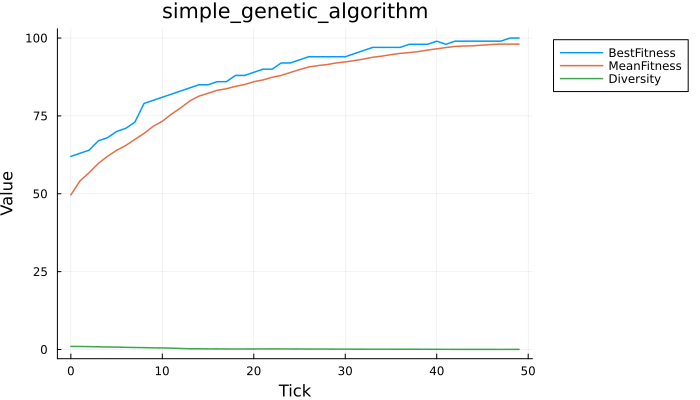
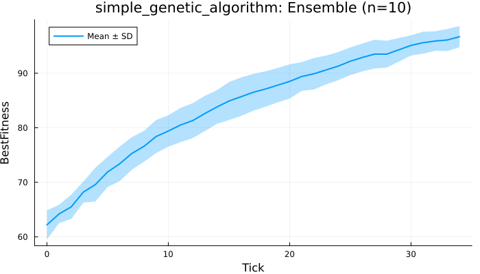
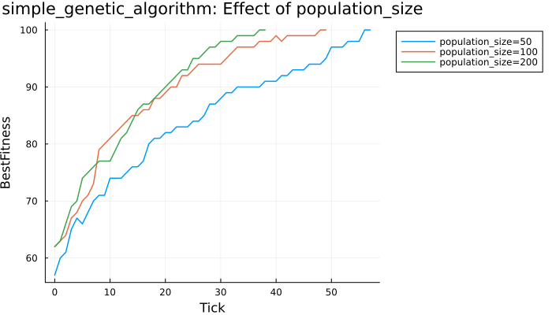

# Simple Genetic Algorithm


- [Overview](#overview)
  - [WHAT IS IT?](#what-is-it)
  - [HOW IT WORKS](#how-it-works)
  - [THINGS TO NOTICE](#things-to-notice)
  - [THINGS TO TRY](#things-to-try)
  - [EXTENDING THE MODEL](#extending-the-model)
  - [NETLOGO FEATURES](#netlogo-features)
  - [RELATED MODELS](#related-models)
  - [CREDITS AND REFERENCES](#credits-and-references)
  - [HOW TO CITE](#how-to-cite)
  - [COPYRIGHT AND LICENSE](#copyright-and-license)
- [Parameters](#parameters)
- [Source Code](#source-code)
- [Time Series](#time-series)
- [Ensemble Runs](#ensemble-runs)
- [Parameter Sensitivity](#parameter-sensitivity)
- [Appendix: Source Code](#appendix-source-code)
  - [Parameters (`parameters.jl`)](#parameters-parametersjl)
  - [Components (`components.jl`)](#components-componentsjl)
  - [Resources (`resources.jl`)](#resources-resourcesjl)
  - [Systems (`systems.jl`)](#systems-systemsjl)
  - [Model (`model.jl`)](#model-modeljl)

## Overview

### WHAT IS IT?

This model demonstrates the use of a genetic algorithm on a very simple
problem. Genetic algorithms (GAs) are a biologically-inspired computer
science technique that combine notions from Mendelian genetics and
Darwinian evolution to search for good solutions to problems (including
difficult problems). The GA works by generating a random population of
solutions to a problem, evaluating those solutions and then using
cloning, recombination and mutation to create new solutions to the
problem.

In this model we use the simple “ALL-ONES” problem to demonstrate how
this is possible. We use such a simple problem in this model in order to
highlight the solution technique only. The idea of the “ALL-ONES”
problem is to find a string of bits (that is, a sequence of just ones
and zeros) that contains all ones, and no zeros. Thus the string that
best solves this problem is “111111…111”.

### HOW IT WORKS

The genetic algorithm is composed of the following steps.

1)  A population of random solutions is created. Each solution consists
    of a string of randomly mixed “1”s and “0”s.

2)  Each solution is evaluated on the basis of how well it solves the
    problem. This measure of the “goodness” of the solution is called
    its “fitness”. In this model, our goal is simply to find a solution
    that consists of all “1”s. (In real-world applications of the
    genetic algorithm, the goals are much more complex, but the
    solutions are still usually encoded as binary strings.)

3)  A new generation of solutions is created from the old generation,
    where solutions that have a higher fitness scores are more likely to
    be chosen as “parent” solutions than those that have low fitness
    scores.

<!-- -->

1)  The selection method used in this model is called “tournament
    selection”, with a tournament size of 3. This means that 3 solutions
    are drawn randomly from the old generation, and the one with the
    highest fitness is chosen to become a parent.

2)  Either one or two parents are chosen to create children. With one
    parent, the child is a clone or copy of the parent. With two
    parents, the process is the digital analog of sexual recombination –
    the two children inherit part of their genetic material from one
    parent and part from the other.

3)  There is also a chance that mutation will occur, and some of the
    child’s bits will be changed from “1”s to “0”s, or vice versa.

<!-- -->

4)  Steps 2 and 3 above are repeated until a solution is found that
    successfully solves the problem.

### THINGS TO NOTICE

Step through the model slowly, and look at the visual representation of
the best solution found in each generation, displayed in the VIEW. How
often does the best solution in Generation X+1 appear to be the
offspring of the best solution in Generation X?

As the fitness in the population increases, the diversity decreases. Why
is this?

### THINGS TO TRY

Explore the effects of larger or smaller population sizes on the number
of generations it takes to solve the problem completely. What happens if
you measure the amount of time (in seconds) that it takes to solve the
problem completely?

How does asexual reproduction compare to sexual reproduction for solving
this problem? (What if CLONING-RATE is 100, or CLONING-RATE is 0?)

How much mutation is beneficial for the genetic algorithm? Can the
genetic algorithm find a perfect solution if there is MUTATION-RATE is
0? What about if MUTATION-RATE is 10.0? Can you find an optimal
MUTATION-RATE?

### EXTENDING THE MODEL

Many variations on this simple genetic algorithm exist. For example,
some genetic algorithms include “elitism”. In this case, the best X% of
solutions from the old generation are always copied directly into the
new generation. Modify this model so that it uses elitism.

Another type of selection for reproduction that is sometimes used in
genetic algorithms is called “roulette selection”. In this case, you may
imagine each solution in the population being assigned a wedge of a
large roulette wheel. The size of the wedge is determined by dividing
the fitness of each solution by the sum of the fitnesses of all
solutions in the population. Thus, the probability of selecting any
given solution to reproduce is directly proportional to its fitness. Try
implementing this type of selection, and compare its performance to the
“tournament selection” method that is currently used in this model.

As noted above, the “ALL-ONES” problem is a toy problem that is not very
interesting in its own right. A natural extension of this model is to
use the genetic algorithm to solve a problem that is significantly more
interesting. Fortunately, you can change the problem that the genetic
algorithm is solving by only modifying one thing, the “fitness
function”, which evaluates how good a given string of bits is at solving
whatever problem you are trying to solve. For example, you could evolve
rules for how a turtle should move, in order to maximize its food
collection as it travels through the world. To do so, you might change
the `ga-calculate-fitness` procedure to run a little simulation where a
turtle moves in the world (according to some rules that are defined by
the string of “1”s and “0”s), count how much food the turtle collects,
and then set the fitness accordingly.

### NETLOGO FEATURES

Note that NetLogo’s powerful ability to work with agentsets makes it
very easy to code the “tournament selection” used in this model. The
following code is sufficient:

    max-one-of (n-of 3 old-generation) [ga-fitness]

### RELATED MODELS

Echo is another model that is inspired by the work of John H. Holland.
It examines issues of evolutionary fitness and natural selection.

There are several NetLogo models that examine principles of evolution
from a more biological standpoint, including Altruism, Bug Hunt
Camouflage, Cooperation, Mimicry, Peppered Moths, as well as the set of
Genetic Drift models.

Sunflower Biomorph uses an artistic form of simulated evolution, driven
by aesthetic choices made by the user.

### CREDITS AND REFERENCES

This model is based off of work by John H. Holland, who is widely
regarded as the father of the genetic algorithms. See Holland’s book
“Adaptation in Natural and Artificial Systems”, 1992, MIT Press.

Additional information about genetic algorithms is available from a
plethora of sources online.

### HOW TO CITE

If you mention this model or the NetLogo software in a publication, we
ask that you include the citations below.

For the model itself:

- Stonedahl, F. and Wilensky, U. (2008). NetLogo Simple Genetic
  Algorithm model.
  http://ccl.northwestern.edu/netlogo/models/SimpleGeneticAlgorithm.
  Center for Connected Learning and Computer-Based Modeling,
  Northwestern University, Evanston, IL.

Please cite the NetLogo software as:

- Wilensky, U. (1999). NetLogo. http://ccl.northwestern.edu/netlogo/.
  Center for Connected Learning and Computer-Based Modeling,
  Northwestern University, Evanston, IL.

### COPYRIGHT AND LICENSE

Copyright 2008 Uri Wilensky.


This model is licensed under the Creative Commons
Attribution-NonCommercial-ShareAlike 3.0 License. To view a copy of this
license, visit https://creativecommons.org/licenses/by-nc-sa/3.0/ or
send a letter to Creative Commons, 559 Nathan Abbott Way, Stanford,
California 94305, USA.

NetLogo itself is free software for non-commercial use under the terms
of the GNU General Public License ([see full license information
here](https://ccl.northwestern.edu/netlogo/docs/copyright.html)).

To inquire about commercial licenses for either NetLogo or specific
models from the models library, please contact
netlogo-commercial-admin@ccl.northwestern.edu.

<!-- 2008 Cite: Stonedahl, F. -->

## Parameters

| Parameter           | Type      | Default | Description            |
|---------------------|-----------|---------|------------------------|
| `population_size`   | `Int`     | `100`   | population size        |
| `crossover_rate`    | `Float64` | `70.0`  | percent                |
| `mutation_rate`     | `Float64` | `0.5`   | percent per bit        |
| `chromosome_length` | `Int`     | `100`   | world-width in NetLogo |
| `max_ticks`         | `Int`     | `500`   | max ticks              |

## Source Code

The Julia code to run this model:

``` julia
using ArkModelZoo
_, trajectory = run_simple_genetic_algorithm()
```

## Time Series



## Ensemble Runs

Ten replicates with different random seeds, showing mean ± standard
deviation.



## Parameter Sensitivity

Varying `population_size`.



## Appendix: Source Code

This model is implemented in the
[Ark.jl](https://github.com/sdwfrost/Ark.jl) Entity-Component-System
(ECS) framework. The code is split into five files, each with a distinct
role:

- **Parameters**: a mutable struct holding all configurable values.
- **Components**: lightweight data types attached to individual entities
  (agents).
- **Resources**: world-level shared state accessible to all systems.
- **Systems**: functions that operate on entities each tick, defining
  model behavior.
- **Model**: wiring that assembles the world, registers resources and
  systems, and provides the run entry point.

### Parameters (`parameters.jl`)

The parameter struct uses `@kwdef` so that every field has a default
value and can be overridden by keyword. These defaults match the
original NetLogo model’s slider settings.

``` julia
Base.@kwdef mutable struct SGAParams
    population_size::Int = 100
    crossover_rate::Float64 = 70.0    # percent
    mutation_rate::Float64 = 0.5      # percent per bit
    chromosome_length::Int = 100      # world-width in NetLogo
    max_ticks::Int = 500
    seed::Int = 42
end
```

### Components (`components.jl`)

Components are lightweight data types attached to individual entities
(agents). Mutable structs hold per-entity state, while empty tag structs
act as markers for the ECS query system to efficiently filter entities.

``` julia
mutable struct SGABits
    bits::Vector{Int}
    fitness::Int
end
SGABits() = SGABits(Int[], 0)
```

### Resources (`resources.jl`)

Resources are world-level singletons shared across all systems, used for
global state and aggregate statistics.

``` julia
mutable struct SGAStats
    best_fitness::Float64
    mean_fitness::Float64
    worst_fitness::Float64
    diversity::Float64
end
SGAStats() = SGAStats(0.0, 0.0, 0.0, 0.0)
```

### Systems (`systems.jl`)

Systems contain the model logic and execute in a defined order each
tick. Each system struct implements either `initialize!` (run once at
setup) or `update!` (run every tick).

``` julia
# --- Initialization ---

struct InitSGASystem <: System end

function initialize!(::InitSGASystem, world::World)
    params = get_resource(world, SGAParams)
    rng = get_resource(world, RNGResource).rng

    for _ in 1:params.population_size
        bits = [rand(rng, 0:1) for _ in 1:params.chromosome_length]
        fitness = sum(bits)
        new_entity!(world, (SGABits(bits, fitness),))
    end

    _sga_update_stats!(world)
    return nothing
end

# --- Go: create next generation ---

struct SGAGoSystem <: System end

function update!(::SGAGoSystem, world::World)
    params = get_resource(world, SGAParams)
    rng = get_resource(world, RNGResource).rng
    stats = get_resource(world, SGAStats)

    # Check termination: perfect solution found
    if stats.best_fitness >= params.chromosome_length
        get_resource(world, Terminate).stop = true
        return nothing
    end

    # Collect old generation
    old_eids = Entity[]
    old_bits_list = SGABits[]
    for (eids, bits_arr) in Query(world, (SGABits,))
        for i in eachindex(eids)
            push!(old_eids, eids[i])
            push!(old_bits_list, bits_arr[i])
        end
    end

    n = params.population_size
    crossover_count = floor(Int, n * params.crossover_rate / 100.0 / 2)

    new_individuals = SGABits[]

    # Crossover
    for _ in 1:crossover_count
        p1 = _sga_tournament(rng, old_bits_list, 3)
        p2 = _sga_tournament(rng, old_bits_list, 3)
        c1_bits, c2_bits = _sga_crossover(rng, old_bits_list[p1].bits, old_bits_list[p2].bits)
        push!(new_individuals, SGABits(c1_bits, 0))
        push!(new_individuals, SGABits(c2_bits, 0))
    end

    # Clone remainder
    remainder = n - crossover_count * 2
    for _ in 1:remainder
        idx = _sga_tournament(rng, old_bits_list, 3)
        push!(new_individuals, SGABits(copy(old_bits_list[idx].bits), 0))
    end

    # Remove old generation
    for eid in old_eids
        remove_entity!(world, eid)
    end

    # Create new generation with mutation
    for ind in new_individuals
        _sga_mutate!(rng, ind.bits, params.mutation_rate)
        ind.fitness = sum(ind.bits)
        new_entity!(world, (ind,))
    end

    _sga_update_stats!(world)
    return nothing
end

function _sga_tournament(rng, pop::Vector{SGABits}, k::Int)
    n = length(pop)
    best_idx = rand(rng, 1:n)
    best_fit = pop[best_idx].fitness
    for _ in 2:k
        idx = rand(rng, 1:n)
        if pop[idx].fitness > best_fit
            best_fit = pop[idx].fitness
            best_idx = idx
        end
    end
    return best_idx
end

function _sga_crossover(rng, bits1::Vector{Int}, bits2::Vector{Int})
    len = length(bits1)
    split = 1 + rand(rng, 0:len-2)
    c1 = vcat(bits1[1:split], bits2[split+1:end])
    c2 = vcat(bits2[1:split], bits1[split+1:end])
    return c1, c2
end

function _sga_mutate!(rng, bits::Vector{Int}, rate::Float64)
    for i in eachindex(bits)
        if rand(rng) * 100.0 < rate
            bits[i] = 1 - bits[i]
        end
    end
end

function _sga_update_stats!(world::World)
    stats = get_resource(world, SGAStats)
    fitnesses = Int[]
    for (_, bits_arr) in Query(world, (SGABits,))
        for b in bits_arr
            push!(fitnesses, b.fitness)
        end
    end
    if !isempty(fitnesses)
        stats.best_fitness = Float64(maximum(fitnesses))
        stats.mean_fitness = mean(fitnesses)
        stats.worst_fitness = Float64(minimum(fitnesses))
    end
    # Diversity: mean pairwise Hamming distance (sample if large)
    stats.diversity = _sga_diversity(world)
end

function _sga_diversity(world::World)
    all_bits = Vector{Int}[]
    for (_, bits_arr) in Query(world, (SGABits,))
        for b in bits_arr
            push!(all_bits, b.bits)
        end
    end
    n = length(all_bits)
    n < 2 && return 0.0
    len = length(all_bits[1])
    total_dist = 0.0
    npairs = 0
    for i in 1:n, j in i+1:n
        d = 0
        for k in 1:len
            if all_bits[i][k] != all_bits[j][k]
                d += 1
            end
        end
        total_dist += d / len
        npairs += 1
    end
    max_possible = floor(Int, n * n / 4)
    max_possible == 0 && return 0.0
    return total_dist / max_possible
end

# --- Termination ---

struct SGATerminationSystem <: System end

function update!(::SGATerminationSystem, world::World)
    params = get_resource(world, SGAParams)
    tick = get_resource(world, Tick)
    if tick.tick + 1 >= params.max_ticks
        get_resource(world, Terminate).stop = true
    end
    return nothing
end
```

### Model (`model.jl`)

The model file assembles all pieces: it creates the ECS `World` with the
required component types, registers resources, builds the `Scheduler`
with systems in execution order, and exposes the public `run` entry
point. The observer pattern records the trajectory each tick.

``` julia
function sga_world(; initial_capacity::Int = 256)
    return World(SGABits; initial_capacity = initial_capacity, allow_mutable = true)
end

function sga_systems()
    return (
        InitSGASystem(),
        SGAGoSystem(),
        SGATerminationSystem(),
    )
end

function sga_model(params::SGAParams = SGAParams())
    world = sga_world()
    _add_standard_resources!(world, params)
    add_resource!(world, SGAStats())
    scheduler = Scheduler(world, sga_systems())
    initialize!(scheduler)
    return scheduler
end

struct SGAObserver end

function sga_headers(::SGAObserver)
    return ["BestFitness", "MeanFitness", "Diversity"]
end

function sga_values(::SGAObserver, world::World)
    stats = get_resource(world, SGAStats)
    return Float64[stats.best_fitness, stats.mean_fitness, stats.diversity]
end

function run_simple_genetic_algorithm(; params::SGAParams = SGAParams(), observe::Bool = true)
    return _run_model(sga_model, SGAObserver(), sga_values; params, observe)
end
```
