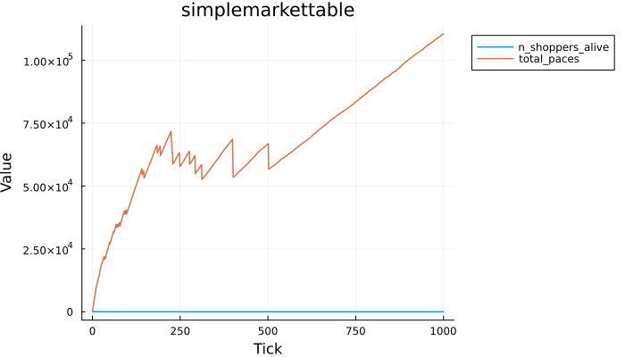
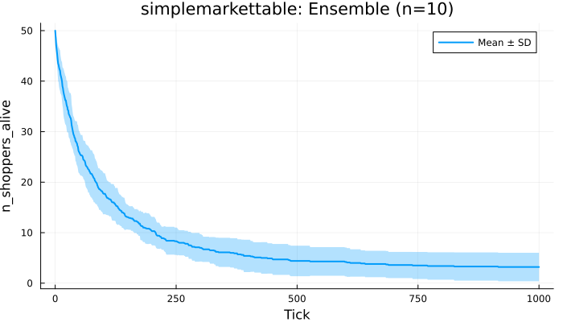
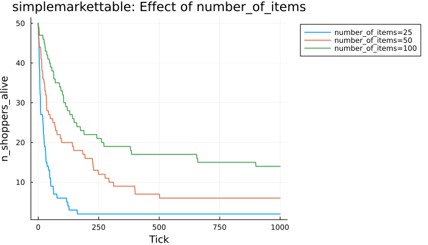

## Overview

This vignette demonstrates the **Simple Market Table** model implemented in [ArkModelZoo.jl](https://github.com/sdwfrost/ArkModelZoo.jl) using the Ark.jl ECS framework.

## Parameters

| Parameter | Type | Default | Description |
|-----------|------|---------|-------------|
| `number_of_items` | `Int` | `50` | number of items |
| `number_of_traders` | `Int` | `50` | number of traders |
| `number_of_shoppers` | `Int` | `50` | number of shoppers |
| `walking_speed` | `Float64` | `0.5` | walking speed |
| `mult` | `Int` | `5` | mult |
| `modulo` | `Int` | `43` | modulo |
| `max_ticks` | `Int` | `1000` | max ticks |

## Source Code

The Julia code to run this model:

```julia
using ArkModelZoo
_, trajectory = run_simplemarkettable()
```

## Time Series

{width=100%}

## Ensemble Runs

Ten replicates with different random seeds, showing mean ± standard deviation.

{width=100%}

## Parameter Sensitivity

Varying `number_of_items`.

{width=100%}


## Appendix: Source Code

This model is implemented in the [Ark.jl](https://github.com/sdwfrost/Ark.jl) Entity-Component-System (ECS) framework. The code is split into five files, each with a distinct role:

- **Parameters**: a mutable struct holding all configurable values.
- **Components**: lightweight data types attached to individual entities (agents).
- **Resources**: world-level shared state accessible to all systems.
- **Systems**: functions that operate on entities each tick, defining model behavior.
- **Model**: wiring that assembles the world, registers resources and systems, and provides the run entry point.

### Parameters (`parameters.jl`)

The parameter struct uses `@kwdef` so that every field has a default value and can be overridden by keyword. These defaults match the original NetLogo model's slider settings.

```julia
Base.@kwdef mutable struct SMktTParams
    number_of_items::Int = 50
    number_of_traders::Int = 50
    number_of_shoppers::Int = 50
    walking_speed::Float64 = 0.5
    mult::Int = 5
    modulo::Int = 43
    max_ticks::Int = 1000
    seed::Int = 42
end
```

### Components (`components.jl`)

Components are lightweight data types attached to individual entities (agents). Mutable structs hold per-entity state, while empty tag structs act as markers for the ECS query system to efficiently filter entities.

```julia
struct SMktTDummy end
```

### Resources (`resources.jl`)

Resources are world-level singletons shared across all systems, used for global state and aggregate statistics.

```julia
mutable struct SMktTState
    n_traders::Int
    trader_x::Vector{Float64}
    trader_y::Vector{Float64}
    trader_stock::Vector{Dict{Int,Int}}
    trader_empty::Vector{Bool}
    trader_adj::Vector{Vector{Int}}

    n_shoppers::Int
    shopper_x::Vector{Float64}
    shopper_y::Vector{Float64}
    shopper_list::Vector{Dict{Int,Int}}
    shopper_speed::Vector{Float64}
    shopper_paces::Vector{Float64}
    shopper_currstall::Vector{Int}
    shopper_alive::Vector{Bool}
end

function SMktTState()
    SMktTState(
        0, Float64[], Float64[], Dict{Int,Int}[], Bool[], Vector{Int}[],
        0, Float64[], Float64[], Dict{Int,Int}[], Float64[], Float64[], Int[], Bool[]
    )
end

mutable struct SMktTStats
    n_shoppers_alive::Int
    total_paces::Float64
end
SMktTStats() = SMktTStats(0, 0.0)
```

### Systems (`systems.jl`)

Systems contain the model logic and execute in a defined order each tick. Each system struct implements either `initialize!` (run once at setup) or `update!` (run every tick).

```julia
# --- Helpers ---

function _smktt_distance(x1, y1, x2, y2)
    dx = x1 - x2
    dy = y1 - y2
    return sqrt(dx * dx + dy * dy)
end

function _smktt_set_stock!(rng, stock::Dict{Int,Int}, n_items::Int)
    x = rand(rng, 0:19)
    for _ in 0:x
        y = rand(rng, 0:(n_items - 1))
        z = rand(rng, 1:20)
        stock[y] = z
    end
end

function _smktt_set_list!(rng, list::Dict{Int,Int}, n_items::Int)
    x = rand(rng, 0:9)
    for _ in 0:x
        y = rand(rng, 0:(n_items - 1))
        z = rand(rng, 1:5)
        list[y] = z
    end
end

function _smktt_tally!(state::SMktTState, stats::SMktTStats)
    stats.n_shoppers_alive = count(state.shopper_alive)
    stats.total_paces = 0.0
    for i in 1:state.n_shoppers
        if state.shopper_alive[i]
            stats.total_paces += state.shopper_paces[i]
        end
    end
end

# --- Systems ---

struct InitSMktTSystem <: System end

function initialize!(::InitSMktTSystem, world::World)
    params = get_resource(world, SMktTParams)
    rng = get_resource(world, RNGResource).rng
    state = get_resource(world, SMktTState)
    stats = get_resource(world, SMktTStats)

    n_t = params.number_of_traders
    n_s = params.number_of_shoppers

    # Create traders with random stock
    state.n_traders = n_t
    state.trader_x = zeros(n_t)
    state.trader_y = zeros(n_t)
    state.trader_stock = [Dict{Int,Int}() for _ in 1:n_t]
    state.trader_empty = fill(false, n_t)
    state.trader_adj = [Int[] for _ in 1:n_t]

    for i in 1:n_t
        _smktt_set_stock!(rng, state.trader_stock[i], params.number_of_items)
    end

    # Layout traders in a circle (radius 16 matches NetLogo max-pxcor)
    for i in 1:n_t
        angle = 2π * (i - 1) / n_t
        state.trader_x[i] = 16.0 * cos(angle)
        state.trader_y[i] = 16.0 * sin(angle)
    end

    # Build trader network: NetLogo formula (who * mult) mod modulo
    # Bidirectional links stored as adjacency lists
    for i in 1:n_t
        partner = ((i - 1) * params.mult) % params.modulo + 1
        if partner != i && partner >= 1 && partner <= n_t
            if !(partner in state.trader_adj[i])
                push!(state.trader_adj[i], partner)
            end
            if !(i in state.trader_adj[partner])
                push!(state.trader_adj[partner], i)
            end
        end
    end

    # Create shoppers with random shopping lists
    state.n_shoppers = n_s
    state.shopper_x = zeros(n_s)
    state.shopper_y = zeros(n_s)
    state.shopper_list = [Dict{Int,Int}() for _ in 1:n_s]
    state.shopper_speed = zeros(n_s)
    state.shopper_paces = zeros(n_s)
    state.shopper_currstall = zeros(Int, n_s)
    state.shopper_alive = fill(true, n_s)

    for i in 1:n_s
        _smktt_set_list!(rng, state.shopper_list[i], params.number_of_items)
        state.shopper_speed[i] = rand(rng) * params.walking_speed + 0.001
    end

    # Move each shopper to a random trader
    for i in 1:n_s
        stall = rand(rng, 1:n_t)
        state.shopper_currstall[i] = stall
        state.shopper_x[i] = state.trader_x[stall]
        state.shopper_y[i] = state.trader_y[stall]
    end

    _smktt_tally!(state, stats)
    return nothing
end

struct SMktTGoSystem <: System end

function update!(::SMktTGoSystem, world::World)
    state = get_resource(world, SMktTState)
    stats = get_resource(world, SMktTStats)
    rng = get_resource(world, RNGResource).rng

    # Stop if no shoppers remain
    if count(state.shopper_alive) <= 0
        get_resource(world, Terminate).stop = true
        return nothing
    end

    # Filter active shoppers and shuffle for random execution order
    active = [i for i in 1:state.n_shoppers
              if state.shopper_alive[i] && !isempty(state.shopper_list[i])]
    shuffle!(rng, active)

    for s in active
        cur = state.shopper_currstall[s]
        adj = state.trader_adj[cur]

        # Navigate network: pick a link-neighbor, or stay if none
        stall = if !isempty(adj)
            adj[rand(rng, 1:length(adj))]
        else
            cur
        end

        if stall != cur
            # Accumulate paces (distance from old position to new stall)
            state.shopper_paces[s] += _smktt_distance(
                state.shopper_x[s], state.shopper_y[s],
                state.trader_x[stall], state.trader_y[stall]
            )

            state.shopper_currstall[s] = stall
            state.shopper_x[s] = state.trader_x[stall]
            state.shopper_y[s] = state.trader_y[stall]

            # Buy items from stall
            stall_stock = state.trader_stock[stall]
            for key in collect(keys(state.shopper_list[s]))
                n = state.shopper_list[s][key]
                if haskey(stall_stock, key)
                    c = stall_stock[key]
                    if c >= n
                        state.shopper_list[s][key] = 0
                    else
                        state.shopper_list[s][key] = n - c
                    end
                    stall_stock[key] = stall_stock[key] - n
                end
            end
        end
    end

    # Clean up shoppers: remove fulfilled items, die if list empty
    for s in 1:state.n_shoppers
        state.shopper_alive[s] || continue
        for key in collect(keys(state.shopper_list[s]))
            if state.shopper_list[s][key] <= 0
                delete!(state.shopper_list[s], key)
            end
        end
        if isempty(state.shopper_list[s])
            state.shopper_alive[s] = false
        end
    end

    # Clean up traders: remove depleted items, mark empty
    for t in 1:state.n_traders
        for key in collect(keys(state.trader_stock[t]))
            if state.trader_stock[t][key] <= 0
                delete!(state.trader_stock[t], key)
            end
        end
        if isempty(state.trader_stock[t])
            state.trader_empty[t] = true
        end
    end

    _smktt_tally!(state, stats)
    return nothing
end

struct SMktTTerminationSystem <: System end

function update!(::SMktTTerminationSystem, world::World)
    params = get_resource(world, SMktTParams)
    tick = get_resource(world, Tick)
    if tick.tick + 1 >= params.max_ticks
        get_resource(world, Terminate).stop = true
    end
    return nothing
end
```

### Model (`model.jl`)

The model file assembles all pieces: it creates the ECS `World` with the required component types, registers resources, builds the `Scheduler` with systems in execution order, and exposes the public `run` entry point. The observer pattern records the trajectory each tick.

```julia
function simplemarkettable_world(; initial_capacity::Int = 128)
    return World(SMktTDummy; initial_capacity = initial_capacity, allow_mutable = true)
end

function simplemarkettable_systems()
    return (
        InitSMktTSystem(),
        SMktTGoSystem(),
        SMktTTerminationSystem(),
    )
end

function simplemarkettable_model(params::SMktTParams = SMktTParams())
    world = simplemarkettable_world()
    _add_standard_resources!(world, params)
    add_resource!(world, SMktTState())
    add_resource!(world, SMktTStats())
    scheduler = Scheduler(world, simplemarkettable_systems())
    initialize!(scheduler)
    return scheduler
end

struct SMktTObserver end

function simplemarkettable_headers(::SMktTObserver)
    return ["n_shoppers_alive", "total_paces"]
end

function simplemarkettable_values(::SMktTObserver, world::World)
    stats = get_resource(world, SMktTStats)
    return Float64[stats.n_shoppers_alive, stats.total_paces]
end

function run_simplemarkettable(; params::SMktTParams = SMktTParams(), observe::Bool = true)
    return _run_model(simplemarkettable_model, SMktTObserver(), simplemarkettable_values; params, observe)
end
```
