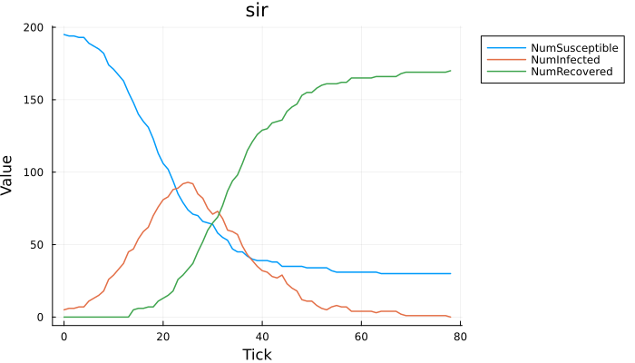
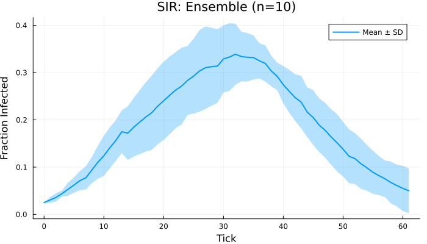
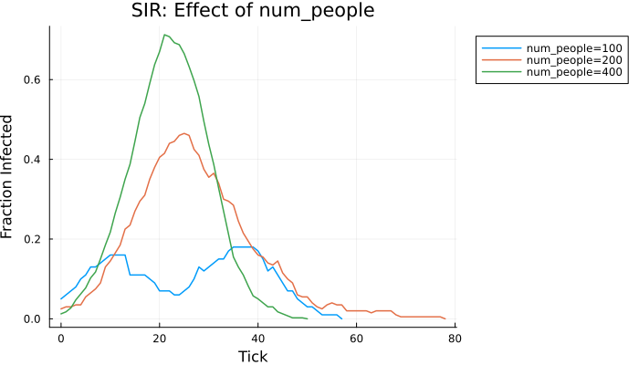

# SIR Epidemic


- [Overview](#overview)
- [Parameters](#parameters)
- [Source Code](#source-code)
- [Time Series](#time-series)
- [Ensemble Runs](#ensemble-runs)
- [Parameter Sensitivity](#parameter-sensitivity)
- [Appendix: Source Code](#appendix-source-code)
  - [Parameters (`parameters.jl`)](#parameters-parametersjl)
  - [Components (`components.jl`)](#components-componentsjl)
  - [Resources (`resources.jl`)](#resources-resourcesjl)
  - [Systems (`systems.jl`)](#systems-systemsjl)
  - [Model (`model.jl`)](#model-modeljl)

## Overview

This vignette demonstrates the **SIR Epidemic** model implemented in
[ArkModelZoo.jl](https://github.com/sdwfrost/ArkModelZoo.jl) using the
Ark.jl ECS framework.

## Parameters

| Parameter          | Type      | Default | Description      |
|--------------------|-----------|---------|------------------|
| `num_people`       | `Int`     | `200`   | num people       |
| `initial_infected` | `Int`     | `5`     | initial infected |
| `infection_radius` | `Float64` | `1.5`   | infection radius |
| `infection_chance` | `Float64` | `0.15`  | infection chance |
| `recovery_time`    | `Int`     | `14`    | recovery time    |
| `grid_width`       | `Int`     | `33`    | grid width       |
| `grid_height`      | `Int`     | `33`    | grid height      |
| `max_ticks`        | `Int`     | `1000`  | max ticks        |

## Source Code

The Julia code to run this model:

``` julia
using ArkModelZoo
_, trajectory = run_sir()
```

## Time Series



## Ensemble Runs

Ten replicates with different random seeds, showing the fraction
infected (NumInfected / population size) with mean ± standard deviation.



## Parameter Sensitivity

Varying `num_people`, plotting the fraction infected over time.



## Appendix: Source Code

This model is implemented in the
[Ark.jl](https://github.com/sdwfrost/Ark.jl) Entity-Component-System
(ECS) framework. The code is split into five files, each with a distinct
role:

- **Parameters**: a mutable struct holding all configurable values.
- **Components**: lightweight data types attached to individual entities
  (agents).
- **Resources**: world-level shared state accessible to all systems.
- **Systems**: functions that operate on entities each tick, defining
  model behavior.
- **Model**: wiring that assembles the world, registers resources and
  systems, and provides the run entry point.

### Parameters (`parameters.jl`)

The parameter struct uses `@kwdef` so that every field has a default
value and can be overridden by keyword. These defaults match the
original NetLogo model’s slider settings.

``` julia
Base.@kwdef mutable struct SIRParams
    num_people::Int = 200
    initial_infected::Int = 5
    infection_radius::Float64 = 1.5
    infection_chance::Float64 = 0.15
    recovery_time::Int = 14
    grid_width::Int = 33
    grid_height::Int = 33
    max_ticks::Int = 1000
    seed::Int = 42
end
```

### Components (`components.jl`)

Components are lightweight data types attached to individual entities
(agents). Mutable structs hold per-entity state, while empty tag structs
act as markers for the ECS query system to efficiently filter entities.

``` julia
# Position on continuous space (NetLogo world -16,16 → [0,33))
mutable struct SIRPosition
    x::Float64
    y::Float64
end

# Persistent heading (degrees, 0=north, clockwise)
mutable struct SIRHeading
    angle::Float64
end

# Days since infection
mutable struct DaysInfected
    days::Int
end

# Tag components for disease state (prefixed to avoid conflict with virus model's @enum)
struct SIRSusceptible end
struct SIRInfected end
struct SIRRecovered end
```

### Resources (`resources.jl`)

Resources are world-level singletons shared across all systems, used for
global state and aggregate statistics.

``` julia
mutable struct SIRStats
    num_susceptible::Int
    num_infected::Int
    num_recovered::Int
end
SIRStats() = SIRStats(0, 0, 0)
```

### Systems (`systems.jl`)

Systems contain the model logic and execute in a defined order each
tick. Each system struct implements either `initialize!` (run once at
setup) or `update!` (run every tick).

``` julia
# SIR Epidemic Model Systems
# Execution order: init → movement → infection/recovery → stats → termination

# --- Initialization ---
# NetLogo: create-turtles 200 [...]; ask n-of 5 turtles [...]; update-counts

struct InitSIRSystem <: System end

function initialize!(::InitSIRSystem, world::World)
    params = get_resource(world, SIRParams)
    rng = get_resource(world, RNGResource).rng
    stats = get_resource(world, SIRStats)
    wf = Float64(params.grid_width)
    hf = Float64(params.grid_height)

    # Create all agents as susceptible with random positions and headings
    for _ in 1:params.num_people
        x = rand(rng) * wf
        y = rand(rng) * hf
        heading = Float64(rand(rng, 0:359))
        new_entity!(world, (SIRPosition(x, y), SIRHeading(heading), SIRSusceptible()))
    end

    # Select initial infected: n-of initial_infected turtles
    all_entities = Entity[]
    for (eids, _) in Query(world, (SIRPosition,); with=(SIRSusceptible,))
        @inbounds for i in eachindex(eids)
            push!(all_entities, eids[i])
        end
    end
    Random.shuffle!(rng, all_entities)
    for i in 1:params.initial_infected
        exchange_components!(world, all_entities[i];
            add = (SIRInfected(), DaysInfected(1)),
            remove = (SIRSusceptible,),
        )
    end

    # Compute initial stats (NetLogo calls update-counts in setup)
    stats.num_susceptible = params.num_people - params.initial_infected
    stats.num_infected = params.initial_infected
    stats.num_recovered = 0
    return nothing
end

# --- Movement ---
# NetLogo: ask turtles [rt random 50 - 25; fd 1]
# Persistent heading, integer turn in [-25, 24], forward 1 unit, toroidal wrapping

struct SIRMovementSystem <: System end

function update!(::SIRMovementSystem, world::World)
    rng = get_resource(world, RNGResource).rng
    params = get_resource(world, SIRParams)
    wf = Float64(params.grid_width)
    hf = Float64(params.grid_height)

    for (_, positions, headings) in Query(world, (SIRPosition, SIRHeading))
        @inbounds for i in eachindex(positions)
            headings[i].angle += Float64(rand(rng, 0:49) - 25)
            θ = deg2rad(headings[i].angle)
            positions[i].x = mod(positions[i].x + sin(θ), wf)
            positions[i].y = mod(positions[i].y + cos(θ), hf)
        end
    end
    return nothing
end

# --- Infection & Recovery ---
# NetLogo: ask turtles with [state = "I"] [
#   ask turtles in-radius 1.5 with [state = "S"] [ if random-float 1.0 < 0.15 [...] ]
#   set days-infected days-infected + 1
#   if days-infected > 14 [ set state "R" ... ]
# ]
#
# The outer `ask` fixes the infected agentset at the start of the tick.
# The inner `ask ... with [state = "S"]` is evaluated fresh, so newly-infected
# turtles from earlier in this tick are no longer susceptible targets.

struct SIRInfectionSystem <: System
    susceptible_cells::Dict{Tuple{Int,Int}, Vector{Tuple{Entity, Float64, Float64}}}
    to_infect::Vector{Entity}
    to_recover::Vector{Entity}
end
SIRInfectionSystem() = SIRInfectionSystem(
    Dict{Tuple{Int,Int}, Vector{Tuple{Entity, Float64, Float64}}}(),
    Entity[], Entity[],
)

function update!(system::SIRInfectionSystem, world::World)
    params = get_resource(world, SIRParams)
    rng = get_resource(world, RNGResource).rng
    w = params.grid_width
    h = params.grid_height
    wf = Float64(w)
    hf = Float64(h)
    radius_sq = params.infection_radius * params.infection_radius

    empty!(system.susceptible_cells)
    empty!(system.to_infect)
    empty!(system.to_recover)

    # Build susceptible spatial index
    for (eids, positions) in Query(world, (SIRPosition,); with=(SIRSusceptible,))
        @inbounds for i in eachindex(positions)
            cx = mod(floor(Int, positions[i].x), w) + 1
            cy = mod(floor(Int, positions[i].y), h) + 1
            key = (cx, cy)
            if !haskey(system.susceptible_cells, key)
                system.susceptible_cells[key] = Tuple{Entity, Float64, Float64}[]
            end
            push!(system.susceptible_cells[key], (eids[i], positions[i].x, positions[i].y))
        end
    end

    # Collect infected entities (fixed agentset for this tick)
    infected_entities = Tuple{Entity, Float64, Float64}[]
    for (eids, positions, _) in Query(world, (SIRPosition, DaysInfected); with=(SIRInfected,))
        @inbounds for i in eachindex(positions)
            push!(infected_entities, (eids[i], positions[i].x, positions[i].y))
        end
    end

    # NetLogo `ask` shuffles the agentset
    Random.shuffle!(rng, infected_entities)

    # Process each infected entity
    for (eid, ix, iy) in infected_entities
        # 1. Infect nearby susceptible
        cx = mod(floor(Int, ix), w) + 1
        cy = mod(floor(Int, iy), h) + 1

        for dx in -2:2, dy in -2:2
            nx = mod(cx - 1 + dx, w) + 1
            ny = mod(cy - 1 + dy, h) + 1
            targets = get(system.susceptible_cells, (nx, ny), nothing)
            targets === nothing && continue

            j = 1
            while j <= length(targets)
                (target_eid, tx, ty) = targets[j]

                # Toroidal distance
                ddx = abs(ix - tx)
                ddx = min(ddx, wf - ddx)
                ddy = abs(iy - ty)
                ddy = min(ddy, hf - ddy)
                dist_sq = ddx * ddx + ddy * ddy

                if dist_sq <= radius_sq
                    if rand(rng) < params.infection_chance
                        push!(system.to_infect, target_eid)
                        deleteat!(targets, j)
                        continue
                    end
                end
                j += 1
            end
        end

        # 2. Increment days-infected
        if is_alive(world, eid)
            days_comp = get_components(world, eid, (DaysInfected,))[1]
            days_comp.days += 1
            # 3. Check for recovery (days-infected > recovery_time)
            if days_comp.days > params.recovery_time
                push!(system.to_recover, eid)
            end
        end
    end

    # Apply infection transitions (Susceptible → Infected)
    for eid in system.to_infect
        is_alive(world, eid) || continue
        exchange_components!(world, eid;
            add = (SIRInfected(), DaysInfected(1)),
            remove = (SIRSusceptible,),
        )
    end

    # Apply recovery transitions (Infected → Recovered)
    for eid in system.to_recover
        is_alive(world, eid) || continue
        exchange_components!(world, eid;
            add = (SIRRecovered(),),
            remove = (SIRInfected, DaysInfected),
        )
    end
    return nothing
end

# --- Statistics ---
# NetLogo: update-counts

struct SIRStatsSystem <: System end

function update!(::SIRStatsSystem, world::World)
    stats = get_resource(world, SIRStats)

    s_count = 0
    for (eids, _) in Query(world, (SIRPosition,); with=(SIRSusceptible,))
        s_count += length(eids)
    end

    i_count = 0
    for (eids, _) in Query(world, (SIRPosition,); with=(SIRInfected,))
        i_count += length(eids)
    end

    r_count = 0
    for (eids, _) in Query(world, (SIRPosition,); with=(SIRRecovered,))
        r_count += length(eids)
    end

    stats.num_susceptible = s_count
    stats.num_infected = i_count
    stats.num_recovered = r_count
    return nothing
end

# --- Termination ---
# NetLogo: if num-infected = 0 [ stop ]

struct SIRTerminationSystem <: System end

function update!(::SIRTerminationSystem, world::World)
    params = get_resource(world, SIRParams)
    tick = get_resource(world, Tick)
    stats = get_resource(world, SIRStats)
    if stats.num_infected == 0 || tick.tick + 1 >= params.max_ticks
        get_resource(world, Terminate).stop = true
    end
    return nothing
end
```

### Model (`model.jl`)

The model file assembles all pieces: it creates the ECS `World` with the
required component types, registers resources, builds the `Scheduler`
with systems in execution order, and exposes the public `run` entry
point. The observer pattern records the trajectory each tick.

``` julia
function sir_world(; initial_capacity::Int = 1024)
    return World(
        SIRPosition,
        SIRHeading,
        DaysInfected,
        SIRSusceptible,
        SIRInfected,
        SIRRecovered;
        initial_capacity = initial_capacity,
        allow_mutable = true,
    )
end

function sir_systems()
    return (
        InitSIRSystem(),
        SIRMovementSystem(),
        SIRInfectionSystem(),
        SIRStatsSystem(),
        SIRTerminationSystem(),
    )
end

function sir_model(params::SIRParams = SIRParams())
    world = sir_world()
    _add_standard_resources!(world, params)
    add_resource!(world, SIRStats())
    scheduler = Scheduler(world, sir_systems())
    initialize!(scheduler)
    return scheduler
end

struct SIRObserver end

function sir_headers(::SIRObserver)
    return ["NumSusceptible", "NumInfected", "NumRecovered"]
end

function sir_values(::SIRObserver, world::World)
    stats = get_resource(world, SIRStats)
    return Float64[stats.num_susceptible, stats.num_infected, stats.num_recovered]
end

function run_sir(; params::SIRParams = SIRParams(), observe::Bool = true)
    return _run_model(sir_model, SIRObserver(), sir_values; params, observe)
end
```
