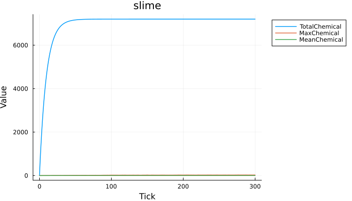
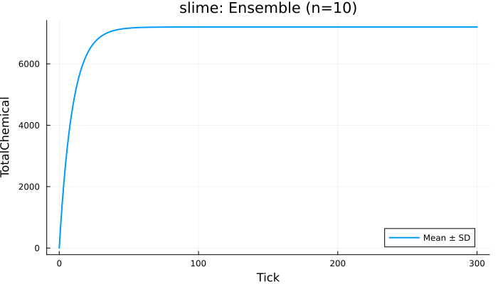
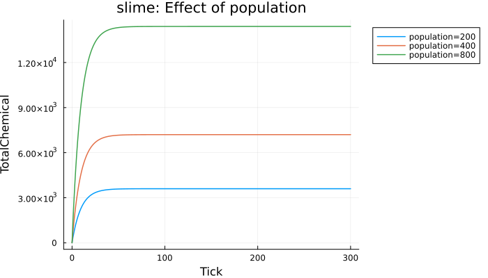

# Slime


- [Overview](#overview)
  - [WHAT IS IT?](#what-is-it)
  - [THINGS TO NOTICE](#things-to-notice)
  - [THINGS TO TRY](#things-to-try)
  - [EXTENDING THE MODEL](#extending-the-model)
  - [NETLOGO FEATURES](#netlogo-features)
  - [RELATED MODELS](#related-models)
  - [CREDITS AND REFERENCES](#credits-and-references)
  - [HOW TO CITE](#how-to-cite)
  - [COPYRIGHT AND LICENSE](#copyright-and-license)
- [Parameters](#parameters)
- [Source Code](#source-code)
- [Time Series](#time-series)
- [Ensemble Runs](#ensemble-runs)
- [Parameter Sensitivity](#parameter-sensitivity)
- [Appendix: Source Code](#appendix-source-code)
  - [Parameters (`parameters.jl`)](#parameters-parametersjl)
  - [Components (`components.jl`)](#components-componentsjl)
  - [Resources (`resources.jl`)](#resources-resourcesjl)
  - [Systems (`systems.jl`)](#systems-systemsjl)
  - [Model (`model.jl`)](#model-modeljl)

## Overview

### WHAT IS IT?

This model is inspired by the aggregation behavior of slime-mold cells.
The slime mold spends much of its life as thousands of distinct
single-celled units, each moving separately. Under the right conditions,
those many cells will coalesce into a single, larger organism. When the
environment is less hospitable, the slime mold acts as a single
organism; when the weather turns cooler and the mold enjoys a large food
supply, “it” becomes a “they.” The slime mold oscillates between being a
single creature and a swarm.

This model shows how creatures can aggregate into clusters without the
control of a “leader” or “pacemaker” cell. This finding was first
described by Evelyn Fox Keller and Lee Segel in a paper in 1970.

Before Keller began her investigations, the conventional belief had been
that slime mold swarms formed at the command of “pacemaker” cells that
ordered the other cells to begin aggregating. In 1962, Shafer showed how
the pacemakers could use cyclic AMP as a signal of sorts to rally the
troops; the slime mold generals would release the compounds at the
appropriate moments, triggering waves of cyclic AMP that washed through
the entire community, as each isolated cell relayed the signal to its
neighbors. Slime mold aggregation, in effect, was a giant game of
Telephone — but only a few elite cells placed the original call.

For the twenty years that followed the publication of Shafer’s original
essay, mycologists assumed that the missing pacemaker cells were a sign
of insufficient data, or poorly designed experiments. But Keller and
Segel took another, more radical approach. They shows that Shafer had it
wrong – that the community of slime mold cells were organizing
themselves without any need for pacemakers. This was one of the first
examples of emergence and self-organization in biology.

Initially, biologists did not accept this explanation. Indeed, the
pacemaker hypothesis would continue as the reigning model for another
decade. Now, slime mold aggregation is recognized as a classic case
study in bottom-up self-organizing behavior.

In this model, each turtle drops a chemical pheromone (shown in green).
The turtles also “sniff” ahead, trying to follow the gradient of other
turtles’ chemicals. Meanwhile, the patches diffuse and evaporate the
pheromone. Following these simple, decentralized rules, the turtles
aggregate into clusters.

### THINGS TO NOTICE

With 100 turtles, not much happens. The turtles wander around dropping
chemical, but the chemical evaporates and diffuses too quickly for the
turtles to aggregate.

With 400 turtles, the result is quite different. When a few turtles
happen (by chance) to wander near one another, they create a small
“puddle” of chemical that can attract any number of other turtles in the
vicinity. The puddle then becomes larger and more attractive as more
turtles enter it and deposit their own chemicals. This process is a good
example of positive feedback: the more turtles, the larger the puddle;
and the larger the puddle, the more likely it is to attract more
turtles.

### THINGS TO TRY

Try different values for the SNIFF-THRESHOLD, SNIFF-ANGLE, WIGGLE-ANGLE,
and WIGGLE-BIAS sliders. How do they affect the turtles’ movement and
the formation of clumps?

Change the SNIFF-ANGLE and WIGGLE-ANGLE sliders after some clumps have
formed. What happens to the clumps? Try the same with SNIFF-THRESHOLD
and WIGGLE-BIAS.

### EXTENDING THE MODEL

Modify the program so that the turtles aggregate into a single large
cluster.

How do the results change if there is more (or less) randomness in the
turtles’ motion?

Notice that the turtles only sniff for chemical in three places:
forward, SNIFF-ANGLE to the left, and SNIFF-ANGLE to the right. Modify
the model so that the turtles sniff all around. How does their
clustering behavior change? Modify the model so that the turtles sniff
in even fewer places. How does their clustering behavior change?

What “critical number” of turtles is needed for the clusters to form?
How does the critical number change if you modify the evaporation or
diffusion rate?

Can you find an algorithm that will let you plot the number of distinct
clusters over time?

### NETLOGO FEATURES

Note the use of the `patch-ahead`, `patch-left-and-ahead`, and
`patch-right-and-ahead` primitives to do the “sniffing”.

### RELATED MODELS

Ants uses a similar idea of creatures that both drop chemical and follow
the gradient of the chemical.

### CREDITS AND REFERENCES

Keller, E & Segel, L. (1970). Initiation of slime mold aggregation
viewed as an instability. Journal of Theoretical Biology, Volume 26,
Issue 3, March 1970, Pages 399–415.

Wilensky, U., & Resnick, M. (1999). Thinking in levels: A dynamic
systems approach to making sense of the world. Journal of Science
Education and Technology, 8(1), 3-19.

Johnson, S. (2001). Emergence: The Connected Lives of Ants, Brains,
Cities, and Software. New York: Scribner.

Resnick, M. (1996). Beyond the centralized mindset. Journal of the
Learning Sciences, 5(1), 1-22.

See also http://www.creepinggarden.com for video of slime mold.

### HOW TO CITE

If you mention this model or the NetLogo software in a publication, we
ask that you include the citations below.

For the model itself:

- Wilensky, U. (1997). NetLogo Slime model.
  http://ccl.northwestern.edu/netlogo/models/Slime. Center for Connected
  Learning and Computer-Based Modeling, Northwestern University,
  Evanston, IL.

Please cite the NetLogo software as:

- Wilensky, U. (1999). NetLogo. http://ccl.northwestern.edu/netlogo/.
  Center for Connected Learning and Computer-Based Modeling,
  Northwestern University, Evanston, IL.

### COPYRIGHT AND LICENSE

Copyright 1997 Uri Wilensky.


This model is licensed under the Creative Commons
Attribution-NonCommercial-ShareAlike 3.0 License. To view a copy of this
license, visit https://creativecommons.org/licenses/by-nc-sa/3.0/ or
send a letter to Creative Commons, 559 Nathan Abbott Way, Stanford,
California 94305, USA.

NetLogo itself is free software for non-commercial use under the terms
of the GNU General Public License ([see full license information
here](https://ccl.northwestern.edu/netlogo/docs/copyright.html)).

To inquire about commercial licenses for either NetLogo or specific
models from the models library, please contact
netlogo-commercial-admin@ccl.northwestern.edu.

This model was created as part of the project: CONNECTED MATHEMATICS:
MAKING SENSE OF COMPLEX PHENOMENA THROUGH BUILDING OBJECT-BASED PARALLEL
MODELS (OBPML). The project gratefully acknowledges the support of the
National Science Foundation (Applications of Advanced Technologies
Program) – grant numbers RED \#9552950 and REC \#9632612.

This model was developed at the MIT Media Lab using CM StarLogo. See
Resnick, M. (1994) “Turtles, Termites and Traffic Jams: Explorations in
Massively Parallel Microworlds.” Cambridge, MA: MIT Press. Adapted to
StarLogoT, 1997, as part of the Connected Mathematics Project.

This model was converted to NetLogo as part of the projects:
PARTICIPATORY SIMULATIONS: NETWORK-BASED DESIGN FOR SYSTEMS LEARNING IN
CLASSROOMS and/or INTEGRATED SIMULATION AND MODELING ENVIRONMENT. The
project gratefully acknowledges the support of the National Science
Foundation (REPP & ROLE programs) – grant numbers REC \#9814682 and
REC-0126227. Converted from StarLogoT to NetLogo, 2000.

<!-- 1997 2000 MIT -->

## Parameters

| Parameter          | Type      | Default | Description      |
|--------------------|-----------|---------|------------------|
| `population`       | `Int`     | `400`   | population       |
| `sniff_threshold`  | `Float64` | `1.0`   | sniff threshold  |
| `sniff_angle`      | `Float64` | `45.0`  | sniff angle      |
| `wiggle_angle`     | `Float64` | `40.0`  | wiggle angle     |
| `wiggle_bias`      | `Float64` | `0.0`   | wiggle bias      |
| `evaporation_rate` | `Float64` | `0.9`   | evaporation rate |
| `diffusion_rate`   | `Float64` | `1.0`   | diffusion rate   |
| `deposit_amount`   | `Float64` | `2.0`   | deposit amount   |
| `grid_width`       | `Int`     | `81`    | -40..40          |
| `grid_height`      | `Int`     | `81`    | grid height      |
| `max_ticks`        | `Int`     | `300`   | max ticks        |

## Source Code

The Julia code to run this model:

``` julia
using ArkModelZoo
_, trajectory = run_slime()
```

## Time Series



## Ensemble Runs

Ten replicates with different random seeds, showing mean ± standard
deviation.



## Parameter Sensitivity

Varying `population`.



## Appendix: Source Code

This model is implemented in the
[Ark.jl](https://github.com/sdwfrost/Ark.jl) Entity-Component-System
(ECS) framework. The code is split into five files, each with a distinct
role:

- **Parameters**: a mutable struct holding all configurable values.
- **Components**: lightweight data types attached to individual entities
  (agents).
- **Resources**: world-level shared state accessible to all systems.
- **Systems**: functions that operate on entities each tick, defining
  model behavior.
- **Model**: wiring that assembles the world, registers resources and
  systems, and provides the run entry point.

### Parameters (`parameters.jl`)

The parameter struct uses `@kwdef` so that every field has a default
value and can be overridden by keyword. These defaults match the
original NetLogo model’s slider settings.

``` julia
Base.@kwdef mutable struct SLParams
    population::Int = 400
    sniff_threshold::Float64 = 1.0
    sniff_angle::Float64 = 45.0
    wiggle_angle::Float64 = 40.0
    wiggle_bias::Float64 = 0.0
    evaporation_rate::Float64 = 0.9
    diffusion_rate::Float64 = 1.0
    deposit_amount::Float64 = 2.0
    grid_width::Int = 81    # -40..40
    grid_height::Int = 81
    max_ticks::Int = 300
    seed::Int = 42
end
```

### Components (`components.jl`)

Components are lightweight data types attached to individual entities
(agents). Mutable structs hold per-entity state, while empty tag structs
act as markers for the ECS query system to efficiently filter entities.

``` julia
mutable struct SLPosition
    x::Float64
    y::Float64
end
SLPosition() = SLPosition(0.0, 0.0)

mutable struct SLHeading
    heading::Float64
end
SLHeading() = SLHeading(0.0)
```

### Resources (`resources.jl`)

Resources are world-level singletons shared across all systems, used for
global state and aggregate statistics.

``` julia
mutable struct SLChemicalGrid
    width::Int
    height::Int
    chemical::Matrix{Float64}
end

function SLChemicalGrid(width::Int, height::Int)
    SLChemicalGrid(width, height, zeros(Float64, width, height))
end

mutable struct SLStats
    total_chemical::Float64
    max_chemical::Float64
end
SLStats() = SLStats(0.0, 0.0)
```

### Systems (`systems.jl`)

Systems contain the model logic and execute in a defined order each
tick. Each system struct implements either `initialize!` (run once at
setup) or `update!` (run every tick).

``` julia
# --- Initialization ---

struct InitSLSystem <: System end

function initialize!(::InitSLSystem, world::World)
    params = get_resource(world, SLParams)
    rng = get_resource(world, RNGResource).rng
    grid = get_resource(world, SLChemicalGrid)

    # Zero chemical grid
    fill!(grid.chemical, 0.0)

    # Create turtles at random positions with random headings
    w, h = grid.width, grid.height
    for _ in 1:params.population
        x = rand(rng) * w + 0.5   # continuous position in [0.5, w+0.5)
        y = rand(rng) * h + 0.5
        heading = rand(rng) * 360.0
        new_entity!(world, (
            SLPosition(x, y),
            SLHeading(heading),
        ))
    end

    return nothing
end

# --- Helper: patch coordinates from continuous position ---

@inline function _sl_patch(x::Float64, y::Float64, w::Int, h::Int)
    return mod1(round(Int, x), w), mod1(round(Int, y), h)
end

# Helper: patch at a given heading and distance from continuous position
@inline function _sl_patch_ahead(x::Float64, y::Float64, heading::Float64,
                                  dist::Float64, w::Int, h::Int)
    θ = deg2rad(heading)
    nx = x + sin(θ) * dist
    ny = y + cos(θ) * dist
    return mod1(round(Int, nx), w), mod1(round(Int, ny), h)
end

# --- Go System ---

struct SLGoSystem <: System end

function update!(::SLGoSystem, world::World)
    params = get_resource(world, SLParams)
    rng = get_resource(world, RNGResource).rng
    grid = get_resource(world, SLChemicalGrid)
    stats = get_resource(world, SLStats)
    w, h = grid.width, grid.height
    chem = grid.chemical

    # Collect all turtle entities for shuffled ask ordering
    turtle_data = Tuple{Entity, Int}[]
    for (eids, _, _) in Query(world, (SLPosition, SLHeading))
        for i in eachindex(eids)
            push!(turtle_data, (eids[i], i))
        end
    end
    Random.shuffle!(rng, turtle_data)

    # Ask turtles (shuffled)
    for (eid, _) in turtle_data
        pos, hdg = get_components(world, eid, (SLPosition, SLHeading))

        # 1. Sniff and turn toward chemical if above threshold
        gx, gy = _sl_patch(pos.x, pos.y, w, h)
        if chem[gx, gy] > params.sniff_threshold
            _sl_turn_toward_chemical!(pos, hdg, chem, params.sniff_angle, w, h)
        end

        # 2. Wiggle: rt random-float wiggle_angle - random-float wiggle_angle + wiggle_bias
        wiggle = rand(rng) * params.wiggle_angle - rand(rng) * params.wiggle_angle + params.wiggle_bias
        hdg.heading = mod(hdg.heading + wiggle, 360.0)

        # 3. Forward 1
        θ = deg2rad(hdg.heading)
        pos.x += sin(θ)
        pos.y += cos(θ)
        # Toroidal wrapping (continuous)
        pos.x = mod(pos.x - 0.5, Float64(w)) + 0.5
        pos.y = mod(pos.y - 0.5, Float64(h)) + 0.5

        # 4. Deposit chemical on current patch
        gx, gy = _sl_patch(pos.x, pos.y, w, h)
        chem[gx, gy] += params.deposit_amount
    end

    # Diffuse chemical
    diffuse!(chem, params.diffusion_rate, w, h)

    # Evaporate
    @inbounds for i in eachindex(chem)
        chem[i] *= params.evaporation_rate
    end

    # Update stats
    total = 0.0
    mx = 0.0
    @inbounds for i in eachindex(chem)
        v = chem[i]
        total += v
        if v > mx
            mx = v
        end
    end
    stats.total_chemical = total
    stats.max_chemical = mx

    return nothing
end

# NetLogo turn-toward-chemical
function _sl_turn_toward_chemical!(pos::SLPosition, hdg::SLHeading,
                                    chem::Matrix{Float64},
                                    sniff_angle::Float64, w::Int, h::Int)
    ahead_x, ahead_y = _sl_patch_ahead(pos.x, pos.y, hdg.heading, 1.0, w, h)
    right_x, right_y = _sl_patch_ahead(pos.x, pos.y, hdg.heading + sniff_angle, 1.0, w, h)
    left_x, left_y = _sl_patch_ahead(pos.x, pos.y, hdg.heading - sniff_angle, 1.0, w, h)

    ahead_chem = chem[ahead_x, ahead_y]
    right_chem = chem[right_x, right_y]
    left_chem = chem[left_x, left_y]

    if right_chem >= ahead_chem && right_chem >= left_chem
        hdg.heading = mod(hdg.heading + sniff_angle, 360.0)
    elseif left_chem >= ahead_chem
        hdg.heading = mod(hdg.heading - sniff_angle + 360.0, 360.0)
    end
    return nothing
end

# --- Termination ---

struct SLTerminationSystem <: System end

function update!(::SLTerminationSystem, world::World)
    params = get_resource(world, SLParams)
    tick = get_resource(world, Tick)

    if tick.tick + 1 >= params.max_ticks
        get_resource(world, Terminate).stop = true
    end
    return nothing
end
```

### Model (`model.jl`)

The model file assembles all pieces: it creates the ECS `World` with the
required component types, registers resources, builds the `Scheduler`
with systems in execution order, and exposes the public `run` entry
point. The observer pattern records the trajectory each tick.

``` julia
function slime_world(; initial_capacity::Int = 4096)
    return World(
        SLPosition,
        SLHeading;
        initial_capacity = initial_capacity,
        allow_mutable = true,
    )
end

function slime_systems()
    return (
        InitSLSystem(),
        SLGoSystem(),
        SLTerminationSystem(),
    )
end

function slime_model(params::SLParams = SLParams())
    world = slime_world()
    _add_standard_resources!(world, params)
    add_resource!(world, SLChemicalGrid(params.grid_width, params.grid_height))
    add_resource!(world, SLStats())
    scheduler = Scheduler(world, slime_systems())
    initialize!(scheduler)
    return scheduler
end

struct SLObserver end

function slime_headers(::SLObserver)
    return ["TotalChemical", "MaxChemical", "MeanChemical"]
end

function slime_values(::SLObserver, world::World)
    stats = get_resource(world, SLStats)
    grid = get_resource(world, SLChemicalGrid)
    n_patches = grid.width * grid.height
    mean_chem = n_patches > 0 ? stats.total_chemical / n_patches : 0.0
    return Float64[stats.total_chemical, stats.max_chemical, mean_chem]
end

function run_slime(; params::SLParams = SLParams(), observe::Bool = true)
    return _run_model(slime_model, SLObserver(), slime_values; params, observe)
end
```
