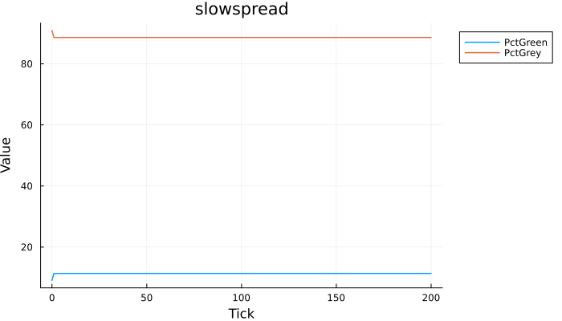
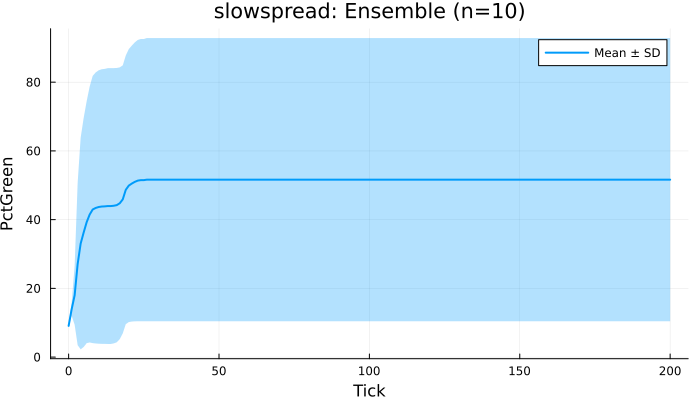
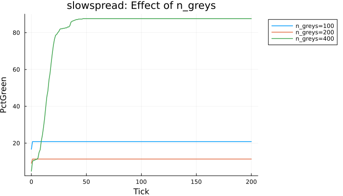

## Overview

This vignette demonstrates the **Slow Spread Env Action** model implemented in [ArkModelZoo.jl](https://github.com/sdwfrost/ArkModelZoo.jl) using the Ark.jl ECS framework.

## Parameters

| Parameter | Type | Default | Description |
|-----------|------|---------|-------------|
| `n_greys` | `Int` | `200` | n greys |
| `n_greens` | `Int` | `20` | n greens |
| `k_degree` | `Int` | `6` | k degree |
| `group_openness` | `Float64` | `0.05` | group openness |
| `prop_hard` | `Float64` | `0.1` | prop hard |
| `activation_threshold` | `Float64` | `0.75` | activation threshold |
| `threshold_strong` | `Int` | `5` | threshold strong |
| `moving` | `Bool` | `true` | moving |
| `strong_ties` | `Bool` | `true` | strong ties |
| `countervailing_contagion` | `Bool` | `true` | countervailing contagion |
| `hub_weak` | `Bool` | `true` | hub weak |
| `max_ticks` | `Int` | `200` | max ticks |

## Source Code

The Julia code to run this model:

```julia
using ArkModelZoo
_, trajectory = run_slowspread()
```

## Time Series

{width=100%}

## Ensemble Runs

Ten replicates with different random seeds, showing mean ± standard deviation.

{width=100%}

## Parameter Sensitivity

Varying `n_greys`.

{width=100%}


## Appendix: Source Code

This model is implemented in the [Ark.jl](https://github.com/sdwfrost/Ark.jl) Entity-Component-System (ECS) framework. The code is split into five files, each with a distinct role:

- **Parameters**: a mutable struct holding all configurable values.
- **Components**: lightweight data types attached to individual entities (agents).
- **Resources**: world-level shared state accessible to all systems.
- **Systems**: functions that operate on entities each tick, defining model behavior.
- **Model**: wiring that assembles the world, registers resources and systems, and provides the run entry point.

### Parameters (`parameters.jl`)

The parameter struct uses `@kwdef` so that every field has a default value and can be overridden by keyword. These defaults match the original NetLogo model's slider settings.

```julia
Base.@kwdef mutable struct SSpreadParams
    n_greys::Int = 200
    n_greens::Int = 20
    k_degree::Int = 6
    group_openness::Float64 = 0.05
    prop_hard::Float64 = 0.1
    activation_threshold::Float64 = 0.75
    threshold_strong::Int = 5
    moving::Bool = true
    strong_ties::Bool = true
    countervailing_contagion::Bool = true
    hub_weak::Bool = true
    max_ticks::Int = 200
    seed::Int = 42
end
```

### Components (`components.jl`)

Components are lightweight data types attached to individual entities (agents). Mutable structs hold per-entity state, while empty tag structs act as markers for the ECS query system to efficiently filter entities.

```julia
struct SSpreadDummy end
```

### Resources (`resources.jl`)

Resources are world-level singletons shared across all systems, used for global state and aggregate statistics.

```julia
mutable struct SSpreadNetwork
    n_agents::Int
    color::Vector{Int}            # 0 = grey, 1 = green
    hardliner::Vector{Bool}
    community::Vector{Int}        # community label from Louvain detection
    adj::Vector{Set{Int}}
    weight::Vector{Dict{Int,Int}} # edge weights: agent → neighbor → weight
    degree::Vector{Int}
end

function SSpreadNetwork()
    SSpreadNetwork(0, Int[], Bool[], Int[], Set{Int}[], Dict{Int,Int}[], Int[])
end

function _sspread_add_agent!(net::SSpreadNetwork, color::Int)
    push!(net.color, color)
    push!(net.hardliner, false)
    push!(net.community, 0)
    push!(net.adj, Set{Int}())
    push!(net.weight, Dict{Int,Int}())
    push!(net.degree, 0)
    net.n_agents += 1
    return net.n_agents
end

function _sspread_add_edge!(net::SSpreadNetwork, i::Int, j::Int, w::Int=1)
    if j ∉ net.adj[i]
        push!(net.adj[i], j)
        push!(net.adj[j], i)
        net.degree[i] += 1
        net.degree[j] += 1
        net.weight[i][j] = w
        net.weight[j][i] = w
    end
    # NetLogo's create-link-with silently ignores existing links (no weight update)
end

function _sspread_remove_edge!(net::SSpreadNetwork, i::Int, j::Int)
    if j ∈ net.adj[i]
        delete!(net.adj[i], j)
        delete!(net.adj[j], i)
        delete!(net.weight[i], j)
        delete!(net.weight[j], i)
        net.degree[i] -= 1
        net.degree[j] -= 1
    end
end

mutable struct SSpreadStats
    pct_green::Float64
    pct_grey::Float64
end
SSpreadStats() = SSpreadStats(0.0, 0.0)
```

### Systems (`systems.jl`)

Systems contain the model logic and execute in a defined order each tick. Each system struct implements either `initialize!` (run once at setup) or `update!` (run every tick).

```julia
# Slow Spread of Environmental Action — opinion dynamics with community structure

struct InitSSpreadSystem <: System end

function _sspread_build_ba!(net::SSpreadNetwork, rng, start_id::Int, n::Int, m::Int, color::Int)
    ids = Int[]
    # Create m+1 initial fully connected nodes
    for _ in 1:(m+1)
        id = _sspread_add_agent!(net, color)
        push!(ids, id)
    end
    for i in 1:length(ids), j in (i+1):length(ids)
        _sspread_add_edge!(net, ids[i], ids[j])
    end
    # Preferential attachment for remaining
    for _ in (m+2):n
        new_id = _sspread_add_agent!(net, color)
        push!(ids, new_id)
        # Degree sum among existing nodes in this sub-network
        total_deg = 0
        for id in ids[1:end-1]
            total_deg += net.degree[id]
        end
        targets = Set{Int}()
        attempts = 0
        while length(targets) < m && attempts < 10000
            attempts += 1
            if total_deg == 0
                # Uniform random
                push!(targets, ids[rand(rng, 1:length(ids)-1)])
            else
                r = rand(rng) * total_deg
                cumulative = 0.0
                for id in ids[1:end-1]
                    cumulative += net.degree[id]
                    if cumulative >= r
                        push!(targets, id)
                        break
                    end
                end
            end
        end
        for t in targets
            _sspread_add_edge!(net, new_id, t)
        end
    end
    return ids
end

# Louvain community detection (matches NetLogo nw:louvain-communities)
function _sspread_louvain!(net::SSpreadNetwork, rng; max_passes::Int=100)
    n = net.n_agents
    n <= 1 && return

    total_edges = 0
    for i in 1:n
        total_edges += net.degree[i]
    end
    m = total_edges ÷ 2  # each edge counted twice in degree sum
    m == 0 && return
    mf = Float64(m)

    comm = collect(1:n)

    for _ in 1:max_passes
        moved = false
        order = shuffle!(rng, collect(1:n))
        for i in order
            ci = comm[i]
            ki = net.degree[i]
            isempty(net.adj[i]) && continue

            # Edges from i to each neighboring community
            ki_to = Dict{Int,Int}()
            for j in net.adj[i]
                cj = comm[j]
                ki_to[cj] = get(ki_to, cj, 0) + 1
            end

            # Total degree of each relevant community
            sigma_tot = Dict{Int,Int}()
            for j in 1:n
                cj = comm[j]
                if cj == ci || haskey(ki_to, cj)
                    sigma_tot[cj] = get(sigma_tot, cj, 0) + net.degree[j]
                end
            end

            ki_in_ci = get(ki_to, ci, 0)
            sigma_ci = get(sigma_tot, ci, 0)

            best_c = ci
            best_dq = 0.0
            for (c, ki_in_c) in ki_to
                c == ci && continue
                sigma_c = get(sigma_tot, c, 0)
                dq = (ki_in_c - ki_in_ci) / mf +
                     ki * ((sigma_ci - ki) - sigma_c) / (2.0 * mf * mf)
                if dq > best_dq
                    best_dq = dq
                    best_c = c
                end
            end

            if best_c != ci
                comm[i] = best_c
                moved = true
            end
        end
        !moved && break
    end

    for i in 1:n
        net.community[i] = comm[i]
    end
end

function initialize!(::InitSSpreadSystem, world::World)
    params = get_resource(world, SSpreadParams)
    rng    = get_resource(world, RNGResource).rng
    net    = get_resource(world, SSpreadNetwork)
    stats  = get_resource(world, SSpreadStats)

    # NetLogo passes k-degree directly as min-degree to nw:generate-preferential-attachment
    # (each new node creates k_degree links), NOT k_degree÷2.
    m = params.k_degree

    # Build two separate BA networks
    grey_ids  = _sspread_build_ba!(net, rng, 1, params.n_greys, m, 0)
    green_ids = _sspread_build_ba!(net, rng, params.n_greys + 1, params.n_greens, min(m, params.n_greens - 1), 1)

    # Inter-group links: NetLogo uses create-links-with <agentset>, meaning each agent
    # that passes the probability check creates links to ALL members of the other group.
    # ask AgentBs [ if random-float 1 < group-openness [create-links-with AgentAs] ]
    for gri in green_ids
        if rand(rng) < params.group_openness
            for gi in grey_ids
                _sspread_add_edge!(net, gri, gi)
            end
        end
    end
    # ask AgentAs [ if random-float 1 < group-openness [create-links-with AgentBs] ]
    for gi in grey_ids
        if rand(rng) < params.group_openness
            for gri in green_ids
                _sspread_add_edge!(net, gi, gri)
            end
        end
    end

    # Community detection via Louvain (matches NetLogo nw:louvain-communities)
    _sspread_louvain!(net, rng)

    # Set edge weights: intra-community = 2, inter-community = 1
    for i in 1:net.n_agents
        for j in net.adj[i]
            w = (net.community[i] == net.community[j]) ? 2 : 1
            net.weight[i][j] = w
        end
    end

    # Hub-weak: NetLogo selects turtles with degree > max-degree - 10, sets all their links to weight 1
    if params.hub_weak
        max_degree = maximum(net.degree[i] for i in 1:net.n_agents)
        for i in 1:net.n_agents
            if net.degree[i] > max_degree - 10
                for j in net.adj[i]
                    net.weight[i][j] = 1
                    net.weight[j][i] = 1
                end
            end
        end
    end

    # Hardliners: 10% of each group
    n_hard_grey = max(1, round(Int, params.prop_hard * params.n_greys))
    n_hard_green = max(1, round(Int, params.prop_hard * params.n_greens))
    shuffle!(rng, grey_ids)
    shuffle!(rng, green_ids)
    for k in 1:min(n_hard_grey, length(grey_ids))
        net.hardliner[grey_ids[k]] = true
    end
    for k in 1:min(n_hard_green, length(green_ids))
        net.hardliner[green_ids[k]] = true
    end

    _sspread_update_stats!(net, stats)
    return nothing
end

function _sspread_update_stats!(net::SSpreadNetwork, stats::SSpreadStats)
    n = net.n_agents
    n_green = count(==(1), net.color)
    stats.pct_green = n > 0 ? n_green / n * 100.0 : 0.0
    stats.pct_grey  = n > 0 ? (n - n_green) / n * 100.0 : 0.0
end

# --- Go system ---
struct SSpreadGoSystem <: System end

function update!(::SSpreadGoSystem, world::World)
    params = get_resource(world, SSpreadParams)
    rng    = get_resource(world, RNGResource).rng
    net    = get_resource(world, SSpreadNetwork)
    stats  = get_resource(world, SSpreadStats)

    n = net.n_agents

    # Moving: NetLogo picks one random link and one random turtle, each with 1% chance
    if params.moving && n > 1
        # ask one-of links [ if random-float 100 < 1 [ die ] ]
        edges = Tuple{Int,Int}[]
        for i in 1:n, j in net.adj[i]
            i < j && push!(edges, (i, j))
        end
        if !isempty(edges)
            ei, ej = edges[rand(rng, 1:length(edges))]
            if rand(rng) * 100.0 < 1.0
                _sspread_remove_edge!(net, ei, ej)
            end
        end
        # ask one-of turtles [ if random-float 100 < 1 [ create-link-with one-of other turtles [ set weight random 3 ] ] ]
        turtle = rand(rng, 1:n)
        if rand(rng) * 100.0 < 1.0
            others = [j for j in 1:n if j != turtle]
            if !isempty(others)
                target = others[rand(rng, 1:length(others))]
                w = rand(rng, 0:2)  # random 3 → 0, 1, or 2
                _sspread_add_edge!(net, turtle, target, w)
            end
        end
    end

    # Interaction: ask turtles [ interact-agent ] — asynchronous, shuffled order
    # NetLogo updates color immediately (asynchronous), so later agents see updated colors.
    order = shuffle!(rng, collect(1:n))

    for i in order
        net.hardliner[i] && continue
        isempty(net.adj[i]) && continue

        total_neighbors = length(net.adj[i])

        # NetLogo interact-agent:
        # count-strong = count ALL diff-color neighbors IF agent has ANY strong links
        # count-weak = count ALL diff-color neighbors IF agent has ANY weak links
        has_strong = false
        has_weak = false
        for j in net.adj[i]
            w = get(net.weight[i], j, 1)
            if w >= 2
                has_strong = true
            else
                has_weak = true
            end
        end

        count_diff_color = 0
        for j in net.adj[i]
            if net.color[j] != net.color[i]
                count_diff_color += 1
            end
        end

        count_weak = has_weak ? count_diff_color : 0
        count_strong = has_strong ? count_diff_color : 0

        # Weak tie activation: agents only turn GREEN (no countervailing contagion in NetLogo)
        threshold_weak = params.activation_threshold * total_neighbors + rand(rng, 0:5)
        if count_weak >= threshold_weak
            net.color[i] = 1  # turn green (asynchronous update)
        end

        # Strong tie activation: agents only turn GREEN
        if params.strong_ties
            threshold_s = params.threshold_strong + rand(rng, 0:3)
            if count_strong >= threshold_s
                net.color[i] = 1  # turn green (asynchronous update)
            end
        end
    end

    _sspread_update_stats!(net, stats)
    return nothing
end

# --- Termination ---
struct SSpreadTerminationSystem <: System end

function update!(::SSpreadTerminationSystem, world::World)
    params = get_resource(world, SSpreadParams)
    tick   = get_resource(world, Tick)
    net    = get_resource(world, SSpreadNetwork)

    all_green = all(==(1), net.color)
    all_grey  = all(==(0), net.color)
    if all_green || all_grey || tick.tick + 1 >= params.max_ticks
        get_resource(world, Terminate).stop = true
    end
    return nothing
end
```

### Model (`model.jl`)

The model file assembles all pieces: it creates the ECS `World` with the required component types, registers resources, builds the `Scheduler` with systems in execution order, and exposes the public `run` entry point. The observer pattern records the trajectory each tick.

```julia
function slowspread_world(; initial_capacity::Int = 128)
    return World(SSpreadDummy; initial_capacity = initial_capacity, allow_mutable = true)
end

function slowspread_systems()
    return (InitSSpreadSystem(), SSpreadGoSystem(), SSpreadTerminationSystem())
end

function slowspread_model(params::SSpreadParams = SSpreadParams())
    world = slowspread_world()
    _add_standard_resources!(world, params)
    add_resource!(world, SSpreadNetwork())
    add_resource!(world, SSpreadStats())
    scheduler = Scheduler(world, slowspread_systems())
    initialize!(scheduler)
    return scheduler
end

struct SSpreadObserver end

function slowspread_headers(::SSpreadObserver)
    return ["PctGreen", "PctGrey"]
end

function slowspread_values(::SSpreadObserver, world::World)
    stats = get_resource(world, SSpreadStats)
    return Float64[stats.pct_green, stats.pct_grey]
end

function run_slowspread(; params::SSpreadParams = SSpreadParams(), observe::Bool = true)
    return _run_model(slowspread_model, SSpreadObserver(), slowspread_values; params, observe)
end
```
