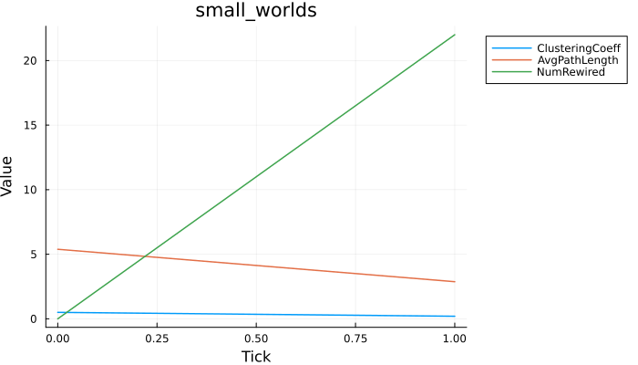
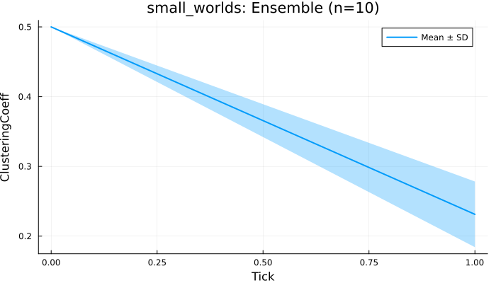
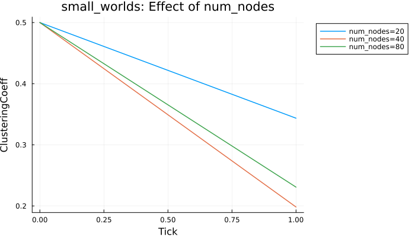

## Overview

### WHAT IS IT?

This model explores the formation of networks that result in the "small world" phenomenon -- the idea that a person is only a couple of connections away from any other person in the world.

A popular example of the small world phenomenon is the network formed by actors appearing in the same movie (e.g., "[Six Degrees of Kevin Bacon](https://en.wikipedia.org/wiki/Six_Degrees_of_Kevin_Bacon)"), but small worlds are not limited to people-only networks. Other examples range from power grids to the neural networks of worms. This model illustrates some general, theoretical conditions under which small world networks between people or things might occur.

### HOW IT WORKS

This model is an adaptation of the [Watts-Strogatz model](https://en.wikipedia.org/wiki/Watts-Strogatz_model) proposed by Duncan Watts and Steve Strogatz (1998). It begins with a network where each person (or "node") is connected to his or her two neighbors on either side. Using this a base, we then modify the network by rewiring nodes–changing one end of a connected pair of nodes and keeping the other end the same. Over time, we analyze the effect this rewiring has the on various connections between nodes and on the properties of the network.

Particularly, we're interested in identifying "small worlds." To identify small worlds, the "average path length" (abbreviated "apl") and "clustering coefficient" (abbreviated "cc") of the network are calculated and plotted after a rewiring is performed. Networks with _short_ average path lengths and _high_ clustering coefficients are considered small world networks. See the **Statistics** section of HOW TO USE IT on how these are calculated.

### THINGS TO NOTICE

Note that for certain ranges of the fraction of nodes rewired, the average path length decreases faster than the clustering coefficient. In fact, there is a range of values for which the average path length is much smaller than clustering coefficient. (Note that the values for average path length and clustering coefficient have been normalized, so that they are more directly comparable.) Networks in that range are considered small worlds.

### THINGS TO TRY

Can you get a small world by repeatedly pressing REWIRE-ONE?

Try plotting the values for different rewiring probabilities and observe the trends of the values for average path length and clustering coefficient.  What is the relationship between rewiring probability and fraction of nodes? In other words, what is the relationship between the rewire-one plot and the rewire-all plot?

Do the trends depend on the number of nodes in the network?

Set NUM-NODES to 80 and then press SETUP. Go to BehaviorSpace and run the VARY-REWIRING-PROBABILITY experiment. Try running the experiment multiple times without clearing the plot (i.e., do not run SETUP again).  What range of rewiring probabilities result in small world networks?

### EXTENDING THE MODEL

Try to see if you can produce the same results if you start with a different type of initial network. Create new BehaviorSpace experiments to compare results.

In a precursor to this model, Watts and Strogatz created an "alpha" model where the rewiring was not based on a global rewiring probability. Instead, the probability that a node got connected to another node depended on how many mutual connections the two nodes had. The extent to which mutual connections mattered was determined by the parameter "alpha." Create the "alpha" model and see if it also can result in small world formation.

### NETLOGO FEATURES

Links are used extensively in this model to model the edges of the network. The model also uses custom link shapes for neighbor's neighbor links.

Lists are used heavily in the procedures that calculates shortest paths.

### RELATED MODELS

See other models in the Networks section of the Models Library, such as Giant Component and Preferential Attachment.

Check out the NW Extension General Examples model to see how similar models might implemented using the built-in NW extension.

### CREDITS AND REFERENCES

This model is adapted from: Duncan J. Watts, Six Degrees: The Science of a Connected Age (W.W. Norton & Company, New York, 2003), pages 83-100.

The work described here was originally published in: DJ Watts and SH Strogatz. Collective dynamics of 'small-world' networks, Nature, 393:440-442 (1998).

The small worlds idea was first made popular by Stanley Milgram's famous experiment (1967) which found that two random US citizens where on average connected by six acquaintances (giving rise to the popular "six degrees of separation" expression): Stanley Milgram. The Small World Problem, Psychology Today, 2: 60-67 (1967).

This experiment was popularized into a game called "six degrees of Kevin Bacon" which you can find more information about here: https://oracleofbacon.org

Thanks to Connor Bain for updating this model in 2020.

### HOW TO CITE

If you mention this model or the NetLogo software in a publication, we ask that you include the citations below.

For the model itself:

* Wilensky, U. (2015).  NetLogo Small Worlds model.  http://ccl.northwestern.edu/netlogo/models/SmallWorlds.  Center for Connected Learning and Computer-Based Modeling, Northwestern University, Evanston, IL.

Please cite the NetLogo software as:

* Wilensky, U. (1999). NetLogo. http://ccl.northwestern.edu/netlogo/. Center for Connected Learning and Computer-Based Modeling, Northwestern University, Evanston, IL.

### COPYRIGHT AND LICENSE

Copyright 2015 Uri Wilensky.


This model is licensed under the Creative Commons Attribution-NonCommercial-ShareAlike 3.0 License.  To view a copy of this license, visit https://creativecommons.org/licenses/by-nc-sa/3.0/ or send a letter to Creative Commons, 559 Nathan Abbott Way, Stanford, California 94305, USA.

NetLogo itself is free software for non-commercial use under the terms of the GNU General Public License ([see full license information here](https://ccl.northwestern.edu/netlogo/docs/copyright.html)).

To inquire about commercial licenses for either NetLogo or specific models from the models library, please contact netlogo-commercial-admin@ccl.northwestern.edu.

<!-- 2015 -->

## Parameters

| Parameter | Type | Default | Description |
|-----------|------|---------|-------------|
| `num_nodes` | `Int` | `40` | num nodes |
| `rewiring_probability` | `Float64` | `0.3` | rewiring probability |
| `max_ticks` | `Int` | `1` | rewire-all is a single operation |

## Source Code

The Julia code to run this model:

```julia
using ArkModelZoo
_, trajectory = run_small_worlds()
```

## Time Series

{width=100%}

## Ensemble Runs

Ten replicates with different random seeds, showing mean ± standard deviation.

{width=100%}

## Parameter Sensitivity

Varying `num_nodes`.

{width=100%}


## Appendix: Source Code

This model is implemented in the [Ark.jl](https://github.com/sdwfrost/Ark.jl) Entity-Component-System (ECS) framework. The code is split into five files, each with a distinct role:

- **Parameters**: a mutable struct holding all configurable values.
- **Components**: lightweight data types attached to individual entities (agents).
- **Resources**: world-level shared state accessible to all systems.
- **Systems**: functions that operate on entities each tick, defining model behavior.
- **Model**: wiring that assembles the world, registers resources and systems, and provides the run entry point.

### Parameters (`parameters.jl`)

The parameter struct uses `@kwdef` so that every field has a default value and can be overridden by keyword. These defaults match the original NetLogo model's slider settings.

```julia
Base.@kwdef mutable struct SWParams
    num_nodes::Int = 40
    rewiring_probability::Float64 = 0.3
    max_ticks::Int = 1          # rewire-all is a single operation
    seed::Int = 42
end
```

### Components (`components.jl`)

Components are lightweight data types attached to individual entities (agents). Mutable structs hold per-entity state, while empty tag structs act as markers for the ECS query system to efficiently filter entities.

```julia
mutable struct SWNode
    node_id::Int
end
SWNode() = SWNode(0)
```

### Resources (`resources.jl`)

Resources are world-level singletons shared across all systems, used for global state and aggregate statistics.

```julia
mutable struct SWNetwork
    graph::NwGraph
    node_to_entity::Vector{Entity}
end
SWNetwork() = SWNetwork(NwGraph(), Entity[])

mutable struct SWStats
    clustering_coefficient::Float64
    average_path_length::Float64
    clustering_coefficient_of_lattice::Float64
    average_path_length_of_lattice::Float64
    number_rewired::Int
end
SWStats() = SWStats(0.0, 0.0, 0.0, 0.0, 0)
```

### Systems (`systems.jl`)

Systems contain the model logic and execute in a defined order each tick. Each system struct implements either `initialize!` (run once at setup) or `update!` (run every tick).

```julia
struct InitSWSystem <: System end

function _sw_is_connected(g::NwGraph)
    g.n <= 1 && return true
    comps = nw_connected_components(g)
    return length(comps) == 1
end

function initialize!(::InitSWSystem, world::World)
    params = get_resource(world, SWParams)
    rng = get_resource(world, RNGResource).rng
    net = get_resource(world, SWNetwork)
    stats = get_resource(world, SWStats)
    n = params.num_nodes

    # Create entities
    net.node_to_entity = Vector{Entity}(undef, n)
    for i in 1:n
        eid = new_entity!(world, (SWNode(i),))
        net.node_to_entity[i] = eid
    end

    # Build ring lattice with k=4 (each node connected to next 2 neighbors)
    g = NwGraph(n)
    for i in 1:n
        for d in 1:2
            j = mod1(i + d, n)
            nw_add_edge!(g, i, j)
        end
    end
    net.graph = g

    # Calculate lattice properties
    stats.clustering_coefficient_of_lattice = nw_mean_clustering_coefficient(g)
    stats.average_path_length_of_lattice = nw_mean_path_length(g)
    stats.clustering_coefficient = stats.clustering_coefficient_of_lattice
    stats.average_path_length = stats.average_path_length_of_lattice
    stats.number_rewired = 0

    return nothing
end

struct SWRewireSystem <: System end

function update!(::SWRewireSystem, world::World)
    params = get_resource(world, SWParams)
    rng = get_resource(world, RNGResource).rng
    net = get_resource(world, SWNetwork)
    stats = get_resource(world, SWStats)
    n = params.num_nodes

    # Rewire-all: try until we get a connected network
    for _attempt in 1:100
        # Start from fresh ring lattice
        g = NwGraph(n)
        for i in 1:n
            for d in 1:2
                j = mod1(i + d, n)
                nw_add_edge!(g, i, j)
            end
        end

        num_rewired = 0
        # Collect all original edges
        edges = Tuple{Int,Int}[]
        for i in 1:n
            for d in 1:2
                j = mod1(i + d, n)
                push!(edges, (i, j))
            end
        end

        for (node1, old_j) in edges
            rand(rng) >= params.rewiring_probability && continue
            nw_degree(g, node1) >= n - 1 && continue
            # Find a new target
            node2 = rand(rng, 1:n)
            attempts = 0
            while (node2 == node1 || nw_has_edge(g, node1, node2)) && attempts < 100
                node2 = rand(rng, 1:n)
                attempts += 1
            end
            attempts >= 100 && continue
            # Rewire
            if nw_has_edge(g, node1, old_j)
                nw_remove_edge!(g, node1, old_j)
                nw_add_edge!(g, node1, node2)
                num_rewired += 1
            end
        end

        if _sw_is_connected(g)
            net.graph = g
            stats.number_rewired = num_rewired
            stats.clustering_coefficient = nw_mean_clustering_coefficient(g)
            stats.average_path_length = nw_mean_path_length(g)
            return nothing
        end
    end
    # Fallback: keep original lattice
    return nothing
end

struct SWTerminationSystem <: System end

function update!(::SWTerminationSystem, world::World)
    params = get_resource(world, SWParams)
    tick = get_resource(world, Tick)
    if tick.tick + 1 >= params.max_ticks
        get_resource(world, Terminate).stop = true
    end
    return nothing
end
```

### Model (`model.jl`)

The model file assembles all pieces: it creates the ECS `World` with the required component types, registers resources, builds the `Scheduler` with systems in execution order, and exposes the public `run` entry point. The observer pattern records the trajectory each tick.

```julia
function sw_world(; initial_capacity::Int = 256)
    return World(SWNode; initial_capacity = initial_capacity, allow_mutable = true)
end

function sw_systems()
    return (InitSWSystem(), SWRewireSystem(), SWTerminationSystem())
end

function sw_model(params::SWParams = SWParams())
    world = sw_world()
    _add_standard_resources!(world, params)
    add_resource!(world, SWNetwork())
    add_resource!(world, SWStats())
    scheduler = Scheduler(world, sw_systems())
    initialize!(scheduler)
    return scheduler
end

struct SWObserver end

function sw_headers(::SWObserver)
    return ["ClusteringCoeff", "AvgPathLength", "NumRewired"]
end

function sw_values(::SWObserver, world::World)
    stats = get_resource(world, SWStats)
    return Float64[stats.clustering_coefficient, stats.average_path_length,
                    Float64(stats.number_rewired)]
end

function run_small_worlds(; params::SWParams = SWParams(), observe::Bool = true)
    return _run_model(sw_model, SWObserver(), sw_values; params, observe)
end
```
