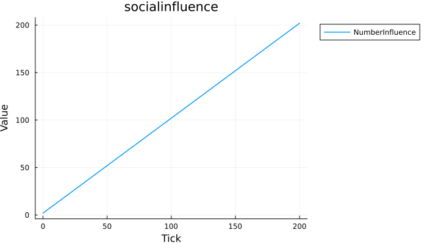
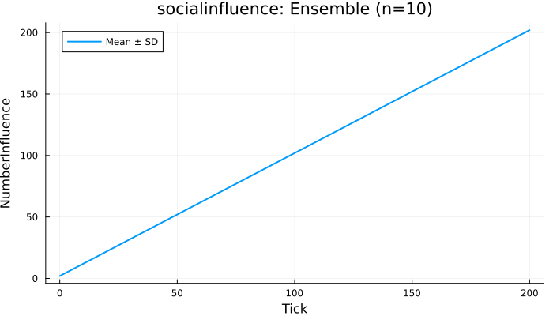

## Overview

### WHAT IS IT?

In some networks, a few "hubs" have lots of connections, while everybody else only has a few. New network members prefer to make a connection to the more popular existing members.

Such networks can be found in a surprisingly large range of real world situations, ranging from the connections between websites to the collaborations between actors.

In some other networks, actors prefer to connect to similar actors to onself.

Such networks can be found in a surprisingly large range of real world situations as well, ranging from the connections between friends, collaborations, to hyperlink networks.

This model generates these networks by a process of "preferential attachment" and "homophily" at the same time, testing whether preferential attachment and homophily mechanism work more dominant.

### HOW IT WORKS

The model starts with two nodes connected by an edge.

At each step, a new node is added.  A new node picks an existing node to connect to.

More specifically, a node's chance of being selected is directly proportional to the number of connections it already has, or its "degree." This is the mechanism which is called "preferential attachment."

Alternatively, there is a homophily mechanism.That is, a new node picks an existing node to connect to, which has the same color with the new node.

Depending on the probability whether preferential attachment is higher or homophily is higher, each links picks different new nodes from different mechanisms. If the probability of preferential attachment is higher, the actor has a higher probability to pick an existing popular node with high degrees, and the link between us is green. If the probability of homophily is higher, the actor has a higher probability to pick an existing similar node with the same color, then the link is set to be yellow

### THINGS TO NOTICE

The networks that result from running this model are often called "scale-free" or "power law" networks. These are networks in which the distribution of the number of connections of each node is not a normal distribution --- instead it follows what is a called a power law distribution.  Power law distributions are different from normal distributions in that they do not have a peak at the average, and they are more likely to contain extreme values (see Albert & Barabási 2002 for a further description of the frequency and significance of scale-free networks).  Barabási and Albert originally described this mechanism for creating networks, but there are other mechanisms of creating scale-free networks and so the networks created by the mechanism implemented in this model are referred to as Barabási scale-free networks.

You can see the degree distribution of the network in this model by looking at the plots. The top plot is a histogram of the degree of each node.  The bottom plot shows the same data, but both axes are on a logarithmic scale.  When degree distribution follows a power law, it appears as a straight line on the log-log plot.  One simple way to think about power laws is that if there is one node with a degree distribution of 1000, then there will be ten nodes with a degree distribution of 100, and 100 nodes with a degree distribution of 10.

### THINGS TO TRY

Let the model run a little while.  How many nodes are "hubs", that is, have many connections?  How many have only a few?  Does some low degree node ever become a hub?  How often?

Turn off the LAYOUT? switch and freeze the view to speed up the model, then allow a large network to form.  What is the shape of the histogram in the top plot?  What do you see in log-log plot? Notice that the log-log plot is only a straight line for a limited range of values.  Why is this?  Does the degree to which the log-log plot resembles a straight line grow as you add more nodes to the network?

### EXTENDING THE MODEL

Assign an additional attribute to each node.  Make the probability of attachment depend on this new attribute as well as on degree.  (A bias slider could control how much the attribute influences the decision.)

Can the layout algorithm be improved?  Perhaps nodes from different hubs could repel each other more strongly than nodes from the same hub, in order to encourage the hubs to be physically separate in the layout.

### NETLOGO FEATURES

Nodes are turtle agents and edges are link agents. The model uses the ONE-OF primitive to chose a random link and the BOTH-ENDS primitive to select the two nodes attached to that link.

The `layout-spring` primitive places the nodes, as if the edges are springs and the nodes are repelling each other.

Though it is not used in this model, there exists a network extension for NetLogo that comes bundled with NetLogo, that has many more network primitives.

### RELATED MODELS

See other models in the Networks section of the Models Library, such as Giant Component.

See also Network Example, in the Code Examples section.

### CREDITS AND REFERENCES

This model is based on:  
Albert-László Barabási. Linked: The New Science of Networks, Perseus Publishing, Cambridge, Massachusetts, pages 79-92.

For a more technical treatment, see:  
Albert-László Barabási & Reka Albert. Emergence of Scaling in Random Networks, Science, Vol 286, Issue 5439, 15 October 1999, pages 509-512.

Barabási's webpage has additional information at: http://www.nd.edu/~alb/

The layout algorithm is based on the Fruchterman-Reingold layout algorithm.  More information about this algorithm can be obtained at: http://citeseer.ist.psu.edu/fruchterman91graph.html.

For a model similar to the one described in the first suggested extension, please consult:  
W. Brian Arthur, "Urban Systems and Historical Path-Dependence", Chapt. 4 in Urban systems and Infrastructure, J. Ausubel and R. Herman (eds.), National Academy of Sciences, Washington, D.C., 1988.

### HOW TO CITE

If you mention this model in a publication, we ask that you include these citations for the model itself and for the NetLogo software:

* Wilensky, U. (2005).  NetLogo Preferential Attachment model.  http://ccl.northwestern.edu/netlogo/models/PreferentialAttachment.  Center for Connected Learning and Computer-Based Modeling, Northwestern University, Evanston, IL.
* Wilensky, U. (1999). NetLogo. http://ccl.northwestern.edu/netlogo/. Center for Connected Learning and Computer-Based Modeling, Northwestern University, Evanston, IL.

### COPYRIGHT AND LICENSE

Copyright 2005 Uri Wilensky.


This work is licensed under the Creative Commons Attribution-NonCommercial-ShareAlike 3.0 License.  To view a copy of this license, visit http://creativecommons.org/licenses/by-nc-sa/3.0/ or send a letter to Creative Commons, 559 Nathan Abbott Way, Stanford, California 94305, USA.

Commercial licenses are also available. To inquire about commercial licenses, please contact Uri Wilensky at uri@northwestern.edu.

## Parameters

| Parameter | Type | Default | Description |
|-----------|------|---------|-------------|
| `max_ticks` | `Int` | `200` | max ticks |

## Source Code

The Julia code to run this model:

```julia
using ArkModelZoo
_, trajectory = run_socialinfluence()
```

## Time Series

{width=100%}

## Ensemble Runs

Ten replicates with different random seeds, showing mean ± standard deviation.

{width=100%}


## Appendix: Source Code

This model is implemented in the [Ark.jl](https://github.com/sdwfrost/Ark.jl) Entity-Component-System (ECS) framework. The code is split into five files, each with a distinct role:

- **Parameters**: a mutable struct holding all configurable values.
- **Components**: lightweight data types attached to individual entities (agents).
- **Resources**: world-level shared state accessible to all systems.
- **Systems**: functions that operate on entities each tick, defining model behavior.
- **Model**: wiring that assembles the world, registers resources and systems, and provides the run entry point.

### Parameters (`parameters.jl`)

The parameter struct uses `@kwdef` so that every field has a default value and can be overridden by keyword. These defaults match the original NetLogo model's slider settings.

```julia
Base.@kwdef mutable struct SInflParams
    max_ticks::Int = 200
    seed::Int = 42
end
```

### Components (`components.jl`)

Components are lightweight data types attached to individual entities (agents). Mutable structs hold per-entity state, while empty tag structs act as markers for the ECS query system to efficiently filter entities.

```julia
struct SInflDummy end
```

### Resources (`resources.jl`)

Resources are world-level singletons shared across all systems, used for global state and aggregate statistics.

```julia
mutable struct SInflState
    n_agents::Int
    colors::Vector{Int}  # 1=yellow, 2=green
    adj::Vector{Set{Int}}
end

function SInflState()
    SInflState(0, Int[], Set{Int}[])
end

function _sinfl_add_agent!(state::SInflState, color::Int)
    push!(state.colors, color)
    push!(state.adj, Set{Int}())
    state.n_agents += 1
    return state.n_agents
end

mutable struct SInflStats
    number_influence::Int
end
SInflStats() = SInflStats(0)
```

### Systems (`systems.jl`)

Systems contain the model logic and execute in a defined order each tick. Each system struct implements either `initialize!` (run once at setup) or `update!` (run every tick).

```julia
struct InitSInflSystem <: System end

function initialize!(::InitSInflSystem, world::World)
    rng = get_resource(world, RNGResource).rng
    state = get_resource(world, SInflState)
    stats = get_resource(world, SInflStats)

    # First node: random color
    color1 = rand(rng, 1:2)
    _sinfl_add_agent!(state, color1)
    stats.number_influence += 1

    # Second node: linked to first, adopts first's color
    _sinfl_add_agent!(state, color1)
    push!(state.adj[1], 2)
    push!(state.adj[2], 1)
    stats.number_influence += 1
    return nothing
end

struct SInflGoSystem <: System end

function update!(::SInflGoSystem, world::World)
    rng = get_resource(world, RNGResource).rng
    state = get_resource(world, SInflState)
    stats = get_resource(world, SInflStats)

    # Find partner: one-of turtles (uniform random)
    partner = rand(rng, 1:state.n_agents)

    # Create new node with random color
    color = rand(rng, 1:2)
    new_id = _sinfl_add_agent!(state, color)

    # Link to partner, adopt partner's color
    push!(state.adj[new_id], partner)
    push!(state.adj[partner], new_id)
    state.colors[new_id] = state.colors[partner]

    stats.number_influence += 1
    return nothing
end

struct SInflTerminationSystem <: System end

function update!(::SInflTerminationSystem, world::World)
    params = get_resource(world, SInflParams)
    tick = get_resource(world, Tick)
    if tick.tick + 1 >= params.max_ticks
        get_resource(world, Terminate).stop = true
    end
    return nothing
end
```

### Model (`model.jl`)

The model file assembles all pieces: it creates the ECS `World` with the required component types, registers resources, builds the `Scheduler` with systems in execution order, and exposes the public `run` entry point. The observer pattern records the trajectory each tick.

```julia
function socialinfluence_world(; initial_capacity::Int = 128)
    return World(SInflDummy; initial_capacity = initial_capacity, allow_mutable = true)
end

function socialinfluence_systems()
    return (InitSInflSystem(), SInflGoSystem(), SInflTerminationSystem())
end

function socialinfluence_model(params::SInflParams = SInflParams())
    world = socialinfluence_world()
    _add_standard_resources!(world, params)
    add_resource!(world, SInflState())
    add_resource!(world, SInflStats())
    scheduler = Scheduler(world, socialinfluence_systems())
    initialize!(scheduler)
    return scheduler
end

struct SInflObserver end

function socialinfluence_headers(::SInflObserver)
    return ["NumberInfluence"]
end

function socialinfluence_values(::SInflObserver, world::World)
    stats = get_resource(world, SInflStats)
    return Float64[stats.number_influence]
end

function run_socialinfluence(; params::SInflParams = SInflParams(), observe::Bool = true)
    return _run_model(socialinfluence_model, SInflObserver(), socialinfluence_values; params, observe)
end
```
