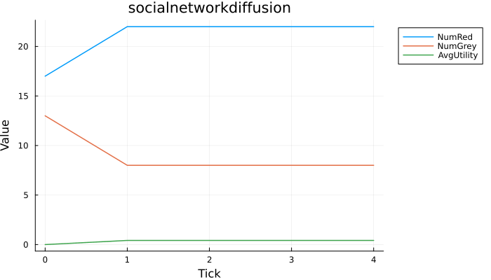
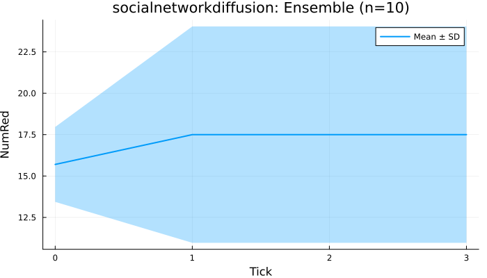
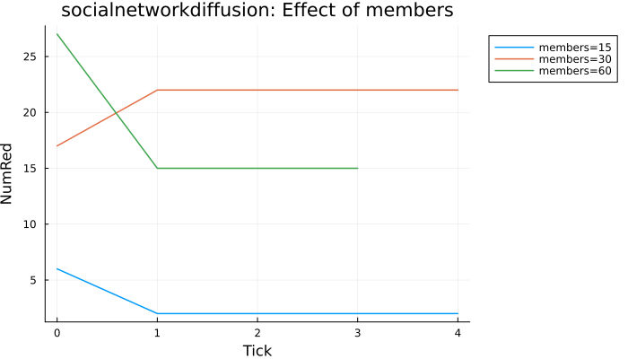

# Social Network Diffusion


- [Overview](#overview)
- [Parameters](#parameters)
- [Source Code](#source-code)
- [Time Series](#time-series)
- [Ensemble Runs](#ensemble-runs)
- [Parameter Sensitivity](#parameter-sensitivity)
- [Appendix: Source Code](#appendix-source-code)
  - [Parameters (`parameters.jl`)](#parameters-parametersjl)
  - [Components (`components.jl`)](#components-componentsjl)
  - [Resources (`resources.jl`)](#resources-resourcesjl)
  - [Systems (`systems.jl`)](#systems-systemsjl)
  - [Model (`model.jl`)](#model-modeljl)

## Overview

This vignette demonstrates the **Social Network Diffusion** model
implemented in
[ArkModelZoo.jl](https://github.com/sdwfrost/ArkModelZoo.jl) using the
Ark.jl ECS framework.

## Parameters

| Parameter   | Type      | Default | Description |
|-------------|-----------|---------|-------------|
| `members`   | `Int`     | `30`    | members     |
| `threshold` | `Float64` | `0.5`   | threshold   |
| `max_ticks` | `Int`     | `20`    | max ticks   |

## Source Code

The Julia code to run this model:

``` julia
using ArkModelZoo
_, trajectory = run_socialnetworkdiffusion()
```

## Time Series



## Ensemble Runs

Ten replicates with different random seeds, showing mean ± standard
deviation.



## Parameter Sensitivity

Varying `members`.



## Appendix: Source Code

This model is implemented in the
[Ark.jl](https://github.com/sdwfrost/Ark.jl) Entity-Component-System
(ECS) framework. The code is split into five files, each with a distinct
role:

- **Parameters**: a mutable struct holding all configurable values.
- **Components**: lightweight data types attached to individual entities
  (agents).
- **Resources**: world-level shared state accessible to all systems.
- **Systems**: functions that operate on entities each tick, defining
  model behavior.
- **Model**: wiring that assembles the world, registers resources and
  systems, and provides the run entry point.

### Parameters (`parameters.jl`)

The parameter struct uses `@kwdef` so that every field has a default
value and can be overridden by keyword. These defaults match the
original NetLogo model’s slider settings.

``` julia
Base.@kwdef mutable struct SocialNetDiffParams
    members::Int = 30
    threshold::Float64 = 0.5
    max_ticks::Int = 20
    seed::Int = 42
end
```

### Components (`components.jl`)

Components are lightweight data types attached to individual entities
(agents). Mutable structs hold per-entity state, while empty tag structs
act as markers for the ECS query system to efficiently filter entities.

``` julia
struct SNDDummy end
```

### Resources (`resources.jl`)

Resources are world-level singletons shared across all systems, used for
global state and aggregate statistics.

``` julia
# Directed network for social belief diffusion with weighted links
mutable struct SNDNetwork
    n::Int
    in_links::Vector{Vector{Int}}
    weights::Dict{Tuple{Int,Int},Float64}
    p::Vector{Int}           # 1=red, -1=grey
    oldsum::Vector{Float64}
    utility::Vector{Float64}
end

function SNDNetwork()
    SNDNetwork(0, Vector{Int}[], Dict{Tuple{Int,Int},Float64}(), Int[], Float64[], Float64[])
end

mutable struct SNDStats
    num_red::Int
    num_grey::Int
    avg_utility::Float64
end
SNDStats() = SNDStats(0, 0, 0.0)
```

### Systems (`systems.jl`)

Systems contain the model logic and execute in a defined order each
tick. Each system struct implements either `initialize!` (run once at
setup) or `update!` (run every tick).

``` julia
# Social Network Diffusion
# Directed BA network; belief diffusion with utility tracking

struct InitSNDSystem <: System end

function _snd_build_directed_ba!(net::SNDNetwork, rng, n::Int, m::Int)
    net.n = n
    resize!(net.in_links, n)
    resize!(net.p, n)
    resize!(net.oldsum, n)
    resize!(net.utility, n)
    for i in 1:n
        net.in_links[i] = Int[]
        net.p[i] = 0
        net.oldsum[i] = 0.0
        net.utility[i] = 0.0
    end

    init = min(m + 1, n)
    for i in 1:init, j in 1:init
        i == j && continue
        push!(net.in_links[j], i)
        net.weights[(i, j)] = round(rand(rng) * 1000) / 1000
    end

    degree = zeros(Int, n)
    for j in 1:init
        degree[j] = length(net.in_links[j])
    end
    for i in (init+1):n
        total_degree = sum(degree[1:i-1])
        total_degree == 0 && continue
        targets = Set{Int}()
        attempts = 0
        while length(targets) < min(m, i-1) && attempts < 10000
            attempts += 1
            r = rand(rng) * total_degree
            cumulative = 0.0
            for j in 1:(i-1)
                cumulative += degree[j]
                if cumulative >= r
                    push!(targets, j)
                    break
                end
            end
        end
        for t in targets
            push!(net.in_links[i], t)
            net.weights[(t, i)] = round(rand(rng) * 1000) / 1000
            degree[t] += 1
            degree[i] += 1
        end
    end
end

function _snd_update_stats!(net::SNDNetwork, stats::SNDStats)
    stats.num_red = count(==(1), net.p)
    stats.num_grey = count(==(-1), net.p)
    if net.n > 0
        stats.avg_utility = sum(net.utility) / net.n
    else
        stats.avg_utility = 0.0
    end
end

function initialize!(::InitSNDSystem, world::World)
    params = get_resource(world, SocialNetDiffParams)
    rng = get_resource(world, RNGResource).rng
    net = get_resource(world, SNDNetwork)
    stats = get_resource(world, SNDStats)

    _snd_build_directed_ba!(net, rng, params.members, 1)

    for i in 1:net.n
        if rand(rng, 0:1) == 1
            net.p[i] = 1
        else
            net.p[i] = -1
        end
    end

    _snd_update_stats!(net, stats)
    return nothing
end

struct SNDGoSystem <: System
    changing::Base.RefValue{Bool}
end
SNDGoSystem() = SNDGoSystem(Ref(true))

function update!(sys::SNDGoSystem, world::World)
    params = get_resource(world, SocialNetDiffParams)
    rng = get_resource(world, RNGResource).rng
    net = get_resource(world, SNDNetwork)
    stats = get_resource(world, SNDStats)
    tick = get_resource(world, Tick)

    if !sys.changing[]
        get_resource(world, Terminate).stop = true
        return nothing
    end

    # NetLogo: if ticks > 20 [stop]
    if tick.tick > params.max_ticks
        get_resource(world, Terminate).stop = true
        return nothing
    end

    sys.changing[] = false

    for i in 1:net.n
        summer = 0.0
        for j in net.in_links[i]
            w = get(net.weights, (j, i), 0.0)
            summer += w * net.p[j]
        end
        old = round(net.oldsum[i]; digits=3)
        summer = round(summer; digits=3)
        if old != summer
            sys.changing[] = true
        end
        net.oldsum[i] = summer

        if summer > params.threshold
            net.p[i] = 1
        elseif summer < -params.threshold
            net.p[i] = -1
        end
    end

    # Compute utility
    for i in 1:net.n
        if isempty(net.in_links[i])
            net.utility[i] = Float64(net.p[i])
        else
            max_alt = -Inf
            for j in net.in_links[i]
                w = get(net.weights, (j, i), 0.0)
                alt = w * net.p[j]
                if alt > max_alt
                    max_alt = alt
                end
            end
            net.utility[i] = max_alt
        end
    end

    _snd_update_stats!(net, stats)
    return nothing
end

struct SNDTerminationSystem <: System end

function update!(::SNDTerminationSystem, world::World)
    params = get_resource(world, SocialNetDiffParams)
    tick = get_resource(world, Tick)
    if tick.tick + 1 >= params.max_ticks
        get_resource(world, Terminate).stop = true
    end
    return nothing
end
```

### Model (`model.jl`)

The model file assembles all pieces: it creates the ECS `World` with the
required component types, registers resources, builds the `Scheduler`
with systems in execution order, and exposes the public `run` entry
point. The observer pattern records the trajectory each tick.

``` julia
function socialnetworkdiffusion_world(; initial_capacity::Int = 128)
    return World(SNDDummy; initial_capacity = initial_capacity, allow_mutable = true)
end

function socialnetworkdiffusion_systems()
    return (InitSNDSystem(), SNDGoSystem(), SNDTerminationSystem())
end

function socialnetworkdiffusion_model(params::SocialNetDiffParams = SocialNetDiffParams())
    world = socialnetworkdiffusion_world()
    _add_standard_resources!(world, params)
    add_resource!(world, SNDNetwork())
    add_resource!(world, SNDStats())
    scheduler = Scheduler(world, socialnetworkdiffusion_systems())
    initialize!(scheduler)
    return scheduler
end

struct SNDObserver end

function socialnetworkdiffusion_headers(::SNDObserver)
    return ["NumRed", "NumGrey", "AvgUtility"]
end

function socialnetworkdiffusion_values(::SNDObserver, world::World)
    stats = get_resource(world, SNDStats)
    return Float64[stats.num_red, stats.num_grey, stats.avg_utility]
end

function run_socialnetworkdiffusion(; params::SocialNetDiffParams = SocialNetDiffParams(), observe::Bool = true)
    return _run_model(socialnetworkdiffusion_model, SNDObserver(), socialnetworkdiffusion_values; params, observe)
end
```
