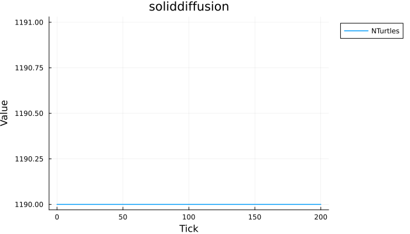
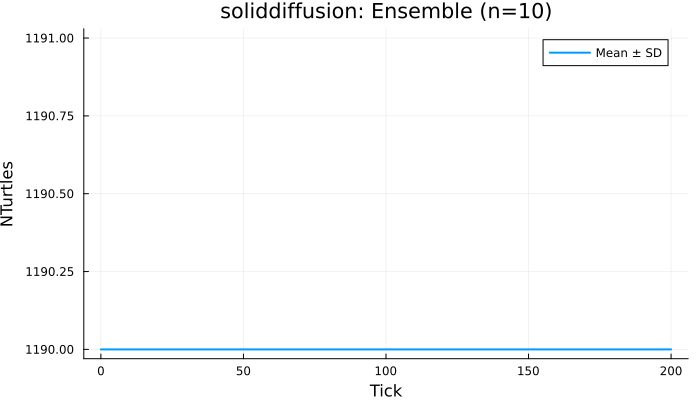

# Solid Diffusion


- [Overview](#overview)
  - [WHAT IS IT?](#what-is-it)
  - [HOW IT WORKS](#how-it-works)
  - [THINGS TO NOTICE](#things-to-notice)
  - [THINGS TO TRY](#things-to-try)
  - [EXTENDING THE MODEL](#extending-the-model)
  - [NETLOGO FEATURES](#netlogo-features)
  - [RELATED MODELS](#related-models)
  - [CREDITS AND REFERENCES](#credits-and-references)
  - [HOW TO CITE](#how-to-cite)
  - [COPYRIGHT AND LICENSE](#copyright-and-license)
- [Parameters](#parameters)
- [Source Code](#source-code)
- [Time Series](#time-series)
- [Ensemble Runs](#ensemble-runs)
- [Appendix: Source Code](#appendix-source-code)
  - [Parameters (`parameters.jl`)](#parameters-parametersjl)
  - [Components (`components.jl`)](#components-componentsjl)
  - [Resources (`resources.jl`)](#resources-resourcesjl)
  - [Systems (`systems.jl`)](#systems-systemsjl)
  - [Model (`model.jl`)](#model-modeljl)

## Overview

### WHAT IS IT?

This model describes how diffusion occurs between two adjacent solids.

Diffusion is one of the most important phenomena in fields such as
biology, chemistry, geology, chemistry, engineering and physics.
Interestingly, before becoming a famous for the Relativity Laws, Albert
Einstein wrote extensively about diffusion, and was one of the first to
connect diffusion to the Brownian motion of atoms.

Diffusion can take place in gases, liquids, or solids. In solids,
particularly, diffusion occurs due to thermally-activated random motion
of atoms - unless the material is at absolute zero temperature (zero
Kelvin), individual atoms keep vibrating and eventually move within the
material. One of the possible net effects of diffusion is that atoms
move from regions of high concentration of one element to regions with
low concentration, until the concentration is equal throughout the
sample.

This model demonstrates a solid diffusion couple, such as copper and
nickel. In a real laboratory, such experiment would take place at very
high temperatures, for the process to take place in a reasonable amount
of time (note that the diffusion coefficient varies exponentially with
the inverse of the temperature). There are many mechanisms for diffusion
in solids. In this model we demonstrate one of them, which is caused by
missing atoms in the metal crystal. The locations, of the missing atoms
are often called vacancies. Therefore, this type of diffusion mechanism
is referred to as “vacancy diffusion”. The extent to which the diffusion
can happen depends on the temperature and the number of vacancies in the
crystal.

In addition, there are various other conditions that are needed for
solid diffusion to occur. Some examples of these are similar atomic
size, similar crystal structure, and similar electronegativity. This
model assumes all of these conditions are present.

### HOW IT WORKS

There are two types of atoms, green and blue. At the beginning, all
green atoms are on the left and the blue atoms are on the right. All the
vacancies start out between the two metals. As atoms move into
vacancies, the vacancies disperse. In most real-world scenarios,
vacancies are scattered in the material to begin with. In this model,
for simplification purposes, we assume that the materials have no
vacancies in the beginning, and that all the vacancies start off in
between the two materials.

In this model we also assume that the heat is evenly distributed
throughout the metals. Therefore, each atom has an equal chance of
breaking bonds with its neighbors and moving to a vacancy.

### THINGS TO NOTICE

If you run the model for a few hundred ticks, the distribution graph
should look like two interleaving curves. The far edges remain purely
one color, while the middle is about 50-50.

The other graph should be generally linear. The “diffusion coefficient”
of the system is proportional to the slope, and can be easily calculated
using the above equation.

### THINGS TO TRY

Let the model run for a long time. (You can use the speed slider to make
the model run faster.) Do you think the metal will ever become
completely diffused?

Try increasing the dimensions of the world. Does the behavior change at
all?

### EXTENDING THE MODEL

The model uses a very simple initial state in which there is always
exactly one column of vacancies and they are all located in the middle.
Try adding settings that dictate how many vacancies there are and where
they start out.

Give the two metals, or the two sides of the world, different
characteristics. For example, a temperature difference could be
simulated by making atomic movements on one side happen less often than
on the other.

Try changing the crystal structure of the atoms. In close-packed atoms
in two dimensions, atoms actually have six neighbors (hexagonal) instead
of four (square).

### NETLOGO FEATURES

This model uses a non-wrapping world.

### RELATED MODELS

MaterialSim Grain Growth GasLab Two Gas

### CREDITS AND REFERENCES

Thanks to James Newell for his work on this model.

For additional information:

Porter, D.A., and Easterling, K.E., Phase Transformations in Metals and
Alloys, 2nd ed., Chapman & Hall, 1992

Shewmon, P.G., Diffusion in solids, 2nd ed., TMS, 1989

### HOW TO CITE

If you mention this model or the NetLogo software in a publication, we
ask that you include the citations below.

For the model itself:

- Wilensky, U. (2007). NetLogo Solid Diffusion model.
  http://ccl.northwestern.edu/netlogo/models/SolidDiffusion. Center for
  Connected Learning and Computer-Based Modeling, Northwestern
  University, Evanston, IL.

Please cite the NetLogo software as:

- Wilensky, U. (1999). NetLogo. http://ccl.northwestern.edu/netlogo/.
  Center for Connected Learning and Computer-Based Modeling,
  Northwestern University, Evanston, IL.

### COPYRIGHT AND LICENSE

Copyright 2007 Uri Wilensky.


This model is licensed under the Creative Commons
Attribution-NonCommercial-ShareAlike 3.0 License. To view a copy of this
license, visit https://creativecommons.org/licenses/by-nc-sa/3.0/ or
send a letter to Creative Commons, 559 Nathan Abbott Way, Stanford,
California 94305, USA.

NetLogo itself is free software for non-commercial use under the terms
of the GNU General Public License ([see full license information
here](https://ccl.northwestern.edu/netlogo/docs/copyright.html)).

To inquire about commercial licenses for either NetLogo or specific
models from the models library, please contact
netlogo-commercial-admin@ccl.northwestern.edu.

<!-- 2007 -->

## Parameters

| Parameter     | Type  | Default | Description |
|---------------|-------|---------|-------------|
| `grid_width`  | `Int` | `35`    | grid width  |
| `grid_height` | `Int` | `35`    | grid height |
| `max_ticks`   | `Int` | `200`   | max ticks   |

## Source Code

The Julia code to run this model:

``` julia
using ArkModelZoo
_, trajectory = run_soliddiffusion()
```

## Time Series



## Ensemble Runs

Ten replicates with different random seeds, showing mean ± standard
deviation.



## Appendix: Source Code

This model is implemented in the
[Ark.jl](https://github.com/sdwfrost/Ark.jl) Entity-Component-System
(ECS) framework. The code is split into five files, each with a distinct
role:

- **Parameters**: a mutable struct holding all configurable values.
- **Components**: lightweight data types attached to individual entities
  (agents).
- **Resources**: world-level shared state accessible to all systems.
- **Systems**: functions that operate on entities each tick, defining
  model behavior.
- **Model**: wiring that assembles the world, registers resources and
  systems, and provides the run entry point.

### Parameters (`parameters.jl`)

The parameter struct uses `@kwdef` so that every field has a default
value and can be overridden by keyword. These defaults match the
original NetLogo model’s slider settings.

``` julia
Base.@kwdef mutable struct SolidDiffusionParams
    grid_width::Int = 35
    grid_height::Int = 35
    max_ticks::Int = 200
    seed::Int = 42
end
```

### Components (`components.jl`)

Components are lightweight data types attached to individual entities
(agents). Mutable structs hold per-entity state, while empty tag structs
act as markers for the ECS query system to efficiently filter entities.

``` julia
struct SDDummy end
```

### Resources (`resources.jl`)

Resources are world-level singletons shared across all systems, used for
global state and aggregate statistics.

``` julia
mutable struct SDGrid
    width::Int
    height::Int
    cells::Matrix{Int}  # 0=empty, 1=green, 2=blue
end
SDGrid(w::Int, h::Int) = SDGrid(w, h, zeros(Int, w, h))

mutable struct SDStats
    n_turtles::Int
end
SDStats() = SDStats(0)
```

### Systems (`systems.jl`)

Systems contain the model logic and execute in a defined order each
tick. Each system struct implements either `initialize!` (run once at
setup) or `update!` (run every tick).

``` julia
# --- Initialization ---

struct InitSDSystem <: System end

function initialize!(::InitSDSystem, world::World)
    params = get_resource(world, SolidDiffusionParams)
    grid = get_resource(world, SDGrid)
    stats = get_resource(world, SDStats)
    w, h = grid.width, grid.height
    cx = (w + 1) ÷ 2  # center x = 18 for 35-wide grid

    n = 0
    for x in 1:w, y in 1:h
        pxcor = x - cx
        if pxcor < 0
            grid.cells[x, y] = 1  # green
            n += 1
        elseif pxcor > 0
            grid.cells[x, y] = 2  # blue
            n += 1
        else
            grid.cells[x, y] = 0  # empty (center column)
        end
    end
    stats.n_turtles = n
    return nothing
end

# --- Update ---

struct SDUpdateSystem <: System end

function update!(::SDUpdateSystem, world::World)
    rng = get_resource(world, RNGResource).rng
    grid = get_resource(world, SDGrid)
    stats = get_resource(world, SDStats)
    w, h = grid.width, grid.height
    cells = grid.cells

    # Iterate empty patches in random order
    perm = randperm(rng, w * h)
    for idx in perm
        y = (idx - 1) ÷ w + 1
        x = (idx - 1) % w + 1
        cells[x, y] != 0 && continue  # skip non-empty

        # Check Von Neumann neighbors (no wrapping)
        neighbors = Tuple{Int,Int}[]
        if x > 1 && cells[x-1, y] != 0
            push!(neighbors, (x-1, y))
        end
        if x < w && cells[x+1, y] != 0
            push!(neighbors, (x+1, y))
        end
        if y > 1 && cells[x, y-1] != 0
            push!(neighbors, (x, y-1))
        end
        if y < h && cells[x, y+1] != 0
            push!(neighbors, (x, y+1))
        end

        if !isempty(neighbors)
            # Pick random occupied neighbor
            nx, ny = neighbors[rand(rng, 1:length(neighbors))]
            # Move atom to empty patch
            cells[x, y] = cells[nx, ny]
            cells[nx, ny] = 0
        end
    end

    # Count turtles
    n = 0
    for i in eachindex(cells)
        if cells[i] != 0
            n += 1
        end
    end
    stats.n_turtles = n

    return nothing
end

# --- Termination ---

struct SDTerminationSystem <: System end

function update!(::SDTerminationSystem, world::World)
    params = get_resource(world, SolidDiffusionParams)
    tick = get_resource(world, Tick)
    if tick.tick + 1 >= params.max_ticks
        get_resource(world, Terminate).stop = true
    end
    return nothing
end
```

### Model (`model.jl`)

The model file assembles all pieces: it creates the ECS `World` with the
required component types, registers resources, builds the `Scheduler`
with systems in execution order, and exposes the public `run` entry
point. The observer pattern records the trajectory each tick.

``` julia
function soliddiffusion_world(; initial_capacity::Int = 128)
    return World(SDDummy; initial_capacity=initial_capacity, allow_mutable=true)
end

function soliddiffusion_systems()
    return (
        InitSDSystem(),
        SDUpdateSystem(),
        SDTerminationSystem(),
    )
end

function soliddiffusion_model(params::SolidDiffusionParams = SolidDiffusionParams())
    world = soliddiffusion_world()
    _add_standard_resources!(world, params)
    add_resource!(world, SDGrid(params.grid_width, params.grid_height))
    add_resource!(world, SDStats())
    scheduler = Scheduler(world, soliddiffusion_systems())
    initialize!(scheduler)
    return scheduler
end

struct SolidDiffusionObserver end

function soliddiffusion_headers(::SolidDiffusionObserver)
    return ["NTurtles"]
end

function soliddiffusion_values(::SolidDiffusionObserver, world::World)
    stats = get_resource(world, SDStats)
    return Float64[stats.n_turtles]
end

function run_soliddiffusion(; params::SolidDiffusionParams = SolidDiffusionParams(), observe::Bool = true)
    return _run_model(soliddiffusion_model, SolidDiffusionObserver(), soliddiffusion_values; params, observe)
end
```
