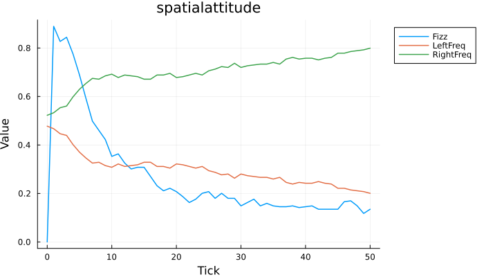
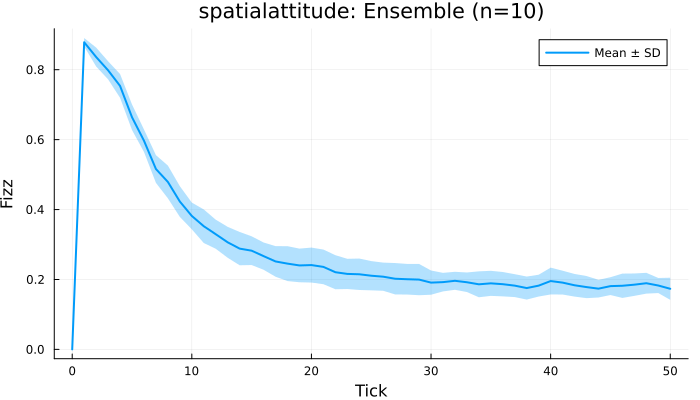
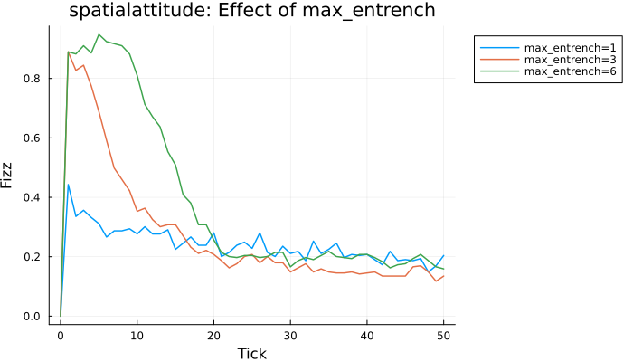

## Overview

This vignette demonstrates the **Spatial Attitude** model implemented in [ArkModelZoo.jl](https://github.com/sdwfrost/ArkModelZoo.jl) using the Ark.jl ECS framework.

## Parameters

| Parameter | Type | Default | Description |
|-----------|------|---------|-------------|
| `influence` | `String` | `"linear"` | influence |
| `max_entrench` | `Int` | `3` | max entrench |
| `init_attitude` | `Int` | `2` | init attitude |
| `opinion_amplification` | `Float64` | `0.5` | opinion amplification |
| `rnd_initial` | `Bool` | `true` | rnd initial |
| `positive_to_negative_ratio` | `Float64` | `0.5` | positive to negative ratio |
| `radius_size` | `Int` | `20` | radius size |
| `grid_xmin` | `Int` | `-8` | grid xmin |
| `grid_xmax` | `Int` | `8` | grid xmax |
| `grid_ymin` | `Int` | `-8` | grid ymin |
| `grid_ymax` | `Int` | `8` | grid ymax |
| `max_ticks` | `Int` | `50` | max ticks |

## Source Code

The Julia code to run this model:

```julia
using ArkModelZoo
_, trajectory = run_spatialattitude()
```

## Time Series

{width=100%}

## Ensemble Runs

Ten replicates with different random seeds, showing mean ± standard deviation.

{width=100%}

## Parameter Sensitivity

Varying `max_entrench`.

{width=100%}


## Appendix: Source Code

This model is implemented in the [Ark.jl](https://github.com/sdwfrost/Ark.jl) Entity-Component-System (ECS) framework. The code is split into five files, each with a distinct role:

- **Parameters**: a mutable struct holding all configurable values.
- **Components**: lightweight data types attached to individual entities (agents).
- **Resources**: world-level shared state accessible to all systems.
- **Systems**: functions that operate on entities each tick, defining model behavior.
- **Model**: wiring that assembles the world, registers resources and systems, and provides the run entry point.

### Parameters (`parameters.jl`)

The parameter struct uses `@kwdef` so that every field has a default value and can be overridden by keyword. These defaults match the original NetLogo model's slider settings.

```julia
Base.@kwdef mutable struct SAttParams
    influence::String = "linear"
    max_entrench::Int = 3
    init_attitude::Int = 2
    opinion_amplification::Float64 = 0.5
    rnd_initial::Bool = true
    positive_to_negative_ratio::Float64 = 0.5
    radius_size::Int = 20
    grid_xmin::Int = -8
    grid_xmax::Int = 8
    grid_ymin::Int = -8
    grid_ymax::Int = 8
    max_ticks::Int = 50
    seed::Int = 42
end
```

### Components (`components.jl`)

Components are lightweight data types attached to individual entities (agents). Mutable structs hold per-entity state, while empty tag structs act as markers for the ECS query system to efficiently filter entities.

```julia
struct SAttDummy end
```

### Resources (`resources.jl`)

Resources are world-level singletons shared across all systems, used for global state and aggregate statistics.

```julia
mutable struct SAttGrid
    width::Int
    height::Int
    old_attitude::Matrix{Int}
    new_attitude::Matrix{Int}
end

function SAttGrid(w::Int, h::Int)
    SAttGrid(w, h, zeros(Int, w, h), zeros(Int, w, h))
end

mutable struct SAttStats
    fizz::Float64
    left_freq::Float64
    right_freq::Float64
end
SAttStats() = SAttStats(0.0, 0.0, 0.0)
```

### Systems (`systems.jl`)

Systems contain the model logic and execute in a defined order each tick. Each system struct implements either `initialize!` (run once at setup) or `update!` (run every tick).

```julia
# Spatial Attitude Dynamics — ECS systems

function _satt_influence_function(influence::String, val::Int, max_entrench::Int)
    if influence == "linear"
        return val == 0 ? 1.0 : Float64(abs(val))
    elseif influence == "square"
        return val == 0 ? 1.0 : Float64(val^2)
    elseif influence == "uniform"
        return 1.0
    elseif influence == "co-linear"
        return val == 0 ? 1.0 : Float64(max_entrench + 1 - abs(val))
    elseif influence == "co-square"
        return val == 0 ? 1.0 : Float64((max_entrench + 1 - abs(val))^2)
    end
    return 1.0
end

struct InitSAttSystem <: System end

function initialize!(::InitSAttSystem, world::World)
    params = get_resource(world, SAttParams)
    rng    = get_resource(world, RNGResource).rng
    grid   = get_resource(world, SAttGrid)
    stats  = get_resource(world, SAttStats)
    w, h = grid.width, grid.height

    if params.rnd_initial
        for x in 1:w, y in 1:h
            if rand(rng) < params.positive_to_negative_ratio
                grid.new_attitude[x, y] = rand(rng, 1:params.init_attitude)
            else
                grid.new_attitude[x, y] = -(rand(rng, 1:params.init_attitude))
            end
        end
    else
        cx = (w + 1) / 2.0
        cy = (h + 1) / 2.0
        for x in 1:w, y in 1:h
            dx = x - cx
            dy = y - cy
            if dx^2 + dy^2 <= params.radius_size^2
                grid.new_attitude[x, y] = params.max_entrench
            else
                grid.new_attitude[x, y] = -params.max_entrench
            end
        end
    end

    copyto!(grid.old_attitude, grid.new_attitude)
    stats.fizz = 0.0
    _satt_measure_freq!(grid, stats)
    return nothing
end

function _satt_measure_freq!(grid::SAttGrid, stats::SAttStats)
    n = grid.width * grid.height
    left_count = 0
    right_count = 0
    for x in 1:grid.width, y in 1:grid.height
        v = grid.old_attitude[x, y]
        if v <= -1; left_count += 1; end
        if v >= 1; right_count += 1; end
    end
    stats.left_freq = left_count / n
    stats.right_freq = right_count / n
end

struct SAttGoSystem <: System end

function update!(::SAttGoSystem, world::World)
    params = get_resource(world, SAttParams)
    rng    = get_resource(world, RNGResource).rng
    grid   = get_resource(world, SAttGrid)
    stats  = get_resource(world, SAttStats)
    w, h = grid.width, grid.height

    cells = [(x, y) for x in 1:w for y in 1:h]
    shuffle!(rng, cells)

    for (x, y) in cells
        nbrs = moore_neighbors_wrap(x, y, w, h)
        isempty(nbrs) && continue
        my_old = grid.old_attitude[x, y]

        localsum = 0.0
        for (nx, ny) in nbrs
            localsum += abs(_satt_influence_function(params.influence, grid.old_attitude[nx, ny], params.max_entrench))
        end
        localsum == 0.0 && continue

        weights = Float64[abs(_satt_influence_function(params.influence, grid.old_attitude[nx, ny], params.max_entrench)) for (nx, ny) in nbrs]
        if isempty(weights); continue; end

        j_idx = weighted_one_of(rng, collect(1:length(nbrs)), weights)
        jx, jy = nbrs[j_idx]
        j_old = grid.old_attitude[jx, jy]

        if rand(rng) < params.opinion_amplification
            if j_old > 0
                if abs(my_old) < params.max_entrench
                    grid.new_attitude[x, y] = my_old == -1 ? 1 : my_old + 1
                end
            end
            if j_old < 0
                if abs(my_old) < params.max_entrench
                    grid.new_attitude[x, y] = my_old == 1 ? -1 : my_old - 1
                end
            end
        else
            if j_old > my_old
                grid.new_attitude[x, y] = my_old == -1 ? 1 : my_old + 1
            end
            if j_old < my_old
                grid.new_attitude[x, y] = my_old == 1 ? -1 : my_old - 1
            end
        end
    end

    n = w * h
    changed = 0
    for x in 1:w, y in 1:h
        if grid.old_attitude[x, y] != grid.new_attitude[x, y]
            changed += 1
        end
    end
    stats.fizz = changed / n

    copyto!(grid.old_attitude, grid.new_attitude)
    _satt_measure_freq!(grid, stats)
    return nothing
end

struct SAttTerminationSystem <: System end

function update!(::SAttTerminationSystem, world::World)
    params = get_resource(world, SAttParams)
    tick   = get_resource(world, Tick)
    if tick.tick + 1 >= params.max_ticks
        get_resource(world, Terminate).stop = true
    end
    return nothing
end
```

### Model (`model.jl`)

The model file assembles all pieces: it creates the ECS `World` with the required component types, registers resources, builds the `Scheduler` with systems in execution order, and exposes the public `run` entry point. The observer pattern records the trajectory each tick.

```julia
function spatialattitude_world(; initial_capacity::Int = 128)
    return World(SAttDummy; initial_capacity = initial_capacity, allow_mutable = true)
end

function spatialattitude_systems()
    return (InitSAttSystem(), SAttGoSystem(), SAttTerminationSystem())
end

function spatialattitude_model(params::SAttParams = SAttParams())
    w = params.grid_xmax - params.grid_xmin + 1
    h = params.grid_ymax - params.grid_ymin + 1
    world = spatialattitude_world()
    _add_standard_resources!(world, params)
    add_resource!(world, SAttGrid(w, h))
    add_resource!(world, SAttStats())
    scheduler = Scheduler(world, spatialattitude_systems())
    initialize!(scheduler)
    return scheduler
end

struct SAttObserver end

function spatialattitude_headers(::SAttObserver)
    return ["Fizz", "LeftFreq", "RightFreq"]
end

function spatialattitude_values(::SAttObserver, world::World)
    stats = get_resource(world, SAttStats)
    return Float64[stats.fizz, stats.left_freq, stats.right_freq]
end

function run_spatialattitude(; params::SAttParams = SAttParams(), observe::Bool = true)
    return _run_model(spatialattitude_model, SAttObserver(), spatialattitude_values; params, observe)
end
```
