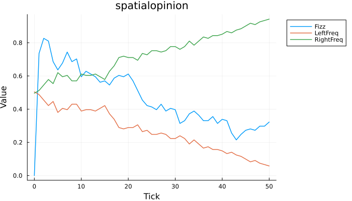
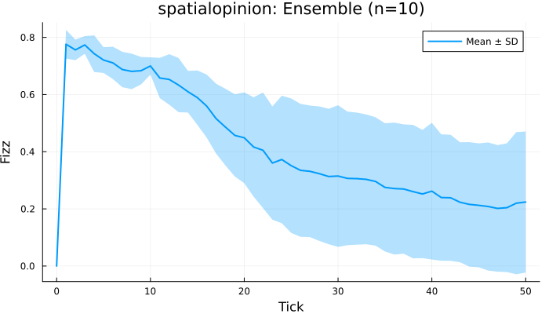
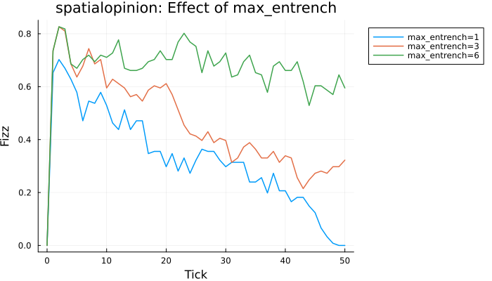

# Spatial Opinion Dynamics


- [Overview](#overview)
- [Parameters](#parameters)
- [Source Code](#source-code)
- [Time Series](#time-series)
- [Ensemble Runs](#ensemble-runs)
- [Parameter Sensitivity](#parameter-sensitivity)
- [Appendix: Source Code](#appendix-source-code)
  - [Parameters (`parameters.jl`)](#parameters-parametersjl)
  - [Components (`components.jl`)](#components-componentsjl)
  - [Resources (`resources.jl`)](#resources-resourcesjl)
  - [Systems (`systems.jl`)](#systems-systemsjl)
  - [Model (`model.jl`)](#model-modeljl)

## Overview

This vignette demonstrates the **Spatial Opinion Dynamics** model
implemented in
[ArkModelZoo.jl](https://github.com/sdwfrost/ArkModelZoo.jl) using the
Ark.jl ECS framework.

## Parameters

| Parameter | Type | Default | Description |
|----|----|----|----|
| `influence` | `String` | `"linear"` | influence |
| `max_entrench` | `Int` | `3` | max entrench |
| `init_attitude` | `Int` | `2` | init attitude |
| `opinion_amplification` | `Float64` | `0.1` | opinion amplification |
| `rnd_initial` | `Bool` | `true` | rnd initial |
| `positive_to_negative_ratio` | `Float64` | `0.5` | positive to negative ratio |
| `radius_size` | `Int` | `20` | radius size |
| `grid_xmin` | `Int` | `-5` | grid xmin |
| `grid_xmax` | `Int` | `5` | grid xmax |
| `grid_ymin` | `Int` | `-5` | grid ymin |
| `grid_ymax` | `Int` | `5` | grid ymax |
| `max_ticks` | `Int` | `50` | max ticks |

## Source Code

The Julia code to run this model:

``` julia
using ArkModelZoo
_, trajectory = run_spatialopinion()
```

## Time Series



## Ensemble Runs

Ten replicates with different random seeds, showing mean ± standard
deviation.



## Parameter Sensitivity

Varying `max_entrench`.



## Appendix: Source Code

This model is implemented in the
[Ark.jl](https://github.com/sdwfrost/Ark.jl) Entity-Component-System
(ECS) framework. The code is split into five files, each with a distinct
role:

- **Parameters**: a mutable struct holding all configurable values.
- **Components**: lightweight data types attached to individual entities
  (agents).
- **Resources**: world-level shared state accessible to all systems.
- **Systems**: functions that operate on entities each tick, defining
  model behavior.
- **Model**: wiring that assembles the world, registers resources and
  systems, and provides the run entry point.

### Parameters (`parameters.jl`)

The parameter struct uses `@kwdef` so that every field has a default
value and can be overridden by keyword. These defaults match the
original NetLogo model’s slider settings.

``` julia
Base.@kwdef mutable struct SOpnParams
    influence::String = "linear"
    max_entrench::Int = 3
    init_attitude::Int = 2
    opinion_amplification::Float64 = 0.1
    rnd_initial::Bool = true
    positive_to_negative_ratio::Float64 = 0.5
    radius_size::Int = 20
    grid_xmin::Int = -5
    grid_xmax::Int = 5
    grid_ymin::Int = -5
    grid_ymax::Int = 5
    max_ticks::Int = 50
    seed::Int = 42
end
```

### Components (`components.jl`)

Components are lightweight data types attached to individual entities
(agents). Mutable structs hold per-entity state, while empty tag structs
act as markers for the ECS query system to efficiently filter entities.

``` julia
struct SOpnDummy end
```

### Resources (`resources.jl`)

Resources are world-level singletons shared across all systems, used for
global state and aggregate statistics.

``` julia
mutable struct SOpnGrid
    width::Int
    height::Int
    old_attitude::Matrix{Int}
    new_attitude::Matrix{Int}
end

function SOpnGrid(w::Int, h::Int)
    SOpnGrid(w, h, zeros(Int, w, h), zeros(Int, w, h))
end

mutable struct SOpnStats
    fizz::Float64
    left_freq::Float64
    right_freq::Float64
end
SOpnStats() = SOpnStats(0.0, 0.0, 0.0)
```

### Systems (`systems.jl`)

Systems contain the model logic and execute in a defined order each
tick. Each system struct implements either `initialize!` (run once at
setup) or `update!` (run every tick).

``` julia
# Spatial Opinion Dynamics — ECS systems

function _sopn_influence_function(influence::String, val::Int, max_entrench::Int)
    if influence == "linear"
        return val == 0 ? 1.0 : Float64(abs(val))
    elseif influence == "square"
        return val == 0 ? 1.0 : Float64(val^2)
    elseif influence == "uniform"
        if val < 0; return 1.0; end
        if val > 0; return 1.0; end
        return 1.0
    elseif influence == "co-linear"
        return val == 0 ? 1.0 : Float64(max_entrench + 1 - abs(val))
    elseif influence == "co-square"
        return val == 0 ? 1.0 : Float64((max_entrench + 1 - abs(val))^2)
    end
    return 1.0
end

struct InitSOpnSystem <: System end

function initialize!(::InitSOpnSystem, world::World)
    params = get_resource(world, SOpnParams)
    rng    = get_resource(world, RNGResource).rng
    grid   = get_resource(world, SOpnGrid)
    stats  = get_resource(world, SOpnStats)
    w, h = grid.width, grid.height

    if params.rnd_initial
        for x in 1:w, y in 1:h
            if rand(rng) < params.positive_to_negative_ratio
                grid.new_attitude[x, y] = rand(rng, 1:params.init_attitude)
            else
                grid.new_attitude[x, y] = -(rand(rng, 1:params.init_attitude))
            end
        end
    else
        cx = (w + 1) / 2.0
        cy = (h + 1) / 2.0
        for x in 1:w, y in 1:h
            dx = x - cx
            dy = y - cy
            if dx^2 + dy^2 <= params.radius_size^2
                grid.new_attitude[x, y] = params.max_entrench
            else
                grid.new_attitude[x, y] = -params.max_entrench
            end
        end
    end

    # old_attitude = new_attitude after setup
    copyto!(grid.old_attitude, grid.new_attitude)
    stats.fizz = 0.0
    _sopn_measure_freq!(grid, stats)
    return nothing
end

function _sopn_measure_freq!(grid::SOpnGrid, stats::SOpnStats)
    n = grid.width * grid.height
    left_count = 0
    right_count = 0
    for x in 1:grid.width, y in 1:grid.height
        v = grid.old_attitude[x, y]
        if v <= -1; left_count += 1; end
        if v >= 1; right_count += 1; end
    end
    stats.left_freq = left_count / n
    stats.right_freq = right_count / n
end

struct SOpnGoSystem <: System end

function update!(::SOpnGoSystem, world::World)
    params = get_resource(world, SOpnParams)
    rng    = get_resource(world, RNGResource).rng
    grid   = get_resource(world, SOpnGrid)
    stats  = get_resource(world, SOpnStats)
    w, h = grid.width, grid.height

    # ask turtles [local-interactions] — shuffle all cells
    cells = [(x, y) for x in 1:w for y in 1:h]
    shuffle!(rng, cells)

    for (x, y) in cells
        nbrs = moore_neighbors_wrap(x, y, w, h)
        isempty(nbrs) && continue
        my_old = grid.old_attitude[x, y]

        # Build weighted pair list from neighbors
        localsum = 0.0
        for (nx, ny) in nbrs
            localsum += abs(_sopn_influence_function(params.influence, grid.old_attitude[nx, ny], params.max_entrench))
        end

        if localsum == 0.0
            continue
        end

        # Weighted selection of neighbor j
        weights = Float64[abs(_sopn_influence_function(params.influence, grid.old_attitude[nx, ny], params.max_entrench)) for (nx, ny) in nbrs]
        j_idx = weighted_one_of(rng, collect(1:length(nbrs)), weights)
        jx, jy = nbrs[j_idx]
        j_old = grid.old_attitude[jx, jy]

        if rand(rng) < params.opinion_amplification
            # Opinion amplification
            if j_old > 0
                if abs(my_old) < params.max_entrench
                    if my_old == -1
                        grid.new_attitude[x, y] = 1
                    else
                        grid.new_attitude[x, y] = my_old + 1
                    end
                end
            end
            if j_old < 0
                if abs(my_old) < params.max_entrench
                    if my_old == 1
                        grid.new_attitude[x, y] = -1
                    else
                        grid.new_attitude[x, y] = my_old - 1
                    end
                end
            end
        else
            # Convergence
            if j_old > my_old
                if my_old == -1
                    grid.new_attitude[x, y] = 1
                else
                    grid.new_attitude[x, y] = my_old + 1
                end
            end
            if j_old < my_old
                if my_old == 1
                    grid.new_attitude[x, y] = -1
                else
                    grid.new_attitude[x, y] = my_old - 1
                end
            end
        end
    end

    # Compute fizz BEFORE updating old_attitude
    n = w * h
    changed = 0
    for x in 1:w, y in 1:h
        if grid.old_attitude[x, y] != grid.new_attitude[x, y]
            changed += 1
        end
    end
    stats.fizz = changed / n

    # Update old_attitude = new_attitude
    copyto!(grid.old_attitude, grid.new_attitude)
    _sopn_measure_freq!(grid, stats)
    return nothing
end

struct SOpnTerminationSystem <: System end

function update!(::SOpnTerminationSystem, world::World)
    params = get_resource(world, SOpnParams)
    tick   = get_resource(world, Tick)
    if tick.tick + 1 >= params.max_ticks
        get_resource(world, Terminate).stop = true
    end
    return nothing
end
```

### Model (`model.jl`)

The model file assembles all pieces: it creates the ECS `World` with the
required component types, registers resources, builds the `Scheduler`
with systems in execution order, and exposes the public `run` entry
point. The observer pattern records the trajectory each tick.

``` julia
function spatialopinion_world(; initial_capacity::Int = 128)
    return World(SOpnDummy; initial_capacity = initial_capacity, allow_mutable = true)
end

function spatialopinion_systems()
    return (InitSOpnSystem(), SOpnGoSystem(), SOpnTerminationSystem())
end

function spatialopinion_model(params::SOpnParams = SOpnParams())
    w = params.grid_xmax - params.grid_xmin + 1
    h = params.grid_ymax - params.grid_ymin + 1
    world = spatialopinion_world()
    _add_standard_resources!(world, params)
    add_resource!(world, SOpnGrid(w, h))
    add_resource!(world, SOpnStats())
    scheduler = Scheduler(world, spatialopinion_systems())
    initialize!(scheduler)
    return scheduler
end

struct SOpnObserver end

function spatialopinion_headers(::SOpnObserver)
    return ["Fizz", "LeftFreq", "RightFreq"]
end

function spatialopinion_values(::SOpnObserver, world::World)
    stats = get_resource(world, SOpnStats)
    return Float64[stats.fizz, stats.left_freq, stats.right_freq]
end

function run_spatialopinion(; params::SOpnParams = SOpnParams(), observe::Bool = true)
    return _run_model(spatialopinion_model, SOpnObserver(), spatialopinion_values; params, observe)
end
```
