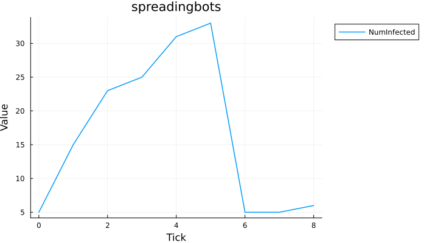
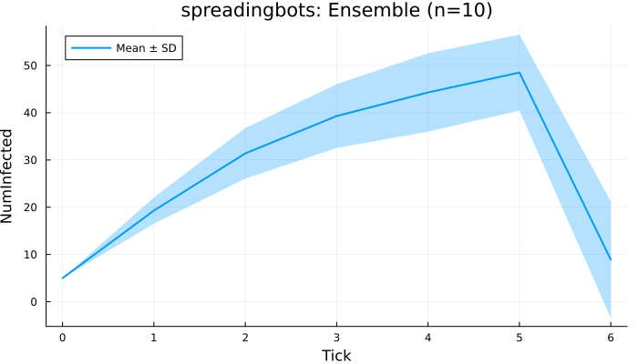
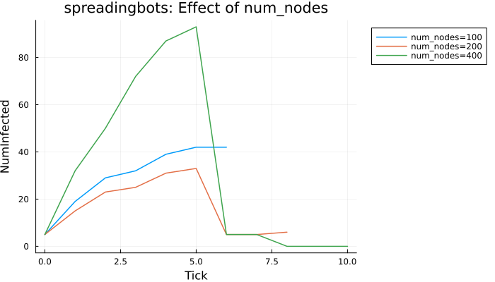

# Spreading Bots


- [Overview](#overview)
- [Parameters](#parameters)
- [Source Code](#source-code)
- [Time Series](#time-series)
- [Ensemble Runs](#ensemble-runs)
- [Parameter Sensitivity](#parameter-sensitivity)
- [Appendix: Source Code](#appendix-source-code)
  - [Parameters (`parameters.jl`)](#parameters-parametersjl)
  - [Components (`components.jl`)](#components-componentsjl)
  - [Resources (`resources.jl`)](#resources-resourcesjl)
  - [Systems (`systems.jl`)](#systems-systemsjl)
  - [Model (`model.jl`)](#model-modeljl)

## Overview

This vignette demonstrates the **Spreading Bots** model implemented in
[ArkModelZoo.jl](https://github.com/sdwfrost/ArkModelZoo.jl) using the
Ark.jl ECS framework.

## Parameters

| Parameter           | Type      | Default                 | Description       |
|---------------------|-----------|-------------------------|-------------------|
| `num_nodes`         | `Int`     | `200`                   | num nodes         |
| `m`                 | `Int`     | `2`                     | m                 |
| `p`                 | `Float64` | `0.11`                  | p                 |
| `gamma`             | `Float64` | `0.5`                   | gamma             |
| `num_infected_init` | `Int`     | `5`                     | num infected init |
| `reinfect_type`     | `String`  | `"eigenval-centrality"` | reinfect type     |
| `bot_group_repet`   | `Int`     | `2`                     | bot group repet   |
| `bot_group_percent` | `Int`     | `5`                     | bot group percent |
| `retention_loss`    | `Bool`    | `true`                  | retention loss    |
| `size_reduction`    | `Float64` | `1.5`                   | size reduction    |
| `max_ticks`         | `Int`     | `100`                   | max ticks         |

## Source Code

The Julia code to run this model:

``` julia
using ArkModelZoo
_, trajectory = run_spreadingbots()
```

## Time Series



## Ensemble Runs

Ten replicates with different random seeds, showing mean ± standard
deviation.



## Parameter Sensitivity

Varying `num_nodes`.



## Appendix: Source Code

This model is implemented in the
[Ark.jl](https://github.com/sdwfrost/Ark.jl) Entity-Component-System
(ECS) framework. The code is split into five files, each with a distinct
role:

- **Parameters**: a mutable struct holding all configurable values.
- **Components**: lightweight data types attached to individual entities
  (agents).
- **Resources**: world-level shared state accessible to all systems.
- **Systems**: functions that operate on entities each tick, defining
  model behavior.
- **Model**: wiring that assembles the world, registers resources and
  systems, and provides the run entry point.

### Parameters (`parameters.jl`)

The parameter struct uses `@kwdef` so that every field has a default
value and can be overridden by keyword. These defaults match the
original NetLogo model’s slider settings.

``` julia
Base.@kwdef mutable struct SBotParams
    num_nodes::Int = 200
    m::Int = 2
    p::Float64 = 0.11
    gamma::Float64 = 0.5
    num_infected_init::Int = 5
    reinfect_type::String = "eigenval-centrality"
    bot_group_repet::Int = 2
    bot_group_percent::Int = 5
    retention_loss::Bool = true
    size_reduction::Float64 = 1.5
    max_ticks::Int = 100
    seed::Int = 42
end
```

### Components (`components.jl`)

Components are lightweight data types attached to individual entities
(agents). Mutable structs hold per-entity state, while empty tag structs
act as markers for the ECS query system to efficiently filter entities.

``` julia
struct SBotDummy end
```

### Resources (`resources.jl`)

Resources are world-level singletons shared across all systems, used for
global state and aggregate statistics.

``` julia
mutable struct SBotNetwork
    n_agents::Int
    adj::Vector{Set{Int}}
    infected::Vector{Bool}
    agent_size::Vector{Float64}
    is_bot::Vector{Bool}
    degrees_bag::Vector{Int}  # degree list for preferential attachment
end

function SBotNetwork()
    SBotNetwork(0, Set{Int}[], Bool[], Float64[], Bool[], Int[])
end

function _sbot_add_agent!(net::SBotNetwork)
    push!(net.adj, Set{Int}())
    push!(net.infected, false)
    push!(net.agent_size, 0.5)
    push!(net.is_bot, false)
    net.n_agents += 1
    return net.n_agents
end

function _sbot_add_edge!(net::SBotNetwork, i::Int, j::Int)
    if i != j && j ∉ net.adj[i]
        push!(net.adj[i], j)
        push!(net.adj[j], i)
        push!(net.degrees_bag, i)
        push!(net.degrees_bag, j)
    end
end

mutable struct SBotStats
    num_infected::Int
    previous_num_infected::Int
end
SBotStats() = SBotStats(0, 0)
```

### Systems (`systems.jl`)

Systems contain the model logic and execute in a defined order each
tick. Each system struct implements either `initialize!` (run once at
setup) or `update!` (run every tick).

``` julia
# Spreading Bots — Bot-augmented epidemic diffusion on preferential-attachment network

struct InitSBotSystem <: System end

function _sbot_find_partner(net::SBotNetwork, rng, node::Int, gamma::Float64)
    while true
        if rand(rng) >= gamma && !isempty(net.degrees_bag)
            partner = net.degrees_bag[rand(rng, 1:length(net.degrees_bag))]
        else
            partner = rand(rng, 1:net.n_agents)
        end
        if partner != node && partner ∉ net.adj[node]
            return partner
        end
    end
end

function initialize!(::InitSBotSystem, world::World)
    params = get_resource(world, SBotParams)
    rng    = get_resource(world, RNGResource).rng
    net    = get_resource(world, SBotNetwork)
    stats  = get_resource(world, SBotStats)

    # Create initial ring of 5 nodes
    for _ in 1:5
        _sbot_add_agent!(net)
    end
    for i in 1:4
        _sbot_add_edge!(net, i, i + 1)
    end
    _sbot_add_edge!(net, 5, 1)

    # First half of preferential attachment growth
    half1 = div(params.num_nodes, 2)
    for _ in 1:half1
        id = _sbot_add_agent!(net)
        for _ in 1:params.m
            partner = _sbot_find_partner(net, rng, id, params.gamma)
            _sbot_add_edge!(net, id, partner)
        end
    end

    # Set bot group
    n_bots = max(1, div(net.n_agents * params.bot_group_percent, 100))
    bot_indices = shuffle!(rng, collect(1:net.n_agents))[1:n_bots]
    for i in bot_indices
        net.is_bot[i] = true
    end

    # Create bot-internal edges
    for _ in 1:params.bot_group_repet
        for i in bot_indices
            j = bot_indices[rand(rng, 1:length(bot_indices))]
            if i != j
                _sbot_add_edge!(net, i, j)
            end
        end
    end

    # Second half of preferential attachment growth
    half2 = div(params.num_nodes, 2) - 4
    for _ in 1:half2
        id = _sbot_add_agent!(net)
        for _ in 1:params.m
            partner = _sbot_find_partner(net, rng, id, params.gamma)
            _sbot_add_edge!(net, id, partner)
        end
    end

    # Seed initial infected using reinfect strategy
    _sbot_reinfect!(net, rng, params, stats)
    return nothing
end

function _sbot_reinfect!(net::SBotNetwork, rng, params::SBotParams, stats::SBotStats)
    for i in 1:net.n_agents
        net.infected[i] = false
        net.agent_size[i] = 1.0
    end
    stats.num_infected = params.num_infected_init
    stats.previous_num_infected = 0

    n_to_infect = min(params.num_infected_init, net.n_agents)

    if params.reinfect_type == "random"
        chosen = shuffle!(rng, collect(1:net.n_agents))[1:n_to_infect]
        for i in chosen
            net.infected[i] = true
            net.agent_size[i] = 2.0
        end
    elseif params.reinfect_type == "group"
        bot_ids = findall(net.is_bot)
        chosen = shuffle!(rng, copy(bot_ids))[1:min(n_to_infect, length(bot_ids))]
        for i in chosen
            net.infected[i] = true
            net.agent_size[i] = 2.0
        end
    elseif params.reinfect_type == "eigenval-centrality"
        ec = nw_eigenvector_centrality(NwGraph(net.n_agents, net.adj))
        sorted = sortperm(ec; rev=true)
        for k in 1:n_to_infect
            i = sorted[k]
            net.infected[i] = true
            net.agent_size[i] = 2.0
        end
    elseif params.reinfect_type == "PageRank-Centrality"
        pr = nw_page_rank(NwGraph(net.n_agents, net.adj))
        sorted = sortperm(pr; rev=true)
        for k in 1:n_to_infect
            i = sorted[k]
            net.infected[i] = true
            net.agent_size[i] = 2.0
        end
    end
end

struct SBotGoSystem <: System end

function update!(::SBotGoSystem, world::World)
    params = get_resource(world, SBotParams)
    rng    = get_resource(world, RNGResource).rng
    net    = get_resource(world, SBotNetwork)
    stats  = get_resource(world, SBotStats)

    # Check if all infected
    if all(net.infected)
        get_resource(world, Terminate).stop = true
        return nothing
    end

    # ask turtles with [infected? = true] — shuffle infected
    infected_ids = findall(net.infected)
    shuffle!(rng, infected_ids)

    for i in infected_ids
        mysize = net.agent_size[i]
        # ask link-neighbors with [infected? = false] — shuffle
        susceptible_nbrs = [j for j in net.adj[i] if !net.infected[j]]
        shuffle!(rng, susceptible_nbrs)
        for j in susceptible_nbrs
            prob = params.retention_loss ? params.p * mysize : params.p
            if rand(rng) <= prob
                net.infected[j] = true
                stats.num_infected += 1
            end
        end
    end

    # Check stagnation
    current_infected = count(net.infected)
    if current_infected == stats.previous_num_infected
        get_resource(world, Terminate).stop = true
        return nothing
    end
    stats.previous_num_infected = current_infected

    # Size reduction for all agents
    for i in 1:net.n_agents
        net.agent_size[i] /= params.size_reduction
        if net.agent_size[i] < 0.1
            net.infected[i] = false
        end
    end

    stats.num_infected = count(net.infected)
    return nothing
end

struct SBotTerminationSystem <: System end

function update!(::SBotTerminationSystem, world::World)
    params = get_resource(world, SBotParams)
    tick   = get_resource(world, Tick)
    if tick.tick + 1 >= params.max_ticks
        get_resource(world, Terminate).stop = true
    end
    return nothing
end
```

### Model (`model.jl`)

The model file assembles all pieces: it creates the ECS `World` with the
required component types, registers resources, builds the `Scheduler`
with systems in execution order, and exposes the public `run` entry
point. The observer pattern records the trajectory each tick.

``` julia
function spreadingbots_world(; initial_capacity::Int = 128)
    return World(SBotDummy; initial_capacity = initial_capacity, allow_mutable = true)
end

function spreadingbots_systems()
    return (InitSBotSystem(), SBotGoSystem(), SBotTerminationSystem())
end

function spreadingbots_model(params::SBotParams = SBotParams())
    world = spreadingbots_world()
    _add_standard_resources!(world, params)
    add_resource!(world, SBotNetwork())
    add_resource!(world, SBotStats())
    scheduler = Scheduler(world, spreadingbots_systems())
    initialize!(scheduler)
    return scheduler
end

struct SBotObserver end

function spreadingbots_headers(::SBotObserver)
    return ["NumInfected"]
end

function spreadingbots_values(::SBotObserver, world::World)
    stats = get_resource(world, SBotStats)
    return Float64[stats.num_infected]
end

function run_spreadingbots(; params::SBotParams = SBotParams(), observe::Bool = true)
    return _run_model(spreadingbots_model, SBotObserver(), spreadingbots_values; params, observe)
end
```
