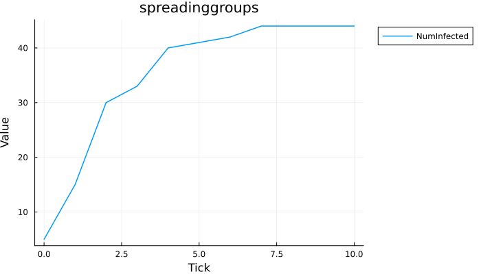
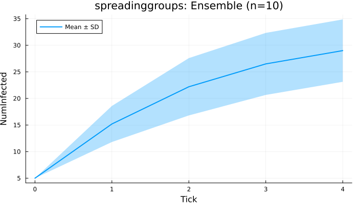
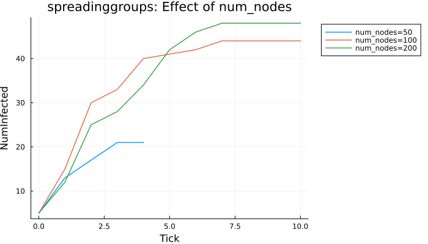

# Spreading Groups


- [Overview](#overview)
  - [WHAT IS IT?](#what-is-it)
  - [HOW IT WORKS](#how-it-works)
  - [THINGS TO NOTICE](#things-to-notice)
  - [RELATED MODELS](#related-models)
  - [CREDITS AND REFERENCES](#credits-and-references)
- [Parameters](#parameters)
- [Source Code](#source-code)
- [Time Series](#time-series)
- [Ensemble Runs](#ensemble-runs)
- [Parameter Sensitivity](#parameter-sensitivity)
- [Appendix: Source Code](#appendix-source-code)
  - [Parameters (`parameters.jl`)](#parameters-parametersjl)
  - [Components (`components.jl`)](#components-componentsjl)
  - [Resources (`resources.jl`)](#resources-resourcesjl)
  - [Systems (`systems.jl`)](#systems-systemsjl)
  - [Model (`model.jl`)](#model-modeljl)

## Overview

### WHAT IS IT?

This model studies the topic of “Spreading Group”. These are
synchronized groups that post a message on Twitter or Facebook together,
in order to increase the message\`s spread. We believe such Spreading
Groups are mainly constructed of bots; - computerized programs that
mimic humans. The model show that such a strategy of using a spreading
group of size k is more effective than reaching a similarly large number
of hubs.

### HOW IT WORKS

The model starts with two nodes connected by an edge. At each step, a
new node is added. After n/2 nodes were added, a step of formation of
the spreading group is performed, followed by another n/2 steps of
preferential attachment.

### THINGS TO NOTICE

1.  Chose the spread with and without the retention loss.
2.  Compare the spread by random k nodes, random k nodes from the
    spreading group, k nodes of the highest eigenvalues.

### RELATED MODELS

See other models in the Networks section of the Models Library, such as
Giant Component. See also Network Example, in the Code Examples section.

### CREDITS AND REFERENCES

This model is based on: Wilensky, U. (2005). NetLogo Preferential
Attachment model. Modified by Lada Adamic 2007 Modified by Alon Sela
2016 in order to inspect the topic of spreading gorups.

## Parameters

| Parameter                 | Type      | Default | Description             |
|---------------------------|-----------|---------|-------------------------|
| `num_nodes`               | `Int`     | `100`   | num nodes               |
| `m`                       | `Int`     | `2`     | m                       |
| `p`                       | `Float64` | `0.11`  | p                       |
| `gamma`                   | `Float64` | `0.5`   | gamma                   |
| `num_infected_init`       | `Int`     | `5`     | num infected init       |
| `spreading_group_percent` | `Float64` | `5.0`   | spreading group percent |
| `spreading_group_repet`   | `Int`     | `2`     | spreading group repet   |
| `retention_loss`          | `Bool`    | `true`  | retention loss          |
| `size_reduction`          | `Float64` | `1.5`   | size reduction          |
| `max_ticks`               | `Int`     | `100`   | max ticks               |

## Source Code

The Julia code to run this model:

``` julia
using ArkModelZoo
_, trajectory = run_spreadinggroups()
```

## Time Series



## Ensemble Runs

Ten replicates with different random seeds, showing mean ± standard
deviation.



## Parameter Sensitivity

Varying `num_nodes`.



## Appendix: Source Code

This model is implemented in the
[Ark.jl](https://github.com/sdwfrost/Ark.jl) Entity-Component-System
(ECS) framework. The code is split into five files, each with a distinct
role:

- **Parameters**: a mutable struct holding all configurable values.
- **Components**: lightweight data types attached to individual entities
  (agents).
- **Resources**: world-level shared state accessible to all systems.
- **Systems**: functions that operate on entities each tick, defining
  model behavior.
- **Model**: wiring that assembles the world, registers resources and
  systems, and provides the run entry point.

### Parameters (`parameters.jl`)

The parameter struct uses `@kwdef` so that every field has a default
value and can be overridden by keyword. These defaults match the
original NetLogo model’s slider settings.

``` julia
Base.@kwdef mutable struct SGroupParams
    num_nodes::Int = 100
    m::Int = 2
    p::Float64 = 0.11
    gamma::Float64 = 0.5
    num_infected_init::Int = 5
    spreading_group_percent::Float64 = 5.0
    spreading_group_repet::Int = 2
    retention_loss::Bool = true
    size_reduction::Float64 = 1.5
    max_ticks::Int = 100
    seed::Int = 42
end
```

### Components (`components.jl`)

Components are lightweight data types attached to individual entities
(agents). Mutable structs hold per-entity state, while empty tag structs
act as markers for the ECS query system to efficiently filter entities.

``` julia
struct SGroupDummy end
```

### Resources (`resources.jl`)

Resources are world-level singletons shared across all systems, used for
global state and aggregate statistics.

``` julia
mutable struct SGroupNetwork
    n_agents::Int
    adj::Vector{Set{Int}}
    degree::Vector{Int}
    infected::Vector{Bool}
    agent_size::Vector{Float64}
    spreading_group::Vector{Bool}
end

function SGroupNetwork()
    SGroupNetwork(0, Set{Int}[], Int[], Bool[], Float64[], Bool[])
end

function _sgroup_add_agent!(net::SGroupNetwork)
    push!(net.adj, Set{Int}())
    push!(net.degree, 0)
    push!(net.infected, false)
    push!(net.agent_size, 1.0)
    push!(net.spreading_group, false)
    net.n_agents += 1
    return net.n_agents
end

function _sgroup_add_edge!(net::SGroupNetwork, i::Int, j::Int)
    if j ∉ net.adj[i]
        push!(net.adj[i], j)
        push!(net.adj[j], i)
        net.degree[i] += 1
        net.degree[j] += 1
    end
end

mutable struct SGroupStats
    num_infected::Int           # cumulative infection counter (tracked output, matches NetLogo global)
    prev_infected_count::Int    # post-infection current count for stalling check
end
SGroupStats() = SGroupStats(0, 0)
```

### Systems (`systems.jl`)

Systems contain the model logic and execute in a defined order each
tick. Each system struct implements either `initialize!` (run once at
setup) or `update!` (run every tick).

``` julia
# Spreading Groups – ECS systems
# Build BA network, select spreading group, seed infection, run epidemic

struct InitSGroupSystem <: System end

# Eigenvector centrality via power iteration (matches NetLogo nw:eigenvector-centrality)
function _sgroup_eigenvector_centrality(net::SGroupNetwork)
    n = net.n_agents
    x = ones(n) / n
    for _ in 1:100
        new_x = zeros(n)
        for i in 1:n
            for j in net.adj[i]
                new_x[i] += x[j]
            end
        end
        nrm = sqrt(sum(v^2 for v in new_x))
        if nrm > 0
            new_x ./= nrm
        end
        x = new_x
    end
    return x
end

# Add a single node via preferential attachment (NetLogo create-preferential-net)
function _sgroup_add_ba_node!(net::SGroupNetwork, rng, m::Int, gamma::Float64)
    new_id = _sgroup_add_agent!(net)
    total_degree = sum(net.degree[k] for k in 1:(new_id - 1))
    targets = Set{Int}()
    attempts = 0
    while length(targets) < m && attempts < 10_000
        attempts += 1
        if rand(rng) < gamma && total_degree > 0
            r = rand(rng) * total_degree
            cumulative = 0.0
            for j in 1:(new_id - 1)
                cumulative += net.degree[j]
                if cumulative >= r
                    push!(targets, j)
                    break
                end
            end
        else
            push!(targets, rand(rng, 1:(new_id - 1)))
        end
    end
    for t in targets
        _sgroup_add_edge!(net, new_id, t)
    end
    return new_id
end

function initialize!(::InitSGroupSystem, world::World)
    params = get_resource(world, SGroupParams)
    rng    = get_resource(world, RNGResource).rng
    net    = get_resource(world, SGroupNetwork)
    stats  = get_resource(world, SGroupStats)

    # Phase 1: Build initial ring of 5 nodes (NetLogo: chain + closing edge)
    for _ in 1:5
        _sgroup_add_agent!(net)
    end
    # NetLogo builds: 1-2, 2-3, 3-4, 4-5, then 5-1 (ring)
    for i in 1:4
        _sgroup_add_edge!(net, i, i + 1)
    end
    _sgroup_add_edge!(net, 5, 1)

    # Phase 2: Add num_nodes/2 nodes via BA (= 50 nodes → total 55)
    n_phase2 = params.num_nodes ÷ 2
    for _ in 1:n_phase2
        _sgroup_add_ba_node!(net, rng, params.m, params.gamma)
    end

    # Phase 3: Select spreading group from current nodes (55)
    n_current = net.n_agents
    n_group = max(1, round(Int, params.num_nodes * params.spreading_group_percent / 100.0))
    indices = Random.shuffle(rng, collect(1:n_current))
    group_members = indices[1:min(n_group, n_current)]
    for i in group_members
        net.spreading_group[i] = true
    end

    # Stochastic partial connection (NetLogo: repeat spreadingGroupRepet [create-spreading-group])
    # Each spreading-group member picks two random members and connects them if not already linked
    spreading_group_repet = 2
    for _ in 1:spreading_group_repet
        sg = findall(net.spreading_group[1:n_current])
        # NetLogo: ask spreading-group [...] — shuffled
        perm = Random.shuffle(rng, copy(sg))
        for _ in perm
            a = sg[rand(rng, 1:length(sg))]
            b = sg[rand(rng, 1:length(sg))]
            if a != b
                _sgroup_add_edge!(net, a, b)  # no-op if already connected
            end
        end
    end

    # Phase 4: Add remaining nodes via BA (num_nodes/2 - 4 = 46 nodes → total 101)
    n_phase4 = params.num_nodes ÷ 2 - 4
    for _ in 1:n_phase4
        _sgroup_add_ba_node!(net, rng, params.m, params.gamma)
    end

    # Phase 5: Seed initial infected via eigenvector centrality (NetLogo: nw:eigenvector-centrality)
    # NetLogo reinfect-once: resets all sizes to 1, then sets infected nodes to size 2
    ec = _sgroup_eigenvector_centrality(net)
    ec_order = sortperm(ec; rev = true)
    for k in 1:min(params.num_infected_init, net.n_agents)
        net.infected[ec_order[k]] = true
        net.agent_size[ec_order[k]] = 2.0   # NetLogo: set size 2
    end
    # num_infected is cumulative (matches NetLogo global that only increments)
    stats.num_infected = params.num_infected_init
    stats.prev_infected_count = 0
    return nothing
end

# --- Main go procedure (single system to preserve NetLogo ordering) ---

struct SGroupGoSystem <: System end

function update!(::SGroupGoSystem, world::World)
    params = get_resource(world, SGroupParams)
    rng    = get_resource(world, RNGResource).rng
    net    = get_resource(world, SGroupNetwork)
    stats  = get_resource(world, SGroupStats)

    # 1. If all infected → stop
    n_currently_infected = count(net.infected[1:net.n_agents])
    if n_currently_infected == net.n_agents
        get_resource(world, Terminate).stop = true
        return nothing
    end

    # 2. Spreading: infected nodes try to infect uninfected neighbours
    # NetLogo: ask turtles with [infected? = true] — shuffled
    infected_list = findall(net.infected[1:net.n_agents])
    Random.shuffle!(rng, infected_list)
    for i in infected_list
        # NetLogo: ask link-neighbors with [infected? = false] — snapshot + shuffled
        uninfected_nbrs = [j for j in net.adj[i] if !net.infected[j]]
        Random.shuffle!(rng, uninfected_nbrs)
        for j in uninfected_nbrs
            prob = params.retention_loss ? params.p * net.agent_size[i] : params.p
            if rand(rng) <= prob
                net.infected[j] = true
                stats.num_infected += 1   # cumulative (matches NetLogo)
            end
        end
    end

    # 3. Stalling check: compare current infected count with post-infection count
    #    from previous tick (NetLogo: tmp vs previous-num-infected, both post-infection)
    current_infected = count(net.infected[1:net.n_agents])
    if current_infected == stats.prev_infected_count
        get_resource(world, Terminate).stop = true
        return nothing
    end
    stats.prev_infected_count = current_infected

    # 4. Size decay for ALL agents (NetLogo: ask turtles [...])
    for i in 1:net.n_agents
        net.agent_size[i] /= params.size_reduction
        if net.agent_size[i] < 0.1
            net.infected[i] = false
        end
    end
    return nothing
end

# --- Tick-limit termination ---

struct SGroupTerminationSystem <: System end

function update!(::SGroupTerminationSystem, world::World)
    params = get_resource(world, SGroupParams)
    tick   = get_resource(world, Tick)
    if tick.tick + 1 >= params.max_ticks
        get_resource(world, Terminate).stop = true
    end
    return nothing
end
```

### Model (`model.jl`)

The model file assembles all pieces: it creates the ECS `World` with the
required component types, registers resources, builds the `Scheduler`
with systems in execution order, and exposes the public `run` entry
point. The observer pattern records the trajectory each tick.

``` julia
function spreadinggroups_world(; initial_capacity::Int = 128)
    return World(SGroupDummy; initial_capacity = initial_capacity, allow_mutable = true)
end

function spreadinggroups_systems()
    return (InitSGroupSystem(), SGroupGoSystem(), SGroupTerminationSystem())
end

function spreadinggroups_model(params::SGroupParams = SGroupParams())
    world = spreadinggroups_world()
    _add_standard_resources!(world, params)
    add_resource!(world, SGroupNetwork())
    add_resource!(world, SGroupStats())
    scheduler = Scheduler(world, spreadinggroups_systems())
    initialize!(scheduler)
    return scheduler
end

struct SGroupObserver end

function spreadinggroups_headers(::SGroupObserver)
    return ["NumInfected"]
end

function spreadinggroups_values(::SGroupObserver, world::World)
    stats = get_resource(world, SGroupStats)
    return Float64[stats.num_infected]
end

function run_spreadinggroups(; params::SGroupParams = SGroupParams(), observe::Bool = true)
    return _run_model(spreadinggroups_model, SGroupObserver(), spreadinggroups_values; params, observe)
end
```
