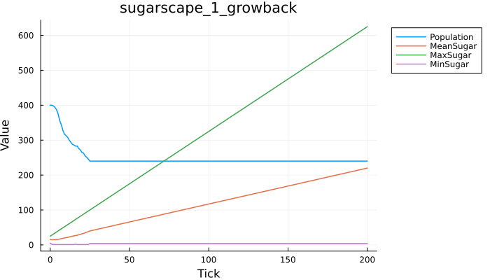
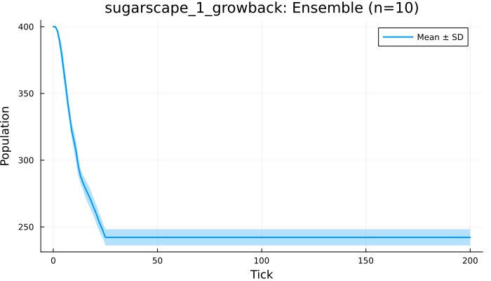
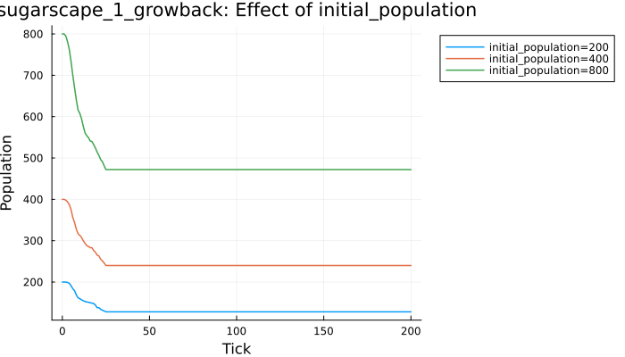

# Sugarscape 1 Growback


- [Overview](#overview)
- [Parameters](#parameters)
- [Source Code](#source-code)
- [Time Series](#time-series)
- [Ensemble Runs](#ensemble-runs)
- [Parameter Sensitivity](#parameter-sensitivity)
- [Appendix: Source Code](#appendix-source-code)
  - [Parameters (`parameters.jl`)](#parameters-parametersjl)
  - [Components (`components.jl`)](#components-componentsjl)
  - [Resources (`resources.jl`)](#resources-resourcesjl)
  - [Systems (`systems.jl`)](#systems-systemsjl)
  - [Model (`model.jl`)](#model-modeljl)

## Overview

This vignette demonstrates the **Sugarscape 1 Growback** model
implemented in
[ArkModelZoo.jl](https://github.com/sdwfrost/ArkModelZoo.jl) using the
Ark.jl ECS framework.

## Parameters

| Parameter            | Type  | Default | Description        |
|----------------------|-------|---------|--------------------|
| `initial_population` | `Int` | `400`   | initial population |
| `grid_width`         | `Int` | `50`    | 0..49 = 50 patches |
| `grid_height`        | `Int` | `50`    | grid height        |
| `max_ticks`          | `Int` | `200`   | max ticks          |

## Source Code

The Julia code to run this model:

``` julia
using ArkModelZoo
_, trajectory = run_sugarscape_1_growback()
```

## Time Series



## Ensemble Runs

Ten replicates with different random seeds, showing mean ± standard
deviation.



## Parameter Sensitivity

Varying `initial_population`.



## Appendix: Source Code

This model is implemented in the
[Ark.jl](https://github.com/sdwfrost/Ark.jl) Entity-Component-System
(ECS) framework. The code is split into five files, each with a distinct
role:

- **Parameters**: a mutable struct holding all configurable values.
- **Components**: lightweight data types attached to individual entities
  (agents).
- **Resources**: world-level shared state accessible to all systems.
- **Systems**: functions that operate on entities each tick, defining
  model behavior.
- **Model**: wiring that assembles the world, registers resources and
  systems, and provides the run entry point.

### Parameters (`parameters.jl`)

The parameter struct uses `@kwdef` so that every field has a default
value and can be overridden by keyword. These defaults match the
original NetLogo model’s slider settings.

``` julia
Base.@kwdef mutable struct S1GParams
    initial_population::Int = 400
    grid_width::Int = 50          # 0..49 = 50 patches
    grid_height::Int = 50
    max_ticks::Int = 200
    seed::Int = 42
end
```

### Components (`components.jl`)

Components are lightweight data types attached to individual entities
(agents). Mutable structs hold per-entity state, while empty tag structs
act as markers for the ECS query system to efficiently filter entities.

``` julia
mutable struct S1GAgent
    x::Int
    y::Int
    sugar::Float64
    metabolism::Int
    vision::Int
end
S1GAgent() = S1GAgent(0, 0, 0.0, 1, 1)
```

### Resources (`resources.jl`)

Resources are world-level singletons shared across all systems, used for
global state and aggregate statistics.

``` julia
mutable struct S1GGrid
    width::Int
    height::Int
    psugar::Matrix{Float64}
    max_psugar::Matrix{Float64}
    occupant::Matrix{Entity}
end

function S1GGrid(w::Int, h::Int)
    S1GGrid(w, h, zeros(w, h), zeros(w, h), fill(zero_entity, w, h))
end

mutable struct S1GStats
    population::Int
    mean_sugar::Float64
    max_sugar::Float64
    min_sugar::Float64
end
S1GStats() = S1GStats(0, 0.0, 0.0, 0.0)
```

### Systems (`systems.jl`)

Systems contain the model logic and execute in a defined order each
tick. Each system struct implements either `initialize!` (run once at
setup) or `update!` (run every tick).

``` julia
# --- Initialization ---

struct InitS1GSystem <: System end

function initialize!(::InitS1GSystem, world::World)
    params = get_resource(world, S1GParams)
    rng = get_resource(world, RNGResource).rng
    grid = get_resource(world, S1GGrid)
    w, h = grid.width, grid.height

    # Generate sugar landscape matching NetLogo: peaks at (35,35) and (15,15)
    # in 0-indexed coords, which is (36,36) and (16,16) in 1-indexed
    # NetLogo uses distancexy which respects wrapping
    cx1, cy1 = 16, 16   # NetLogo (15,15) in 0-indexed
    cx2, cy2 = 36, 36   # NetLogo (35,35) in 0-indexed
    for x in 1:w, y in 1:h
        # Wrapping distance (matching NetLogo distancexy)
        dx1 = min(abs(x - cx1), w - abs(x - cx1))
        dy1 = min(abs(y - cy1), h - abs(y - cy1))
        d1 = sqrt(Float64(dx1)^2 + Float64(dy1)^2)
        dx2 = min(abs(x - cx2), w - abs(x - cx2))
        dy2 = min(abs(y - cy2), h - abs(y - cy2))
        d2 = sqrt(Float64(dx2)^2 + Float64(dy2)^2)
        d = min(d1, d2)
        ms = 0.0
        if d <= 20; ms = 1.0; end
        if d <= 15; ms = 2.0; end
        if d <= 10; ms = 3.0; end
        if d <= 5;  ms = 4.0; end
        grid.max_psugar[x, y] = ms
        grid.psugar[x, y] = ms
    end

    # Place agents on random unoccupied patches
    all_positions = [(x, y) for x in 1:w for y in 1:h]
    Random.shuffle!(rng, all_positions)
    placed = 0
    for (x, y) in all_positions
        placed >= params.initial_population && break
        agent = S1GAgent()
        agent.x = x
        agent.y = y
        agent.sugar = Float64(5 + rand(rng, 0:20))   # random-in-range 5 25
        agent.metabolism = 1 + rand(rng, 0:3)          # random-in-range 1 4
        agent.vision = 1 + rand(rng, 0:5)             # random-in-range 1 6
        eid = new_entity!(world, (agent,))
        grid.occupant[x, y] = eid
        placed += 1
    end

    _s1g_update_stats!(world)
    return nothing
end

# --- Go ---

struct S1GGoSystem <: System end

function update!(::S1GGoSystem, world::World)
    params = get_resource(world, S1GParams)
    rng = get_resource(world, RNGResource).rng
    grid = get_resource(world, S1GGrid)
    w, h = grid.width, grid.height

    # Immediate growback
    for x in 1:w, y in 1:h
        grid.psugar[x, y] = grid.max_psugar[x, y]
    end

    # Collect agents
    agents = Tuple{Entity, S1GAgent}[]
    for (eids, agent_arr) in Query(world, (S1GAgent,))
        for i in eachindex(eids)
            push!(agents, (eids[i], agent_arr[i]))
        end
    end
    Random.shuffle!(rng, agents)

    dead = Entity[]
    for (eid, ag) in agents
        # Move: collect unoccupied vision patches + current patch (always included)
        # NetLogo: (patch-set patch-here (patches at-points vision-points) with [not any? turtles-here])
        # The `with` filter applies to vision patches only, NOT to patch-here
        # So patch-here is ALWAYS a candidate (distance=0 makes it win ties)
        candidates = Tuple{Int,Int}[]
        push!(candidates, (ag.x, ag.y))  # patch-here always included
        for (ddx, ddy) in ((0, 1), (0, -1), (1, 0), (-1, 0))
            for d in 1:ag.vision
                nx = mod1(ag.x + ddx * d, w)
                ny = mod1(ag.y + ddy * d, h)
                if is_zero(grid.occupant[nx, ny])
                    push!(candidates, (nx, ny))
                end
            end
        end
        unique!(candidates)

        # with-max [psugar]
        max_ps = maximum(grid.psugar[c[1], c[2]] for c in candidates)
        winners = filter(c -> grid.psugar[c[1], c[2]] == max_ps, candidates)

        # min-one-of [distance myself] (wrapping Euclidean distance)
        function wdist(cx, cy)
            dx = min(abs(cx - ag.x), w - abs(cx - ag.x))
            dy = min(abs(cy - ag.y), h - abs(cy - ag.y))
            return sqrt(Float64(dx)^2 + Float64(dy)^2)
        end
        min_d = minimum(wdist(c[1], c[2]) for c in winners)
        closest = filter(c -> wdist(c[1], c[2]) == min_d, winners)
        chosen = closest[rand(rng, 1:length(closest))]

        if chosen != (ag.x, ag.y)
            grid.occupant[ag.x, ag.y] = zero_entity
            ag.x, ag.y = chosen
            grid.occupant[ag.x, ag.y] = eid
        end

        # Eat
        ag.sugar = ag.sugar - ag.metabolism + grid.psugar[ag.x, ag.y]
        grid.psugar[ag.x, ag.y] = 0.0

        if ag.sugar <= 0
            push!(dead, eid)
            grid.occupant[ag.x, ag.y] = zero_entity
        end
    end

    # Remove dead agents
    for eid in dead
        remove_entity!(world, eid)
    end

    _s1g_update_stats!(world)
    return nothing
end

function _s1g_update_stats!(world::World)
    stats = get_resource(world, S1GStats)
    sugars = Float64[]
    for (_, agent_arr) in Query(world, (S1GAgent,))
        for ag in agent_arr
            push!(sugars, ag.sugar)
        end
    end
    n = length(sugars)
    stats.population = n
    if n > 0
        stats.mean_sugar = mean(sugars)
        stats.max_sugar = maximum(sugars)
        stats.min_sugar = minimum(sugars)
    else
        stats.mean_sugar = 0.0
        stats.max_sugar = 0.0
        stats.min_sugar = 0.0
    end
end

# --- Termination ---

struct S1GTerminationSystem <: System end

function update!(::S1GTerminationSystem, world::World)
    params = get_resource(world, S1GParams)
    tick = get_resource(world, Tick)
    stats = get_resource(world, S1GStats)
    if stats.population == 0 || tick.tick + 1 >= params.max_ticks
        get_resource(world, Terminate).stop = true
    end
    return nothing
end
```

### Model (`model.jl`)

The model file assembles all pieces: it creates the ECS `World` with the
required component types, registers resources, builds the `Scheduler`
with systems in execution order, and exposes the public `run` entry
point. The observer pattern records the trajectory each tick.

``` julia
function s1g_world(; initial_capacity::Int = 1024)
    return World(S1GAgent; initial_capacity = initial_capacity, allow_mutable = true)
end

function s1g_systems()
    return (
        InitS1GSystem(),
        S1GGoSystem(),
        S1GTerminationSystem(),
    )
end

function s1g_model(params::S1GParams = S1GParams())
    world = s1g_world()
    _add_standard_resources!(world, params)
    add_resource!(world, S1GGrid(params.grid_width, params.grid_height))
    add_resource!(world, S1GStats())
    scheduler = Scheduler(world, s1g_systems())
    initialize!(scheduler)
    return scheduler
end

struct S1GObserver end

function s1g_headers(::S1GObserver)
    return ["Population", "MeanSugar", "MaxSugar", "MinSugar"]
end

function s1g_values(::S1GObserver, world::World)
    stats = get_resource(world, S1GStats)
    return Float64[stats.population, stats.mean_sugar, stats.max_sugar, stats.min_sugar]
end

function run_sugarscape_1_growback(; params::S1GParams = S1GParams(), observe::Bool = true)
    return _run_model(s1g_model, S1GObserver(), s1g_values; params, observe)
end
```
