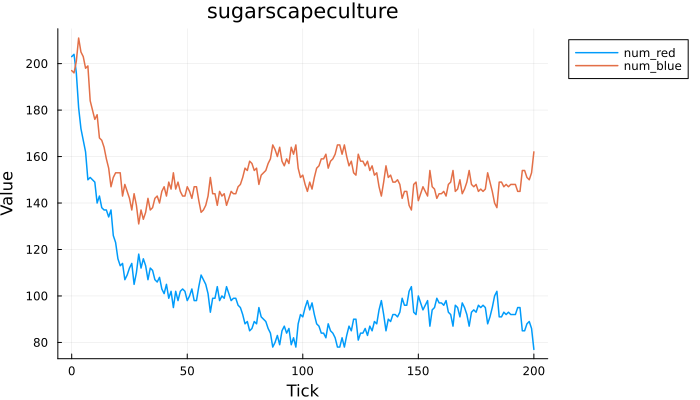
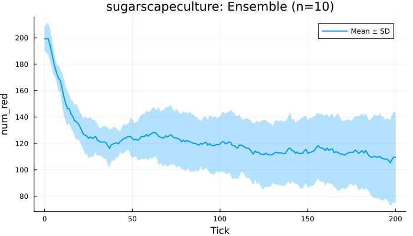
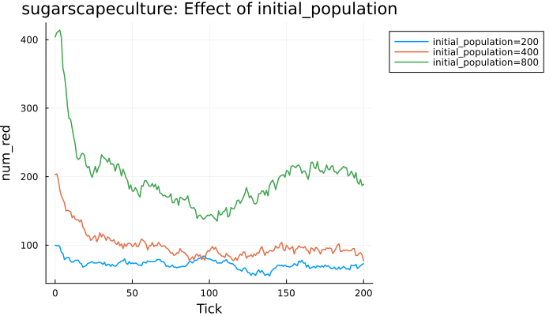

# Sugarscape Culture


- [Overview](#overview)
- [Parameters](#parameters)
- [Source Code](#source-code)
- [Time Series](#time-series)
- [Ensemble Runs](#ensemble-runs)
- [Parameter Sensitivity](#parameter-sensitivity)
- [Appendix: Source Code](#appendix-source-code)
  - [Parameters (`parameters.jl`)](#parameters-parametersjl)
  - [Components (`components.jl`)](#components-componentsjl)
  - [Resources (`resources.jl`)](#resources-resourcesjl)
  - [Systems (`systems.jl`)](#systems-systemsjl)
  - [Model (`model.jl`)](#model-modeljl)

## Overview

This vignette demonstrates the **Sugarscape Culture** model implemented
in [ArkModelZoo.jl](https://github.com/sdwfrost/ArkModelZoo.jl) using
the Ark.jl ECS framework.

## Parameters

| Parameter            | Type  | Default | Description        |
|----------------------|-------|---------|--------------------|
| `initial_population` | `Int` | `400`   | initial population |
| `grid_width`         | `Int` | `50`    | grid width         |
| `grid_height`        | `Int` | `50`    | grid height        |
| `max_ticks`          | `Int` | `200`   | max ticks          |

## Source Code

The Julia code to run this model:

``` julia
using ArkModelZoo
_, trajectory = run_sugarscapeculture()
```

## Time Series



## Ensemble Runs

Ten replicates with different random seeds, showing mean ± standard
deviation.



## Parameter Sensitivity

Varying `initial_population`.



## Appendix: Source Code

This model is implemented in the
[Ark.jl](https://github.com/sdwfrost/Ark.jl) Entity-Component-System
(ECS) framework. The code is split into five files, each with a distinct
role:

- **Parameters**: a mutable struct holding all configurable values.
- **Components**: lightweight data types attached to individual entities
  (agents).
- **Resources**: world-level shared state accessible to all systems.
- **Systems**: functions that operate on entities each tick, defining
  model behavior.
- **Model**: wiring that assembles the world, registers resources and
  systems, and provides the run entry point.

### Parameters (`parameters.jl`)

The parameter struct uses `@kwdef` so that every field has a default
value and can be overridden by keyword. These defaults match the
original NetLogo model’s slider settings.

``` julia
Base.@kwdef mutable struct SCParams
    initial_population::Int = 400
    grid_width::Int = 50
    grid_height::Int = 50
    max_ticks::Int = 200
    seed::Int = 42
end
```

### Components (`components.jl`)

Components are lightweight data types attached to individual entities
(agents). Mutable structs hold per-entity state, while empty tag structs
act as markers for the ECS query system to efficiently filter entities.

``` julia
struct SCDummy end
```

### Resources (`resources.jl`)

Resources are world-level singletons shared across all systems, used for
global state and aggregate statistics.

``` julia
# 50×50 sugar landscape from the NetLogo Sugarscape Culture model.
# SC_SUGAR_LANDSCAPE[i, j] corresponds to NetLogo matrix row (i-1), column (j-1).
# Patch mapping: max_psugar[x, y] = SC_SUGAR_LANDSCAPE[x, 51 - y]
const SC_SUGAR_LANDSCAPE = [
    0 0 0 0 0 0 0 0 0 0 0 0 0 0 0 0 0 0 1 1 1 1 1 1 1 1 1 2 2 2 2 2 2 2 2 2 3 3 3 3 3 3 2 2 2 2 2 2 2 2;
    0 0 0 0 0 0 0 0 0 0 0 0 0 0 0 0 0 0 1 1 1 1 1 1 1 1 2 2 2 2 2 2 2 2 3 3 3 3 3 3 3 3 3 3 2 2 2 2 2 2;
    0 0 0 0 0 0 0 0 0 0 0 0 0 0 0 0 0 1 1 1 1 1 1 1 1 2 2 2 2 2 2 2 3 3 3 3 3 3 3 3 3 3 3 3 3 3 2 2 2 2;
    0 0 0 0 0 0 0 0 0 0 0 0 0 0 0 0 0 1 1 1 1 1 1 1 1 2 2 2 2 2 2 3 3 3 3 3 3 3 3 3 3 3 3 3 3 3 3 2 2 2;
    0 0 0 0 0 0 0 0 0 0 0 0 0 0 0 0 0 1 1 1 1 1 1 1 2 2 2 2 2 2 3 3 3 3 3 3 3 3 3 3 3 3 3 3 3 3 3 3 2 2;
    0 0 0 0 0 0 0 0 0 0 0 0 0 0 0 0 1 1 1 1 1 1 1 1 2 2 2 2 2 2 3 3 3 3 3 3 3 4 4 4 4 3 3 3 3 3 3 3 2 2;
    0 0 0 0 0 0 0 0 0 0 0 0 0 0 0 1 1 1 1 1 1 1 1 1 2 2 2 2 2 3 3 3 3 3 3 4 4 4 4 4 4 4 4 3 3 3 3 3 3 2;
    0 0 0 0 0 0 0 0 0 0 0 0 0 0 0 1 1 1 1 1 1 1 1 2 2 2 2 2 2 3 3 3 3 3 4 4 4 4 4 4 4 4 4 4 3 3 3 3 3 2;
    0 0 0 0 0 0 0 0 0 0 0 0 0 0 1 1 1 1 1 1 1 1 1 2 2 2 2 2 3 3 3 3 3 3 4 4 4 4 4 4 4 4 4 4 3 3 3 3 3 3;
    0 0 0 0 0 0 0 0 0 0 0 0 0 1 1 1 1 1 1 1 1 1 1 2 2 2 2 2 3 3 3 3 3 4 4 4 4 4 4 4 4 4 4 4 4 3 3 3 3 3;
    0 0 0 0 0 0 0 0 0 0 0 0 1 1 1 1 1 1 1 1 1 1 2 2 2 2 2 2 3 3 3 3 3 4 4 4 4 4 4 4 4 4 4 4 4 3 3 3 3 3;
    0 0 0 0 0 0 0 0 0 0 0 1 1 1 1 1 1 1 1 1 1 1 2 2 2 2 2 2 3 3 3 3 3 4 4 4 4 4 4 4 4 4 4 4 4 3 3 3 3 3;
    0 0 0 0 0 0 0 0 0 0 1 1 1 1 1 1 1 1 1 1 1 1 2 2 2 2 2 2 3 3 3 3 3 4 4 4 4 4 4 4 4 4 4 4 4 3 3 3 3 3;
    0 0 0 0 0 0 0 0 0 1 1 1 1 1 1 1 1 1 1 1 1 1 2 2 2 2 2 2 3 3 3 3 3 3 4 4 4 4 4 4 4 4 4 4 3 3 3 3 3 3;
    0 0 0 0 0 0 0 1 1 1 1 1 1 1 1 1 1 1 1 1 1 2 2 2 2 2 2 2 3 3 3 3 3 3 4 4 4 4 4 4 4 4 4 4 3 3 3 3 3 2;
    0 0 0 0 0 1 1 1 1 1 1 1 1 1 1 1 1 1 1 1 2 2 2 2 2 2 2 2 3 3 3 3 3 3 3 4 4 4 4 4 4 4 4 3 3 3 3 3 3 2;
    1 1 1 1 1 1 1 1 1 1 1 1 1 1 1 1 1 1 1 2 2 2 2 2 2 2 2 2 3 3 3 3 3 3 3 3 3 4 4 4 4 3 3 3 3 3 3 3 2 2;
    1 1 1 1 1 1 1 1 1 1 1 1 1 1 1 1 1 1 2 2 2 2 2 2 2 2 2 2 2 3 3 3 3 3 3 3 3 3 3 3 3 3 3 3 3 3 3 3 2 2;
    1 1 1 1 1 1 1 1 1 1 1 1 1 1 1 2 2 2 2 2 2 2 2 2 2 2 2 2 2 3 3 3 3 3 3 3 3 3 3 3 3 3 3 3 3 3 3 2 2 2;
    1 1 1 1 1 1 1 1 1 1 2 2 2 2 2 2 2 2 2 2 2 2 2 2 2 2 2 2 2 2 3 3 3 3 3 3 3 3 3 3 3 3 3 3 3 3 2 2 2 2;
    1 1 1 1 1 1 1 1 2 2 2 2 2 2 2 2 2 2 2 2 2 2 2 2 2 2 2 2 2 2 2 3 3 3 3 3 3 3 3 3 3 3 3 3 2 2 2 2 2 2;
    1 1 1 1 1 1 2 2 2 2 2 2 2 2 2 2 2 2 2 2 2 2 2 2 2 2 2 2 2 2 2 2 2 3 3 3 3 3 3 3 3 3 2 2 2 2 2 2 2 2;
    1 1 1 1 2 2 2 2 2 2 2 2 2 2 2 2 2 2 2 2 2 2 2 2 2 2 2 2 2 2 2 2 2 2 2 2 2 2 2 2 2 2 2 2 2 2 2 2 2 1;
    1 1 1 2 2 2 2 2 2 2 2 2 2 2 2 2 2 2 2 2 2 2 2 2 2 2 2 2 2 2 2 2 2 2 2 2 2 2 2 2 2 2 2 2 2 2 2 2 1 1;
    1 1 2 2 2 2 2 2 2 2 2 2 3 3 3 3 3 3 3 3 3 2 2 2 2 2 2 2 2 2 2 2 2 2 2 2 2 2 2 2 2 2 2 2 2 2 2 1 1 1;
    1 2 2 2 2 2 2 2 2 2 3 3 3 3 3 3 3 3 3 3 3 3 3 2 2 2 2 2 2 2 2 2 2 2 2 2 2 2 2 2 2 2 2 2 2 1 1 1 1 1;
    1 2 2 2 2 2 2 2 3 3 3 3 3 3 3 3 3 3 3 3 3 3 3 3 2 2 2 2 2 2 2 2 2 2 2 2 2 2 2 2 2 2 1 1 1 1 1 1 1 1;
    2 2 2 2 2 2 2 3 3 3 3 3 3 3 3 3 3 3 3 3 3 3 3 3 3 2 2 2 2 2 2 2 2 2 2 2 2 2 1 1 1 1 1 1 1 1 1 1 1 1;
    2 2 2 2 2 2 3 3 3 3 3 3 3 3 3 3 3 3 3 3 3 3 3 3 3 2 2 2 2 2 2 2 2 2 2 2 2 1 1 1 1 1 1 1 1 1 1 1 1 1;
    2 2 2 2 2 2 3 3 3 3 3 3 3 4 4 4 4 3 3 3 3 3 3 3 3 3 2 2 2 2 2 2 2 2 2 2 1 1 1 1 1 1 1 1 1 1 1 1 1 1;
    2 2 2 2 2 3 3 3 3 3 3 4 4 4 4 4 4 4 4 3 3 3 3 3 3 3 2 2 2 2 2 2 2 2 2 2 1 1 1 1 1 1 1 1 1 1 1 0 0 0;
    2 2 2 2 2 3 3 3 3 3 4 4 4 4 4 4 4 4 4 4 3 3 3 3 3 3 2 2 2 2 2 2 2 2 1 1 1 1 1 1 1 1 1 1 1 1 0 0 0 0;
    2 2 2 2 3 3 3 3 3 3 4 4 4 4 4 4 4 4 4 4 3 3 3 3 3 3 2 2 2 2 2 2 2 2 1 1 1 1 1 1 1 1 1 1 0 0 0 0 0 0;
    2 2 2 2 3 3 3 3 3 4 4 4 4 4 4 4 4 4 4 4 4 3 3 3 3 3 2 2 2 2 2 2 1 1 1 1 1 1 1 1 1 1 0 0 0 0 0 0 0 0;
    2 2 2 2 3 3 3 3 3 4 4 4 4 4 4 4 4 4 4 4 4 3 3 3 3 3 2 2 2 2 2 2 1 1 1 1 1 1 1 1 1 1 0 0 0 0 0 0 0 0;
    2 2 2 2 3 3 3 3 3 4 4 4 4 4 4 4 4 4 4 4 4 3 3 3 3 3 2 2 2 2 2 2 1 1 1 1 1 1 1 1 1 0 0 0 0 0 0 0 0 0;
    2 2 2 2 3 3 3 3 3 4 4 4 4 4 4 4 4 4 4 4 4 3 3 3 3 3 2 2 2 2 2 1 1 1 1 1 1 1 1 1 0 0 0 0 0 0 0 0 0 0;
    2 2 2 2 3 3 3 3 3 3 4 4 4 4 4 4 4 4 4 4 3 3 3 3 3 3 2 2 2 2 2 1 1 1 1 1 1 1 1 0 0 0 0 0 0 0 0 0 0 0;
    2 2 2 2 2 3 3 3 3 3 4 4 4 4 4 4 4 4 4 4 3 3 3 3 3 2 2 2 2 2 2 1 1 1 1 1 1 1 1 0 0 0 0 0 0 0 0 0 0 0;
    2 2 2 2 2 3 3 3 3 3 3 4 4 4 4 4 4 4 4 3 3 3 3 3 3 2 2 2 2 2 1 1 1 1 1 1 1 1 0 0 0 0 0 0 0 0 0 0 0 0;
    2 2 2 2 2 2 3 3 3 3 3 3 3 4 4 4 4 3 3 3 3 3 3 3 2 2 2 2 2 2 1 1 1 1 1 1 1 0 0 0 0 0 0 0 0 0 0 0 0 0;
    2 2 2 2 2 2 3 3 3 3 3 3 3 3 3 3 3 3 3 3 3 3 3 3 2 2 2 2 2 2 1 1 1 1 1 1 1 0 0 0 0 0 0 0 0 0 0 0 0 0;
    2 2 2 2 2 2 2 3 3 3 3 3 3 3 3 3 3 3 3 3 3 3 3 2 2 2 2 2 2 1 1 1 1 1 1 1 1 0 0 0 0 0 0 0 0 0 0 0 0 0;
    1 2 2 2 2 2 2 2 3 3 3 3 3 3 3 3 3 3 3 3 3 3 2 2 2 2 2 2 1 1 1 1 1 1 1 1 1 0 0 0 0 0 0 0 0 0 0 0 0 0;
    1 2 2 2 2 2 2 2 2 2 3 3 3 3 3 3 3 3 3 3 2 2 2 2 2 2 2 2 1 1 1 1 1 1 1 1 1 0 0 0 0 0 0 0 0 0 0 0 0 0;
    1 1 2 2 2 2 2 2 2 2 2 2 3 3 3 3 3 3 2 2 2 2 2 2 2 2 2 1 1 1 1 1 1 1 1 1 1 0 0 0 0 0 0 0 0 0 0 0 0 0;
    1 1 1 2 2 2 2 2 2 2 2 2 2 2 2 2 2 2 2 2 2 2 2 2 2 2 1 1 1 1 1 1 1 1 1 1 0 0 0 0 0 0 0 0 0 0 0 0 0 0;
    1 1 1 1 2 2 2 2 2 2 2 2 2 2 2 2 2 2 2 2 2 2 2 2 2 1 1 1 1 1 1 1 1 1 1 1 0 0 0 0 0 0 0 0 0 0 0 0 0 0;
    1 1 1 1 1 1 2 2 2 2 2 2 2 2 2 2 2 2 2 2 2 2 2 1 1 1 1 1 1 1 1 1 1 1 1 1 0 0 0 0 0 0 0 0 0 0 0 0 0 0;
    1 1 1 1 1 1 1 1 2 2 2 2 2 2 2 2 2 2 2 2 2 1 1 1 1 1 1 1 1 1 1 1 1 1 1 0 0 0 0 0 0 0 0 0 0 0 0 0 0 0
]

mutable struct SCAgent
    x::Int
    y::Int
    sugar::Int
    metabolism::Int
    vision::Int
    culture::Vector{Int}   # 11 elements, each 0 or 1
end

mutable struct SCWorld
    width::Int
    height::Int
    psugar::Matrix{Int}
    max_psugar::Matrix{Int}
    agents::Vector{SCAgent}
    occupant::Matrix{Int}  # 0 = empty, positive = index into agents
end

function SCWorld(w::Int, h::Int)
    SCWorld(w, h, zeros(Int, w, h), zeros(Int, w, h), SCAgent[], zeros(Int, w, h))
end

mutable struct SCStats
    num_red::Int
    num_blue::Int
end
SCStats() = SCStats(0, 0)
```

### Systems (`systems.jl`)

Systems contain the model logic and execute in a defined order each
tick. Each system struct implements either `initialize!` (run once at
setup) or `update!` (run every tick).

``` julia
# Sugarscape Culture — sugar harvesting with cultural tag diffusion on a 50×50 grid

struct InitSCSystem <: System end

function _sc_update_stats!(world_data::SCWorld, stats::SCStats)
    nr = 0
    nb = 0
    for agent in world_data.agents
        if sum(agent.culture) > 5
            nr += 1
        else
            nb += 1
        end
    end
    stats.num_red = nr
    stats.num_blue = nb
end

function initialize!(::InitSCSystem, world::World)
    params     = get_resource(world, SCParams)
    rng        = get_resource(world, RNGResource).rng
    world_data = get_resource(world, SCWorld)
    stats      = get_resource(world, SCStats)

    w, h = world_data.width, world_data.height

    # Initialize sugar landscape
    for x in 1:w, y in 1:h
        world_data.max_psugar[x, y] = SC_SUGAR_LANDSCAPE[x, 51 - y]
    end
    world_data.psugar .= world_data.max_psugar

    # Create agents at random unoccupied patches
    for _ in 1:params.initial_population
        while true
            x = rand(rng, 1:w)
            y = rand(rng, 1:h)
            if world_data.occupant[x, y] == 0
                agent = SCAgent(
                    x, y,
                    rand(rng, 5:25),
                    rand(rng, 1:4),
                    rand(rng, 1:6),
                    [rand(rng, 0:1) for _ in 1:11]
                )
                push!(world_data.agents, agent)
                world_data.occupant[x, y] = length(world_data.agents)
                break
            end
        end
    end

    _sc_update_stats!(world_data, stats)
    return nothing
end

# --- Main simulation step ---
struct SCGoSystem <: System end

function update!(::SCGoSystem, world::World)
    rng        = get_resource(world, RNGResource).rng
    world_data = get_resource(world, SCWorld)
    stats      = get_resource(world, SCStats)

    w, h = world_data.width, world_data.height
    agents = world_data.agents
    n = length(agents)
    if n == 0
        _sc_update_stats!(world_data, stats)
        return nothing
    end

    # Growback all patches
    for x in 1:w, y in 1:h
        world_data.psugar[x, y] = min(world_data.max_psugar[x, y], world_data.psugar[x, y] + 1)
    end

    # Shuffled agent processing order
    order = shuffle!(rng, collect(1:n))

    # Neighbor offsets (N, E, S, W)
    neighbor_dx = (0, 1, 0, -1)
    neighbor_dy = (1, 0, -1, 0)

    for idx in order
        agent = agents[idx]
        if agent.sugar <= 0
            continue  # already dead this tick
        end

        # --- Culture step ---
        ax, ay = agent.x, agent.y
        neighbor_ids = Int[]
        for k in 1:4
            nx = mod1(ax + neighbor_dx[k], w)
            ny = mod1(ay + neighbor_dy[k], h)
            occ = world_data.occupant[nx, ny]
            if occ != 0 && agents[occ].sugar > 0
                push!(neighbor_ids, occ)
            end
        end
        if !isempty(neighbor_ids)
            tag_idx = rand(rng, 1:11)
            my_tag = agent.culture[tag_idx]
            shuffle!(rng, neighbor_ids)
            for nid in neighbor_ids
                if agents[nid].culture[tag_idx] != my_tag
                    agents[nid].culture[tag_idx] = my_tag
                end
            end
        end

        # --- Move step ---
        # Candidates: current patch + unoccupied vision patches along 4 axes
        best_sugar = world_data.psugar[ax, ay]
        best_dist = 0
        # Collect all candidates as (x, y, sugar, dist)
        cand_x = [ax]
        cand_y = [ay]
        cand_s = [world_data.psugar[ax, ay]]
        cand_d = [0]

        for n in 1:agent.vision
            for (dx, dy) in ((0, n), (n, 0), (0, -n), (-n, 0))
                nx = mod1(ax + dx, w)
                ny = mod1(ay + dy, h)
                if world_data.occupant[nx, ny] == 0
                    push!(cand_x, nx)
                    push!(cand_y, ny)
                    push!(cand_s, world_data.psugar[nx, ny])
                    push!(cand_d, n)
                end
            end
        end

        # Find max sugar among candidates
        max_s = maximum(cand_s)
        # Among max-sugar candidates, find min distance
        min_d = typemax(Int)
        for i in eachindex(cand_s)
            if cand_s[i] == max_s && cand_d[i] < min_d
                min_d = cand_d[i]
            end
        end
        # Collect best candidates (max sugar, min distance)
        best_ids = Int[]
        for i in eachindex(cand_s)
            if cand_s[i] == max_s && cand_d[i] == min_d
                push!(best_ids, i)
            end
        end
        chosen = best_ids[rand(rng, 1:length(best_ids))]
        new_x, new_y = cand_x[chosen], cand_y[chosen]

        if new_x != ax || new_y != ay
            world_data.occupant[ax, ay] = 0
            agent.x = new_x
            agent.y = new_y
            world_data.occupant[new_x, new_y] = idx
        end

        # --- Eat step ---
        agent.sugar = agent.sugar - agent.metabolism + world_data.psugar[agent.x, agent.y]
        world_data.psugar[agent.x, agent.y] = 0

        # --- Death check ---
        if agent.sugar <= 0
            world_data.occupant[agent.x, agent.y] = 0
        end
    end

    # Remove dead agents and rebuild occupant grid
    alive = SCAgent[]
    for agent in agents
        if agent.sugar > 0
            push!(alive, agent)
        end
    end
    world_data.agents = alive
    fill!(world_data.occupant, 0)
    for (i, agent) in enumerate(world_data.agents)
        world_data.occupant[agent.x, agent.y] = i
    end

    _sc_update_stats!(world_data, stats)
    return nothing
end

# --- Termination ---
struct SCTerminationSystem <: System end

function update!(::SCTerminationSystem, world::World)
    params     = get_resource(world, SCParams)
    tick       = get_resource(world, Tick)
    world_data = get_resource(world, SCWorld)

    if isempty(world_data.agents) || tick.tick + 1 >= params.max_ticks
        get_resource(world, Terminate).stop = true
    end
    return nothing
end
```

### Model (`model.jl`)

The model file assembles all pieces: it creates the ECS `World` with the
required component types, registers resources, builds the `Scheduler`
with systems in execution order, and exposes the public `run` entry
point. The observer pattern records the trajectory each tick.

``` julia
function sugarscapeculture_world(; initial_capacity::Int = 128)
    return World(SCDummy; initial_capacity = initial_capacity, allow_mutable = true)
end

function sugarscapeculture_systems()
    return (InitSCSystem(), SCGoSystem(), SCTerminationSystem())
end

function sugarscapeculture_model(params::SCParams = SCParams())
    world = sugarscapeculture_world()
    _add_standard_resources!(world, params)
    add_resource!(world, SCWorld(params.grid_width, params.grid_height))
    add_resource!(world, SCStats())
    scheduler = Scheduler(world, sugarscapeculture_systems())
    initialize!(scheduler)
    return scheduler
end

struct SCObserver end

function sugarscapeculture_headers(::SCObserver)
    return ["num_red", "num_blue"]
end

function sugarscapeculture_values(::SCObserver, world::World)
    stats = get_resource(world, SCStats)
    return Float64[stats.num_red, stats.num_blue]
end

function run_sugarscapeculture(; params::SCParams = SCParams(), observe::Bool = true)
    return _run_model(sugarscapeculture_model, SCObserver(), sugarscapeculture_values; params, observe)
end
```
