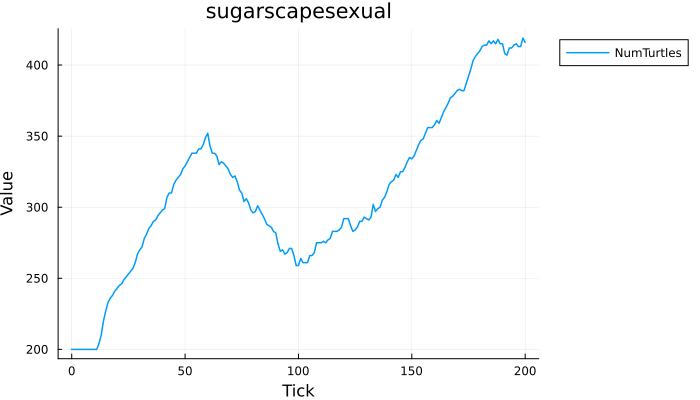
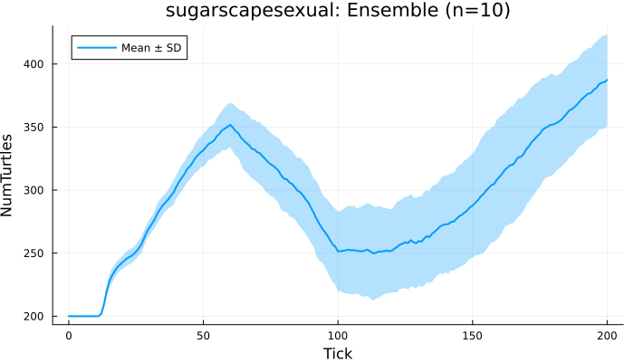
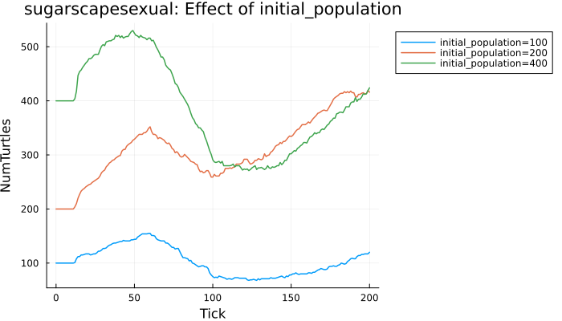

## Overview

### WHAT IS IT?

This model in the NetLogo Sugarscape suite implements Epstein & Axtell's Sugarscape Sexual reproduction, as described in chapter 3 of their book Growing Artificial Societies: Social Science from the Bottom Up. It simulates a population with limited, spatially-distributed resources available and 2 differents sex distrbuted among population. In order to can reproduce each turtle must be from different sex and have enough amount of sugar and their age must be in the range of fertility variable.

### HOW IT WORKS

The rules are similar to Sugarscape constant grow, in adition each individual has a defined sex, that could be female or male. If an individual finds another turtle from different sex and in a reproductive age and with enough amount of sugar and the turtle is near the caller and there is an empty patch near them, then thay can offspring. Vision and metabolism are passed through generations by random chance or the vision from one parent or the metabolism from the other.

### THINGS TO NOTICE

The world has a carrying capacity, which is lower than the initial population of the world. Agents who are born in sugarless places or who consume more sugar than the land cannot be supported by the world, and die. Other agents die from competition - although some places in the world have enough sugar to support them, the sugar supply is limited and other agents may reach and consume it first.

As the population stabilizes, the average vision increases while the average metabolism decreases. Agents with lower vision cannot find the better sugar patches, while agents with high metabolism cannot support themselves. The death of these agents causes the attribute averages to change.

You can watch different demographic regimes going through time; inheritance follows mendelian rules.

### THINGS TO TRY

Population grows and shrinks until reach some kind of stable state. You can try with different initial populations and test some hypothesis about the influence of this initial state in the final state.

### EXTENDING THE MODEL

As mentiones by Axtell & Epstein you can change the way of agent reproduction and avoid reproduction among members of the same family or you can change the sugar inheritance rule once one of the parents die (in current implementation that amount of sugar is vanished from the board).

### NETLOGO FEATURES

We use here the matrix extension to build the sugar world.

### RELATED MODELS

Other models in the NetLogo Sugarscape suite include:

* Sugarscape 1 Immediate Growback
* Sugarscape 3 Wealth Distribution
* Sugarscape 4 Seasonal Migration
* Sugarscape 5 Cultural Dynamics
* Sugarscape 6 Sexual Reproduction

### CREDITS AND REFERENCES

Epstein, J. and Axtell, R. (1996). Growing Artificial Societies: Social Science from the Bottom Up.  Washington, D.C.: Brookings Institution Press.

### HOW TO CITE

If you mention this model or the NetLogo software in a publication, we ask that you include the citations below.

For the model itself:

* Diaz Cordova, D, (2023). Netlogo Sugarscape 6. Sexual Reproduction. Universidad Nacional de Lanús. Argentina.

Please cite the NetLogo software as:

* Wilensky, U. (1999). NetLogo. http://ccl.northwestern.edu/netlogo/. Center for Connected Learning and Computer-Based Modeling, Northwestern University, Evanston, IL.

### COPYRIGHT AND LICENSE

Copyright 2009 Uri Wilensky.


This work is licensed under the Creative Commons Attribution-NonCommercial-ShareAlike 3.0 License.  To view a copy of this license, visit https://creativecommons.org/licenses/by-nc-sa/3.0/ or send a letter to Creative Commons, 559 Nathan Abbott Way, Stanford, California 94305, USA.

Commercial licenses are also available. To inquire about commercial licenses, please contact Uri Wilensky at uri@northwestern.edu.

<!-- 2009 Cite: Li, J. -->

## Parameters

| Parameter | Type | Default | Description |
|-----------|------|---------|-------------|
| `initial_population` | `Int` | `200` | initial population |
| `grid_width` | `Int` | `50` | grid width |
| `grid_height` | `Int` | `50` | grid height |
| `max_ticks` | `Int` | `200` | max ticks |

## Source Code

The Julia code to run this model:

```julia
using ArkModelZoo
_, trajectory = run_sugarscapesexual()
```

## Time Series

{width=100%}

## Ensemble Runs

Ten replicates with different random seeds, showing mean ± standard deviation.

{width=100%}

## Parameter Sensitivity

Varying `initial_population`.

{width=100%}


## Appendix: Source Code

This model is implemented in the [Ark.jl](https://github.com/sdwfrost/Ark.jl) Entity-Component-System (ECS) framework. The code is split into five files, each with a distinct role:

- **Parameters**: a mutable struct holding all configurable values.
- **Components**: lightweight data types attached to individual entities (agents).
- **Resources**: world-level shared state accessible to all systems.
- **Systems**: functions that operate on entities each tick, defining model behavior.
- **Model**: wiring that assembles the world, registers resources and systems, and provides the run entry point.

### Parameters (`parameters.jl`)

The parameter struct uses `@kwdef` so that every field has a default value and can be overridden by keyword. These defaults match the original NetLogo model's slider settings.

```julia
Base.@kwdef mutable struct SSParams
    initial_population::Int = 200
    grid_width::Int = 50
    grid_height::Int = 50
    max_ticks::Int = 200
    seed::Int = 42
end
```

### Components (`components.jl`)

Components are lightweight data types attached to individual entities (agents). Mutable structs hold per-entity state, while empty tag structs act as markers for the ECS query system to efficiently filter entities.

```julia
struct SSDummy end
```

### Resources (`resources.jl`)

Resources are world-level singletons shared across all systems, used for global state and aggregate statistics.

```julia
# Row r of the matrix corresponds to NetLogo y = 50-r (row 1 = top, row 50 = bottom).
# During init: max_psugar[x, y] = SS_SUGAR_LANDSCAPE[51-y, x]
const SS_SUGAR_LANDSCAPE = [
    0 0 0 0 0 0 0 0 0 0 0 0 0 0 0 0 0 0 1 1 1 1 1 1 1 1 1 2 2 2 2 2 2 2 2 2 3 3 3 3 3 3 2 2 2 2 2 2 2 2;
    0 0 0 0 0 0 0 0 0 0 0 0 0 0 0 0 0 0 1 1 1 1 1 1 1 1 2 2 2 2 2 2 2 2 3 3 3 3 3 3 3 3 3 3 2 2 2 2 2 2;
    0 0 0 0 0 0 0 0 0 0 0 0 0 0 0 0 0 1 1 1 1 1 1 1 1 2 2 2 2 2 2 2 3 3 3 3 3 3 3 3 3 3 3 3 3 3 2 2 2 2;
    0 0 0 0 0 0 0 0 0 0 0 0 0 0 0 0 0 1 1 1 1 1 1 1 1 2 2 2 2 2 2 3 3 3 3 3 3 3 3 3 3 3 3 3 3 3 3 2 2 2;
    0 0 0 0 0 0 0 0 0 0 0 0 0 0 0 0 0 1 1 1 1 1 1 1 2 2 2 2 2 2 3 3 3 3 3 3 3 3 3 3 3 3 3 3 3 3 3 3 2 2;
    0 0 0 0 0 0 0 0 0 0 0 0 0 0 0 0 1 1 1 1 1 1 1 1 2 2 2 2 2 2 3 3 3 3 3 3 3 4 4 4 4 3 3 3 3 3 3 3 2 2;
    0 0 0 0 0 0 0 0 0 0 0 0 0 0 0 1 1 1 1 1 1 1 1 1 2 2 2 2 2 3 3 3 3 3 3 4 4 4 4 4 4 4 4 3 3 3 3 3 3 2;
    0 0 0 0 0 0 0 0 0 0 0 0 0 0 0 1 1 1 1 1 1 1 1 2 2 2 2 2 2 3 3 3 3 3 4 4 4 4 4 4 4 4 4 4 3 3 3 3 3 2;
    0 0 0 0 0 0 0 0 0 0 0 0 0 0 1 1 1 1 1 1 1 1 1 2 2 2 2 2 3 3 3 3 3 3 4 4 4 4 4 4 4 4 4 4 3 3 3 3 3 3;
    0 0 0 0 0 0 0 0 0 0 0 0 0 1 1 1 1 1 1 1 1 1 1 2 2 2 2 2 3 3 3 3 3 4 4 4 4 4 4 4 4 4 4 4 4 3 3 3 3 3;
    0 0 0 0 0 0 0 0 0 0 0 0 1 1 1 1 1 1 1 1 1 1 2 2 2 2 2 2 3 3 3 3 3 4 4 4 4 4 4 4 4 4 4 4 4 3 3 3 3 3;
    0 0 0 0 0 0 0 0 0 0 0 1 1 1 1 1 1 1 1 1 1 1 2 2 2 2 2 2 3 3 3 3 3 4 4 4 4 4 4 4 4 4 4 4 4 3 3 3 3 3;
    0 0 0 0 0 0 0 0 0 0 1 1 1 1 1 1 1 1 1 1 1 1 2 2 2 2 2 2 3 3 3 3 3 4 4 4 4 4 4 4 4 4 4 4 4 3 3 3 3 3;
    0 0 0 0 0 0 0 0 0 1 1 1 1 1 1 1 1 1 1 1 1 1 2 2 2 2 2 2 3 3 3 3 3 3 4 4 4 4 4 4 4 4 4 4 3 3 3 3 3 3;
    0 0 0 0 0 0 0 1 1 1 1 1 1 1 1 1 1 1 1 1 1 2 2 2 2 2 2 2 3 3 3 3 3 3 4 4 4 4 4 4 4 4 4 4 3 3 3 3 3 2;
    0 0 0 0 0 1 1 1 1 1 1 1 1 1 1 1 1 1 1 1 2 2 2 2 2 2 2 2 3 3 3 3 3 3 3 4 4 4 4 4 4 4 4 3 3 3 3 3 3 2;
    1 1 1 1 1 1 1 1 1 1 1 1 1 1 1 1 1 1 1 2 2 2 2 2 2 2 2 2 3 3 3 3 3 3 3 3 3 4 4 4 4 3 3 3 3 3 3 3 2 2;
    1 1 1 1 1 1 1 1 1 1 1 1 1 1 1 1 1 1 2 2 2 2 2 2 2 2 2 2 2 3 3 3 3 3 3 3 3 3 3 3 3 3 3 3 3 3 3 3 2 2;
    1 1 1 1 1 1 1 1 1 1 1 1 1 1 1 2 2 2 2 2 2 2 2 2 2 2 2 2 2 3 3 3 3 3 3 3 3 3 3 3 3 3 3 3 3 3 3 2 2 2;
    1 1 1 1 1 1 1 1 1 1 2 2 2 2 2 2 2 2 2 2 2 2 2 2 2 2 2 2 2 2 3 3 3 3 3 3 3 3 3 3 3 3 3 3 3 3 2 2 2 2;
    1 1 1 1 1 1 1 1 2 2 2 2 2 2 2 2 2 2 2 2 2 2 2 2 2 2 2 2 2 2 2 3 3 3 3 3 3 3 3 3 3 3 3 3 2 2 2 2 2 2;
    1 1 1 1 1 1 2 2 2 2 2 2 2 2 2 2 2 2 2 2 2 2 2 2 2 2 2 2 2 2 2 2 2 3 3 3 3 3 3 3 3 3 2 2 2 2 2 2 2 2;
    1 1 1 1 2 2 2 2 2 2 2 2 2 2 2 2 2 2 2 2 2 2 2 2 2 2 2 2 2 2 2 2 2 2 2 2 2 2 2 2 2 2 2 2 2 2 2 2 2 1;
    1 1 1 2 2 2 2 2 2 2 2 2 2 2 2 2 2 2 2 2 2 2 2 2 2 2 2 2 2 2 2 2 2 2 2 2 2 2 2 2 2 2 2 2 2 2 2 2 1 1;
    1 1 2 2 2 2 2 2 2 2 2 2 3 3 3 3 3 3 3 3 3 2 2 2 2 2 2 2 2 2 2 2 2 2 2 2 2 2 2 2 2 2 2 2 2 2 2 1 1 1;
    1 2 2 2 2 2 2 2 2 2 3 3 3 3 3 3 3 3 3 3 3 3 3 2 2 2 2 2 2 2 2 2 2 2 2 2 2 2 2 2 2 2 2 2 2 1 1 1 1 1;
    1 2 2 2 2 2 2 2 3 3 3 3 3 3 3 3 3 3 3 3 3 3 3 3 2 2 2 2 2 2 2 2 2 2 2 2 2 2 2 2 2 2 1 1 1 1 1 1 1 1;
    2 2 2 2 2 2 2 3 3 3 3 3 3 3 3 3 3 3 3 3 3 3 3 3 3 2 2 2 2 2 2 2 2 2 2 2 2 2 1 1 1 1 1 1 1 1 1 1 1 1;
    2 2 2 2 2 2 3 3 3 3 3 3 3 3 3 3 3 3 3 3 3 3 3 3 3 2 2 2 2 2 2 2 2 2 2 2 2 1 1 1 1 1 1 1 1 1 1 1 1 1;
    2 2 2 2 2 2 3 3 3 3 3 3 3 4 4 4 4 3 3 3 3 3 3 3 3 3 2 2 2 2 2 2 2 2 2 2 1 1 1 1 1 1 1 1 1 1 1 1 1 1;
    2 2 2 2 2 3 3 3 3 3 3 4 4 4 4 4 4 4 4 3 3 3 3 3 3 3 2 2 2 2 2 2 2 2 2 2 1 1 1 1 1 1 1 1 1 1 1 0 0 0;
    2 2 2 2 2 3 3 3 3 3 4 4 4 4 4 4 4 4 4 4 3 3 3 3 3 3 2 2 2 2 2 2 2 2 1 1 1 1 1 1 1 1 1 1 1 1 0 0 0 0;
    2 2 2 2 3 3 3 3 3 3 4 4 4 4 4 4 4 4 4 4 3 3 3 3 3 3 2 2 2 2 2 2 2 2 1 1 1 1 1 1 1 1 1 1 0 0 0 0 0 0;
    2 2 2 2 3 3 3 3 3 4 4 4 4 4 4 4 4 4 4 4 4 3 3 3 3 3 2 2 2 2 2 2 1 1 1 1 1 1 1 1 1 1 0 0 0 0 0 0 0 0;
    2 2 2 2 3 3 3 3 3 4 4 4 4 4 4 4 4 4 4 4 4 3 3 3 3 3 2 2 2 2 2 2 1 1 1 1 1 1 1 1 1 1 0 0 0 0 0 0 0 0;
    2 2 2 2 3 3 3 3 3 4 4 4 4 4 4 4 4 4 4 4 4 3 3 3 3 3 2 2 2 2 2 2 1 1 1 1 1 1 1 1 1 0 0 0 0 0 0 0 0 0;
    2 2 2 2 3 3 3 3 3 4 4 4 4 4 4 4 4 4 4 4 4 3 3 3 3 3 2 2 2 2 2 1 1 1 1 1 1 1 1 1 0 0 0 0 0 0 0 0 0 0;
    2 2 2 2 3 3 3 3 3 3 4 4 4 4 4 4 4 4 4 4 3 3 3 3 3 3 2 2 2 2 2 1 1 1 1 1 1 1 1 0 0 0 0 0 0 0 0 0 0 0;
    2 2 2 2 2 3 3 3 3 3 4 4 4 4 4 4 4 4 4 4 3 3 3 3 3 2 2 2 2 2 2 1 1 1 1 1 1 1 1 0 0 0 0 0 0 0 0 0 0 0;
    2 2 2 2 2 3 3 3 3 3 3 4 4 4 4 4 4 4 4 3 3 3 3 3 3 2 2 2 2 2 1 1 1 1 1 1 1 1 0 0 0 0 0 0 0 0 0 0 0 0;
    2 2 2 2 2 2 3 3 3 3 3 3 3 4 4 4 4 3 3 3 3 3 3 3 2 2 2 2 2 2 1 1 1 1 1 1 1 0 0 0 0 0 0 0 0 0 0 0 0 0;
    2 2 2 2 2 2 3 3 3 3 3 3 3 3 3 3 3 3 3 3 3 3 3 3 2 2 2 2 2 2 1 1 1 1 1 1 1 0 0 0 0 0 0 0 0 0 0 0 0 0;
    2 2 2 2 2 2 2 3 3 3 3 3 3 3 3 3 3 3 3 3 3 3 3 2 2 2 2 2 2 1 1 1 1 1 1 1 1 0 0 0 0 0 0 0 0 0 0 0 0 0;
    1 2 2 2 2 2 2 2 3 3 3 3 3 3 3 3 3 3 3 3 3 3 2 2 2 2 2 2 1 1 1 1 1 1 1 1 1 0 0 0 0 0 0 0 0 0 0 0 0 0;
    1 2 2 2 2 2 2 2 2 2 3 3 3 3 3 3 3 3 3 3 2 2 2 2 2 2 2 2 1 1 1 1 1 1 1 1 1 0 0 0 0 0 0 0 0 0 0 0 0 0;
    1 1 2 2 2 2 2 2 2 2 2 2 3 3 3 3 3 3 2 2 2 2 2 2 2 2 2 1 1 1 1 1 1 1 1 1 1 0 0 0 0 0 0 0 0 0 0 0 0 0;
    1 1 1 2 2 2 2 2 2 2 2 2 2 2 2 2 2 2 2 2 2 2 2 2 2 2 1 1 1 1 1 1 1 1 1 1 0 0 0 0 0 0 0 0 0 0 0 0 0 0;
    1 1 1 1 2 2 2 2 2 2 2 2 2 2 2 2 2 2 2 2 2 2 2 2 2 1 1 1 1 1 1 1 1 1 1 1 0 0 0 0 0 0 0 0 0 0 0 0 0 0;
    1 1 1 1 1 1 2 2 2 2 2 2 2 2 2 2 2 2 2 2 2 2 2 1 1 1 1 1 1 1 1 1 1 1 1 1 0 0 0 0 0 0 0 0 0 0 0 0 0 0;
    1 1 1 1 1 1 1 1 2 2 2 2 2 2 2 2 2 2 2 2 2 1 1 1 1 1 1 1 1 1 1 1 1 1 1 0 0 0 0 0 0 0 0 0 0 0 0 0 0 0;
]

mutable struct SSAgent
    x::Int
    y::Int
    sugar::Float64
    metabolism::Int
    vision::Int
    sexo::Int         # 0=female, 1=male
    edad::Int         # age
    muerte::Int       # death age
    fertilidadc::Int  # fertility start
    fertilidadf::Int  # fertility end
    dotacion::Float64 # initial endowment
    alive::Bool
end

mutable struct SSWorld
    width::Int
    height::Int
    psugar::Matrix{Int}
    max_psugar::Matrix{Int}
    agents::Vector{SSAgent}
    occupant::Matrix{Int}    # 0=empty, positive=agent index
end

function SSWorld(w::Int, h::Int)
    SSWorld(w, h, zeros(Int, w, h), zeros(Int, w, h), SSAgent[], zeros(Int, w, h))
end

mutable struct SSStats
    num_turtles::Int
end
SSStats() = SSStats(0)
```

### Systems (`systems.jl`)

Systems contain the model logic and execute in a defined order each tick. Each system struct implements either `initialize!` (run once at setup) or `update!` (run every tick).

```julia
# --- Initialization ---

struct InitSSSystem <: System end

function initialize!(::InitSSSystem, world::World)
    params = get_resource(world, SSParams)
    rng = get_resource(world, RNGResource).rng
    ssworld = get_resource(world, SSWorld)
    stats = get_resource(world, SSStats)
    w, h = ssworld.width, ssworld.height

    # Load landscape: row 1 of matrix = top (y=h), row h = bottom (y=1)
    for x in 1:w, y in 1:h
        val = SS_SUGAR_LANDSCAPE[h + 1 - y, x]
        ssworld.max_psugar[x, y] = val
        ssworld.psugar[x, y] = val
    end

    # Create agents at random unoccupied patches
    for _ in 1:params.initial_population
        # Find an unoccupied patch
        px, py = rand(rng, 1:w), rand(rng, 1:h)
        while ssworld.occupant[px, py] != 0
            px, py = rand(rng, 1:w), rand(rng, 1:h)
        end
        sug = Float64(rand(rng, 50:100))
        met = rand(rng, 1:4)
        vis = rand(rng, 1:6)
        sexo = rand(rng, 0:1)
        muerte = 60 + rand(rng, 0:39)
        fertilidadc = 12 + rand(rng, 0:2)
        fertilidadf = sexo == 1 ? 50 + rand(rng, 0:9) : 40 + rand(rng, 0:9)
        agent = SSAgent(px, py, sug, met, vis, sexo, 0, muerte, fertilidadc, fertilidadf, sug, true)
        push!(ssworld.agents, agent)
        ssworld.occupant[px, py] = length(ssworld.agents)
    end

    stats.num_turtles = length(ssworld.agents)
    return nothing
end

# --- Main Go System ---

struct SSGoSystem <: System end

function update!(::SSGoSystem, world::World)
    rng = get_resource(world, RNGResource).rng
    ssworld = get_resource(world, SSWorld)
    stats = get_resource(world, SSStats)
    w, h = ssworld.width, ssworld.height
    agents = ssworld.agents

    # If no alive agents → terminate
    nalive = count(a -> a.alive, agents)
    if nalive == 0
        get_resource(world, Terminate).stop = true
        return nothing
    end

    # Growback
    for x in 1:w, y in 1:h
        if ssworld.psugar[x, y] < ssworld.max_psugar[x, y]
            ssworld.psugar[x, y] = min(ssworld.max_psugar[x, y], ssworld.psugar[x, y] + 1)
        end
    end

    # Process agents in shuffled order (snapshot of current alive agents)
    alive_indices = [i for i in 1:length(agents) if agents[i].alive]
    Random.shuffle!(rng, alive_indices)

    for idx in alive_indices
        agent = agents[idx]
        !agent.alive && continue

        # Move
        _ss_move!(agent, ssworld, rng, idx)

        # Eat
        agent.sugar = agent.sugar - agent.metabolism + ssworld.psugar[agent.x, agent.y]
        ssworld.psugar[agent.x, agent.y] = 0

        # Death: sugar
        if agent.sugar <= 0
            agent.alive = false
            ssworld.occupant[agent.x, agent.y] = 0
            continue
        end

        # Death: age
        if agent.edad == agent.muerte
            agent.alive = false
            ssworld.occupant[agent.x, agent.y] = 0
            continue
        end

        # Age
        agent.edad += 1

        # Reproduction
        if agent.edad >= agent.fertilidadc && agent.edad <= agent.fertilidadf && agent.sugar >= agent.dotacion
            _ss_sexear!(agent, ssworld, rng, idx)
        end
    end

    # Compact: remove dead agents, rebuild occupant grid
    filter!(a -> a.alive, agents)
    _ss_rebuild_occupant!(ssworld)

    stats.num_turtles = length(agents)
    return nothing
end

# --- Movement: vision-based cardinal search ---

function _ss_move!(agent::SSAgent, ssworld::SSWorld, rng, agent_idx::Int)
    w, h = ssworld.width, ssworld.height
    best_sugar = -1
    best_dist = w + h
    candidates = Tuple{Int,Int}[]

    for (dx, dy) in ((0, 1), (1, 0), (0, -1), (-1, 0))
        for d in 1:agent.vision
            nx = mod1(agent.x + dx * d, w)
            ny = mod1(agent.y + dy * d, h)
            ssworld.occupant[nx, ny] != 0 && continue
            s = ssworld.psugar[nx, ny]
            if s > best_sugar || (s == best_sugar && d < best_dist)
                best_sugar = s
                best_dist = d
                empty!(candidates)
                push!(candidates, (nx, ny))
            elseif s == best_sugar && d == best_dist
                push!(candidates, (nx, ny))
            end
        end
    end

    isempty(candidates) && return

    cx, cy = candidates[rand(rng, 1:length(candidates))]
    ssworld.occupant[agent.x, agent.y] = 0
    ssworld.occupant[cx, cy] = agent_idx
    agent.x = cx
    agent.y = cy
end

# --- Reproduction ---

function _ss_sexear!(agent::SSAgent, ssworld::SSWorld, rng, agent_idx::Int)
    w, h = ssworld.width, ssworld.height
    agents = ssworld.agents
    dirs = ((0, 1), (1, 0), (0, -1), (-1, 0))

    # Find neighbor4 agents of opposite sex
    neighbor_indices = Int[]
    for (dx, dy) in dirs
        nx = mod1(agent.x + dx, w)
        ny = mod1(agent.y + dy, h)
        occ = ssworld.occupant[nx, ny]
        if occ > 0 && agents[occ].alive && agents[occ].sexo != agent.sexo
            push!(neighbor_indices, occ)
        end
    end

    Random.shuffle!(rng, neighbor_indices)

    for ni in neighbor_indices
        neighbor = agents[ni]

        # Check neighbor fertility
        neighbor.alive || continue
        (neighbor.edad >= neighbor.fertilidadc && neighbor.edad <= neighbor.fertilidadf && neighbor.sugar >= neighbor.dotacion) || continue

        # Re-check self fertility (sugar may have dropped from prior birth)
        (agent.sugar >= agent.dotacion) || return

        born = false
        birth_x, birth_y = 0, 0

        # Try from neighbor's side
        for (dx, dy) in dirs
            born && break
            bx = mod1(neighbor.x + dx, w)
            by = mod1(neighbor.y + dy, h)
            if ssworld.occupant[bx, by] == 0
                birth_x, birth_y = bx, by
                born = true
            end
        end

        # Try from own side
        if !born
            for (dx, dy) in dirs
                born && break
                bx = mod1(agent.x + dx, w)
                by = mod1(agent.y + dy, h)
                if ssworld.occupant[bx, by] == 0
                    birth_x, birth_y = bx, by
                    born = true
                end
            end
        end

        if born
            child_metabolism = rand(rng, Bool) ? agent.metabolism : neighbor.metabolism
            child_vision = rand(rng, Bool) ? agent.vision : neighbor.vision
            child_sexo = rand(rng, 0:1)
            child_muerte = 60 + rand(rng, 0:39)
            child_fertilidadc = 12 + rand(rng, 0:2)
            child_fertilidadf = child_sexo == 1 ? 50 + rand(rng, 0:9) : 40 + rand(rng, 0:9)
            child_sugar = agent.dotacion / 2.0 + neighbor.dotacion / 2.0
            child_dotacion = child_sugar

            child = SSAgent(
                birth_x, birth_y,
                child_sugar, child_metabolism, child_vision,
                child_sexo, 0, child_muerte,
                child_fertilidadc, child_fertilidadf,
                child_dotacion, true,
            )

            push!(agents, child)
            ssworld.occupant[birth_x, birth_y] = length(agents)

            # Parents pay sugar cost
            agent.sugar -= agent.dotacion / 2.0
            neighbor.sugar -= neighbor.dotacion / 2.0
        end
    end
end

# --- Rebuild occupant grid ---

function _ss_rebuild_occupant!(ssworld::SSWorld)
    fill!(ssworld.occupant, 0)
    for (i, agent) in enumerate(ssworld.agents)
        if agent.alive
            ssworld.occupant[agent.x, agent.y] = i
        end
    end
end

# --- Termination ---

struct SSTerminationSystem <: System end

function update!(::SSTerminationSystem, world::World)
    params = get_resource(world, SSParams)
    tick = get_resource(world, Tick)
    ssworld = get_resource(world, SSWorld)
    nalive = count(a -> a.alive, ssworld.agents)
    if nalive == 0 || tick.tick + 1 >= params.max_ticks
        get_resource(world, Terminate).stop = true
    end
    return nothing
end
```

### Model (`model.jl`)

The model file assembles all pieces: it creates the ECS `World` with the required component types, registers resources, builds the `Scheduler` with systems in execution order, and exposes the public `run` entry point. The observer pattern records the trajectory each tick.

```julia
function sugarscapesexual_world(; initial_capacity::Int = 1024)
    return World(SSDummy; initial_capacity = initial_capacity, allow_mutable = true)
end

function sugarscapesexual_systems()
    return (
        InitSSSystem(),
        SSGoSystem(),
        SSTerminationSystem(),
    )
end

function sugarscapesexual_model(params::SSParams = SSParams())
    world = sugarscapesexual_world()
    _add_standard_resources!(world, params)
    add_resource!(world, SSWorld(params.grid_width, params.grid_height))
    add_resource!(world, SSStats())
    scheduler = Scheduler(world, sugarscapesexual_systems())
    initialize!(scheduler)
    return scheduler
end

struct SSObserver end

function sugarscapesexual_headers(::SSObserver)
    return ["NumTurtles"]
end

function sugarscapesexual_values(::SSObserver, world::World)
    stats = get_resource(world, SSStats)
    return Float64[stats.num_turtles]
end

function run_sugarscapesexual(; params::SSParams = SSParams(), observe::Bool = true)
    return _run_model(sugarscapesexual_model, SSObserver(), sugarscapesexual_values; params, observe)
end
```
