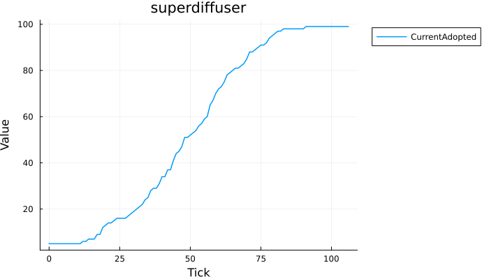
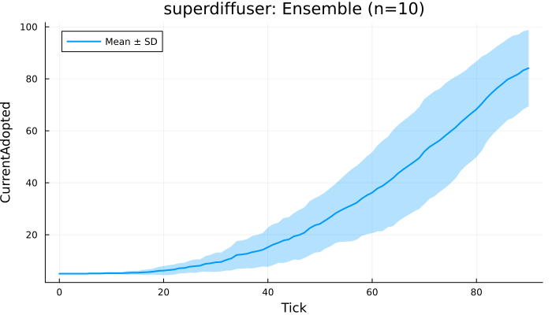
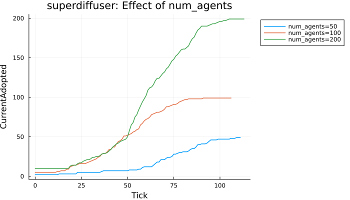

# SuperDiffuser


- [Overview](#overview)
- [Parameters](#parameters)
- [Source Code](#source-code)
- [Time Series](#time-series)
- [Ensemble Runs](#ensemble-runs)
- [Parameter Sensitivity](#parameter-sensitivity)
- [Appendix: Source Code](#appendix-source-code)
  - [Parameters (`parameters.jl`)](#parameters-parametersjl)
  - [Components (`components.jl`)](#components-componentsjl)
  - [Resources (`resources.jl`)](#resources-resourcesjl)
  - [Systems (`systems.jl`)](#systems-systemsjl)
  - [Model (`model.jl`)](#model-modeljl)

## Overview

This vignette demonstrates the **SuperDiffuser** model implemented in
[ArkModelZoo.jl](https://github.com/sdwfrost/ArkModelZoo.jl) using the
Ark.jl ECS framework.

## Parameters

| Parameter               | Type      | Default | Description           |
|-------------------------|-----------|---------|-----------------------|
| `num_agents`            | `Int`     | `100`   | num agents            |
| `min_links`             | `Int`     | `2`     | min links             |
| `percent_adopted_start` | `Float64` | `0.05`  | percent adopted start |
| `avg_attitude`          | `Float64` | `2.0`   | avg attitude          |
| `avg_pers_power`        | `Float64` | `0.25`  | avg pers power        |
| `avg_pers_one`          | `Float64` | `10.0`  | avg pers one          |
| `adopt_threshold`       | `Float64` | `5.0`   | adopt threshold       |
| `social_influence`      | `Float64` | `0.05`  | social influence      |
| `status_quo_limit`      | `Int`     | `50`    | status quo limit      |
| `max_ticks`             | `Int`     | `200`   | max ticks             |

## Source Code

The Julia code to run this model:

``` julia
using ArkModelZoo
_, trajectory = run_superdiffuser()
```

## Time Series



## Ensemble Runs

Ten replicates with different random seeds, showing mean ± standard
deviation.



## Parameter Sensitivity

Varying `num_agents`.



## Appendix: Source Code

This model is implemented in the
[Ark.jl](https://github.com/sdwfrost/Ark.jl) Entity-Component-System
(ECS) framework. The code is split into five files, each with a distinct
role:

- **Parameters**: a mutable struct holding all configurable values.
- **Components**: lightweight data types attached to individual entities
  (agents).
- **Resources**: world-level shared state accessible to all systems.
- **Systems**: functions that operate on entities each tick, defining
  model behavior.
- **Model**: wiring that assembles the world, registers resources and
  systems, and provides the run entry point.

### Parameters (`parameters.jl`)

The parameter struct uses `@kwdef` so that every field has a default
value and can be overridden by keyword. These defaults match the
original NetLogo model’s slider settings.

``` julia
Base.@kwdef mutable struct SDiffParams
    num_agents::Int = 100
    min_links::Int = 2
    percent_adopted_start::Float64 = 0.05
    avg_attitude::Float64 = 2.0
    avg_pers_power::Float64 = 0.25
    avg_pers_one::Float64 = 10.0
    adopt_threshold::Float64 = 5.0
    social_influence::Float64 = 0.05
    status_quo_limit::Int = 50
    max_ticks::Int = 200
    seed::Int = 42
end
```

### Components (`components.jl`)

Components are lightweight data types attached to individual entities
(agents). Mutable structs hold per-entity state, while empty tag structs
act as markers for the ECS query system to efficiently filter entities.

``` julia
struct SDiffDummy end
```

### Resources (`resources.jl`)

Resources are world-level singletons shared across all systems, used for
global state and aggregate statistics.

``` julia
mutable struct SDiffNetwork
    n_agents::Int
    adopted::Vector{Bool}
    attitude::Vector{Float64}
    pers_one::Vector{Float64}     # probability (0-100) of attempting persuasion
    pers_power::Vector{Float64}   # persuasion strength
    message::Vector{Float64}      # incoming message this tick
    adj::Vector{Set{Int}}
    degree::Vector{Int}
end

function SDiffNetwork()
    SDiffNetwork(0, Bool[], Float64[], Float64[], Float64[], Float64[], Set{Int}[], Int[])
end

function _sdiff_add_agent!(net::SDiffNetwork)
    push!(net.adopted, false)
    push!(net.attitude, 0.0)
    push!(net.pers_one, 0.0)
    push!(net.pers_power, 0.0)
    push!(net.message, 0.0)
    push!(net.adj, Set{Int}())
    push!(net.degree, 0)
    net.n_agents += 1
    return net.n_agents
end

function _sdiff_add_edge!(net::SDiffNetwork, i::Int, j::Int)
    if j ∉ net.adj[i]
        push!(net.adj[i], j)
        push!(net.adj[j], i)
        net.degree[i] += 1
        net.degree[j] += 1
    end
end

mutable struct SDiffStats
    current_adopted::Int
    status_quo_counter::Int
    status_quo::Bool
end
SDiffStats() = SDiffStats(0, 0, false)
```

### Systems (`systems.jl`)

Systems contain the model logic and execute in a defined order each
tick. Each system struct implements either `initialize!` (run once at
setup) or `update!` (run every tick).

``` julia
# SuperDiffuser — persuasion-based adoption on BA network

struct InitSDiffSystem <: System end

function _sdiff_build_ba!(net::SDiffNetwork, rng, n::Int, m::Int)
    # Start with m+1 fully connected nodes
    for _ in 1:(m+1)
        _sdiff_add_agent!(net)
    end
    for i in 1:(m+1), j in (i+1):(m+1)
        _sdiff_add_edge!(net, i, j)
    end
    # Preferential attachment for remaining nodes
    for _ in (m+2):n
        new_id = _sdiff_add_agent!(net)
        total_degree = sum(net.degree[1:new_id-1])
        targets = Set{Int}()
        attempts = 0
        while length(targets) < m && attempts < 10000
            attempts += 1
            r = rand(rng) * total_degree
            cumulative = 0.0
            for j in 1:(new_id-1)
                cumulative += net.degree[j]
                if cumulative >= r
                    push!(targets, j)
                    break
                end
            end
        end
        for t in targets
            _sdiff_add_edge!(net, new_id, t)
        end
    end
end

function initialize!(::InitSDiffSystem, world::World)
    params = get_resource(world, SDiffParams)
    rng    = get_resource(world, RNGResource).rng
    net    = get_resource(world, SDiffNetwork)
    stats  = get_resource(world, SDiffStats)

    _sdiff_build_ba!(net, rng, params.num_agents, params.min_links)

    # Assign agent properties
    for i in 1:net.n_agents
        # pers-one: random-normal(10, 20) clamped [0, 100]
        net.pers_one[i] = clamp(randn(rng) * 20.0 + params.avg_pers_one, 0.0, 100.0)
        # attitude: random-normal(2, 1) clamped [1, 3.9]
        net.attitude[i] = clamp(randn(rng) * 1.0 + params.avg_attitude, 1.0, 3.9)
        # pers-power: random-normal(0.25, 0.1) clamped [0, 2]
        net.pers_power[i] = clamp(randn(rng) * 0.1 + params.avg_pers_power, 0.0, 2.0)
        net.message[i] = 0.0
    end

    # Initial adopters: 5% of agents
    n_initial = max(1, round(Int, params.percent_adopted_start * params.num_agents))
    indices = shuffle!(rng, collect(1:net.n_agents))
    for k in 1:min(n_initial, net.n_agents)
        net.adopted[indices[k]] = true
    end

    stats.current_adopted = count(net.adopted)
    stats.status_quo_counter = 0
    return nothing
end

# --- Go system ---
struct SDiffGoSystem <: System end

function update!(::SDiffGoSystem, world::World)
    params = get_resource(world, SDiffParams)
    rng    = get_resource(world, RNGResource).rng
    net    = get_resource(world, SDiffNetwork)
    stats  = get_resource(world, SDiffStats)

    old_status_quo = stats.status_quo
    stats.status_quo = true

    # NetLogo does NOT clear messages at start of tick.
    # Messages persist if the target was processed BEFORE the persuader in the previous tick.
    # Non-adopted agents clear their own message in update-attitude after consuming it.

    # NetLogo: ask turtles [ update-friends; if adopted? [...] if not adopted? [...] ]
    # This is INTERLEAVED in shuffled order — each agent acts fully before the next.
    order = randperm(rng, net.n_agents)

    for i in order
        # update-friends: count adopted/non-adopted neighbors
        adopt_friends = 0
        non_adopt_friends = 0
        for j in net.adj[i]
            if net.adopted[j]
                adopt_friends += 1
            else
                non_adopt_friends += 1
            end
        end

        if net.adopted[i] && non_adopt_friends > 0
            # persuade
            if rand(rng, 0:99) < net.pers_one[i]
                # ask one-of link-neighbors with [adopted? = false]
                non_adopted_neighbors = Int[]
                for j in net.adj[i]
                    if !net.adopted[j]
                        push!(non_adopted_neighbors, j)
                    end
                end
                if !isempty(non_adopted_neighbors)
                    target = non_adopted_neighbors[rand(rng, 1:length(non_adopted_neighbors))]
                    net.message[target] = net.pers_power[i]
                end
            end
        end

        if !net.adopted[i]
            # update-attitude
            old_attitude = net.attitude[i]
            net.attitude[i] += net.message[i] + adopt_friends * params.social_influence
            if net.attitude[i] > 7.0
                net.attitude[i] = 7.0
            end
            if net.attitude[i] >= params.adopt_threshold
                net.adopted[i] = true
            end
            net.message[i] = 0.0
            if old_attitude != net.attitude[i]
                stats.status_quo = false
            end
        end
    end

    # Status-quo counter: NetLogo increments when BOTH previous and current tick had no attitude changes
    if old_status_quo && stats.status_quo
        stats.status_quo_counter += 1
    else
        stats.status_quo_counter = 0
    end

    stats.current_adopted = count(net.adopted)

    return nothing
end

# --- Termination ---
struct SDiffTerminationSystem <: System end

function update!(::SDiffTerminationSystem, world::World)
    params = get_resource(world, SDiffParams)
    tick   = get_resource(world, Tick)
    net    = get_resource(world, SDiffNetwork)
    stats  = get_resource(world, SDiffStats)

    all_adopted = all(net.adopted)
    if all_adopted || stats.status_quo_counter >= params.status_quo_limit || tick.tick + 1 >= params.max_ticks
        get_resource(world, Terminate).stop = true
    end
    return nothing
end
```

### Model (`model.jl`)

The model file assembles all pieces: it creates the ECS `World` with the
required component types, registers resources, builds the `Scheduler`
with systems in execution order, and exposes the public `run` entry
point. The observer pattern records the trajectory each tick.

``` julia
function superdiffuser_world(; initial_capacity::Int = 128)
    return World(SDiffDummy; initial_capacity = initial_capacity, allow_mutable = true)
end

function superdiffuser_systems()
    return (InitSDiffSystem(), SDiffGoSystem(), SDiffTerminationSystem())
end

function superdiffuser_model(params::SDiffParams = SDiffParams())
    world = superdiffuser_world()
    _add_standard_resources!(world, params)
    add_resource!(world, SDiffNetwork())
    add_resource!(world, SDiffStats())
    scheduler = Scheduler(world, superdiffuser_systems())
    initialize!(scheduler)
    return scheduler
end

struct SDiffObserver end

function superdiffuser_headers(::SDiffObserver)
    return ["CurrentAdopted"]
end

function superdiffuser_values(::SDiffObserver, world::World)
    stats = get_resource(world, SDiffStats)
    return Float64[stats.current_adopted]
end

function run_superdiffuser(; params::SDiffParams = SDiffParams(), observe::Bool = true)
    scheduler = superdiffuser_model(params)
    obs = SDiffObserver()
    trajectory = Vector{Vector{Float64}}()
    if observe
        push!(trajectory, superdiffuser_values(obs, scheduler.world))
    end
    while step!(scheduler)
        if observe
            # NetLogo BehaviorSpace does not record metrics on the tick where
            # `stop` is called.  Match that behaviour by skipping the observation
            # when the termination system has signalled stop during this step.
            if get_resource(scheduler.world, Terminate).stop
                break
            end
            push!(trajectory, superdiffuser_values(obs, scheduler.world))
        end
    end
    return scheduler, trajectory
end
```
