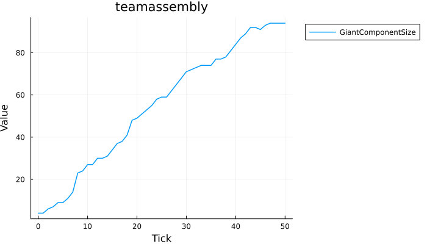
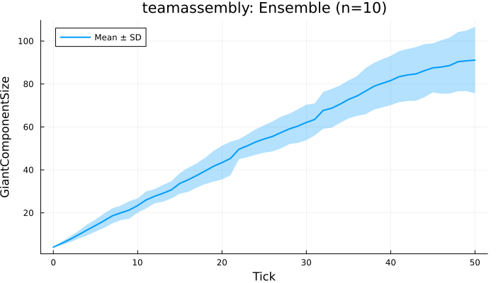
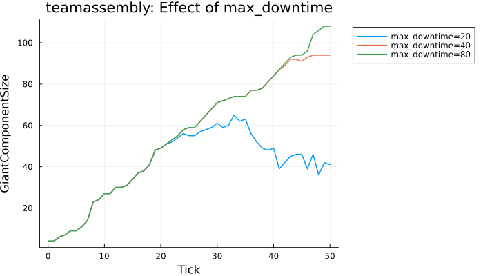

# Team Assembly


- [Overview](#overview)
  - [WHAT IS IT?](#what-is-it)
  - [HOW IT WORKS](#how-it-works)
  - [THINGS TO NOTICE](#things-to-notice)
  - [THINGS TO TRY](#things-to-try)
  - [EXTENDING THE MODEL](#extending-the-model)
  - [NETLOGO FEATURES](#netlogo-features)
  - [RELATED MODELS](#related-models)
  - [CREDITS AND REFERENCES](#credits-and-references)
  - [HOW TO CITE](#how-to-cite)
  - [COPYRIGHT AND LICENSE](#copyright-and-license)
- [Parameters](#parameters)
- [Source Code](#source-code)
- [Time Series](#time-series)
- [Ensemble Runs](#ensemble-runs)
- [Parameter Sensitivity](#parameter-sensitivity)
- [Appendix: Source Code](#appendix-source-code)
  - [Parameters (`parameters.jl`)](#parameters-parametersjl)
  - [Components (`components.jl`)](#components-componentsjl)
  - [Resources (`resources.jl`)](#resources-resourcesjl)
  - [Systems (`systems.jl`)](#systems-systemsjl)
  - [Model (`model.jl`)](#model-modeljl)

## Overview

### WHAT IS IT?

This model of collaboration networks illustrates how the behavior of
individuals in assembling small teams for short-term projects can give
rise to a variety of large-scale network structures over time. It is an
adaptation of the team assembly model presented by Guimera, Uzzi, Spiro
& Amaral (2005). The rules of the model draw upon observations of
collaboration networks ranging from Broadway productions to scientific
publications in psychology and astronomy.

Many of the general features found in the networks of creative
enterprises can be captured by the Team Assembly model with two simple
parameters: the proportion of newcomers participating in a team and the
propensity for past collaborators to work again with one another.

### HOW IT WORKS

At each tick a new team is assembled. Team members are either
inexperienced “newcomers” — people who have not previously participated
in any teams – or are established “incumbents” — experienced people who
have previously participated on a team. Each member is chosen
sequentially. The P slider gives the probability that a new team member
will be an incumbent. If the new member is not a newcomer, then with a
probability given by the Q slider, an incumbent will be chosen at random
from the pool of previous collaborators of an incumbent already on the
team. Otherwise, a new member will just be randomly chosen from all
incumbents. When a team is created, all members are linked to one
another. If an agent does not participate in a new team for a prolonged
period of time, the agent and her links are removed from the network.

Agents in a newly assembled team are colored blue if they are newcomers
and yellow if they are incumbents. Smaller grey circles represent those
that are not currently collaborating. Links indicate members’ experience
at their most recent time of collaboration. For example, blue links
between agents indicate that two agents collaborated as newcomers. Green
and yellow links correspond to one-time newcomer-incumbent and
incumbent-incumbent collaborations, respectively. Finally, red links
indicate that agents have collaborated with one another multiple times.

### THINGS TO NOTICE

The model captures two basic features of collaboration networks that can
influence or stifle innovation in creative enterprises by varying the
values of P and Q. First is the distribution of the type of the
connection between collaborators, which can be seen in the LINK COUNTS
plot. An overabundance of newcomer-newcomer (blue) links might indicate
that a field is not taking advantage of experienced members. On the
other hand, a multitude of repeat collaborations (red) and
incumbent-incumbent (yellow) links may indicate a lack of diversity in
ideas or experiences.

Second is the overall connectivity of the collaboration network. For
example, many academic fields are said to be comprised of an “invisible
college” of loosely connected academic communities. By contrast, patent
networks tend to consist of isolated clusters or chains of inventors.
You can see one measure of this on the % OF AGENTS IN THE GIANT
COMPONENT plot – the giant component being the size of the largest
connected chain of collaborators.

You can also see the different emergent topologies in the display. New
collaborations or synergy among teams naturally tend to the center of
the display. Teams or clusters of teams with few connections to new
collaborations naturally “float” to the edges of the world. Newcomers
always start in the center of the world. Incumbents, which are chosen at
random, may be located in any part of the screen. Thus, collaborations
amongst newcomers and or distant team components tend toward the center,
and disconnected clusters are repelled from the centered.

Finally, note that the structure of collaboration networks in the model
can change dramatically over time. Initially, only new teams are
generated; the collaborative field has not existed long enough for
members to retire. However, after a period of time (MAX-DOWNTIME),
inactive agents begin to retire, and the number of agents becomes
relatively stable – the emergent effects of P and Q become more apparent
in this equilibrium stage. Note also that the end of the growth stage is
often marked by a drop in the connectivity of the network.

### THINGS TO TRY

Keeping Q fixed at 40%, how does the structure of collaboration networks
vary with P? For example, which values of P produce isolated clusters of
agents? As P increases, how do these clusters combine to form more
complex structures? Over which values of P does the transition from a
disconnected network to a fully connected network occur?

Set P to 40% and Q to 100%, so that all incumbents choose to work with
past collaborators. Press SETUP, then GO, and let the model run for
about 100 steps after the number of agents in the network stops growing.
What happens to the connectivity of the collaboration network? Keeping P
fixed, continue to lower Q in decrements of 5-10%.

Try keeping P and Q constant and varying TEAM-SIZE. How does the global
structure of the network change with larger or smaller team sizes? Under
which ranges of P and Q does this relation hold?

### EXTENDING THE MODEL

What happens when the size of new teams are not constant? Try changing
the rules so that team sizes vary randomly from a distribution or
increase over time.

How do P and Q relate to the global clustering coefficient of the
network? You may wish to use code from the Small Worlds model in the
Networks section of Sample Models.

Can you modify the model so that agents are more likely to collaborate
with collaborators of collaborators?

Collaboration networks can alternatively be thought of as a network
consisting of individuals linked to projects. For example, one can
represent a scientific journal with two types of nodes, scientists and
publications. Ties between scientists and publications represent
authorship. Thus, links between a publication multiple scientists
specify co-authorship. More generally, a collaborative project may be
represented one type of node, and participants another type. Can you
modify the model to assemble teams using bipartite networks?

### NETLOGO FEATURES

Though it is not used in this model, there exists a network extension
for NetLogo that you can download at:
https://github.com/NetLogo/NW-Extension.

### RELATED MODELS

Preferential Attachment - gives a generative explanation of how general
principles of attachment can give rise to a network structure common to
many technological and biological systems.

Giant Component - shows how critical points exist in which a network can
transition from a rather disconnected topology to a fully connected
topology

### CREDITS AND REFERENCES

This model is based on: R Guimera, B Uzzi, J Spiro, L Amaral. Team
Assembly Mechanisms Determine Collaboration Network Structure and Team
Performance. Science 2005, V308, N5722, p697-702
https://amaral.northwestern.edu/media/publication_pdfs/Guimera-2005-Science-308-697.pdf

### HOW TO CITE

If you mention this model or the NetLogo software in a publication, we
ask that you include the citations below.

For the model itself:

- Bakshy, E. and Wilensky, U. (2007). NetLogo Team Assembly model.
  http://ccl.northwestern.edu/netlogo/models/TeamAssembly. Center for
  Connected Learning and Computer-Based Modeling, Northwestern
  University, Evanston, IL.

Please cite the NetLogo software as:

- Wilensky, U. (1999). NetLogo. http://ccl.northwestern.edu/netlogo/.
  Center for Connected Learning and Computer-Based Modeling,
  Northwestern University, Evanston, IL.

### COPYRIGHT AND LICENSE

Copyright 2007 Uri Wilensky.


This model is licensed under the Creative Commons
Attribution-NonCommercial-ShareAlike 3.0 License. To view a copy of this
license, visit https://creativecommons.org/licenses/by-nc-sa/3.0/ or
send a letter to Creative Commons, 559 Nathan Abbott Way, Stanford,
California 94305, USA.

NetLogo itself is free software for non-commercial use under the terms
of the GNU General Public License ([see full license information
here](https://ccl.northwestern.edu/netlogo/docs/copyright.html)).

To inquire about commercial licenses for either NetLogo or specific
models from the models library, please contact
netlogo-commercial-admin@ccl.northwestern.edu.

<!-- 2007 Cite: Bakshy, E. -->

## Parameters

| Parameter | Type | Default | Description |
|----|----|----|----|
| `max_downtime` | `Int` | `40` | max downtime |
| `p` | `Float64` | `40.0` | % chance of newcomer (vs incumbent) |
| `q` | `Float64` | `65.0` | % chance of picking collaborator of team member |
| `team_size` | `Int` | `4` | team size |
| `max_ticks` | `Int` | `50` | max ticks |

## Source Code

The Julia code to run this model:

``` julia
using ArkModelZoo
_, trajectory = run_teamassembly()
```

## Time Series



## Ensemble Runs

Ten replicates with different random seeds, showing mean ± standard
deviation.



## Parameter Sensitivity

Varying `max_downtime`.



## Appendix: Source Code

This model is implemented in the
[Ark.jl](https://github.com/sdwfrost/Ark.jl) Entity-Component-System
(ECS) framework. The code is split into five files, each with a distinct
role:

- **Parameters**: a mutable struct holding all configurable values.
- **Components**: lightweight data types attached to individual entities
  (agents).
- **Resources**: world-level shared state accessible to all systems.
- **Systems**: functions that operate on entities each tick, defining
  model behavior.
- **Model**: wiring that assembles the world, registers resources and
  systems, and provides the run entry point.

### Parameters (`parameters.jl`)

The parameter struct uses `@kwdef` so that every field has a default
value and can be overridden by keyword. These defaults match the
original NetLogo model’s slider settings.

``` julia
Base.@kwdef mutable struct TeamAssemblyParams
    max_downtime::Int = 40
    p::Float64 = 40.0        # % chance of newcomer (vs incumbent)
    q::Float64 = 65.0        # % chance of picking collaborator of team member
    team_size::Int = 4
    max_ticks::Int = 50
    seed::Int = 42
end
```

### Components (`components.jl`)

Components are lightweight data types attached to individual entities
(agents). Mutable structs hold per-entity state, while empty tag structs
act as markers for the ECS query system to efficiently filter entities.

``` julia
struct TeamDummy end
```

### Resources (`resources.jl`)

Resources are world-level singletons shared across all systems, used for
global state and aggregate statistics.

``` julia
mutable struct TeamState
    in_team::Vector{Bool}
    incumbent::Vector{Bool}
    downtime::Vector{Int}
    alive::Vector{Bool}
    adj::Vector{Set{Int}}
    n_agents::Int
end

function TeamState()
    TeamState(Bool[], Bool[], Int[], Bool[], Set{Int}[], 0)
end

function _team_add_agent!(state::TeamState)
    push!(state.in_team, false)
    push!(state.incumbent, false)
    push!(state.downtime, 0)
    push!(state.alive, true)
    push!(state.adj, Set{Int}())
    state.n_agents += 1
    return state.n_agents
end

mutable struct TeamStats
    giant_component_size::Int
end
TeamStats() = TeamStats(0)
```

### Systems (`systems.jl`)

Systems contain the model logic and execute in a defined order each
tick. Each system struct implements either `initialize!` (run once at
setup) or `update!` (run every tick).

``` julia
struct InitTeamSystem <: System end

function initialize!(::InitTeamSystem, world::World)
    params = get_resource(world, TeamAssemblyParams)
    state = get_resource(world, TeamState)
    stats = get_resource(world, TeamStats)

    # Create initial team of team_size agents
    for _ in 1:params.team_size
        idx = _team_add_agent!(state)
        state.in_team[idx] = true
        state.incumbent[idx] = true
    end

    # Tie collaborators: all in-team agents linked to each other
    _team_tie_collaborators!(state)

    # Unmark in-team
    for i in 1:state.n_agents
        state.in_team[i] = false
    end

    # Find components
    stats.giant_component_size = _team_find_giant_component(state)

    return nothing
end

function _team_tie_collaborators!(state::TeamState)
    team_members = Int[]
    for i in 1:state.n_agents
        if state.alive[i] && state.in_team[i]
            push!(team_members, i)
        end
    end
    for i in 1:length(team_members)
        for j in (i+1):length(team_members)
            a, b = team_members[i], team_members[j]
            push!(state.adj[a], b)
            push!(state.adj[b], a)
        end
    end
end

function _team_find_giant_component(state::TeamState)
    explored = falses(state.n_agents)
    giant = 0
    for i in 1:state.n_agents
        if state.alive[i] && !explored[i]
            size = _team_bfs!(state, explored, i)
            if size > giant
                giant = size
            end
        end
    end
    return giant
end

function _team_bfs!(state::TeamState, explored::BitVector, start::Int)
    stack = Int[start]
    explored[start] = true
    count = 0
    while !isempty(stack)
        node = pop!(stack)
        count += 1
        for nb in state.adj[node]
            if state.alive[nb] && !explored[nb]
                explored[nb] = true
                push!(stack, nb)
            end
        end
    end
    return count
end

# --- Main Update System ---

struct TeamGoSystem <: System end

function update!(::TeamGoSystem, world::World)
    params = get_resource(world, TeamAssemblyParams)
    rng = get_resource(world, RNGResource).rng
    state = get_resource(world, TeamState)
    stats = get_resource(world, TeamStats)

    # Mark all alive agents as incumbent
    for i in 1:state.n_agents
        if state.alive[i]
            state.incumbent[i] = true
        end
    end

    # Pick team members
    _team_pick_members!(rng, state, params)

    # Tie collaborators
    _team_tie_collaborators!(state)

    # Age out + unmark in-team
    for i in 1:state.n_agents
        if state.alive[i]
            if state.downtime[i] > params.max_downtime
                state.alive[i] = false
                # Remove from all adjacency lists
                for nb in state.adj[i]
                    delete!(state.adj[nb], i)
                end
                empty!(state.adj[i])
            end
            state.in_team[i] = false
            state.downtime[i] += 1
        end
    end

    # Find components
    stats.giant_component_size = _team_find_giant_component(state)

    return nothing
end

function _team_pick_members!(rng, state::TeamState, params::TeamAssemblyParams)
    for _ in 1:params.team_size
        new_member = 0

        if rand(rng) * 100.0 >= params.p
            # Newcomer
            new_member = _team_add_agent!(state)
        else
            # Try to pick incumbent
            if rand(rng) * 100.0 < params.q
                # Try to pick collaborator of a current team member
                # Find team members who have non-team neighbors
                candidates_source = Int[]
                for i in 1:state.n_agents
                    if state.alive[i] && state.in_team[i]
                        for nb in state.adj[i]
                            if state.alive[nb] && !state.in_team[nb]
                                push!(candidates_source, i)
                                break
                            end
                        end
                    end
                end

                if !isempty(candidates_source)
                    # Pick a non-team neighbor of a random team member with such neighbors
                    src = candidates_source[rand(rng, 1:length(candidates_source))]
                    eligible = Int[]
                    for nb in state.adj[src]
                        if state.alive[nb] && !state.in_team[nb]
                            push!(eligible, nb)
                        end
                    end
                    # NetLogo: "one-of turtles with [not in-team? and (any? link-neighbors with [in-team?])]"
                    # Actually the NetLogo picks from ALL non-team agents who have at least one team neighbor
                    all_eligible = Int[]
                    for i in 1:state.n_agents
                        if state.alive[i] && !state.in_team[i]
                            for nb in state.adj[i]
                                if state.alive[nb] && state.in_team[nb]
                                    push!(all_eligible, i)
                                    break
                                end
                            end
                        end
                    end
                    if !isempty(all_eligible)
                        new_member = all_eligible[rand(rng, 1:length(all_eligible))]
                    else
                        # Fallback: pick any non-team alive agent
                        new_member = _team_pick_any_nonteam(rng, state)
                    end
                else
                    # No team member has non-team neighbors, pick any non-team agent
                    new_member = _team_pick_any_nonteam(rng, state)
                end
            else
                # Pick any non-team alive agent
                new_member = _team_pick_any_nonteam(rng, state)
            end
        end

        if new_member > 0
            state.in_team[new_member] = true
            state.downtime[new_member] = 0
        end
    end
end

function _team_pick_any_nonteam(rng, state::TeamState)
    candidates = Int[]
    for i in 1:state.n_agents
        if state.alive[i] && !state.in_team[i]
            push!(candidates, i)
        end
    end
    if isempty(candidates)
        return 0
    end
    return candidates[rand(rng, 1:length(candidates))]
end

# --- Termination ---

struct TeamTerminationSystem <: System end

function update!(::TeamTerminationSystem, world::World)
    params = get_resource(world, TeamAssemblyParams)
    tick = get_resource(world, Tick)
    if tick.tick + 1 >= params.max_ticks
        get_resource(world, Terminate).stop = true
    end
    return nothing
end
```

### Model (`model.jl`)

The model file assembles all pieces: it creates the ECS `World` with the
required component types, registers resources, builds the `Scheduler`
with systems in execution order, and exposes the public `run` entry
point. The observer pattern records the trajectory each tick.

``` julia
function teamassembly_world(; initial_capacity::Int = 128)
    return World(TeamDummy; initial_capacity=initial_capacity, allow_mutable=true)
end

function teamassembly_systems()
    return (
        InitTeamSystem(),
        TeamGoSystem(),
        TeamTerminationSystem(),
    )
end

function teamassembly_model(params::TeamAssemblyParams = TeamAssemblyParams())
    world = teamassembly_world()
    _add_standard_resources!(world, params)
    add_resource!(world, TeamState())
    add_resource!(world, TeamStats())
    scheduler = Scheduler(world, teamassembly_systems())
    initialize!(scheduler)
    return scheduler
end

struct TeamAssemblyObserver end

function teamassembly_headers(::TeamAssemblyObserver)
    return ["GiantComponentSize"]
end

function teamassembly_values(::TeamAssemblyObserver, world::World)
    stats = get_resource(world, TeamStats)
    return Float64[stats.giant_component_size]
end

function run_teamassembly(; params::TeamAssemblyParams = TeamAssemblyParams(), observe::Bool = true)
    return _run_model(teamassembly_model, TeamAssemblyObserver(), teamassembly_values; params, observe)
end
```
