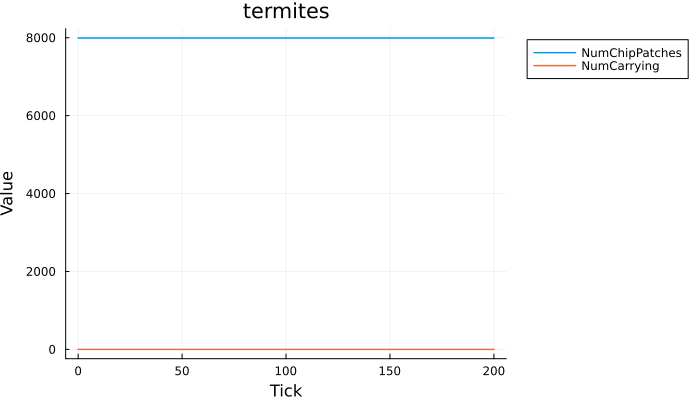
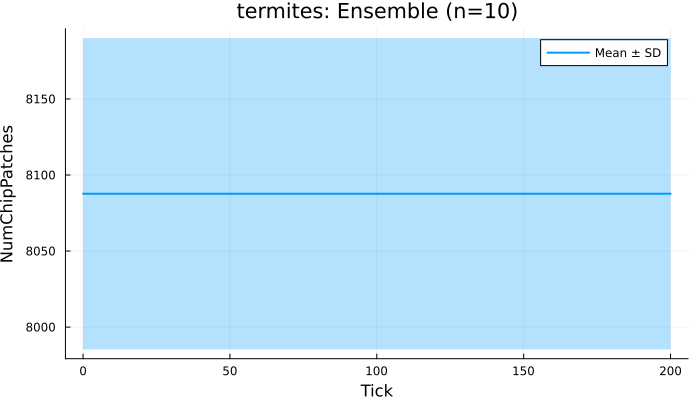
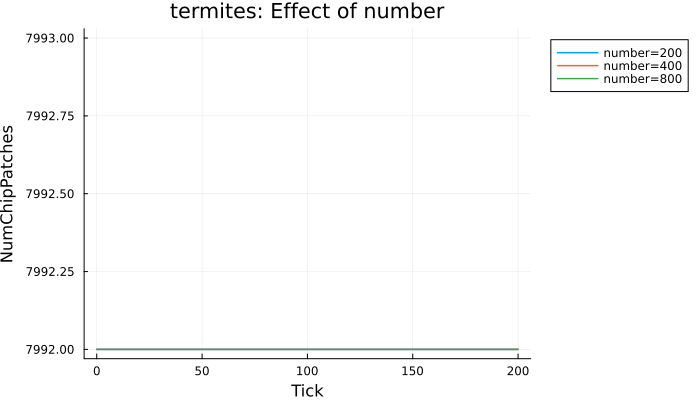

# Termites


- [Overview](#overview)
  - [WHAT IS IT?](#what-is-it)
  - [THINGS TO NOTICE](#things-to-notice)
  - [THINGS TO TRY](#things-to-try)
  - [EXTENDING THE MODEL](#extending-the-model)
  - [NETLOGO FEATURES](#netlogo-features)
  - [RELATED MODELS](#related-models)
  - [HOW TO CITE](#how-to-cite)
  - [COPYRIGHT AND LICENSE](#copyright-and-license)
- [Parameters](#parameters)
- [Source Code](#source-code)
- [Time Series](#time-series)
- [Ensemble Runs](#ensemble-runs)
- [Parameter Sensitivity](#parameter-sensitivity)
- [Appendix: Source Code](#appendix-source-code)
  - [Parameters (`parameters.jl`)](#parameters-parametersjl)
  - [Components (`components.jl`)](#components-componentsjl)
  - [Resources (`resources.jl`)](#resources-resourcesjl)
  - [Systems (`systems.jl`)](#systems-systemsjl)
  - [Model (`model.jl`)](#model-modeljl)

## Overview

### WHAT IS IT?

This project is inspired by the behavior of termites gathering wood
chips into piles. The termites follow a set of simple rules. Each
termite starts wandering randomly. If it bumps into a wood chip, it
picks the chip up, and continues to wander randomly. When it bumps into
another wood chip, it finds a nearby empty space and puts its wood chip
down. With these simple rules, the wood chips eventually end up in a
single pile.

### THINGS TO NOTICE

As piles of wood chips begin to form, the piles are not “protected” in
any way. That is, termites sometimes take chips away from existing
piles. That strategy might seem counter-productive. But if the piles
were “protected”, you would end up with lots of little piles, not one
big one.

The final piles are roughly round. Why is this? What other physical
situations also produce round things?

In general, the number of piles decreases with time. Why? Some piles
disappear, when termites carry away all of the chips. And there is no
way to start a new pile from scratch, since termites always put their
wood chips near other wood chips. So the number of piles must decrease
over time. (The only way a “new” pile starts is when an existing pile
splits into two.)

This project is a good example of a “decentralized” strategy. There is
no termite in charge, and no special pre-designated site for the piles.
Each termite follows a set of simple rules, but the colony as a whole
accomplishes a rather sophisticated task.

### THINGS TO TRY

Do the results change if you use just a single termite? What if you use
several thousand termites?

When there are just two piles left, which of them is most likely to
“win” as the single, final pile? How often does the larger of the two
piles win? If one pile has only a single wood chip, and the other pile
has the rest of the wood chips, what are the chances that the first pile
will win?

### EXTENDING THE MODEL

Can you extend the model to have the termites sort several colors of
wood?

Plot the number of piles, or their average size, or the number of
termites carrying wood chips, as the model runs.

### NETLOGO FEATURES

Notice that the wood chips do not exist as objects. They are just
represented as colors in the patches. The termites update the patch
colors as they pick up and put down the wood chips. In effect, the
patches are being used as the data structure. This strategy is useful in
many NetLogo programs.

Note than when you stop the GO forever button, the termites keep moving
for a little while. This is because they are each finishing the commands
in the GO procedure. To do this, they must finish their current cycle of
finding a chip, finding a pile, and then finding an empty spot near the
pile. In most models, the GO function only moves the model forward one
step, but in this model, the GO function is written to advance the
turtles through a full cycle of activity. See the “Buttons” section of
the Programming Guide in the User Manual for more information on turtle
forever buttons.

### RELATED MODELS

- Painted Desert Challenge
- Shepherds
- State Machine Example

### HOW TO CITE

If you mention this model or the NetLogo software in a publication, we
ask that you include the citations below.

For the model itself:

- Wilensky, U. (1997). NetLogo Termites model.
  http://ccl.northwestern.edu/netlogo/models/Termites. Center for
  Connected Learning and Computer-Based Modeling, Northwestern
  University, Evanston, IL.

Please cite the NetLogo software as:

- Wilensky, U. (1999). NetLogo. http://ccl.northwestern.edu/netlogo/.
  Center for Connected Learning and Computer-Based Modeling,
  Northwestern University, Evanston, IL.

### COPYRIGHT AND LICENSE

Copyright 1997 Uri Wilensky.


This model is licensed under the Creative Commons
Attribution-NonCommercial-ShareAlike 3.0 License. To view a copy of this
license, visit https://creativecommons.org/licenses/by-nc-sa/3.0/ or
send a letter to Creative Commons, 559 Nathan Abbott Way, Stanford,
California 94305, USA.

NetLogo itself is free software for non-commercial use under the terms
of the GNU General Public License ([see full license information
here](https://ccl.northwestern.edu/netlogo/docs/copyright.html)).

To inquire about commercial licenses for either NetLogo or specific
models from the models library, please contact
netlogo-commercial-admin@ccl.northwestern.edu.

This model was created as part of the project: CONNECTED MATHEMATICS:
MAKING SENSE OF COMPLEX PHENOMENA THROUGH BUILDING OBJECT-BASED PARALLEL
MODELS (OBPML). The project gratefully acknowledges the support of the
National Science Foundation (Applications of Advanced Technologies
Program) – grant numbers RED \#9552950 and REC \#9632612.

This model was developed at the MIT Media Lab using CM StarLogo. See
Resnick, M. (1994) “Turtles, Termites and Traffic Jams: Explorations in
Massively Parallel Microworlds.” Cambridge, MA: MIT Press. Adapted to
StarLogoT, 1997, as part of the Connected Mathematics Project.

This model was converted to NetLogo as part of the projects:
PARTICIPATORY SIMULATIONS: NETWORK-BASED DESIGN FOR SYSTEMS LEARNING IN
CLASSROOMS and/or INTEGRATED SIMULATION AND MODELING ENVIRONMENT. The
project gratefully acknowledges the support of the National Science
Foundation (REPP & ROLE programs) – grant numbers REC \#9814682 and
REC-0126227. Converted from StarLogoT to NetLogo, 2001.

<!-- 1997 2001 MIT -->

## Parameters

| Parameter     | Type      | Default | Description                        |
|---------------|-----------|---------|------------------------------------|
| `number`      | `Int`     | `400`   | number of termites                 |
| `density`     | `Float64` | `20.0`  | percent of patches with wood chips |
| `grid_width`  | `Int`     | `201`   | -100..100                          |
| `grid_height` | `Int`     | `201`   | grid height                        |
| `max_ticks`   | `Int`     | `200`   | max ticks                          |
| `max_steps`   | `Int`     | `5000`  | bound for iterative search loops   |

## Source Code

The Julia code to run this model:

``` julia
using ArkModelZoo
_, trajectory = run_termites()
```

## Time Series



## Ensemble Runs

Ten replicates with different random seeds, showing mean ± standard
deviation.



## Parameter Sensitivity

Varying `number`.



## Appendix: Source Code

This model is implemented in the
[Ark.jl](https://github.com/sdwfrost/Ark.jl) Entity-Component-System
(ECS) framework. The code is split into five files, each with a distinct
role:

- **Parameters**: a mutable struct holding all configurable values.
- **Components**: lightweight data types attached to individual entities
  (agents).
- **Resources**: world-level shared state accessible to all systems.
- **Systems**: functions that operate on entities each tick, defining
  model behavior.
- **Model**: wiring that assembles the world, registers resources and
  systems, and provides the run entry point.

### Parameters (`parameters.jl`)

The parameter struct uses `@kwdef` so that every field has a default
value and can be overridden by keyword. These defaults match the
original NetLogo model’s slider settings.

``` julia
Base.@kwdef mutable struct TMParams
    number::Int = 400          # number of termites
    density::Float64 = 20.0    # percent of patches with wood chips
    grid_width::Int = 201      # -100..100
    grid_height::Int = 201
    max_ticks::Int = 200
    max_steps::Int = 5000      # bound for iterative search loops
    seed::Int = 42
end
```

### Components (`components.jl`)

Components are lightweight data types attached to individual entities
(agents). Mutable structs hold per-entity state, while empty tag structs
act as markers for the ECS query system to efficiently filter entities.

``` julia
# Continuous position (NetLogo coordinates)
mutable struct TMPosition
    x::Float64
    y::Float64
end
TMPosition() = TMPosition(0.0, 0.0)

# Heading in degrees (NetLogo convention: 0=north, 90=east, clockwise)
mutable struct TMHeading
    angle::Float64
end
TMHeading() = TMHeading(0.0)

# Whether the termite is carrying a wood chip
mutable struct TMCarrying
    carrying::Bool
end
TMCarrying() = TMCarrying(false)
```

### Resources (`resources.jl`)

Resources are world-level singletons shared across all systems, used for
global state and aggregate statistics.

``` julia
mutable struct TMGrid
    width::Int
    height::Int
    chips::Matrix{Bool}   # true = wood chip present at this patch
end

function TMGrid(width::Int, height::Int)
    TMGrid(width, height, fill(false, width, height))
end

function tm_has_chip(grid::TMGrid, gx::Int, gy::Int)
    return grid.chips[gx, gy]
end

function tm_place_chip!(grid::TMGrid, gx::Int, gy::Int)
    grid.chips[gx, gy] = true
end

function tm_remove_chip!(grid::TMGrid, gx::Int, gy::Int)
    grid.chips[gx, gy] = false
end

mutable struct TMStats
    num_chip_patches::Int   # total chips on ground
    num_carrying::Int       # termites currently carrying a chip
end
TMStats() = TMStats(0, 0)
```

### Systems (`systems.jl`)

Systems contain the model logic and execute in a defined order each
tick. Each system struct implements either `initialize!` (run once at
setup) or `update!` (run every tick).

``` julia
# ── Helper: convert continuous position to grid cell (toroidal) ──

function _tm_to_grid(x::Float64, y::Float64, w::Int, h::Int)
    gx = mod1(round(Int, x), w)
    gy = mod1(round(Int, y), h)
    return gx, gy
end

# NetLogo fd: x += sin(heading°) * dist, y += cos(heading°) * dist
function _tm_fd!(pos::TMPosition, heading::Float64, dist::Float64, w::Int, h::Int)
    θ = heading * π / 180.0
    pos.x += sin(θ) * dist
    pos.y += cos(θ) * dist
    # Wrap toroidally to [1, width] and [1, height]
    half_w = Float64(w) / 2.0
    half_h = Float64(h) / 2.0
    pos.x = mod(pos.x - 0.5, Float64(w)) + 0.5
    pos.y = mod(pos.y - 0.5, Float64(h)) + 0.5
    return nothing
end

# NetLogo wiggle: fd 1; rt random 50; lt random 50
function _tm_wiggle!(pos::TMPosition, heading::TMHeading, rng, w::Int, h::Int)
    _tm_fd!(pos, heading.angle, 1.0, w, h)
    heading.angle = mod(heading.angle + rand(rng, 0:49) - rand(rng, 0:49), 360.0)
    return nothing
end

# ── Initialization ──

struct InitTMSystem <: System end

function initialize!(::InitTMSystem, world::World)
    params = get_resource(world, TMParams)
    rng = get_resource(world, RNGResource).rng
    grid = get_resource(world, TMGrid)

    # Place chips: each patch has density% chance of a chip
    for x in 1:grid.width, y in 1:grid.height
        if rand(rng) * 100.0 < params.density
            tm_place_chip!(grid, x, y)
        end
    end

    # Create termites at random positions with random headings
    for _ in 1:params.number
        x = rand(rng) * Float64(params.grid_width) + 0.5
        y = rand(rng) * Float64(params.grid_height) + 0.5
        heading = Float64(rand(rng, 0:359))
        new_entity!(world, (
            TMPosition(x, y),
            TMHeading(heading),
            TMCarrying(false),
        ))
    end

    # Compute initial stats
    update!(TMStatsSystem(), world)
    return nothing
end

# ── Go System: each termite does a full cycle per tick ──

struct TMGoSystem <: System
    order::Vector{Int}
end
TMGoSystem() = TMGoSystem(Int[])

function update!(system::TMGoSystem, world::World)
    params = get_resource(world, TMParams)
    rng = get_resource(world, RNGResource).rng
    grid = get_resource(world, TMGrid)
    w = grid.width
    h = grid.height
    max_steps = params.max_steps

    # Collect all termites into flat arrays
    n = 0
    for (eids, _, _, _) in Query(world, (TMPosition, TMHeading, TMCarrying))
        n += length(eids)
    end
    n == 0 && return nothing

    all_pos = Vector{TMPosition}(undef, n)
    all_head = Vector{TMHeading}(undef, n)
    all_carry = Vector{TMCarrying}(undef, n)

    idx = 0
    for (_, positions, headings, carryings) in Query(world, (TMPosition, TMHeading, TMCarrying))
        @inbounds for i in eachindex(positions)
            idx += 1
            all_pos[idx] = positions[i]
            all_head[idx] = headings[i]
            all_carry[idx] = carryings[i]
        end
    end

    # Shuffle order (NetLogo ask shuffles each tick)
    resize!(system.order, n)
    for i in 1:n
        system.order[i] = i
    end
    Random.shuffle!(rng, system.order)

    for ord_idx in 1:n
        ti = system.order[ord_idx]
        pos = all_pos[ti]
        head = all_head[ti]
        carry = all_carry[ti]

        if carry.carrying
            # Already carrying from previous tick (shouldn't happen in full-cycle model,
            # but handle gracefully): continue find-new-pile → put-down-chip
            _tm_find_new_pile!(pos, head, carry, grid, rng, w, h, max_steps)
            _tm_put_down_chip!(pos, head, carry, grid, rng, w, h, max_steps)
        else
            # Full cycle: search-for-chip → find-new-pile → put-down-chip
            _tm_search_for_chip!(pos, head, carry, grid, rng, w, h, max_steps)
            # Only continue if we picked up a chip
            if carry.carrying
                _tm_find_new_pile!(pos, head, carry, grid, rng, w, h, max_steps)
                _tm_put_down_chip!(pos, head, carry, grid, rng, w, h, max_steps)
            end
        end
    end
    return nothing
end

# search-for-chip: wiggle until on a chip patch, pick it up, fd 20
function _tm_search_for_chip!(pos::TMPosition, head::TMHeading, carry::TMCarrying,
                              grid::TMGrid, rng, w::Int, h::Int, max_steps::Int)
    for _ in 1:max_steps
        gx, gy = _tm_to_grid(pos.x, pos.y, w, h)
        if tm_has_chip(grid, gx, gy)
            # Pick up chip
            tm_remove_chip!(grid, gx, gy)
            carry.carrying = true
            # fd 20 to move away from the pile
            _tm_fd!(pos, head.angle, 20.0, w, h)
            return nothing
        end
        _tm_wiggle!(pos, head, rng, w, h)
    end
    return nothing
end

# find-new-pile: wiggle until on a chip patch (don't pick it up)
function _tm_find_new_pile!(pos::TMPosition, head::TMHeading, carry::TMCarrying,
                            grid::TMGrid, rng, w::Int, h::Int, max_steps::Int)
    for _ in 1:max_steps
        gx, gy = _tm_to_grid(pos.x, pos.y, w, h)
        if tm_has_chip(grid, gx, gy)
            return nothing
        end
        _tm_wiggle!(pos, head, rng, w, h)
    end
    return nothing
end

# put-down-chip: find an empty adjacent spot, drop chip, get-away
function _tm_put_down_chip!(pos::TMPosition, head::TMHeading, carry::TMCarrying,
                            grid::TMGrid, rng, w::Int, h::Int, max_steps::Int)
    for _ in 1:max_steps
        gx, gy = _tm_to_grid(pos.x, pos.y, w, h)
        if !tm_has_chip(grid, gx, gy)
            # Drop chip here
            tm_place_chip!(grid, gx, gy)
            carry.carrying = false
            # get-away: rt random 360, fd 20, repeat until on empty patch
            _tm_get_away!(pos, head, grid, rng, w, h, max_steps)
            return nothing
        end
        # Random turn and step to find empty spot near pile
        head.angle = mod(Float64(rand(rng, 0:359)), 360.0)
        _tm_fd!(pos, head.angle, 1.0, w, h)
    end
    return nothing
end

# get-away: rt random 360, fd 20, repeat until on empty (no chip) patch
function _tm_get_away!(pos::TMPosition, head::TMHeading,
                       grid::TMGrid, rng, w::Int, h::Int, max_steps::Int)
    for _ in 1:max_steps
        head.angle = mod(Float64(rand(rng, 0:359)), 360.0)
        _tm_fd!(pos, head.angle, 20.0, w, h)
        gx, gy = _tm_to_grid(pos.x, pos.y, w, h)
        if !tm_has_chip(grid, gx, gy)
            return nothing
        end
    end
    return nothing
end

# ── Stats System ──

struct TMStatsSystem <: System end

function update!(::TMStatsSystem, world::World)
    grid = get_resource(world, TMGrid)
    stats = get_resource(world, TMStats)

    # Count chip patches on the ground
    chip_count = 0
    for x in 1:grid.width, y in 1:grid.height
        if grid.chips[x, y]
            chip_count += 1
        end
    end
    stats.num_chip_patches = chip_count

    # Count termites carrying chips
    carrying_count = 0
    for (_, carryings) in Query(world, (TMCarrying,))
        @inbounds for i in eachindex(carryings)
            if carryings[i].carrying
                carrying_count += 1
            end
        end
    end
    stats.num_carrying = carrying_count
    return nothing
end

# ── Termination System ──

struct TMTerminationSystem <: System end

function update!(::TMTerminationSystem, world::World)
    params = get_resource(world, TMParams)
    tick = get_resource(world, Tick)
    if tick.tick + 1 >= params.max_ticks
        get_resource(world, Terminate).stop = true
    end
    return nothing
end
```

### Model (`model.jl`)

The model file assembles all pieces: it creates the ECS `World` with the
required component types, registers resources, builds the `Scheduler`
with systems in execution order, and exposes the public `run` entry
point. The observer pattern records the trajectory each tick.

``` julia
function termites_world(; initial_capacity::Int = 2048)
    return World(
        TMPosition,
        TMHeading,
        TMCarrying;
        initial_capacity = initial_capacity,
        allow_mutable = true,
    )
end

function termites_systems()
    return (
        InitTMSystem(),
        TMGoSystem(),
        TMStatsSystem(),
        TMTerminationSystem(),
    )
end

function termites_model(params::TMParams = TMParams())
    world = termites_world()
    _add_standard_resources!(world, params)
    add_resource!(world, TMGrid(params.grid_width, params.grid_height))
    add_resource!(world, TMStats())
    scheduler = Scheduler(world, termites_systems())
    initialize!(scheduler)
    return scheduler
end

struct TMObserver end

function termites_headers(::TMObserver)
    return ["NumChipPatches", "NumCarrying"]
end

function termites_values(::TMObserver, world::World)
    stats = get_resource(world, TMStats)
    return Float64[stats.num_chip_patches, stats.num_carrying]
end

function run_termites(; params::TMParams = TMParams(), observe::Bool = true)
    return _run_model(termites_model, TMObserver(), termites_values; params, observe)
end
```
