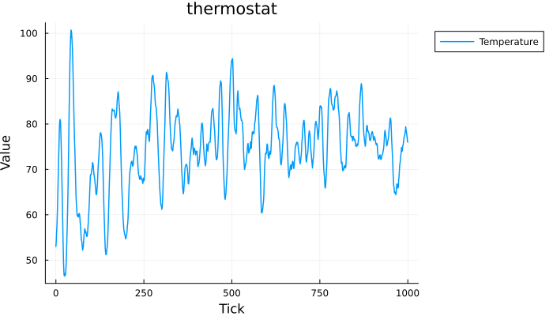
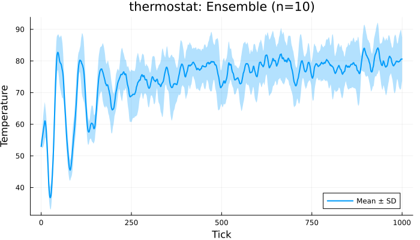
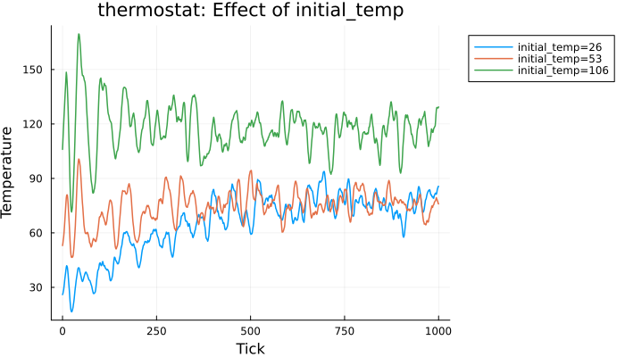

# Thermostat


- [Overview](#overview)
  - [WHAT IS IT?](#what-is-it)
  - [HOW IT WORKS](#how-it-works)
  - [THINGS TO NOTICE](#things-to-notice)
  - [EXTENDING THE MODEL](#extending-the-model)
  - [HOW TO CITE](#how-to-cite)
  - [COPYRIGHT AND LICENSE](#copyright-and-license)
- [Parameters](#parameters)
- [Source Code](#source-code)
- [Time Series](#time-series)
- [Ensemble Runs](#ensemble-runs)
- [Parameter Sensitivity](#parameter-sensitivity)
- [Appendix: Source Code](#appendix-source-code)
  - [Parameters (`parameters.jl`)](#parameters-parametersjl)
  - [Components (`components.jl`)](#components-componentsjl)
  - [Resources (`resources.jl`)](#resources-resourcesjl)
  - [Systems (`systems.jl`)](#systems-systemsjl)
  - [Model (`model.jl`)](#model-modeljl)

## Overview

### WHAT IS IT?

A thermostat is a device that responds to the temperature of a room in
order to maintain the temperature at some desired level. This is often
used as an example of feedback control, where a system adjusts its
behavior in response the effects of its prior behavior. Generally
speaking, heating systems have only two settings - on and off - and it
is the job of the thermostat to turn the heater on and off at the
appropriate times. A simple thermostat does this by switching the heater
on when the temperature of the room has fallen below the set desired
temperature, and switching the heater off once the desired temperature
has been reached or exceeded.

### HOW IT WORKS

In this model, the red turtles represent heat, and the yellow border
demarcates the room whose temperature is being regulated. The yellow
border is semi-permeable, allowing some of the heat that hits it to
escape from the room. This heat disappears from the model once it
reaches the edge of the world. A thermometer, indicated by the green
square, measures the approximate temperature of the room (effectively,
the density of red turtles). The heater is located in the center of the
room, represented by a white patch.

It should be noted that use of turtles in this model to represent heat
**is not intended to be physically realistic**. Instead, it is an
example where a model is simplified in such a way so as to make another
feature of the model more salient. In this case, it is the regulating
function of the thermostat that we are primarily concerned with.

### THINGS TO NOTICE

With some settings, the room cannot be heated to the desired temperature
(for example, the room attains a maximum temperature that is lower than
the desired temperature). Under what circumstances does this happen?

Look at the plot: does the thermostat do a good job of keeping the
temperature at the desired level? If we hold the variables constant, to
what factors can we attribute fluctuations of the temperature (in red)
over the desired temperature (in green)?

Try adjusting the insulation of the room and the strength of the heater.
Do these factors affect the efficiency of the thermostat (i.e. cause the
temperature to stay closer or further from the desired temperature)?

Notice that there is a delay from the time the heater is turned on to
the time when this added heat reached the thermometer. What are the
consequences of this delay?

### EXTENDING THE MODEL

The thermostat in this model uses a very simple rule to control the
heater based on the temperature. It might be possible to improve the
performance of this system by making it ‘smarter’. One suggestion is to
write a control program that turns the heater on and off before the
temperature hits the desired temperature — this would compensate for the
delay mentioned above. Try rewriting the function THERMO-CONTROL. Keep
in mind that the only inputs your control function should have are
GOAL-TEMP and TEMPERATURE, and the only action should be to either call
RUN-HEATER or not. Notice this leaves open the possibility of creating
variables to store past information.

Much of observed instability in the temperature might simply be
attributed to the thermometer that we are using. The current thermometer
takes an average of the number of turtles occupying the green patches
over the past ten ticks. Why do you suppose we are measuring the
temperature in such a way, instead of simply counting the number of
turtles inside the room? Can you design a better thermometer?

This model doesn’t account for how the outside temperature (outside the
yellow box) could effect the inside temperature. Alter the model so that
this now becomes a factor.

The heater in this model puts out heat at a fixed rate, regardless of
how long it has been on. Real heaters generally have a warm up period
during which time they slowly increase their output, until they reach
their maximum rate. Try adjusting the heater in this model to act more
like a real heater. How does this affect the behavior or efficiency of
the thermostat? How might we alter THERMO-CONTROL to account for this?

Begin a simulation with INITIAL-TEMP set to zero, and notice how long it
takes to heat up the room. This means that if we wanted to warm the room
up at a certain time it might make sense to turn the heater on
beforehand. Introduce time into this model, and try adjusting the
thermostat so that it heats the room according to some schedule.

### HOW TO CITE

If you mention this model or the NetLogo software in a publication, we
ask that you include the citations below.

For the model itself:

- Wilensky, U. (1998). NetLogo Thermostat model.
  http://ccl.northwestern.edu/netlogo/models/Thermostat. Center for
  Connected Learning and Computer-Based Modeling, Northwestern
  University, Evanston, IL.

Please cite the NetLogo software as:

- Wilensky, U. (1999). NetLogo. http://ccl.northwestern.edu/netlogo/.
  Center for Connected Learning and Computer-Based Modeling,
  Northwestern University, Evanston, IL.

### COPYRIGHT AND LICENSE

Copyright 1998 Uri Wilensky.


This model is licensed under the Creative Commons
Attribution-NonCommercial-ShareAlike 3.0 License. To view a copy of this
license, visit https://creativecommons.org/licenses/by-nc-sa/3.0/ or
send a letter to Creative Commons, 559 Nathan Abbott Way, Stanford,
California 94305, USA.

NetLogo itself is free software for non-commercial use under the terms
of the GNU General Public License ([see full license information
here](https://ccl.northwestern.edu/netlogo/docs/copyright.html)).

To inquire about commercial licenses for either NetLogo or specific
models from the models library, please contact
netlogo-commercial-admin@ccl.northwestern.edu.

This model was created as part of the project: CONNECTED MATHEMATICS:
MAKING SENSE OF COMPLEX PHENOMENA THROUGH BUILDING OBJECT-BASED PARALLEL
MODELS (OBPML). The project gratefully acknowledges the support of the
National Science Foundation (Applications of Advanced Technologies
Program) – grant numbers RED \#9552950 and REC \#9632612.

This model was converted to NetLogo as part of the projects:
PARTICIPATORY SIMULATIONS: NETWORK-BASED DESIGN FOR SYSTEMS LEARNING IN
CLASSROOMS and/or INTEGRATED SIMULATION AND MODELING ENVIRONMENT. The
project gratefully acknowledges the support of the National Science
Foundation (REPP & ROLE programs) – grant numbers REC \#9814682 and
REC-0126227. Converted from StarLogoT to NetLogo, 2001.

<!-- 1998 2001 -->

## Parameters

| Parameter         | Type  | Default | Description           |
|-------------------|-------|---------|-----------------------|
| `initial_temp`    | `Int` | `53`    | initial temp          |
| `goal_temp`       | `Int` | `67`    | goal temp             |
| `heater_strength` | `Int` | `4`     | heater strength       |
| `insulation`      | `Int` | `50`    | insulation            |
| `grid_width`      | `Int` | `71`    | grid width            |
| `grid_height`     | `Int` | `71`    | grid height           |
| `min_cor`         | `Int` | `-35`   | min-pxcor = min-pycor |
| `max_cor`         | `Int` | `35`    | max-pxcor = max-pycor |
| `max_ticks`       | `Int` | `1000`  | max ticks             |

## Source Code

The Julia code to run this model:

``` julia
using ArkModelZoo
_, trajectory = run_thermostat()
```

## Time Series



## Ensemble Runs

Ten replicates with different random seeds, showing mean ± standard
deviation.



## Parameter Sensitivity

Varying `initial_temp`.



## Appendix: Source Code

This model is implemented in the
[Ark.jl](https://github.com/sdwfrost/Ark.jl) Entity-Component-System
(ECS) framework. The code is split into five files, each with a distinct
role:

- **Parameters**: a mutable struct holding all configurable values.
- **Components**: lightweight data types attached to individual entities
  (agents).
- **Resources**: world-level shared state accessible to all systems.
- **Systems**: functions that operate on entities each tick, defining
  model behavior.
- **Model**: wiring that assembles the world, registers resources and
  systems, and provides the run entry point.

### Parameters (`parameters.jl`)

The parameter struct uses `@kwdef` so that every field has a default
value and can be overridden by keyword. These defaults match the
original NetLogo model’s slider settings.

``` julia
Base.@kwdef mutable struct ThermostatParams
    initial_temp::Int = 53
    goal_temp::Int = 67
    heater_strength::Int = 4
    insulation::Int = 50
    grid_width::Int = 71
    grid_height::Int = 71
    min_cor::Int = -35      # min-pxcor = min-pycor
    max_cor::Int = 35       # max-pxcor = max-pycor
    max_ticks::Int = 1000
    seed::Int = 42
end
```

### Components (`components.jl`)

Components are lightweight data types attached to individual entities
(agents). Mutable structs hold per-entity state, while empty tag structs
act as markers for the ECS query system to efficiently filter entities.

``` julia
# Heat particle position (continuous, non-wrapping world)
mutable struct ThermoPosition
    x::Float64
    y::Float64
end

# Persistent heading (degrees, 0=north, clockwise)
mutable struct ThermoHeading
    angle::Float64
end
```

### Resources (`resources.jl`)

Resources are world-level singletons shared across all systems, used for
global state and aggregate statistics.

``` julia
# Patch type grid: 0=interior, 1=wall(yellow), 2=thermometer(green)
mutable struct ThermoGrid
    width::Int          # 71
    height::Int         # 71
    min_cor::Int        # -35 (min patch coordinate)
    cells::Matrix{Int8}
end

function ThermoGrid(width::Int, height::Int, min_cor::Int)
    ThermoGrid(width, height, min_cor, zeros(Int8, width, height))
end

mutable struct ThermoStats
    temperature::Float64
    temperatures::Vector{Float64}   # rolling window of 10 readings
end
ThermoStats() = ThermoStats(0.0, Float64[])
```

### Systems (`systems.jl`)

Systems contain the model logic and execute in a defined order each
tick. Each system struct implements either `initialize!` (run once at
setup) or `update!` (run every tick).

``` julia
const THERMO_INTERIOR = Int8(0)
const THERMO_WALL     = Int8(1)
const THERMO_GREEN    = Int8(2)

# --- Grid helpers ---

# Convert continuous position to patch coordinate (NetLogo round-to-nearest)
_thermo_patch(v::Float64) = round(Int, v)

# Convert patch coordinate to 1-based grid index
_thermo_idx(pc::Int, min_cor::Int) = pc - min_cor + 1

# Check if patch (px,py) is inside the grid
function _thermo_in_bounds(px::Int, py::Int, min_cor::Int, max_cor::Int)
    return min_cor <= px <= max_cor && min_cor <= py <= max_cor
end

# Get patch type at continuous position
function _thermo_ptype(grid::ThermoGrid, x::Float64, y::Float64)
    px = _thermo_patch(x)
    py = _thermo_patch(y)
    if !_thermo_in_bounds(px, py, grid.min_cor, grid.min_cor + grid.width - 1)
        return THERMO_WALL  # out of bounds treated as wall
    end
    ix = _thermo_idx(px, grid.min_cor)
    iy = _thermo_idx(py, grid.min_cor)
    return grid.cells[ix, iy]
end

# --- Initialization ---

struct InitThermoSystem <: System end

function initialize!(::InitThermoSystem, world::World)
    params = get_resource(world, ThermostatParams)
    rng = get_resource(world, RNGResource).rng
    grid = get_resource(world, ThermoGrid)
    stats = get_resource(world, ThermoStats)

    min_c = params.min_cor
    max_c = params.max_cor

    # Wall boundary at ±(max_cor - 7) = ±28
    wall_bound = max_c - 7  # 28

    # Set up grid patch types
    for px in min_c:max_c, py in min_c:max_c
        ix = _thermo_idx(px, min_c)
        iy = _thermo_idx(py, min_c)
        if abs(px) >= wall_bound || abs(py) >= wall_bound
            grid.cells[ix, iy] = THERMO_WALL
        elseif abs(px) < 5 && py > (max_c - 25) && py < (max_c - 15)
            # Thermometer: |x|<5 and 10<y<20 → py in 11..19
            grid.cells[ix, iy] = THERMO_GREEN
        else
            grid.cells[ix, iy] = THERMO_INTERIOR
        end
    end

    # Initial temperature readings
    stats.temperatures = fill(Float64(params.initial_temp), 10)
    stats.temperature = Float64(params.initial_temp)

    # Create initial heat particles at origin with random heading, fd random-float 27
    w = params.grid_width
    move_dist_max = Float64(max_c - 8)  # 27.0
    n_initial = round(Int, params.initial_temp * ((w - 16)^2 / 81.0))

    for _ in 1:n_initial
        heading = Float64(rand(rng, 0:359))
        dist = rand(rng) * move_dist_max
        θ = deg2rad(heading)
        x = sin(θ) * dist
        y = cos(θ) * dist
        new_entity!(world, (ThermoPosition(x, y), ThermoHeading(heading)))
    end
    return nothing
end

# --- Circulation ---
# NetLogo: if pcolor=yellow and random-float insulation > 1 → redirect.
# Then fd 1. If not can-move? 1 → die.

mutable struct ThermoCirculateSystem <: System
    to_remove::Vector{Entity}
end
ThermoCirculateSystem() = ThermoCirculateSystem(Entity[])

function update!(system::ThermoCirculateSystem, world::World)
    params = get_resource(world, ThermostatParams)
    rng = get_resource(world, RNGResource).rng
    grid = get_resource(world, ThermoGrid)
    min_c = params.min_cor
    max_c = params.max_cor
    w = params.grid_width
    half_world = Float64(max_c) + 0.5  # 35.5

    # facexy target ranges
    face_xrange = Float64(w - 13)   # 58.0
    face_yrange = Float64(w - 14)   # 57.0
    face_offset = Float64(max_c - 6) # 29.0

    empty!(system.to_remove)

    for (eids, positions, headings) in Query(world, (ThermoPosition, ThermoHeading))
        @inbounds for i in eachindex(positions)
            x = positions[i].x
            y = positions[i].y
            ptype = _thermo_ptype(grid, x, y)

            # On wall patch: chance to redirect toward interior
            if ptype == THERMO_WALL
                if rand(rng) * params.insulation > 1.0
                    # facexy random interior point
                    tx = rand(rng) * face_xrange - face_offset
                    ty = rand(rng) * face_yrange - face_offset
                    dx = tx - x
                    dy = ty - y
                    headings[i].angle = atand(dx, dy)  # NetLogo heading convention
                end
            end

            # fd 1
            θ = deg2rad(headings[i].angle)
            nx = x + sin(θ)
            ny = y + cos(θ)
            positions[i].x = nx
            positions[i].y = ny

            # can-move? 1 check: would next step go out of world?
            check_x = nx + sin(θ)
            check_y = ny + cos(θ)
            if check_x < -half_world || check_x > half_world ||
               check_y < -half_world || check_y > half_world
                push!(system.to_remove, eids[i])
            end
        end
    end

    for e in system.to_remove
        is_alive(world, e) && remove_entity!(world, e)
    end
    return nothing
end

# --- Temperature measurement ---

struct ThermoTemperatureSystem <: System end

function update!(::ThermoTemperatureSystem, world::World)
    grid = get_resource(world, ThermoGrid)
    stats = get_resource(world, ThermoStats)

    # Count particles on green (thermometer) patches
    count_green = 0
    for (_, positions) in Query(world, (ThermoPosition,))
        @inbounds for i in eachindex(positions)
            if _thermo_ptype(grid, positions[i].x, positions[i].y) == THERMO_GREEN
                count_green += 1
            end
        end
    end

    # Update rolling temperature: but-last fput count temperatures
    pop!(stats.temperatures)
    pushfirst!(stats.temperatures, Float64(count_green))
    stats.temperature = sum(stats.temperatures) / length(stats.temperatures)
    return nothing
end

# --- Heater control ---

struct ThermoHeaterSystem <: System end

function update!(::ThermoHeaterSystem, world::World)
    params = get_resource(world, ThermostatParams)
    rng = get_resource(world, RNGResource).rng
    stats = get_resource(world, ThermoStats)

    if stats.temperature < params.goal_temp
        # Create heater_strength new particles at origin with random heading
        for _ in 1:params.heater_strength
            heading = Float64(rand(rng, 0:359))
            new_entity!(world, (ThermoPosition(0.0, 0.0), ThermoHeading(heading)))
        end
    end
    return nothing
end

# --- Stats (temperature already computed) ---

struct ThermoStatsSystem <: System end
function update!(::ThermoStatsSystem, world::World)
    return nothing
end

# --- Termination ---

struct ThermoTerminationSystem <: System end

function update!(::ThermoTerminationSystem, world::World)
    params = get_resource(world, ThermostatParams)
    tick = get_resource(world, Tick)
    if tick.tick + 1 >= params.max_ticks
        get_resource(world, Terminate).stop = true
    end
    return nothing
end
```

### Model (`model.jl`)

The model file assembles all pieces: it creates the ECS `World` with the
required component types, registers resources, builds the `Scheduler`
with systems in execution order, and exposes the public `run` entry
point. The observer pattern records the trajectory each tick.

``` julia
function thermostat_world(; initial_capacity::Int = 4096)
    return World(
        ThermoPosition,
        ThermoHeading;
        initial_capacity = initial_capacity,
        allow_mutable = true,
    )
end

function thermostat_systems()
    return (
        InitThermoSystem(),
        ThermoCirculateSystem(),
        ThermoTemperatureSystem(),
        ThermoHeaterSystem(),
        ThermoStatsSystem(),
        ThermoTerminationSystem(),
    )
end

function thermostat_model(params::ThermostatParams = ThermostatParams())
    world = thermostat_world()
    _add_standard_resources!(world, params)
    add_resource!(world, ThermoGrid(params.grid_width, params.grid_height, params.min_cor))
    add_resource!(world, ThermoStats())
    scheduler = Scheduler(world, thermostat_systems())
    initialize!(scheduler)
    return scheduler
end

struct ThermostatObserver end

function thermostat_headers(::ThermostatObserver)
    return ["Temperature"]
end

function thermostat_values(::ThermostatObserver, world::World)
    stats = get_resource(world, ThermoStats)
    return Float64[stats.temperature]
end

function run_thermostat(; params::ThermostatParams = ThermostatParams(), observe::Bool = true)
    return _run_model(thermostat_model, ThermostatObserver(), thermostat_values; params, observe)
end
```
