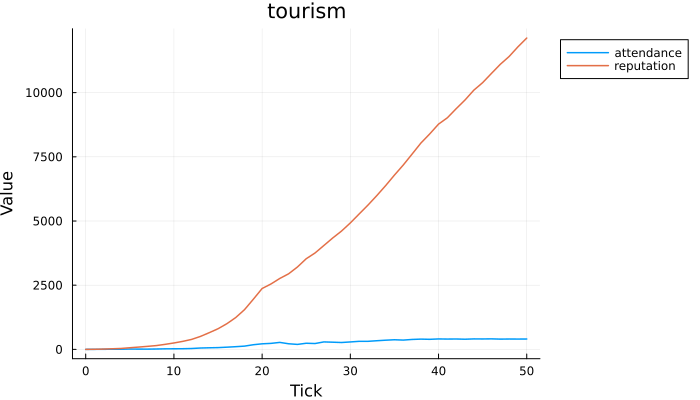
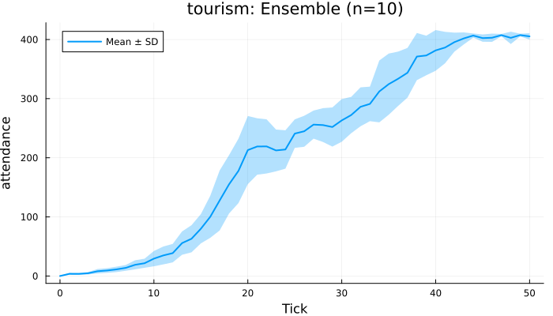
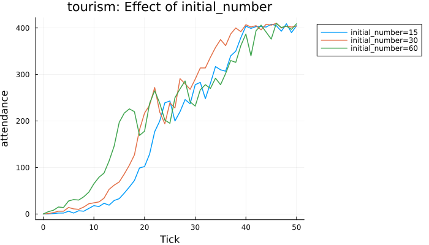

## Overview

This vignette demonstrates the **Tourism** model implemented in [ArkModelZoo.jl](https://github.com/sdwfrost/ArkModelZoo.jl) using the Ark.jl ECS framework.

## Parameters

| Parameter | Type | Default | Description |
|-----------|------|---------|-------------|
| `initial_number` | `Int` | `30` | initial number |
| `maintaining_rate` | `Float64` | `80.0` | maintaining rate |
| `capacity` | `Int` | `410` | capacity |
| `innovative` | `Bool` | `false` | innovative |
| `promotive` | `Bool` | `false` | promotive |
| `extension` | `Bool` | `false` | extension |
| `max_ticks` | `Int` | `50` | max ticks |

## Source Code

The Julia code to run this model:

```julia
using ArkModelZoo
_, trajectory = run_tourism()
```

## Time Series

{width=100%}

## Ensemble Runs

Ten replicates with different random seeds, showing mean ± standard deviation.

{width=100%}

## Parameter Sensitivity

Varying `initial_number`.

{width=100%}


## Appendix: Source Code

This model is implemented in the [Ark.jl](https://github.com/sdwfrost/Ark.jl) Entity-Component-System (ECS) framework. The code is split into five files, each with a distinct role:

- **Parameters**: a mutable struct holding all configurable values.
- **Components**: lightweight data types attached to individual entities (agents).
- **Resources**: world-level shared state accessible to all systems.
- **Systems**: functions that operate on entities each tick, defining model behavior.
- **Model**: wiring that assembles the world, registers resources and systems, and provides the run entry point.

### Parameters (`parameters.jl`)

The parameter struct uses `@kwdef` so that every field has a default value and can be overridden by keyword. These defaults match the original NetLogo model's slider settings.

```julia
# Tourism Destination model – parameters

Base.@kwdef mutable struct TourismParams
    initial_number::Int = 30
    maintaining_rate::Float64 = 80.0
    capacity::Int = 410
    innovative::Bool = false
    promotive::Bool = false
    extension::Bool = false
    max_ticks::Int = 50
    seed::Int = 42
end
```

### Components (`components.jl`)

Components are lightweight data types attached to individual entities (agents). Mutable structs hold per-entity state, while empty tag structs act as markers for the ECS query system to efficiently filter entities.

```julia
# Tourism Destination model – ECS components

mutable struct TourismVisitor
    revisit_interval::Int
    evaluation::Int
    is_social::Bool
    at_destination::Bool
end
TourismVisitor() = TourismVisitor(1, 0, false, false)
```

### Resources (`resources.jl`)

Resources are world-level singletons shared across all systems, used for global state and aggregate statistics.

```julia
# Tourism Destination model – ECS resources

mutable struct TourismStats
    attendance::Int
    reputation::Float64
end
TourismStats() = TourismStats(0, 0.0)

mutable struct TourismState
    attraction::Float64
end
TourismState() = TourismState(300.0)
```

### Systems (`systems.jl`)

Systems contain the model logic and execute in a defined order each tick. Each system struct implements either `initialize!` (run once at setup) or `update!` (run every tick).

```julia
struct InitTourismSystem <: System end

function initialize!(::InitTourismSystem, world::World)
    params = get_resource(world, TourismParams)
    rng = get_resource(world, RNGResource).rng
    stats = get_resource(world, TourismStats)
    state = get_resource(world, TourismState)

    stats.attendance = 0
    stats.reputation = 0.0
    state.attraction = 300.0

    # Pass 1: Create all visitors with revisit_interval (NetLogo: crt block)
    eids = Entity[]
    for _ in 1:params.initial_number
        e = new_entity!(world, (TourismVisitor(
            rand(rng, 1:9), 0, false, false
        ),))
        push!(eids, e)
    end

    # Pass 2: Assign social? separately (NetLogo: ask turtles [...])
    for e in eids
        v = get_components(world, e, (TourismVisitor,))[1]
        v.is_social = rand(rng) < 0.5
    end
end

struct TourismUpdateSystem <: System end

function update!(::TourismUpdateSystem, world::World)
    params = get_resource(world, TourismParams)
    rng = get_resource(world, RNGResource).rng
    tick = get_resource(world, Tick)
    stats = get_resource(world, TourismStats)
    state = get_resource(world, TourismState)

    all_eids = Entity[]
    for (eids,) in Query(world, (TourismVisitor,))
        append!(all_eids, eids)
    end
    isempty(all_eids) && return

    # NetLogo: tick happens at START of go, before the ask block
    current_tick = tick.tick + 1

    shuffle!(rng, all_eids)
    to_spawn = TourismVisitor[]
    to_kill = Set{Entity}()

    for eid in all_eids
        eid in to_kill && continue

        visitor = get_components(world, eid, (TourismVisitor,))[1]
        visitor.revisit_interval -= 1

        if visitor.revisit_interval == 0
            visitor.at_destination = true
            evaluate_visitor!(visitor, state, stats, params, rng, to_spawn, to_kill, eid, world, all_eids)

            # Update attraction (only if visitor survived evaluate)
            if params.innovative
                if current_tick <= 30
                    state.attraction += -1.0 + params.maintaining_rate / 100.0 + 0.2
                else
                    state.attraction += -1.0 + params.maintaining_rate / 100.0 + 0.2 + 0.1
                end
            else
                state.attraction += -1.0 + params.maintaining_rate / 100.0 + 0.2
            end

            # Promotive: hatch new visitor
            if params.promotive && !(eid in to_kill)
                push!(to_spawn, TourismVisitor(
                    rand(rng, 1:9), 0, rand(rng) < 0.5, false
                ))
            end
        else
            visitor.at_destination = false
        end

        # Recount attendance (NetLogo: count turtles-on destination-patches)
        dest_count = 0
        for (eids2, visitors2) in Query(world, (TourismVisitor,))
            @inbounds for j in eachindex(visitors2)
                if visitors2[j].at_destination && !(eids2[j] in to_kill)
                    dest_count += 1
                end
            end
        end
        stats.attendance = dest_count

        # Death check: if 1 = random 9 + 1 → probability 1/9
        if !(eid in to_kill) && rand(rng, 1:9) == 1
            push!(to_kill, eid)
        end
    end

    # Extension check
    if params.extension && current_tick == 70
        params.capacity += 100
    end

    for eid in to_kill
        is_alive(world, eid) && remove_entity!(world, eid)
    end
    for v in to_spawn
        new_entity!(world, (v,))
    end
end

function evaluate_visitor!(visitor, state, stats, params, rng, to_spawn, to_kill, eid, world, all_eids)
    attraction = state.attraction
    attendance = Float64(stats.attendance)
    capacity = Float64(params.capacity)
    died = false

    # NetLogo uses sequential `if` (not if/elseif). Conditions can overlap at
    # boundary values, so we use separate `if` blocks with a `died` guard.
    if visitor.is_social
        if attraction >= 250 && attendance <= 0.5 * capacity
            visitor.evaluation = 3
            stats.reputation += 2
            visitor.revisit_interval = rand(rng, 0:3)
            for _ in 1:2
                push!(to_spawn, TourismVisitor(rand(rng, 1:9), 0, true, false))
            end
        end
        if attraction >= 250 && attendance > 0.5 * capacity && attendance < capacity
            visitor.evaluation = 2
            stats.reputation += 1
            visitor.revisit_interval = rand(rng, 0:7)
            push!(to_spawn, TourismVisitor(rand(rng, 1:9), 0, true, false))
        end
        if attraction <= 250 && attraction > 50 && attendance <= 0.5 * capacity
            visitor.evaluation = 1
            visitor.revisit_interval = rand(rng, 0:29)
        end
        if attraction <= 250 && attraction > 50 && attendance > 0.5 * capacity && attendance < capacity
            visitor.evaluation = 1
            visitor.revisit_interval = rand(rng, 0:29)
        end
        if attendance >= capacity && !died
            visitor.evaluation = 0
            stats.reputation -= 2
            push!(to_kill, eid)
            died = true
            kill_one_of_type!(world, true, to_kill, all_eids, rng)
        end
        if attraction <= 50 && !died
            visitor.evaluation = 0
            stats.reputation -= 2
            push!(to_kill, eid)
            died = true
            kill_one_of_type!(world, true, to_kill, all_eids, rng)
        end
    else
        if attraction >= 250 && attendance <= 0.5 * capacity
            visitor.evaluation = 3
            stats.reputation += 2
            visitor.revisit_interval = rand(rng, 0:3)
            for _ in 1:2
                push!(to_spawn, TourismVisitor(rand(rng, 1:9), 0, false, false))
            end
        end
        if attraction >= 250 && attendance > 0.5 * capacity && attendance < 0.8 * capacity
            visitor.evaluation = 1
            visitor.revisit_interval = rand(rng, 0:29)
        end
        if attendance >= 0.8 * capacity && !died
            visitor.evaluation = 0
            stats.reputation -= 2
            push!(to_kill, eid)
            died = true
            kill_one_of_type!(world, false, to_kill, all_eids, rng)
        end
        if attraction <= 250 && attraction > 0 && attendance <= 0.5 * capacity
            visitor.evaluation = 2
            stats.reputation += 1
            visitor.revisit_interval = rand(rng, 0:7)
            push!(to_spawn, TourismVisitor(rand(rng, 1:9), 0, false, false))
        end
        if attraction <= 250 && attendance > 0.5 * capacity && attraction > 0 && attendance < 0.8 * capacity
            visitor.evaluation = 1
            visitor.revisit_interval = rand(rng, 0:29)
        end
        if attraction <= 0 && !died
            visitor.evaluation = 0
            stats.reputation -= 2
            push!(to_kill, eid)
            died = true
            kill_one_of_type!(world, false, to_kill, all_eids, rng)
        end
    end
end

function kill_one_of_type!(world, is_social::Bool, to_kill, all_eids, rng)
    candidates = Entity[]
    for e in all_eids
        e in to_kill && continue
        is_alive(world, e) || continue
        v = get_components(world, e, (TourismVisitor,))[1]
        if v.is_social == is_social
            push!(candidates, e)
        end
    end
    if !isempty(candidates)
        push!(to_kill, candidates[rand(rng, 1:length(candidates))])
    end
end

struct TourismStatsSystem <: System end

function update!(::TourismStatsSystem, world::World)
    stats = get_resource(world, TourismStats)
    dest_count = 0
    for (_, visitors) in Query(world, (TourismVisitor,))
        for v in visitors
            if v.at_destination
                dest_count += 1
            end
        end
    end
    stats.attendance = dest_count
end

struct TourismTerminationSystem <: System end

function update!(::TourismTerminationSystem, world::World)
    params = get_resource(world, TourismParams)
    tick = get_resource(world, Tick)
    term = get_resource(world, Terminate)

    n_visitors = 0
    for (eids,) in Query(world, (TourismVisitor,))
        n_visitors += length(eids)
    end
    if n_visitors == 0
        term.stop = true
        return
    end

    if tick.tick + 1 >= params.max_ticks
        term.stop = true
    end
end
```

### Model (`model.jl`)

The model file assembles all pieces: it creates the ECS `World` with the required component types, registers resources, builds the `Scheduler` with systems in execution order, and exposes the public `run` entry point. The observer pattern records the trajectory each tick.

```julia
function tourism_world(; initial_capacity::Int = 512)
    World(
        TourismVisitor;
        initial_capacity = initial_capacity,
        allow_mutable = true
    )
end

function tourism_systems()
    return (
        InitTourismSystem(),
        TourismUpdateSystem(),
        TourismStatsSystem(),
        TourismTerminationSystem()
    )
end

function tourism_model(params::TourismParams = TourismParams())
    world = tourism_world()
    _add_standard_resources!(world, params)
    add_resource!(world, TourismStats())
    add_resource!(world, TourismState())
    scheduler = Scheduler(world, tourism_systems())
    initialize!(scheduler)
    return scheduler
end

struct TourismObserver end

function tourism_headers(::TourismObserver)
    return ["attendance", "reputation"]
end

function tourism_values(::TourismObserver, world::World)
    stats = get_resource(world, TourismStats)
    return Float64[Float64(stats.attendance), stats.reputation]
end

function run_tourism(; params::TourismParams = TourismParams(), observe::Bool = true)
    return _run_model(tourism_model, TourismObserver(), tourism_values; params, observe)
end
```
