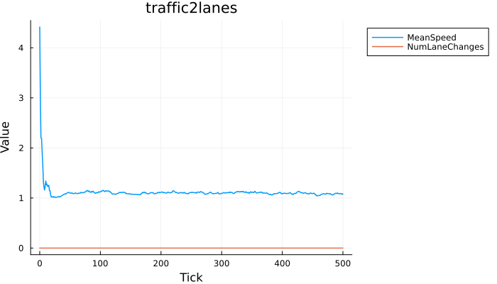
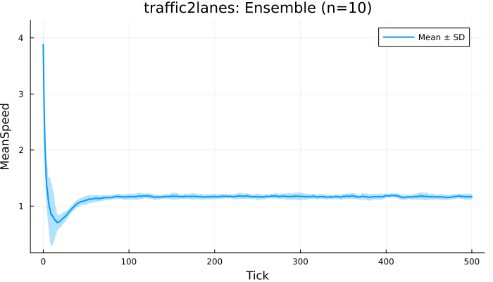
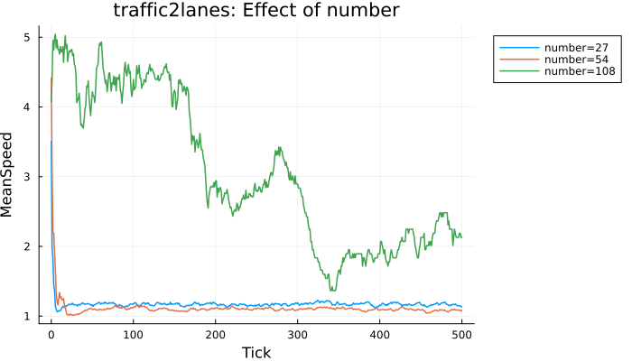

# Traffic 2 Lanes


- [Overview](#overview)
  - [WHAT IS IT?](#what-is-it)
  - [THINGS TO NOTICE](#things-to-notice)
  - [THINGS TO TRY](#things-to-try)
  - [EXTENDING THE MODEL](#extending-the-model)
  - [NETLOGO FEATURES](#netlogo-features)
  - [RELATED MODELS](#related-models)
  - [HOW TO CITE](#how-to-cite)
  - [COPYRIGHT AND LICENSE](#copyright-and-license)
- [Parameters](#parameters)
- [Source Code](#source-code)
- [Time Series](#time-series)
- [Ensemble Runs](#ensemble-runs)
- [Parameter Sensitivity](#parameter-sensitivity)
- [Appendix: Source Code](#appendix-source-code)
  - [Parameters (`parameters.jl`)](#parameters-parametersjl)
  - [Components (`components.jl`)](#components-componentsjl)
  - [Resources (`resources.jl`)](#resources-resourcesjl)
  - [Systems (`systems.jl`)](#systems-systemsjl)
  - [Model (`model.jl`)](#model-modeljl)

## Overview

### WHAT IS IT?

This model is a more sophisticated two-lane version of the “Traffic
Basic” model. Much like the simpler model, this model demonstrates how
traffic jams can form. In the two-lane version, drivers have a new
option; they can react by changing lanes, although this often does
little to solve their problem.

As in the Traffic Basic model, traffic may slow down and jam without any
centralized cause.

### THINGS TO NOTICE

Traffic jams can start from small “seeds.” Cars start with random
positions. If some cars are clustered together, they will move slowly,
causing cars behind them to slow down, and a traffic jam forms.

Even though all of the cars are moving forward, the traffic jams tend to
move backwards. This behavior is common in wave phenomena: the behavior
of the group is often very different from the behavior of the
individuals that make up the group.

Just as each car has a current speed, each driver has a current
patience. Each time the driver has to hit the brakes to avoid hitting
the car in front of them, they loose a little patience. When a driver’s
patience expires, the driver tries to change lane. The driver’s patience
gets reset to the maximum patience.

When the number of cars in the model is high, drivers lose their
patience quickly and start weaving in and out of lanes. This phenomenon
is called “snaking” and is common in congested highways. And if the
number of cars is high enough, almost every car ends up trying to change
lanes and the traffic slows to a crawl, making the situation even worse,
with cars getting momentarily stuck between lanes because they are
unable to change. Does that look like a real life situation to you?

Watch the MEAN-SPEED monitor, which computes the average speed of the
cars. What happens to the speed over time? What is the relation between
the speed of the cars and the presence (or absence) of traffic jams?

Look at the two plots. Can you detect discernible patterns in the plots?

The grass patches on each side of the road are all a slightly different
shade of green. The road patches, to a lesser extent, are different
shades of grey. This is not just about making the model look nice: it
also helps create an impression of movement when using the FOLLOW
SELECTED CAR button.

### THINGS TO TRY

What could you change to minimize the chances of traffic jams forming,
besides just the number of cars? What is the relationship between number
of cars, number of lanes, and (in this case) the length of each lane?

Explore changes to the sliders SLOW-DOWN and SPEED-UP. How do these
affect the flow of traffic? Can you set them so as to create maximal
snaking?

Change the code so that all cars always start on the same lane. Does the
proportion of cars on each lane eventually balance out? How long does it
take?

Try using the `"default"` turtle shape instead of the car shape, either
by changing the code or by typing `ask turtles [ set shape "default" ]`
in the command center after clicking SETUP. This will allow you to
quickly spot the cars trying to change lanes. What happens to them when
there is a lot of traffic?

### EXTENDING THE MODEL

The way this model is written makes it easy to add more lanes. Look for
the `number-of-lanes` reporter in the code and play around with it.

Try to create a “Traffic Crossroads” (where two sets of cars might meet
at a traffic light), or “Traffic Bottleneck” model (where two lanes
might merge to form one lane).

Note that the cars never crash into each other: a car will never enter a
patch or pass through a patch containing another car. Remove this
feature, and have the turtles that collide die upon collision. What will
happen to such a model over time?

### NETLOGO FEATURES

Note the use of `mouse-down?` and `mouse-xcor`/`mouse-ycor` to enable
selecting a car for special attention.

Each turtle has a shape, unlike in some other models. NetLogo uses
`set shape` to alter the shapes of turtles. You can, using the shapes
editor in the Tools menu, create your own turtle shapes or modify
existing ones. Then you can modify the code to use your own shapes.

### RELATED MODELS

- “Traffic Basic”: a simple model of the movement of cars on a highway.

- “Traffic Basic Utility”: a version of “Traffic Basic” including a
  utility function for the cars.

- “Traffic Basic Adaptive”: a version of “Traffic Basic” where cars
  adapt their acceleration to try and maintain a smooth flow of traffic.

- “Traffic Basic Adaptive Individuals”: a version of “Traffic Basic
  Adaptive” where each car adapts individually, instead of all cars
  adapting in unison.

- “Traffic Intersection”: a model of cars traveling through a single
  intersection.

- “Traffic Grid”: a model of traffic moving in a city grid, with
  stoplights at the intersections.

- “Traffic Grid Goal”: a version of “Traffic Grid” where the cars have
  goals, namely to drive to and from work.

- “Gridlock HubNet”: a version of “Traffic Grid” where students control
  traffic lights in real-time.

- “Gridlock Alternate HubNet”: a version of “Gridlock HubNet” where
  students can enter NetLogo code to plot custom metrics.

### HOW TO CITE

If you mention this model or the NetLogo software in a publication, we
ask that you include the citations below.

For the model itself:

- Wilensky, U. & Payette, N. (1998). NetLogo Traffic 2 Lanes model.
  http://ccl.northwestern.edu/netlogo/models/Traffic2Lanes. Center for
  Connected Learning and Computer-Based Modeling, Northwestern
  University, Evanston, IL.

Please cite the NetLogo software as:

- Wilensky, U. (1999). NetLogo. http://ccl.northwestern.edu/netlogo/.
  Center for Connected Learning and Computer-Based Modeling,
  Northwestern University, Evanston, IL.

### COPYRIGHT AND LICENSE

Copyright 1998 Uri Wilensky.


This model is licensed under the Creative Commons
Attribution-NonCommercial-ShareAlike 3.0 License. To view a copy of this
license, visit https://creativecommons.org/licenses/by-nc-sa/3.0/ or
send a letter to Creative Commons, 559 Nathan Abbott Way, Stanford,
California 94305, USA.

NetLogo itself is free software for non-commercial use under the terms
of the GNU General Public License ([see full license information
here](https://ccl.northwestern.edu/netlogo/docs/copyright.html)).

To inquire about commercial licenses for either NetLogo or specific
models from the models library, please contact
netlogo-commercial-admin@ccl.northwestern.edu.

This model was created as part of the project: CONNECTED MATHEMATICS:
MAKING SENSE OF COMPLEX PHENOMENA THROUGH BUILDING OBJECT-BASED PARALLEL
MODELS (OBPML). The project gratefully acknowledges the support of the
National Science Foundation (Applications of Advanced Technologies
Program) – grant numbers RED \#9552950 and REC \#9632612.

This model was converted to NetLogo as part of the projects:
PARTICIPATORY SIMULATIONS: NETWORK-BASED DESIGN FOR SYSTEMS LEARNING IN
CLASSROOMS and/or INTEGRATED SIMULATION AND MODELING ENVIRONMENT. The
project gratefully acknowledges the support of the National Science
Foundation (REPP & ROLE programs) – grant numbers REC \#9814682 and
REC-0126227. Converted from StarLogoT to NetLogo, 2001.

<!-- 1998 2001 Cite: Wilensky, U. & Payette, N. -->

## Parameters

| Parameter     | Type      | Default | Description                 |
|---------------|-----------|---------|-----------------------------|
| `number`      | `Int`     | `54`    | number                      |
| `speed_up`    | `Float64` | `38.0`  | acceleration per 1000 ticks |
| `slow_down`   | `Float64` | `77.0`  | deceleration per 1000 ticks |
| `look_ahead`  | `Int`     | `1`     | 1 or 2 patches ahead        |
| `road_length` | `Int`     | `51`    | -25..25                     |
| `max_ticks`   | `Int`     | `500`   | max ticks                   |

## Source Code

The Julia code to run this model:

``` julia
using ArkModelZoo
_, trajectory = run_traffic2lanes()
```

## Time Series



## Ensemble Runs

Ten replicates with different random seeds, showing mean ± standard
deviation.



## Parameter Sensitivity

Varying `number`.



## Appendix: Source Code

This model is implemented in the
[Ark.jl](https://github.com/sdwfrost/Ark.jl) Entity-Component-System
(ECS) framework. The code is split into five files, each with a distinct
role:

- **Parameters**: a mutable struct holding all configurable values.
- **Components**: lightweight data types attached to individual entities
  (agents).
- **Resources**: world-level shared state accessible to all systems.
- **Systems**: functions that operate on entities each tick, defining
  model behavior.
- **Model**: wiring that assembles the world, registers resources and
  systems, and provides the run entry point.

### Parameters (`parameters.jl`)

The parameter struct uses `@kwdef` so that every field has a default
value and can be overridden by keyword. These defaults match the
original NetLogo model’s slider settings.

``` julia
Base.@kwdef mutable struct T2LParams
    number::Int = 54
    speed_up::Float64 = 38.0      # acceleration per 1000 ticks
    slow_down::Float64 = 77.0     # deceleration per 1000 ticks
    look_ahead::Int = 1           # 1 or 2 patches ahead
    road_length::Int = 51         # -25..25
    max_ticks::Int = 500
    seed::Int = 42
end
```

### Components (`components.jl`)

Components are lightweight data types attached to individual entities
(agents). Mutable structs hold per-entity state, while empty tag structs
act as markers for the ECS query system to efficiently filter entities.

``` julia
mutable struct T2LCar
    x::Int
    pycor::Int             # actual y position: -2..2 (intermediate during lane change)
    lane::Int              # logical lane: 0 or 1
    speed::Float64
    speed_limit::Float64
    patience::Int
    max_patience::Int
    target_lane::Int
    change::Bool
end
T2LCar() = T2LCar(0, -2, 0, 0.0, 1.0, 50, 50, 0, false)
```

### Resources (`resources.jl`)

Resources are world-level singletons shared across all systems, used for
global state and aggregate statistics.

``` julia
mutable struct T2LRoad
    length::Int           # x-axis length (wrapping)
    # 2D occupancy: occ[x, row] where row = pycor + 3  (pycor -2..2 → row 1..5)
    occ::Matrix{Entity}
end

function T2LRoad(len::Int)
    T2LRoad(len, fill(zero_entity, len, 5))
end

# pycor ∈ {-2,-1,0,1,2} → row ∈ {1,2,3,4,5}
@inline pycor_to_row(py::Int) = py + 3

mutable struct T2LStats
    mean_speed::Float64
    num_lane_changes::Int
end
T2LStats() = T2LStats(0.0, 0)
```

### Systems (`systems.jl`)

Systems contain the model logic and execute in a defined order each
tick. Each system struct implements either `initialize!` (run once at
setup) or `update!` (run every tick).

``` julia
# --- Initialization ---

struct InitT2LSystem <: System end

function initialize!(::InitT2LSystem, world::World)
    params = get_resource(world, T2LParams)
    rng = get_resource(world, RNGResource).rng
    road = get_resource(world, T2LRoad)
    len = road.length

    for i in 1:params.number
        lane = rand(rng, 0:1)
        pycor = lane == 0 ? -2 : 2
        # NetLogo: random 9.9 truncates to random 9 → integer 0..8
        speed = 0.1 + Float64(rand(rng, 0:8))
        speed_limit = (rand(rng, 0:10) / 10.0) + 1.0
        max_pat = rand(rng, 0:49) + 10
        patience = max_pat - rand(rng, 0:9)
        target_lane = lane

        car = T2LCar(0, pycor, lane, speed, speed_limit, patience, max_pat, target_lane, false)

        # Place on empty spot — NetLogo: move-to one-of patches with [...not any? turtles-here]
        # then loop { if other turtles-here fd 1 else stop }
        row = pycor_to_row(pycor)
        placed = false
        # Try random-xcor then fd 1 loop (wrapping)
        start_x = rand(rng, 1:len)
        for offset in 0:(len-1)
            x = mod1(start_x + offset, len)
            if is_zero(road.occ[x, row])
                car.x = x
                eid = new_entity!(world, (car,))
                road.occ[x, row] = eid
                placed = true
                break
            end
        end
        if !placed
            # Try other lane
            other_lane = 1 - lane
            other_pycor = other_lane == 0 ? -2 : 2
            other_row = pycor_to_row(other_pycor)
            car.lane = other_lane
            car.pycor = other_pycor
            car.target_lane = other_lane
            for offset in 0:(len-1)
                x = mod1(start_x + offset, len)
                if is_zero(road.occ[x, other_row])
                    car.x = x
                    eid = new_entity!(world, (car,))
                    road.occ[x, other_row] = eid
                    placed = true
                    break
                end
            end
        end
    end
    # Compute initial stats (matching NetLogo's update-tracked-globals in setup)
    stats = get_resource(world, T2LStats)
    total_speed = 0.0
    n = 0
    for (_, cars) in Query(world, (T2LCar,))
        for c in cars
            total_speed += c.speed
            n += 1
        end
    end
    stats.mean_speed = n > 0 ? total_speed / n : 0.0
    return nothing
end

struct T2LGoSystem <: System end

# Helper: get entity at (pxcor+dx, pycor+dy) with x-wrapping, no y-wrapping
@inline function turtles_at(road::T2LRoad, x::Int, py::Int, dx::Int, dy::Int)
    new_py = py + dy
    if new_py < -2 || new_py > 2
        return zero_entity
    end
    new_x = mod1(x + dx, road.length)
    return road.occ[new_x, pycor_to_row(new_py)]
end

function update!(::T2LGoSystem, world::World)
    params = get_resource(world, T2LParams)
    rng = get_resource(world, RNGResource).rng
    road = get_resource(world, T2LRoad)
    stats = get_resource(world, T2LStats)
    len = road.length
    accel = params.speed_up / 1000.0
    decel = params.slow_down / 1000.0

    num_changes = 0

    # Collect all cars
    car_list = Tuple{Entity, Int}[]
    for (eids, cars) in Query(world, (T2LCar,))
        @inbounds for i in eachindex(cars)
            push!(car_list, (eids[i], i))
        end
    end
    Random.shuffle!(rng, car_list)

    total_speed = 0.0

    for (eid, _) in car_list
        car = get_components(world, eid, (T2LCar,))[1]

        # ── Speed adjustment: turtles-at 1 0 checks (pxcor+1, same pycor) ──
        ahead_eid = turtles_at(road, car.x, car.pycor, 1, 0)
        if !is_zero(ahead_eid) && ahead_eid != eid
            ahead_car = get_components(world, ahead_eid, (T2LCar,))[1]
            car.speed = ahead_car.speed
            car.speed -= decel  # decelerate
        else
            if params.look_ahead == 2
                ahead2_eid = turtles_at(road, car.x, car.pycor, 2, 0)
                if !is_zero(ahead2_eid) && ahead2_eid != eid
                    ahead2_car = get_components(world, ahead2_eid, (T2LCar,))[1]
                    car.speed = ahead2_car.speed
                    car.speed -= decel
                else
                    car.speed += accel  # accelerate
                end
            else
                car.speed += accel
            end
        end
        if car.speed < 0.01; car.speed = 0.01; end
        if car.speed > car.speed_limit; car.speed = car.speed_limit; end

        # ── Signal / Change lanes ──
        if !car.change
            # signal procedure
            ahead_eid = turtles_at(road, car.x, car.pycor, 1, 0)
            if !is_zero(ahead_eid) && ahead_eid != eid
                ahead_car = get_components(world, ahead_eid, (T2LCar,))[1]
                if ahead_car.speed < car.speed
                    car.change = true
                end
                # if ahead_car.speed >= car.speed, change? unchanged
            else
                car.change = false
            end
        else
            # change-lanes procedure
            if car.patience <= 0
                if car.max_patience <= 1
                    car.max_patience = rand(rng, 0:9) + 1
                else
                    car.max_patience = car.max_patience - rand(rng, 0:4)
                end
                car.patience = car.max_patience
                if car.target_lane == 0
                    car.target_lane = 1
                    car.lane = 0
                else
                    car.target_lane = 0
                    car.lane = 1
                end
            else
                car.patience -= 1
            end

            if car.target_lane == car.lane
                if car.target_lane == 0
                    car.target_lane = 1
                    car.change = false
                else
                    car.target_lane = 0
                    car.change = false
                end
            else
                target_pycor = car.target_lane == 1 ? 2 : -2
                if car.pycor == target_pycor
                    # Arrived at target lane
                    car.lane = car.target_lane
                    car.change = false
                    num_changes += 1
                else
                    # Move toward target pycor
                    dy = car.target_lane == 1 ? 1 : -1
                    next_py = car.pycor + dy
                    next_row = pycor_to_row(next_py)
                    cur_row = pycor_to_row(car.pycor)
                    # turtles-at 0 dy
                    up_eid = road.occ[car.x, next_row]
                    if is_zero(up_eid) || up_eid == eid
                        # Move up/down
                        road.occ[car.x, cur_row] = zero_entity
                        car.pycor = next_py
                        road.occ[car.x, next_row] = eid
                    else
                        # Blocked vertically — try forward: turtles-at 1 0
                        fwd_eid = turtles_at(road, car.x, car.pycor, 1, 0)
                        if is_zero(fwd_eid) || fwd_eid == eid
                            old_x = car.x
                            car.x = mod1(car.x + 1, len)
                            road.occ[old_x, cur_row] = zero_entity
                            road.occ[car.x, cur_row] = eid
                        else
                            # Blocked both ways — decelerate
                            car.speed -= decel
                            if car.speed <= 0
                                car.speed = 0.1
                            end
                        end
                    end
                end
            end
        end

        # ── Final movement (3-way decision) ──
        # Re-check from current (possibly updated) position
        ahead_eid = turtles_at(road, car.x, car.pycor, 1, 0)
        cur_row = pycor_to_row(car.pycor)
        if !is_zero(ahead_eid) && ahead_eid != eid
            # Car at +1: match speed, don't move
            # NetLogo: and (xcor != min-pxcor - .5) — always true since xcor >= min-pxcor
            ahead_car = get_components(world, ahead_eid, (T2LCar,))[1]
            car.speed = ahead_car.speed
        else
            ahead2_eid = turtles_at(road, car.x, car.pycor, 2, 0)
            if !is_zero(ahead2_eid) && ahead2_eid != eid && car.speed > 1.0
                # Car at +2, speed > 1: match speed, fd 1
                ahead2_car = get_components(world, ahead2_eid, (T2LCar,))[1]
                car.speed = ahead2_car.speed
                old_x = car.x
                car.x = mod1(car.x + 1, len)
                road.occ[old_x, cur_row] = zero_entity
                road.occ[car.x, cur_row] = eid
            else
                # jump speed — teleport forward by speed patches
                steps = round(Int, car.speed)
                if steps > 0
                    old_x = car.x
                    car.x = mod1(car.x + steps, len)
                    road.occ[old_x, cur_row] = zero_entity
                    road.occ[car.x, cur_row] = eid
                end
            end
        end

        total_speed += car.speed
    end

    n = length(car_list)
    stats.mean_speed = n > 0 ? total_speed / n : 0.0
    stats.num_lane_changes = num_changes
    return nothing
end

# --- Termination ---

struct T2LTerminationSystem <: System end

function update!(::T2LTerminationSystem, world::World)
    params = get_resource(world, T2LParams)
    tick = get_resource(world, Tick)
    if tick.tick + 1 >= params.max_ticks
        get_resource(world, Terminate).stop = true
    end
    return nothing
end
```

### Model (`model.jl`)

The model file assembles all pieces: it creates the ECS `World` with the
required component types, registers resources, builds the `Scheduler`
with systems in execution order, and exposes the public `run` entry
point. The observer pattern records the trajectory each tick.

``` julia
function traffic2lanes_world(; initial_capacity::Int = 4096)
    return World(T2LCar; initial_capacity = initial_capacity, allow_mutable = true)
end

function traffic2lanes_systems()
    return (InitT2LSystem(), T2LGoSystem(), T2LTerminationSystem())
end

function traffic2lanes_model(params::T2LParams = T2LParams())
    world = traffic2lanes_world()
    _add_standard_resources!(world, params)
    add_resource!(world, T2LRoad(params.road_length))
    add_resource!(world, T2LStats())
    scheduler = Scheduler(world, traffic2lanes_systems())
    initialize!(scheduler)
    return scheduler
end

struct T2LObserver end

function traffic2lanes_headers(::T2LObserver)
    return ["MeanSpeed", "NumLaneChanges"]
end

function traffic2lanes_values(::T2LObserver, world::World)
    stats = get_resource(world, T2LStats)
    return Float64[stats.mean_speed, Float64(stats.num_lane_changes)]
end

function run_traffic2lanes(; params::T2LParams = T2LParams(), observe::Bool = true)
    return _run_model(traffic2lanes_model, T2LObserver(), traffic2lanes_values; params, observe)
end
```
