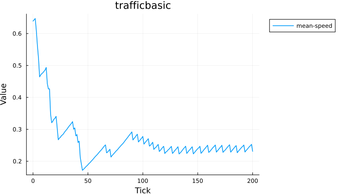
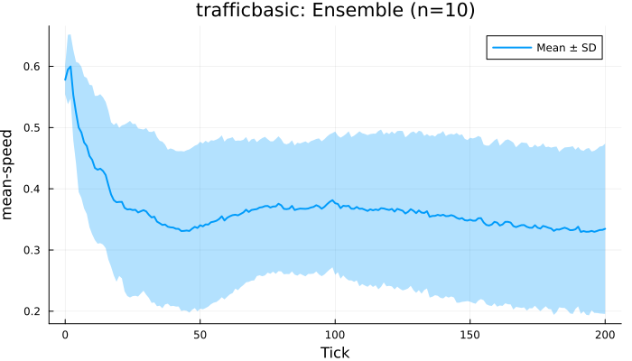
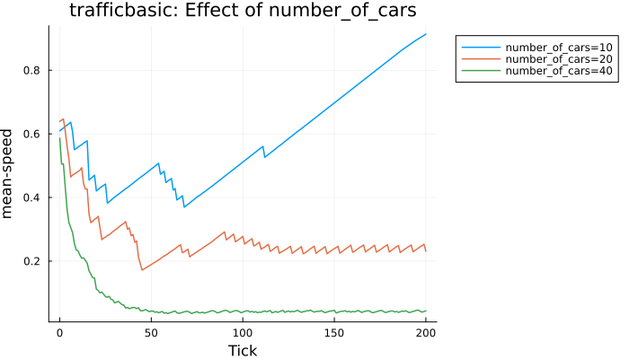

# Traffic Basic


- [Overview](#overview)
  - [WHAT IS IT?](#what-is-it)
  - [THINGS TO NOTICE](#things-to-notice)
  - [THINGS TO TRY](#things-to-try)
  - [EXTENDING THE MODEL](#extending-the-model)
  - [NETLOGO FEATURES](#netlogo-features)
  - [RELATED MODELS](#related-models)
  - [HOW TO CITE](#how-to-cite)
  - [COPYRIGHT AND LICENSE](#copyright-and-license)
- [Parameters](#parameters)
- [Source Code](#source-code)
- [Time Series](#time-series)
- [Ensemble Runs](#ensemble-runs)
- [Parameter Sensitivity](#parameter-sensitivity)
- [Appendix: Source Code](#appendix-source-code)
  - [Parameters (`parameters.jl`)](#parameters-parametersjl)
  - [Components (`components.jl`)](#components-componentsjl)
  - [Resources (`resources.jl`)](#resources-resourcesjl)
  - [Systems (`systems.jl`)](#systems-systemsjl)
  - [Model (`model.jl`)](#model-modeljl)

## Overview

### WHAT IS IT?

This model models the movement of cars on a highway. Each car follows a
simple set of rules: it slows down (decelerates) if it sees a car close
ahead, and speeds up (accelerates) if it doesn’t see a car ahead. The
model demonstrates how traffic jams can form even without any accidents,
broken bridges, or overturned trucks. No “centralized cause” is needed
for a traffic jam to form.

### THINGS TO NOTICE

Traffic jams can start from small “seeds.” These cars start with random
positions and random speeds. If some cars are clustered together, they
will move slowly, causing cars behind them to slow down, and a traffic
jam forms.

Even though all of the cars are moving forward, the traffic jams tend to
move backwards. This behavior is common in wave phenomena: the behavior
of the group is often very different from the behavior of the
individuals that make up the group.

The plot shows three values as the model runs:

- the fastest speed of any car (this doesn’t exceed the speed limit!)

- the slowest speed of any car

- the speed of a single car (turtle 0), painted red so it can be
  watched.

Notice not only the maximum and minimum, but also the variability – the
“jerkiness” of one vehicle.

Notice that the default settings have cars decelerating much faster than
they accelerate. This is typical of traffic flow models.

Even though both ACCELERATION and DECELERATION are very small, the cars
can achieve high speeds as these values are added or subtracted at each
tick.

### THINGS TO TRY

In this model there are three sliders that can affect the tendency to
create traffic jams: the initial NUMBER-OF-CARS, ACCELERATION, and
DECELERATION.

Look for patterns in how these settings affect the traffic flow. Which
variable has the greatest effect? Do the patterns make sense? Do they
seem to be consistent with your driving experiences?

Set DECELERATION to zero. What happens to the flow? Gradually increase
DECELERATION while the model runs. At what point does the flow “break
down”?

### EXTENDING THE MODEL

Try other rules for speeding up and slowing down. Is the rule presented
here realistic? Are there other rules that are more accurate or
represent better driving strategies?

In reality, different vehicles may follow different rules. Try giving
different rules or ACCELERATION/DECELERATION values to some of the cars.
Can one bad driver mess things up?

The asymmetry between acceleration and deceleration is a simplified
representation of different driving habits and response times. Can you
explicitly encode these into the model?

What could you change to minimize the chances of traffic jams forming?

What could you change to make traffic jams move forward rather than
backward?

Make a model of two-lane traffic.

### NETLOGO FEATURES

The plot shows both global values and the value for a single car, which
helps one watch overall patterns and individual behavior at the same
time.

The `watch` command is used to make it easier to focus on the red car.

The `speed-limit` and `speed-min` variables are set to constant values.
Since they are the same for every car, these variables could have been
defined as globals rather than turtle variables. We have specified them
as turtle variables since modifications or extensions to this model
might well have every car with its own speed-limit values.

### RELATED MODELS

- “Traffic Basic Utility”: a version of “Traffic Basic” including a
  utility function for the cars.

- “Traffic Basic Adaptive”: a version of “Traffic Basic” where cars
  adapt their acceleration to try and maintain a smooth flow of traffic.

- “Traffic Basic Adaptive Individuals”: a version of “Traffic Basic
  Adaptive” where each car adapts individually, instead of all cars
  adapting in unison.

- “Traffic 2 Lanes”: a more sophisticated two-lane version of the
  “Traffic Basic” model.

- “Traffic Intersection”: a model of cars traveling through a single
  intersection.

- “Traffic Grid”: a model of traffic moving in a city grid, with
  stoplights at the intersections.

- “Traffic Grid Goal”: a version of “Traffic Grid” where the cars have
  goals, namely to drive to and from work.

- “Gridlock HubNet”: a version of “Traffic Grid” where students control
  traffic lights in real-time.

- “Gridlock Alternate HubNet”: a version of “Gridlock HubNet” where
  students can enter NetLogo code to plot custom metrics.

### HOW TO CITE

If you mention this model or the NetLogo software in a publication, we
ask that you include the citations below.

For the model itself:

- Wilensky, U. (1997). NetLogo Traffic Basic model.
  http://ccl.northwestern.edu/netlogo/models/TrafficBasic. Center for
  Connected Learning and Computer-Based Modeling, Northwestern
  University, Evanston, IL.

Please cite the NetLogo software as:

- Wilensky, U. (1999). NetLogo. http://ccl.northwestern.edu/netlogo/.
  Center for Connected Learning and Computer-Based Modeling,
  Northwestern University, Evanston, IL.

### COPYRIGHT AND LICENSE

Copyright 1997 Uri Wilensky.


This model is licensed under the Creative Commons
Attribution-NonCommercial-ShareAlike 3.0 License. To view a copy of this
license, visit https://creativecommons.org/licenses/by-nc-sa/3.0/ or
send a letter to Creative Commons, 559 Nathan Abbott Way, Stanford,
California 94305, USA.

NetLogo itself is free software for non-commercial use under the terms
of the GNU General Public License ([see full license information
here](https://ccl.northwestern.edu/netlogo/docs/copyright.html)).

To inquire about commercial licenses for either NetLogo or specific
models from the models library, please contact
netlogo-commercial-admin@ccl.northwestern.edu.

This model was created as part of the project: CONNECTED MATHEMATICS:
MAKING SENSE OF COMPLEX PHENOMENA THROUGH BUILDING OBJECT-BASED PARALLEL
MODELS (OBPML). The project gratefully acknowledges the support of the
National Science Foundation (Applications of Advanced Technologies
Program) – grant numbers RED \#9552950 and REC \#9632612.

This model was developed at the MIT Media Lab using CM StarLogo. See
Resnick, M. (1994) “Turtles, Termites and Traffic Jams: Explorations in
Massively Parallel Microworlds.” Cambridge, MA: MIT Press. Adapted to
StarLogoT, 1997, as part of the Connected Mathematics Project.

This model was converted to NetLogo as part of the projects:
PARTICIPATORY SIMULATIONS: NETWORK-BASED DESIGN FOR SYSTEMS LEARNING IN
CLASSROOMS and/or INTEGRATED SIMULATION AND MODELING ENVIRONMENT. The
project gratefully acknowledges the support of the National Science
Foundation (REPP & ROLE programs) – grant numbers REC \#9814682 and
REC-0126227. Converted from StarLogoT to NetLogo, 2001.

<!-- 1997 2001 MIT -->

## Parameters

| Parameter | Type | Default | Description |
|----|----|----|----|
| `number_of_cars` | `Int` | `20` | number of cars |
| `acceleration` | `Float64` | `0.0045` | acceleration |
| `deceleration` | `Float64` | `0.026` | deceleration |
| `road_length` | `Int` | `51` | world-width (from -25 to 25 = 51 patches) |
| `max_ticks` | `Int` | `200` | max ticks |

## Source Code

The Julia code to run this model:

``` julia
using ArkModelZoo
_, trajectory = run_trafficbasic()
```

## Time Series



## Ensemble Runs

Ten replicates with different random seeds, showing mean ± standard
deviation.



## Parameter Sensitivity

Varying `number_of_cars`.



## Appendix: Source Code

This model is implemented in the
[Ark.jl](https://github.com/sdwfrost/Ark.jl) Entity-Component-System
(ECS) framework. The code is split into five files, each with a distinct
role:

- **Parameters**: a mutable struct holding all configurable values.
- **Components**: lightweight data types attached to individual entities
  (agents).
- **Resources**: world-level shared state accessible to all systems.
- **Systems**: functions that operate on entities each tick, defining
  model behavior.
- **Model**: wiring that assembles the world, registers resources and
  systems, and provides the run entry point.

### Parameters (`parameters.jl`)

The parameter struct uses `@kwdef` so that every field has a default
value and can be overridden by keyword. These defaults match the
original NetLogo model’s slider settings.

``` julia
Base.@kwdef mutable struct TBParams
    number_of_cars::Int = 20
    acceleration::Float64 = 0.0045
    deceleration::Float64 = 0.026
    road_length::Int = 51        # world-width (from -25 to 25 = 51 patches)
    max_ticks::Int = 200
    seed::Int = 42
end
```

### Components (`components.jl`)

Components are lightweight data types attached to individual entities
(agents). Mutable structs hold per-entity state, while empty tag structs
act as markers for the ECS query system to efficiently filter entities.

``` julia
struct TBDummy end
```

### Resources (`resources.jl`)

Resources are world-level singletons shared across all systems, used for
global state and aggregate statistics.

``` julia
mutable struct TBCar
    x::Float64       # continuous position on the 1D road
    speed::Float64
    speed_limit::Float64
    speed_min::Float64
end

mutable struct TBRoad
    length::Int
    cars::Vector{TBCar}
end
TBRoad(len::Int) = TBRoad(len, TBCar[])

mutable struct TBStats
    mean_speed::Float64
end
TBStats() = TBStats(0.0)
```

### Systems (`systems.jl`)

Systems contain the model logic and execute in a defined order each
tick. Each system struct implements either `initialize!` (run once at
setup) or `update!` (run every tick).

``` julia
# Traffic Basic systems matching NetLogo Traffic Basic
# Execution order: init → go (accelerate/decelerate + move) → terminate

using Random: shuffle!

# --- Initialization ---
# NetLogo: crt number-of-cars with random positions, separated so no two share a patch

struct InitTBSystem <: System end

function initialize!(::InitTBSystem, world::World)
    params = get_resource(world, TBParams)
    rng = get_resource(world, RNGResource).rng
    road = get_resource(world, TBRoad)

    n = min(params.number_of_cars, params.road_length)
    empty!(road.cars)

    # Pick n distinct integer positions (NetLogo separate-cars ensures no overlap)
    positions = shuffle!(rng, collect(0:params.road_length - 1))[1:n]

    for pos in positions
        spd = 0.1 + rand(rng) * 0.9
        push!(road.cars, TBCar(Float64(pos), spd, 1.0, 0.0))
    end

    # Update stats
    stats = get_resource(world, TBStats)
    stats.mean_speed = sum(c.speed for c in road.cars) / length(road.cars)
    return nothing
end

# --- Go (main step) ---
# NetLogo: ask turtles (shuffled) — find car-ahead, adjust speed, move

struct TBGoSystem <: System end

function update!(::TBGoSystem, world::World)
    params = get_resource(world, TBParams)
    rng = get_resource(world, RNGResource).rng
    road = get_resource(world, TBRoad)
    stats = get_resource(world, TBStats)
    L = road.length
    cars = road.cars

    n = length(cars)
    n == 0 && return nothing

    # NetLogo `ask turtles` shuffles — process in random order
    order = shuffle!(rng, collect(1:n))

    for idx in order
        car = cars[idx]
        # patch-ahead 1: the patch at floor(x) + 1, wrapped
        patch_ahead = mod(floor(Int, car.x) + 1, L)

        # Find car-ahead: any OTHER car whose floor(x) == patch_ahead
        car_ahead_speed = nothing
        for j in 1:n
            j == idx && continue
            if mod(floor(Int, cars[j].x), L) == patch_ahead
                car_ahead_speed = cars[j].speed
                break
            end
        end

        if car_ahead_speed !== nothing
            # Match speed of car ahead, then decelerate
            car.speed = car_ahead_speed
            car.speed -= params.deceleration
        else
            # No car ahead — accelerate
            car.speed += params.acceleration
        end

        # Clamp speed to [speed_min, speed_limit]
        car.speed < car.speed_min && (car.speed = car.speed_min)
        car.speed > car.speed_limit && (car.speed = car.speed_limit)

        # Move forward with wrapping
        car.x = mod(car.x + car.speed, L)
    end

    # Update mean speed
    stats.mean_speed = sum(c.speed for c in cars) / n
    return nothing
end

# --- Termination ---

struct TBTerminationSystem <: System end

function update!(::TBTerminationSystem, world::World)
    params = get_resource(world, TBParams)
    tick = get_resource(world, Tick)
    if tick.tick + 1 >= params.max_ticks
        get_resource(world, Terminate).stop = true
    end
    return nothing
end
```

### Model (`model.jl`)

The model file assembles all pieces: it creates the ECS `World` with the
required component types, registers resources, builds the `Scheduler`
with systems in execution order, and exposes the public `run` entry
point. The observer pattern records the trajectory each tick.

``` julia
function trafficbasic_world(; initial_capacity::Int = 64)
    return World(
        TBDummy;
        initial_capacity = initial_capacity,
        allow_mutable = true,
    )
end

function trafficbasic_systems()
    return (
        InitTBSystem(),
        TBGoSystem(),
        TBTerminationSystem(),
    )
end

function trafficbasic_model(params::TBParams = TBParams())
    world = trafficbasic_world()
    _add_standard_resources!(world, params)
    add_resource!(world, TBRoad(params.road_length))
    add_resource!(world, TBStats())
    scheduler = Scheduler(world, trafficbasic_systems())
    initialize!(scheduler)
    return scheduler
end

struct TBObserver end

function trafficbasic_headers(::TBObserver)
    return ["mean-speed"]
end

function trafficbasic_values(::TBObserver, world::World)
    stats = get_resource(world, TBStats)
    return Float64[stats.mean_speed]
end

function run_trafficbasic(; params::TBParams = TBParams(), observe::Bool = true)
    return _run_model(trafficbasic_model, TBObserver(), trafficbasic_values; params, observe)
end
```
