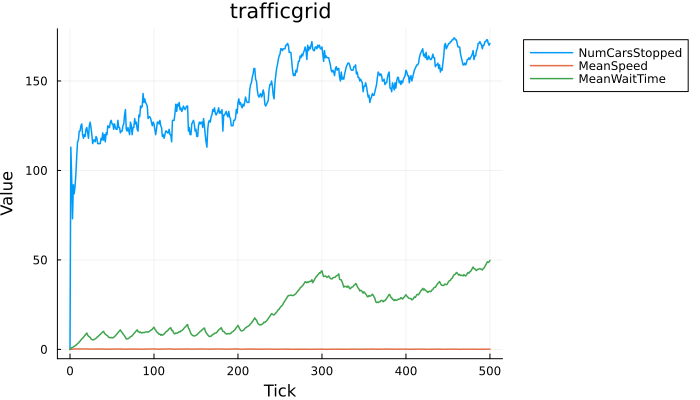
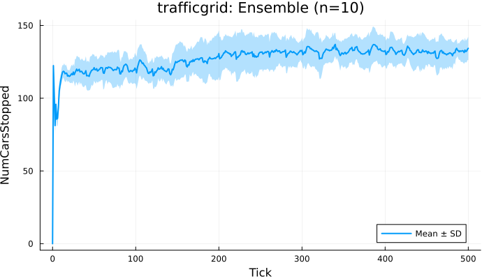
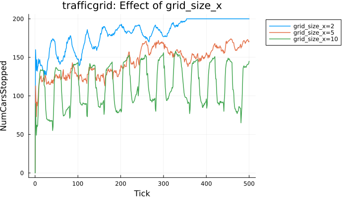

# Traffic Grid


- [Overview](#overview)
  - [WHAT IS IT?](#what-is-it)
  - [HOW IT WORKS](#how-it-works)
  - [THINGS TO NOTICE](#things-to-notice)
  - [THINGS TO TRY](#things-to-try)
  - [EXTENDING THE MODEL](#extending-the-model)
  - [NETLOGO FEATURES](#netlogo-features)
  - [RELATED MODELS](#related-models)
  - [HOW TO CITE](#how-to-cite)
  - [COPYRIGHT AND LICENSE](#copyright-and-license)
- [Parameters](#parameters)
- [Source Code](#source-code)
- [Time Series](#time-series)
- [Ensemble Runs](#ensemble-runs)
- [Parameter Sensitivity](#parameter-sensitivity)
- [Appendix: Source Code](#appendix-source-code)
  - [Parameters (`parameters.jl`)](#parameters-parametersjl)
  - [Components (`components.jl`)](#components-componentsjl)
  - [Resources (`resources.jl`)](#resources-resourcesjl)
  - [Systems (`systems.jl`)](#systems-systemsjl)
  - [Model (`model.jl`)](#model-modeljl)

## Overview

### WHAT IS IT?

This is a model of traffic moving in a city grid. It allows you to
control traffic lights and global variables, such as the speed limit and
the number of cars, and explore traffic dynamics.

Try to develop strategies to improve traffic and to understand the
different ways to measure the quality of traffic.

### HOW IT WORKS

Each time step, the cars attempt to move forward at their current speed.
If their current speed is less than the speed limit and there is no car
directly in front of them, they accelerate. If there is a slower car in
front of them, they match the speed of the slower car and deccelerate.
If there is a red light or a stopped car in front of them, they stop.

There are two different ways the lights can change. First, the user can
change any light at any time by making the light current, and then
clicking CHANGE LIGHT. Second, lights can change automatically, once per
cycle. Initially, all lights will automatically change at the beginning
of each cycle.

### THINGS TO NOTICE

When cars have stopped at a traffic light, and then they start moving
again, the traffic jam will move backwards even though the cars are
moving forwards. Why is this?

When POWER? is turned off and there are quite a few cars on the roads,
“gridlock” usually occurs after a while. In fact, gridlock can be so
severe that traffic stops completely. Why is it that no car can move
forward and break the gridlock? Could this happen in the real world?

Gridlock can occur when the power is turned on, as well. What kinds of
situations can lead to gridlock?

### THINGS TO TRY

Try changing the speed limit for the cars. How does this affect the
overall efficiency of the traffic flow? Are fewer cars stopping for a
shorter amount of time? Is the average speed of the cars higher or lower
than before?

Try changing the number of cars on the roads. Does this affect the
efficiency of the traffic flow?

How about changing the speed of the simulation? Does this affect the
efficiency of the traffic flow?

Try running this simulation with all lights automatic. Is it harder to
make the traffic move well using this scheme than controlling one light
manually? Why?

Try running this simulation with all lights automatic. Try to find a way
of setting the phases of the traffic lights so that the average speed of
the cars is the highest. Now try to minimize the number of stopped cars.
Now try to decrease the average wait time of the cars. Is there any
correlation between these different metrics?

### EXTENDING THE MODEL

Currently, the maximum speed limit (found in the SPEED-LIMIT slider) for
the cars is 1.0. This is due to the fact that the cars must look ahead
the speed that they are traveling to see if there are cars ahead of
them. If there aren’t, they speed up. If there are, they slow down.
Looking ahead for a value greater than 1 is a little bit tricky. Try
implementing the correct behavior for speeds greater than 1.

When a car reaches the edge of the world, it reappears on the other
side. What if it disappeared, and if new cars entered the city at random
locations and intervals?

### NETLOGO FEATURES

This model uses two forever buttons which may be active simultaneously,
to allow the user to select a new current intersection while the model
is running.

It also uses a chooser to allow the user to choose between several
different possible plots, or to display all of them at once.

### RELATED MODELS

- “Traffic Basic”: a simple model of the movement of cars on a highway.

- “Traffic Basic Utility”: a version of “Traffic Basic” including a
  utility function for the cars.

- “Traffic Basic Adaptive”: a version of “Traffic Basic” where cars
  adapt their acceleration to try and maintain a smooth flow of traffic.

- “Traffic Basic Adaptive Individuals”: a version of “Traffic Basic
  Adaptive” where each car adapts individually, instead of all cars
  adapting in unison.

- “Traffic 2 Lanes”: a more sophisticated two-lane version of the
  “Traffic Basic” model.

- “Traffic Intersection”: a model of cars traveling through a single
  intersection.

- “Traffic Grid Goal”: a version of “Traffic Grid” where the cars have
  goals, namely to drive to and from work.

- “Gridlock HubNet”: a version of “Traffic Grid” where students control
  traffic lights in real-time.

- “Gridlock Alternate HubNet”: a version of “Gridlock HubNet” where
  students can enter NetLogo code to plot custom metrics.

### HOW TO CITE

If you mention this model or the NetLogo software in a publication, we
ask that you include the citations below.

For the model itself:

- Wilensky, U. (2003). NetLogo Traffic Grid model.
  http://ccl.northwestern.edu/netlogo/models/TrafficGrid. Center for
  Connected Learning and Computer-Based Modeling, Northwestern
  University, Evanston, IL.

Please cite the NetLogo software as:

- Wilensky, U. (1999). NetLogo. http://ccl.northwestern.edu/netlogo/.
  Center for Connected Learning and Computer-Based Modeling,
  Northwestern University, Evanston, IL.

### COPYRIGHT AND LICENSE

Copyright 2003 Uri Wilensky.


This model is licensed under the Creative Commons
Attribution-NonCommercial-ShareAlike 3.0 License. To view a copy of this
license, visit https://creativecommons.org/licenses/by-nc-sa/3.0/ or
send a letter to Creative Commons, 559 Nathan Abbott Way, Stanford,
California 94305, USA.

NetLogo itself is free software for non-commercial use under the terms
of the GNU General Public License ([see full license information
here](https://ccl.northwestern.edu/netlogo/docs/copyright.html)).

To inquire about commercial licenses for either NetLogo or specific
models from the models library, please contact
netlogo-commercial-admin@ccl.northwestern.edu.

This model was created as part of the projects: PARTICIPATORY
SIMULATIONS: NETWORK-BASED DESIGN FOR SYSTEMS LEARNING IN CLASSROOMS
and/or INTEGRATED SIMULATION AND MODELING ENVIRONMENT. The project
gratefully acknowledges the support of the National Science Foundation
(REPP & ROLE programs) – grant numbers REC \#9814682 and REC-0126227.

<!-- 2003 -->

## Parameters

| Parameter         | Type      | Default | Description     |
|-------------------|-----------|---------|-----------------|
| `grid_size_x`     | `Int`     | `5`     | grid size x     |
| `grid_size_y`     | `Int`     | `5`     | grid size y     |
| `num_cars`        | `Int`     | `200`   | num cars        |
| `speed_limit`     | `Float64` | `1.0`   | speed limit     |
| `ticks_per_cycle` | `Int`     | `20`    | ticks per cycle |
| `power`           | `Bool`    | `true`  | power           |
| `max_ticks`       | `Int`     | `500`   | max ticks       |

## Source Code

The Julia code to run this model:

``` julia
using ArkModelZoo
_, trajectory = run_trafficgrid()
```

## Time Series



## Ensemble Runs

Ten replicates with different random seeds, showing mean ± standard
deviation.



## Parameter Sensitivity

Varying `grid_size_x`.



## Appendix: Source Code

This model is implemented in the
[Ark.jl](https://github.com/sdwfrost/Ark.jl) Entity-Component-System
(ECS) framework. The code is split into five files, each with a distinct
role:

- **Parameters**: a mutable struct holding all configurable values.
- **Components**: lightweight data types attached to individual entities
  (agents).
- **Resources**: world-level shared state accessible to all systems.
- **Systems**: functions that operate on entities each tick, defining
  model behavior.
- **Model**: wiring that assembles the world, registers resources and
  systems, and provides the run entry point.

### Parameters (`parameters.jl`)

The parameter struct uses `@kwdef` so that every field has a default
value and can be overridden by keyword. These defaults match the
original NetLogo model’s slider settings.

``` julia
Base.@kwdef mutable struct TGParams
    grid_size_x::Int = 5
    grid_size_y::Int = 5
    num_cars::Int = 200
    speed_limit::Float64 = 1.0
    ticks_per_cycle::Int = 20
    power::Bool = true
    max_ticks::Int = 500
    seed::Int = 42
end
```

### Components (`components.jl`)

Components are lightweight data types attached to individual entities
(agents). Mutable structs hold per-entity state, while empty tag structs
act as markers for the ECS query system to efficiently filter entities.

``` julia
mutable struct TGCar
    x::Float64
    y::Float64
    speed::Float64
    up_car::Bool       # true=moving south (heading 180), false=moving east (heading 90)
    wait_time::Int
end
TGCar() = TGCar(0.0, 0.0, 0.0, true, 0)
```

### Resources (`resources.jl`)

Resources are world-level singletons shared across all systems, used for
global state and aggregate statistics.

``` julia
mutable struct TGRoad
    width::Int
    height::Int
    is_road::Matrix{Bool}
    is_intersection::Matrix{Bool}
    green_light_up::Matrix{Bool}  # at intersections
    my_phase::Matrix{Int}         # phase for each intersection (-1 = non-intersection)
    # Patch colors for signal patches: 0=none, 1=red, 2=green, 3=white(road)
    patch_color::Matrix{Int}
    grid_x_inc::Float64
    grid_y_inc::Float64
end

function TGRoad(w::Int, h::Int, gxi::Float64, gyi::Float64)
    TGRoad(w, h,
           fill(false, w, h),
           fill(false, w, h),
           fill(true, w, h),
           fill(-1, w, h),
           fill(0, w, h),
           gxi, gyi)
end

mutable struct TGStats
    num_cars_stopped::Int
    mean_speed::Float64
    mean_wait_time::Float64
end
TGStats() = TGStats(0, 0.0, 0.0)
```

### Systems (`systems.jl`)

Systems contain the model logic and execute in a defined order each
tick. Each system struct implements either `initialize!` (run once at
setup) or `update!` (run every tick).

``` julia
# --- Initialization ---

struct InitTGSystem <: System end

# Check if (x,y) is a road patch using NetLogo's formula:
# Vertical roads: floor((pxcor + max-pxcor - floor(grid-x-inc - 1)) mod grid-x-inc) == 0
# Horizontal roads: floor((pycor + max-pycor) mod grid-y-inc) == 0
# Here x,y are 1-indexed; NetLogo pxcor = x - (w+1)/2, max-pxcor = (w-1)/2
function _tg_is_x_road(x::Int, w::Int, gxi::Float64)
    pxcor = x - (w + 1) ÷ 2
    max_pxcor = (w - 1) ÷ 2
    return floor((pxcor + max_pxcor - floor(gxi - 1)) % gxi) == 0
end

function _tg_is_y_road(y::Int, h::Int, gyi::Float64)
    pycor = y - (h + 1) ÷ 2
    max_pycor = (h - 1) ÷ 2
    return floor((pycor + max_pycor) % gyi) == 0
end

function initialize!(::InitTGSystem, world::World)
    params = get_resource(world, TGParams)
    rng = get_resource(world, RNGResource).rng
    road = get_resource(world, TGRoad)
    w, h = road.width, road.height
    gxi, gyi = road.grid_x_inc, road.grid_y_inc

    # Setup roads and intersections
    road_patches = Tuple{Int,Int}[]
    for x in 1:w, y in 1:h
        is_xr = _tg_is_x_road(x, w, gxi)
        is_yr = _tg_is_y_road(y, h, gyi)
        is_r = is_xr || is_yr
        road.is_road[x, y] = is_r
        if is_r
            road.patch_color[x, y] = 3  # white (road)
            push!(road_patches, (x, y))
        end
        if is_xr && is_yr
            road.is_intersection[x, y] = true
            road.green_light_up[x, y] = true
            road.my_phase[x, y] = 0
        end
    end

    # Setup signal colors
    _tg_set_signal_colors!(road, params)

    # Place cars on road patches
    Random.shuffle!(rng, road_patches)
    n_cars = min(params.num_cars, length(road_patches))

    for i in 1:n_cars
        rx, ry = road_patches[i]
        # Determine direction based on position (vertical road = up-car)
        is_xr = _tg_is_x_road(rx, w, gxi)
        up_car = if road.is_intersection[rx, ry]
            rand(rng, Bool)
        else
            is_xr  # on vertical road → heading south (up-car)
        end
        speed = 0.0
        new_entity!(world, (TGCar(Float64(rx), Float64(ry), speed, up_car, 0),))
    end
    return nothing
end

function _tg_set_signal_colors!(road::TGRoad, params::TGParams)
    w, h = road.width, road.height
    # Reset all road patches to white first
    for x in 1:w, y in 1:h
        if road.is_road[x, y]
            road.patch_color[x, y] = 3  # white
        end
    end
    # Set signal patches at each intersection
    for x in 1:w, y in 1:h
        if road.is_intersection[x, y]
            if params.power
                if road.green_light_up[x, y]
                    # patch-at -1 0 = red (east-west gets red)
                    if x - 1 >= 1; road.patch_color[x - 1, y] = 1; end  # red
                    # patch-at 0 1 = green (north-south gets green)
                    if y + 1 <= h; road.patch_color[x, y + 1] = 2; end  # green
                else
                    if x - 1 >= 1; road.patch_color[x - 1, y] = 2; end  # green
                    if y + 1 <= h; road.patch_color[x, y + 1] = 1; end  # red
                end
            else
                if x - 1 >= 1; road.patch_color[x - 1, y] = 3; end
                if y + 1 <= h; road.patch_color[x, y + 1] = 3; end
            end
        end
    end
end

# --- Go ---

struct TGGoSystem <: System end

function update!(::TGGoSystem, world::World)
    params = get_resource(world, TGParams)
    rng = get_resource(world, RNGResource).rng
    road = get_resource(world, TGRoad)
    stats = get_resource(world, TGStats)
    tick_val = get_resource(world, Tick).tick
    w, h = road.width, road.height
    accel = 0.099

    # ── Set signals ──
    # NetLogo: phase increments each tick, resets at ticks_per_cycle
    phase = tick_val % params.ticks_per_cycle
    for x in 1:w, y in 1:h
        if road.is_intersection[x, y] && road.my_phase[x, y] >= 0
            mp = road.my_phase[x, y]
            if phase == (mp * params.ticks_per_cycle) ÷ 100
                road.green_light_up[x, y] = !road.green_light_up[x, y]
            end
        end
    end
    _tg_set_signal_colors!(road, params)

    num_stopped = 0
    total_speed = 0.0
    total_wait = 0.0
    n_cars = 0

    # Collect cars
    cars = Tuple{Entity, Int}[]
    for (eids, cardata) in Query(world, (TGCar,))
        @inbounds for i in eachindex(cardata)
            push!(cars, (eids[i], i))
        end
    end
    Random.shuffle!(rng, cars)

    # Build spatial index: patch → list of (entity, up_car?) for turtles-at checks
    car_at = Dict{Tuple{Int,Int}, Vector{Tuple{Entity, Bool, Float64}}}()
    for (eid, _) in cars
        car = get_components(world, eid, (TGCar,))[1]
        px = _tg_patch(car.x, w)
        py = _tg_patch(car.y, h)
        key = (px, py)
        entry = (eid, car.up_car, car.speed)
        if haskey(car_at, key)
            push!(car_at[key], entry)
        else
            car_at[key] = [entry]
        end
    end

    for (eid, _) in cars
        car = get_components(world, eid, (TGCar,))[1]
        n_cars += 1
        px = _tg_patch(car.x, w)
        py = _tg_patch(car.y, h)

        # ── set-car-speed: check pcolor at current patch ──
        if road.patch_color[px, py] == 1  # red
            car.speed = 0.0
        else
            # Check car ahead
            if car.up_car
                dx, dy = 0, -1  # heading 180 = south
            else
                dx, dy = 1, 0   # heading 90 = east
            end
            ax = mod1(px + dx, w)
            ay = mod1(py + dy, h)
            ahead_list = get(car_at, (ax, ay), Tuple{Entity, Bool, Float64}[])
            ahead = filter(e -> e[1] != eid, ahead_list)
            if !isempty(ahead)
                # Check if any have different direction
                cross = filter(e -> e[2] != car.up_car, ahead)
                if !isempty(cross)
                    car.speed = 0.0
                else
                    # Same direction: match speed and decelerate
                    ahead_speed = ahead[rand(rng, 1:length(ahead))][3]
                    car.speed = ahead_speed
                    car.speed = car.speed <= 0 ? 0.0 : car.speed - accel
                end
            else
                # No car ahead: accelerate
                car.speed = car.speed > params.speed_limit ? params.speed_limit : car.speed + accel
            end
        end

        # ── Move: fd speed ──
        old_px, old_py = px, py
        if car.up_car
            car.y = _tg_wrap(car.y - car.speed, h)
        else
            car.x = _tg_wrap(car.x + car.speed, w)
        end
        new_px = _tg_patch(car.x, w)
        new_py = _tg_patch(car.y, h)

        # Update spatial index
        if new_px != old_px || new_py != old_py
            old_key = (old_px, old_py)
            if haskey(car_at, old_key)
                filter!(e -> e[1] != eid, car_at[old_key])
            end
            new_key = (new_px, new_py)
            entry = (eid, car.up_car, car.speed)
            if haskey(car_at, new_key)
                push!(car_at[new_key], entry)
            else
                car_at[new_key] = [entry]
            end
        else
            # Update speed in spatial index
            old_key = (old_px, old_py)
            if haskey(car_at, old_key)
                for j in eachindex(car_at[old_key])
                    if car_at[old_key][j][1] == eid
                        car_at[old_key][j] = (eid, car.up_car, car.speed)
                        break
                    end
                end
            end
        end

        # ── Record data ──
        if car.speed == 0.0
            num_stopped += 1
            car.wait_time += 1
        else
            car.wait_time = 0
        end
        total_speed += car.speed
        total_wait += car.wait_time
    end

    stats.num_cars_stopped = num_stopped
    stats.mean_speed = n_cars > 0 ? total_speed / n_cars : 0.0
    stats.mean_wait_time = n_cars > 0 ? total_wait / n_cars : 0.0
    return nothing
end

# Get 1-indexed patch coordinate from float position in wrapping world of size sz
function _tg_patch(pos::Float64, sz::Int)
    # NetLogo: pxcor = round(xcor), and patches are 1..sz in our system
    p = round(Int, pos)
    return mod1(p, sz)
end

# Wrap a float position into [1, sz+1) range
function _tg_wrap(pos::Float64, sz::Int)
    p = mod(pos - 1.0, Float64(sz)) + 1.0
    return p
end

# --- Termination ---

struct TGTerminationSystem <: System end

function update!(::TGTerminationSystem, world::World)
    params = get_resource(world, TGParams)
    tick = get_resource(world, Tick)
    if tick.tick + 1 >= params.max_ticks
        get_resource(world, Terminate).stop = true
    end
    return nothing
end
```

### Model (`model.jl`)

The model file assembles all pieces: it creates the ECS `World` with the
required component types, registers resources, builds the `Scheduler`
with systems in execution order, and exposes the public `run` entry
point. The observer pattern records the trajectory each tick.

``` julia
function trafficgrid_world(; initial_capacity::Int = 4096)
    return World(TGCar; initial_capacity = initial_capacity, allow_mutable = true)
end

function trafficgrid_systems()
    return (InitTGSystem(), TGGoSystem(), TGTerminationSystem())
end

function trafficgrid_model(params::TGParams = TGParams())
    world = trafficgrid_world()
    _add_standard_resources!(world, params)
    # World size: -18..18 = 37x37 (matching NetLogo wrapper)
    w = 37
    h = 37
    gxi = Float64(w) / params.grid_size_x
    gyi = Float64(h) / params.grid_size_y
    add_resource!(world, TGRoad(w, h, gxi, gyi))
    add_resource!(world, TGStats())
    scheduler = Scheduler(world, trafficgrid_systems())
    initialize!(scheduler)
    return scheduler
end

struct TGObserver end

function trafficgrid_headers(::TGObserver)
    return ["NumCarsStopped", "MeanSpeed", "MeanWaitTime"]
end

function trafficgrid_values(::TGObserver, world::World)
    stats = get_resource(world, TGStats)
    return Float64[Float64(stats.num_cars_stopped), stats.mean_speed, stats.mean_wait_time]
end

function run_trafficgrid(; params::TGParams = TGParams(), observe::Bool = true)
    return _run_model(trafficgrid_model, TGObserver(), trafficgrid_values; params, observe)
end
```
