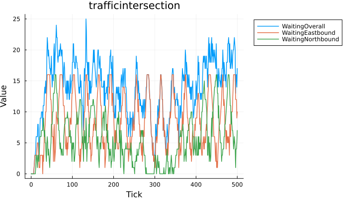
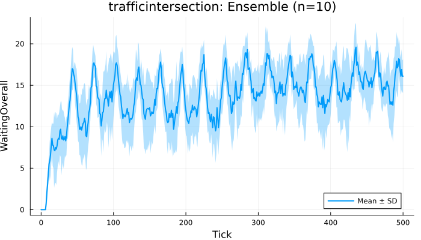
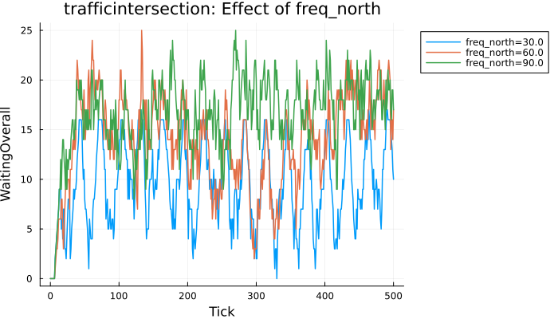

# Traffic Intersection


- [Overview](#overview)
  - [WHAT IS IT?](#what-is-it)
  - [HOW IT WORKS](#how-it-works)
  - [THINGS TO NOTICE](#things-to-notice)
  - [THINGS TO TRY](#things-to-try)
  - [EXTENDING THE MODEL](#extending-the-model)
  - [RELATED MODELS](#related-models)
  - [HOW TO CITE](#how-to-cite)
  - [COPYRIGHT AND LICENSE](#copyright-and-license)
- [Parameters](#parameters)
- [Source Code](#source-code)
- [Time Series](#time-series)
- [Ensemble Runs](#ensemble-runs)
- [Parameter Sensitivity](#parameter-sensitivity)
- [Appendix: Source Code](#appendix-source-code)
  - [Parameters (`parameters.jl`)](#parameters-parametersjl)
  - [Components (`components.jl`)](#components-componentsjl)
  - [Resources (`resources.jl`)](#resources-resourcesjl)
  - [Systems (`systems.jl`)](#systems-systemsjl)
  - [Model (`model.jl`)](#model-modeljl)

## Overview

### WHAT IS IT?

In this model the turtles are cars traveling through an intersection.
The user has the ability to control the frequency of cars coming from
each direction, the speed of the cars, and the timing of the light at
the traffic intersection. Once the frequency and speed of cars is
selected, the user should run the simulation and adjust the timing of
the traffic light so as to minimize the amount of waiting time of cars
traveling through the intersection.

### HOW IT WORKS

The rules for each car are:

- I can only go in the direction I started in, or stop.

- I stop for cars in front of me and red lights, and I stop for a yellow
  light if I’m not already on it.

- If I am moving quickly and I see that I will have to stop soon, I try
  to slow down enough to make sure I can stop in time, up to MAX-BRAKE.

- If I see that I have free space in front of me, I speed up towards the
  SPEED-LIMIT, up to MAX-ACCEL.

- If I am on the same space as another car, we crash and die.

### THINGS TO NOTICE

Cars start out evenly spaced but over time, they form bunches. What
kinds of patterns appear in the traffic flow?

Under what conditions do the cars appear to be moving backwards?

Gridlock happens when cars are unable to move because cars from the
other direction are in their path. What settings cause gridlock in this
model? What settings can be changed to end the gridlock?

### THINGS TO TRY

Try to answer the following questions before running the simulations.

Record your predictions.

Compare your predicted results with the actual results.

- What reasoning led you to correct predictions?

- What assumptions that you made need to be revised?

Try different numbers of eastbound cars while keeping all other slider
values the same.

Try different numbers of northbound cars while keeping all other slider
values the same.

Try different values of SPEED-LIMIT while keeping all other slider
values the same.

Try different values of MAX-ACCEL while keeping all other slider values
the same.

Try different values of GREEN-LENGTH and YELLOW-LENGTH while keeping all
other slider values the same.

For all of the above cases, consider the following:

- What happens to the waiting time of eastbound cars?

- What happens to the waiting time of northbound cars?

- What happens to the overall waiting time?

- What generalizations can you make about the impact of each variable on
  the waiting time of cars?

- What kind of relationship exists between the number of cars and the
  waiting time they experience?

- What kind of relationship exists between the speed of cars and the
  waiting time they experience?

- What kind of relationship exists between the number of ticks of green
  light and the waiting time cars experience?

Use your answers to the above questions to come up with a strategy for
minimizing the waiting time of cars.

What factor (or combination of factors) has the most influence over the
waiting time experienced by the cars?

### EXTENDING THE MODEL

Find a realistic way to eliminate all crashes by only changing car
behavior.

Allow different light lengths for each direction in order to control
wait time better.

Is there a better way to measure the efficiency of an intersection than
the current number of stopped cars?

### RELATED MODELS

- “Traffic Basic”: a simple model of the movement of cars on a highway.

- “Traffic Basic Utility”: a version of “Traffic Basic” including a
  utility function for the cars.

- “Traffic Basic Adaptive”: a version of “Traffic Basic” where cars
  adapt their acceleration to try and maintain a smooth flow of traffic.

- “Traffic Basic Adaptive Individuals”: a version of “Traffic Basic
  Adaptive” where each car adapts individually, instead of all cars
  adapting in unison.

- “Traffic 2 Lanes”: a more sophisticated two-lane version of the
  “Traffic Basic” model.

- “Traffic Grid”: a model of traffic moving in a city grid, with
  stoplights at the intersections.

- “Traffic Grid Goal”: a version of “Traffic Grid” where the cars have
  goals, namely to drive to and from work.

- “Gridlock HubNet”: a version of “Traffic Grid” where students control
  traffic lights in real-time.

- “Gridlock Alternate HubNet”: a version of “Gridlock HubNet” where
  students can enter NetLogo code to plot custom metrics.

### HOW TO CITE

If you mention this model or the NetLogo software in a publication, we
ask that you include the citations below.

For the model itself:

- Wilensky, U. (1998). NetLogo Traffic Intersection model.
  http://ccl.northwestern.edu/netlogo/models/TrafficIntersection. Center
  for Connected Learning and Computer-Based Modeling, Northwestern
  University, Evanston, IL.

Please cite the NetLogo software as:

- Wilensky, U. (1999). NetLogo. http://ccl.northwestern.edu/netlogo/.
  Center for Connected Learning and Computer-Based Modeling,
  Northwestern University, Evanston, IL.

### COPYRIGHT AND LICENSE

Copyright 1998 Uri Wilensky.


This model is licensed under the Creative Commons
Attribution-NonCommercial-ShareAlike 3.0 License. To view a copy of this
license, visit https://creativecommons.org/licenses/by-nc-sa/3.0/ or
send a letter to Creative Commons, 559 Nathan Abbott Way, Stanford,
California 94305, USA.

NetLogo itself is free software for non-commercial use under the terms
of the GNU General Public License ([see full license information
here](https://ccl.northwestern.edu/netlogo/docs/copyright.html)).

To inquire about commercial licenses for either NetLogo or specific
models from the models library, please contact
netlogo-commercial-admin@ccl.northwestern.edu.

This model was created as part of the project: CONNECTED MATHEMATICS:
MAKING SENSE OF COMPLEX PHENOMENA THROUGH BUILDING OBJECT-BASED PARALLEL
MODELS (OBPML). The project gratefully acknowledges the support of the
National Science Foundation (Applications of Advanced Technologies
Program) – grant numbers RED \#9552950 and REC \#9632612.

This model was converted to NetLogo as part of the projects:
PARTICIPATORY SIMULATIONS: NETWORK-BASED DESIGN FOR SYSTEMS LEARNING IN
CLASSROOMS and/or INTEGRATED SIMULATION AND MODELING ENVIRONMENT. The
project gratefully acknowledges the support of the National Science
Foundation (REPP & ROLE programs) – grant numbers REC \#9814682 and
REC-0126227. Converted from StarLogoT to NetLogo, 2002.

<!-- 1998 2002 -->

## Parameters

| Parameter       | Type      | Default | Description                       |
|-----------------|-----------|---------|-----------------------------------|
| `freq_north`    | `Float64` | `60.0`  | percent chance new car from north |
| `freq_east`     | `Float64` | `100.0` | percent chance new car from east  |
| `speed_limit`   | `Int`     | `5`     | speed limit                       |
| `max_accel`     | `Int`     | `2`     | max accel                         |
| `max_brake`     | `Int`     | `4`     | max brake                         |
| `green_length`  | `Int`     | `12`    | green length                      |
| `yellow_length` | `Int`     | `3`     | yellow length                     |
| `auto`          | `Bool`    | `true`  | auto                              |
| `grid_size`     | `Int`     | `35`    | -17..17 = 35                      |
| `max_ticks`     | `Int`     | `500`   | max ticks                         |

## Source Code

The Julia code to run this model:

``` julia
using ArkModelZoo
_, trajectory = run_trafficintersection()
```

## Time Series



## Ensemble Runs

Ten replicates with different random seeds, showing mean ± standard
deviation.



## Parameter Sensitivity

Varying `freq_north`.



## Appendix: Source Code

This model is implemented in the
[Ark.jl](https://github.com/sdwfrost/Ark.jl) Entity-Component-System
(ECS) framework. The code is split into five files, each with a distinct
role:

- **Parameters**: a mutable struct holding all configurable values.
- **Components**: lightweight data types attached to individual entities
  (agents).
- **Resources**: world-level shared state accessible to all systems.
- **Systems**: functions that operate on entities each tick, defining
  model behavior.
- **Model**: wiring that assembles the world, registers resources and
  systems, and provides the run entry point.

### Parameters (`parameters.jl`)

The parameter struct uses `@kwdef` so that every field has a default
value and can be overridden by keyword. These defaults match the
original NetLogo model’s slider settings.

``` julia
Base.@kwdef mutable struct TIParams
    freq_north::Float64 = 60.0   # percent chance new car from north
    freq_east::Float64 = 100.0   # percent chance new car from east
    speed_limit::Int = 5
    max_accel::Int = 2
    max_brake::Int = 4
    green_length::Int = 12
    yellow_length::Int = 3
    auto::Bool = true
    grid_size::Int = 35   # -17..17 = 35
    max_ticks::Int = 500
    seed::Int = 42
end
```

### Components (`components.jl`)

Components are lightweight data types attached to individual entities
(agents). Mutable structs hold per-entity state, while empty tag structs
act as markers for the ECS query system to efficiently filter entities.

``` julia
mutable struct TICar
    x::Int
    y::Int
    heading::Int     # 0=north, 90=east
    speed::Int
end
TICar() = TICar(0, 0, 0, 0)
```

### Resources (`resources.jl`)

Resources are world-level singletons shared across all systems, used for
global state and aggregate statistics.

``` julia
mutable struct TIRoad
    size::Int
    # Road: patches where |x - center| <= 1 or |y - center| <= 1
    # Signal state
    stop_light::Symbol   # :north or :east (which direction has green)
    # Grid of occupancy
    occupancy::Matrix{Entity}
    # Accident patches: countdown timer (0 = clear)
    accidents::Matrix{Int}
end

function TIRoad(sz::Int)
    TIRoad(sz, :north, fill(zero_entity, sz, sz), zeros(Int, sz, sz))
end

mutable struct TIStats
    waiting_overall::Int
    waiting_eastbound::Int
    waiting_northbound::Int
    num_collisions::Int
end
TIStats() = TIStats(0, 0, 0, 0)
```

### Systems (`systems.jl`)

Systems contain the model logic and execute in a defined order each
tick. Each system struct implements either `initialize!` (run once at
setup) or `update!` (run every tick).

``` julia
# --- Initialization ---

struct InitTISystem <: System end

function initialize!(::InitTISystem, world::World)
    params = get_resource(world, TIParams)
    road = get_resource(world, TIRoad)
    road.stop_light = :north
    _ti_update_stats!(world)
    return nothing
end

function _ti_is_road(sz::Int, x::Int, y::Int)
    center = (sz + 1) ÷ 2
    return abs(x - center) <= 1 || abs(y - center) <= 1
end

function _ti_is_intersection(sz::Int, x::Int, y::Int)
    center = (sz + 1) ÷ 2
    return abs(x - center) <= 1 && abs(y - center) <= 1
end

function _ti_update_stats!(world::World)
    stats = get_resource(world, TIStats)
    waiting = 0
    waiting_e = 0
    waiting_n = 0
    for (_, cars) in Query(world, (TICar,))
        @inbounds for i in eachindex(cars)
            c = cars[i]
            if c.speed == 0
                waiting += 1
                if c.heading == 90
                    waiting_e += 1
                elseif c.heading == 0
                    waiting_n += 1
                end
            end
        end
    end
    stats.waiting_overall = waiting
    stats.waiting_eastbound = waiting_e
    stats.waiting_northbound = waiting_n
end

# --- Helpers ---

@inline function _ti_heading_delta(heading::Int)
    heading == 0 ? (0, 1) : (1, 0)
end

# NetLogo signal patches:
#   stop_light="north" → patch (0,-1)=red, patch (-1,0)=green   (north STOPPED)
#   stop_light="east"  → patch (0,-1)=green, patch (-1,0)=red   (east STOPPED)
# In Ark coords (center=18): (0,-1)=(center, center-1)=(18,17), (-1,0)=(center-1, center)=(17,18)
#
# The OLD Ark convention: stop_light=:north means "north has GREEN" (opposite of NL).
# Combined with switch-at-start + tick>0 guard, the signal timing is accidentally correct.
# We keep the OLD convention and just fix the red-patch check to match NL's single-patch behavior.
#
# OLD :north (north GREEN, east RED) matches NL "east" → red at (-1,0) = Ark (17,18)
# OLD :east  (east GREEN, north RED) matches NL "north" → red at (0,-1) = Ark (18,17)
@inline function _ti_is_red_patch(road::TIRoad, center::Int, x::Int, y::Int)
    if road.stop_light == :north
        # East is stopped → red at Ark (center-1, center) = NL (-1, 0)
        return x == center - 1 && y == center
    else
        # North is stopped → red at Ark (center, center-1) = NL (0, -1)
        return x == center && y == center - 1
    end
end

# NetLogo clear-ahead: look max-accel + speed patches ahead.
# Reports distance to first obstacle (red patch, orange/accident, or turtle).
function _ti_clear_ahead(car::TICar, road::TIRoad, params::TIParams, sz::Int)
    return _ti_clear_ahead_at(car.x, car.y, car.heading, car.speed, road, params, sz)
end

function _ti_clear_ahead_at(x::Int, y::Int, heading::Int, speed::Int,
                            road::TIRoad, params::TIParams, sz::Int)
    dx, dy = _ti_heading_delta(heading)
    center = (sz + 1) ÷ 2
    n = 1
    max_look = params.max_accel + speed
    for _ in 1:max_look
        nx, ny = x + n * dx, y + n * dy
        if nx < 1 || nx > sz || ny < 1 || ny > sz
            break
        end
        if _ti_is_red_patch(road, center, nx, ny) ||
           road.accidents[nx, ny] > 0 ||
           !is_zero(road.occupancy[nx, ny])
            return n
        end
        n += 1
    end
    return n
end

# --- Go ---

struct TIGoSystem <: System end

function update!(::TIGoSystem, world::World)
    params = get_resource(world, TIParams)
    rng = get_resource(world, RNGResource).rng
    road = get_resource(world, TIRoad)
    stats = get_resource(world, TIStats)
    sz = road.size
    tick_val = get_resource(world, Tick).tick
    center = (sz + 1) ÷ 2

    # Switch light FIRST (OLD order — accidentally correct with OLD signal semantics)
    if params.auto
        cycle = params.green_length + params.yellow_length
        if cycle > 0 && tick_val % cycle == 0 && tick_val > 0
            road.stop_light = road.stop_light == :north ? :east : :north
        end
    end

    # ── 1. move-cars: ask turtles [move] then check-for-collisions ──
    car_list = Tuple{Entity, Int}[]
    for (eids, cars) in Query(world, (TICar,))
        @inbounds for i in eachindex(cars)
            push!(car_list, (eids[i], i))
        end
    end
    Random.shuffle!(rng, car_list)

    dead_set = Set{Entity}()

    for (eid, _) in car_list
        eid in dead_set && continue
        car_comp = try
            get_components(world, eid, (TICar,))
        catch
            nothing
        end
        (car_comp === nothing || isempty(car_comp)) && continue
        car = car_comp[1]

        # clear-ahead
        clear = _ti_clear_ahead(car, road, params, sz)

        # Speed adjustment (matches NetLogo move procedure)
        if clear > car.speed
            if car.speed < params.speed_limit
                car.speed = car.speed + min(params.max_accel, clear - 1 - car.speed)
            end
            if car.speed > params.speed_limit
                car.speed = params.speed_limit
            end
        else
            car.speed = car.speed - min(params.max_brake, car.speed - (clear - 1))
            if car.speed < 0; car.speed = 0; end
        end

        # Move: repeat speed [fd 1; if not can-move? 1 [die]; if pcolor = orange [die]]
        if road.occupancy[car.x, car.y] == eid
            road.occupancy[car.x, car.y] = zero_entity
        end
        alive = true
        for _ in 1:car.speed
            dx, dy = _ti_heading_delta(car.heading)
            nx, ny = car.x + dx, car.y + dy
            if nx < 1 || nx > sz || ny < 1 || ny > sz
                push!(dead_set, eid)
                alive = false
                break
            end
            if road.accidents[nx, ny] > 0
                road.accidents[nx, ny] = 5
                push!(dead_set, eid)
                alive = false
                break
            end
            car.x = nx
            car.y = ny
            # can-move? 1: check if NEXT step would be off-grid
            nnx, nny = nx + dx, ny + dy
            if nnx < 1 || nnx > sz || nny < 1 || nny > sz
                push!(dead_set, eid)
                alive = false
                break
            end
        end

        if alive
            # Inline collision: if another car already at this position
            if !is_zero(road.occupancy[car.x, car.y]) && road.occupancy[car.x, car.y] != eid
                other = road.occupancy[car.x, car.y]
                road.accidents[car.x, car.y] = 5
                road.occupancy[car.x, car.y] = zero_entity
                push!(dead_set, other)
                push!(dead_set, eid)
            else
                road.occupancy[car.x, car.y] = eid
            end
        end
    end

    # check-for-collisions: decay old accidents
    for i in eachindex(road.accidents)
        if road.accidents[i] > 0
            road.accidents[i] -= 1
        end
    end

    # Remove dead cars
    for eid in dead_set
        car_comp = try
            get_components(world, eid, (TICar,))
        catch
            nothing
        end
        if car_comp !== nothing && !isempty(car_comp)
            c = car_comp[1]
            if c.x >= 1 && c.x <= sz && c.y >= 1 && c.y <= sz
                if road.occupancy[c.x, c.y] == eid
                    road.occupancy[c.x, c.y] = zero_entity
                end
            end
        end
        try
            remove_entity!(world, eid)
        catch
        end
    end

    # ── 2. make-new-cars ──
    if rand(rng) * 100.0 < params.freq_north
        spawn_x = center
        spawn_y = 1
        if is_zero(road.occupancy[spawn_x, spawn_y])
            spd = min(_ti_clear_ahead_at(spawn_x, spawn_y, 0, 0, road, params, sz),
                      params.speed_limit)
            eid = new_entity!(world, (TICar(spawn_x, spawn_y, 0, spd),))
            road.occupancy[spawn_x, spawn_y] = eid
        end
    end

    if rand(rng) * 100.0 < params.freq_east
        spawn_x = 1
        spawn_y = center
        if is_zero(road.occupancy[spawn_x, spawn_y])
            spd = min(_ti_clear_ahead_at(spawn_x, spawn_y, 90, 0, road, params, sz),
                      params.speed_limit)
            eid = new_entity!(world, (TICar(spawn_x, spawn_y, 90, spd),))
            road.occupancy[spawn_x, spawn_y] = eid
        end
    end

    # ── 3. Update stats ──
    _ti_update_stats!(world)
    return nothing
end

# --- Termination ---

struct TITerminationSystem <: System end

function update!(::TITerminationSystem, world::World)
    params = get_resource(world, TIParams)
    tick = get_resource(world, Tick)
    if tick.tick + 1 >= params.max_ticks
        get_resource(world, Terminate).stop = true
    end
    return nothing
end
```

### Model (`model.jl`)

The model file assembles all pieces: it creates the ECS `World` with the
required component types, registers resources, builds the `Scheduler`
with systems in execution order, and exposes the public `run` entry
point. The observer pattern records the trajectory each tick.

``` julia
function trafficintersection_world(; initial_capacity::Int = 4096)
    return World(TICar; initial_capacity = initial_capacity, allow_mutable = true)
end

function trafficintersection_systems()
    return (InitTISystem(), TIGoSystem(), TITerminationSystem())
end

function trafficintersection_model(params::TIParams = TIParams())
    world = trafficintersection_world()
    _add_standard_resources!(world, params)
    add_resource!(world, TIRoad(params.grid_size))
    add_resource!(world, TIStats())
    scheduler = Scheduler(world, trafficintersection_systems())
    initialize!(scheduler)
    return scheduler
end

struct TIObserver end

function trafficintersection_headers(::TIObserver)
    return ["WaitingOverall", "WaitingEastbound", "WaitingNorthbound"]
end

function trafficintersection_values(::TIObserver, world::World)
    stats = get_resource(world, TIStats)
    return Float64[Float64(stats.waiting_overall), Float64(stats.waiting_eastbound), Float64(stats.waiting_northbound)]
end

function run_trafficintersection(; params::TIParams = TIParams(), observe::Bool = true)
    return _run_model(trafficintersection_model, TIObserver(), trafficintersection_values; params, observe)
end
```
