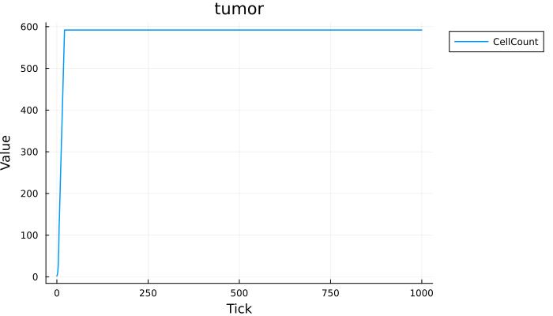
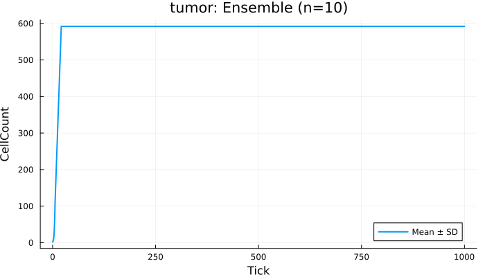

## Overview

### WHAT IS IT?

This model illustrates the growth of a tumor and how it resists chemical treatment.  A tumor consists of two kinds of cells: stem cells (blue turtles) and transitory cells (all other turtles).

### HOW IT WORKS

During mitosis, a stem cell can divide either asymmetrically or symmetrically. In asymmetric mitosis, one of the two daughter cells remains a stem cell, replacing its parent. So a stem cell effectively never dies - it is quasi reincarnated after each division. The other daughter cell turns into a transitory cell that moves outward.

Young transitory cells may divide, breeding other transitory cells.  The transitory cells stop dividing at a certain age and change color from red to white to black, eventually dying.

A stem cell may also divide symmetrically into two stem cells (blue turtles). In this example the original stem cell divides symmetrically only once. The first stem cell remains static, but the second stem cell moves to the right. This activity, in which the cell advances into distant sites and creates another tumor colony, is called metastasis. Notice that the metastasis is red. It is made of cells that die young, when they are still red, rather than ending as black dots as in the static tumor. As the disease progresses, cells die younger and younger.

### THINGS TO NOTICE

First, notice the blue dot. It represents a normal stem cell that has been transformed into a tumor stem cell.  Set the "leave-trail" switch to On, and click 'go'.  A tumor is formed as the stem cell creates transitory cells, which reproduce themselves.  It grows to a certain size.  As it grows, a bulge appears on the right side.  This is a tumor outgrowth, caused by symmetric mitosis of the stem cell. The outgrowth will turn into a metastasis and grow into remote regions.

After a while the tumor and metastasis appear to reach their ultimate size and nothing interesting seems to be happening. This illustrates how the tumor presents itself to the physician - as a solid cell mass. In reality, this seemingly solid mass conceals active cell turnover. To reveal it, set the leave-trail switch to Off, click on SETUP, and then click on GO to run the simulation again.

Slow down the model so you can follow individual steps.  Move the speed slider to the left, click on SETUP and GO, and observe the blue stem cell.  It divides into two blue stem cells.  One remains static, and the other moves to the right.

Look at the static stem cell (blue).  It breeds red cells which move outward and change their color as they age. When young, they are red and create more transitory cells. Then they turn white, then black, and then they die.

### THINGS TO TRY

Try a treatment: click on the 'kill transitory cells' button while the model is running. This simulates treatment with a chemical agent.  The agent eliminates young (red) cells that divide, and it spares older cells.  Note that the tumor shrinks and grows again.  Continue with this "chemotherapy" by clicking on the button again and watch the plot.  Repeat the treatment several times until you have understood why it fails.

Most of the chemotherapy drugs known as M- and S-poisons inhibit cell division, but generally do not cause cell death. Thus chemotherapy can be represented as killing the young (red) transitory cells, since only young cells divide. Older, non-dividing transitory cells are not affected; they continue aging and finally pass away.

The problem is that the stem cells maintain the tumor and propagate its metastases. Also known as clonogenic cells, stem cells are generally resistant to chemotherapy. They can be eliminated only with high doses of chemicals, which endanger healthy stem cells. The therapeutic margin of chemical drugs is extremely narrow. That is, they do about the same amount of harm as good.

Let the tumor grow again.  Click on 'kill moving stem cell' and continue running the model.  The right blue stem cell disappears. Its progeny live a bit longer and then die. Now click on "kill original stem cell", and watch the gradual disappearance of the tumor, as no new cells are created and existing cells continue aging until they die and disappear.

Any questions? Before asking, continue exploring the model until you grasp its behavior.  The model reveals a hidden dimension that is difficult to understand. It is the time dimension of tissues (and the tumor) in the body.

### EXTENDING THE MODEL

What alternative treatments would you suggest?  How would you model them here?

### CREDITS AND REFERENCES

The original StarLogoT Tumor model was contributed in 1997 by Gershom Zajicek M.D., Professor of Experimental Medicine and Cancer Research at The Hebrew University-Hadassah Medical School, Jerusalem. It was adapted and converted to NetLogo by Wilensky and members of the CCL in 1998.

### HOW TO CITE

If you mention this model or the NetLogo software in a publication, we ask that you include the citations below.

For the model itself:

* Zacijek, G. and Wilensky, U. (1998).  NetLogo Tumor model.  http://ccl.northwestern.edu/netlogo/models/Tumor.  Center for Connected Learning and Computer-Based Modeling, Northwestern University, Evanston, IL.

Please cite the NetLogo software as:

* Wilensky, U. (1999). NetLogo. http://ccl.northwestern.edu/netlogo/. Center for Connected Learning and Computer-Based Modeling, Northwestern University, Evanston, IL.

### COPYRIGHT AND LICENSE

Copyright 1998 Uri Wilensky.


This model is licensed under the Creative Commons Attribution-NonCommercial-ShareAlike 3.0 License.  To view a copy of this license, visit https://creativecommons.org/licenses/by-nc-sa/3.0/ or send a letter to Creative Commons, 559 Nathan Abbott Way, Stanford, California 94305, USA.

NetLogo itself is free software for non-commercial use under the terms of the GNU General Public License ([see full license information here](https://ccl.northwestern.edu/netlogo/docs/copyright.html)).

To inquire about commercial licenses for either NetLogo or specific models from the models library, please contact netlogo-commercial-admin@ccl.northwestern.edu.

This model was created as part of the project: CONNECTED MATHEMATICS: MAKING SENSE OF COMPLEX PHENOMENA THROUGH BUILDING OBJECT-BASED PARALLEL MODELS (OBPML).  The project gratefully acknowledges the support of the National Science Foundation (Applications of Advanced Technologies Program) -- grant numbers RED #9552950 and REC #9632612.

This model was converted to NetLogo as part of the projects: PARTICIPATORY SIMULATIONS: NETWORK-BASED DESIGN FOR SYSTEMS LEARNING IN CLASSROOMS and/or INTEGRATED SIMULATION AND MODELING ENVIRONMENT. The project gratefully acknowledges the support of the National Science Foundation (REPP & ROLE programs) -- grant numbers REC #9814682 and REC-0126227. Converted from StarLogoT to NetLogo, 2001.

<!-- 1998 2001 Cite: Zacijek, G. -->

## Parameters

| Parameter | Type | Default | Description |
|-----------|------|---------|-------------|
| `grid_width` | `Int` | `103` | -51..51 |
| `grid_height` | `Int` | `103` | grid height |
| `max_ticks` | `Int` | `1000` | max ticks |

## Source Code

The Julia code to run this model:

```julia
using ArkModelZoo
_, trajectory = run_tumor()
```

## Time Series

{width=100%}

## Ensemble Runs

Ten replicates with different random seeds, showing mean ± standard deviation.

{width=100%}


## Appendix: Source Code

This model is implemented in the [Ark.jl](https://github.com/sdwfrost/Ark.jl) Entity-Component-System (ECS) framework. The code is split into five files, each with a distinct role:

- **Parameters**: a mutable struct holding all configurable values.
- **Components**: lightweight data types attached to individual entities (agents).
- **Resources**: world-level shared state accessible to all systems.
- **Systems**: functions that operate on entities each tick, defining model behavior.
- **Model**: wiring that assembles the world, registers resources and systems, and provides the run entry point.

### Parameters (`parameters.jl`)

The parameter struct uses `@kwdef` so that every field has a default value and can be overridden by keyword. These defaults match the original NetLogo model's slider settings.

```julia
Base.@kwdef mutable struct TumorParams
    grid_width::Int = 103       # -51..51
    grid_height::Int = 103
    max_ticks::Int = 1000
    seed::Int = 42
end
```

### Components (`components.jl`)

Components are lightweight data types attached to individual entities (agents). Mutable structs hold per-entity state, while empty tag structs act as markers for the ECS query system to efficiently filter entities.

```julia
# Cell position (continuous, toroidal wrapping)
mutable struct TumorPosition
    x::Float64
    y::Float64
end

# Persistent heading (degrees, 0=north, clockwise)
mutable struct TumorHeading
    angle::Float64
end

# Cell age (incremented each tick)
mutable struct TumorAge
    age::Int
end

# Tag: stem cell (never dies, always divides)
struct StemCell end

# Tag: metastatic lineage (different death threshold)
struct MetastaticTag end
```

### Resources (`resources.jl`)

Resources are world-level singletons shared across all systems, used for global state and aggregate statistics.

```julia
mutable struct TumorStats
    cell_count::Int
end
TumorStats() = TumorStats(0)
```

### Systems (`systems.jl`)

Systems contain the model logic and execute in a defined order each tick. Each system struct implements either `initialize!` (run once at setup) or `update!` (run every tick).

```julia
# --- Initialization ---
# NetLogo: create 2 stem cells at (min-pxcor/2, 0) = (-25.5, 0).
# Turtle 0: non-metastatic stem, default heading (0).
# Turtle 1: metastatic stem, heading 90.

struct InitTumorSystem <: System end

function initialize!(::InitTumorSystem, world::World)
    params = get_resource(world, TumorParams)
    stats = get_resource(world, TumorStats)
    wf = Float64(params.grid_width)

    # Non-metastatic stem (turtle 0): position (min-pxcor/2, 0) in NetLogo coords.
    # In our [0, 103) space: x = (-51/2 + 51.5) = 26.0, y = 51.5
    # Actually min-pxcor = -51, min-pxcor/2 = -25.5.
    # Mapped to [0,103): x = -25.5 + 51.5 = 26.0, y = 0 + 51.5 = 51.5
    stem0_x = 26.0
    stem0_y = 51.5
    new_entity!(world, (
        TumorPosition(stem0_x, stem0_y),
        TumorHeading(0.0),
        TumorAge(0),
        StemCell(),
    ))

    # Metastatic stem (turtle 1): same position, heading 90
    new_entity!(world, (
        TumorPosition(stem0_x, stem0_y),
        TumorHeading(90.0),
        TumorAge(0),
        StemCell(),
        MetastaticTag(),
    ))

    stats.cell_count = 2
    return nothing
end

# --- Update ---
# Each tick, process all EXISTING turtles in random order (newly hatched excluded).
# Per turtle:
#   1. If metastatic stem and xcor < 25 → fd 1
#   2. age += 1
#   3. If non-stem: move-transitional-cells (fd 1, hatch if age < 6)
#   4. If stem: mitosis (hatch 1 non-stem cell)
#   5. Death check

mutable struct TumorUpdateSystem <: System
    current_entities::Vector{Tuple{Entity, Bool, Bool}}  # (eid, is_stem, is_metastatic)
    to_spawn::Vector{Tuple{Float64, Float64, Float64, Int, Bool}}  # (x, y, heading, age, metastatic)
    to_remove::Vector{Entity}
end
TumorUpdateSystem() = TumorUpdateSystem(
    Tuple{Entity, Bool, Bool}[],
    Tuple{Float64, Float64, Float64, Int, Bool}[],
    Entity[],
)

function update!(system::TumorUpdateSystem, world::World)
    params = get_resource(world, TumorParams)
    rng = get_resource(world, RNGResource).rng
    wf = Float64(params.grid_width)
    hf = Float64(params.grid_height)

    # NetLogo xcor=25 in [0,103) space: 25 + 51.5 = 76.5
    xcor_threshold = 76.5

    empty!(system.current_entities)
    empty!(system.to_spawn)
    empty!(system.to_remove)

    # Collect current entities by archetype (snapshot — newly spawned excluded)
    for (eids, _) in Query(world, (TumorPosition,); with=(StemCell, MetastaticTag))
        @inbounds for i in eachindex(eids)
            push!(system.current_entities, (eids[i], true, true))
        end
    end
    for (eids, _) in Query(world, (TumorPosition,); with=(StemCell,), without=(MetastaticTag,))
        @inbounds for i in eachindex(eids)
            push!(system.current_entities, (eids[i], true, false))
        end
    end
    for (eids, _) in Query(world, (TumorPosition,); with=(MetastaticTag,), without=(StemCell,))
        @inbounds for i in eachindex(eids)
            push!(system.current_entities, (eids[i], false, true))
        end
    end
    for (eids, _) in Query(world, (TumorPosition,); without=(StemCell, MetastaticTag))
        @inbounds for i in eachindex(eids)
            push!(system.current_entities, (eids[i], false, false))
        end
    end

    # Random order (NetLogo ask turtles)
    shuffle!(rng, system.current_entities)

    for (eid, is_stem, is_meta) in system.current_entities
        is_alive(world, eid) || continue

        pos = get_components(world, eid, (TumorPosition,))[1]
        hdg = get_components(world, eid, (TumorHeading,))[1]
        age_c = get_components(world, eid, (TumorAge,))[1]

        # 1. Metastatic stem movement
        if is_stem && is_meta && pos.x < xcor_threshold
            θ = deg2rad(hdg.angle)
            pos.x = mod(pos.x + sin(θ), wf)
            pos.y = mod(pos.y + cos(θ), hf)
        end

        # 2. Age
        age_c.age += 1

        # 3. Transitional cell movement & division
        if !is_stem
            # fd 1
            θ = deg2rad(hdg.angle)
            pos.x = mod(pos.x + sin(θ), wf)
            pos.y = mod(pos.y + cos(θ), hf)

            # Hatch if young (age < 6, but age was just incremented, so check age < 6)
            if age_c.age < 6
                new_heading = rand(rng) * 360.0
                nθ = deg2rad(new_heading)
                nx = mod(pos.x + sin(nθ), wf)
                ny = mod(pos.y + cos(nθ), hf)
                push!(system.to_spawn, (nx, ny, new_heading, age_c.age, is_meta))
            end
        end

        # 4. Mitosis (stem cells)
        if is_stem
            θ = deg2rad(hdg.angle)
            nx = mod(pos.x + sin(θ), wf)
            ny = mod(pos.y + cos(θ), hf)
            # New cell: non-stem, age 0, inherits metastatic from parent
            push!(system.to_spawn, (nx, ny, hdg.angle, 0, is_meta))
        end

        # 5. Death
        if !is_stem
            if !is_meta && age_c.age > 20
                push!(system.to_remove, eid)
            elseif is_meta && age_c.age > 4
                push!(system.to_remove, eid)
            end
        end
    end

    # Spawn new cells
    for (x, y, heading, age, meta) in system.to_spawn
        if meta
            new_entity!(world, (
                TumorPosition(x, y),
                TumorHeading(heading),
                TumorAge(age),
                MetastaticTag(),
            ))
        else
            new_entity!(world, (
                TumorPosition(x, y),
                TumorHeading(heading),
                TumorAge(age),
            ))
        end
    end

    # Remove dead cells
    for e in system.to_remove
        is_alive(world, e) && remove_entity!(world, e)
    end
    return nothing
end

# --- Stats ---

struct TumorStatsSystem <: System end

function update!(::TumorStatsSystem, world::World)
    stats = get_resource(world, TumorStats)
    count = 0
    for (eids, _) in Query(world, (TumorPosition,))
        count += length(eids)
    end
    stats.cell_count = count
    return nothing
end

# --- Termination ---

struct TumorTerminationSystem <: System end

function update!(::TumorTerminationSystem, world::World)
    params = get_resource(world, TumorParams)
    tick = get_resource(world, Tick)
    stats = get_resource(world, TumorStats)
    if stats.cell_count <= 0 || tick.tick + 1 >= params.max_ticks
        get_resource(world, Terminate).stop = true
    end
    return nothing
end
```

### Model (`model.jl`)

The model file assembles all pieces: it creates the ECS `World` with the required component types, registers resources, builds the `Scheduler` with systems in execution order, and exposes the public `run` entry point. The observer pattern records the trajectory each tick.

```julia
function tumor_world(; initial_capacity::Int = 8192)
    return World(
        TumorPosition,
        TumorHeading,
        TumorAge,
        StemCell,
        MetastaticTag;
        initial_capacity = initial_capacity,
        allow_mutable = true,
    )
end

function tumor_systems()
    return (
        InitTumorSystem(),
        TumorUpdateSystem(),
        TumorStatsSystem(),
        TumorTerminationSystem(),
    )
end

function tumor_model(params::TumorParams = TumorParams())
    world = tumor_world()
    _add_standard_resources!(world, params)
    add_resource!(world, TumorStats())
    scheduler = Scheduler(world, tumor_systems())
    initialize!(scheduler)
    return scheduler
end

struct TumorObserver end

function tumor_headers(::TumorObserver)
    return ["CellCount"]
end

function tumor_values(::TumorObserver, world::World)
    stats = get_resource(world, TumorStats)
    return Float64[stats.cell_count]
end

function run_tumor(; params::TumorParams = TumorParams(), observe::Bool = true)
    return _run_model(tumor_model, TumorObserver(), tumor_values; params, observe)
end
```
