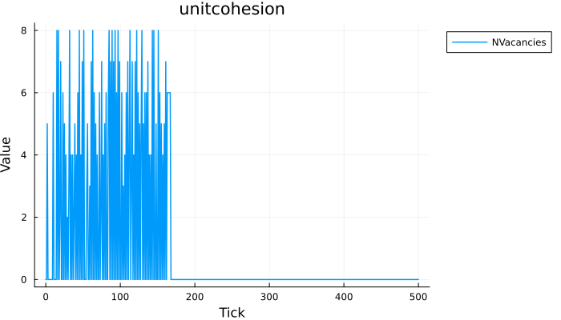
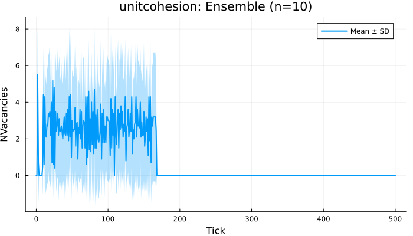
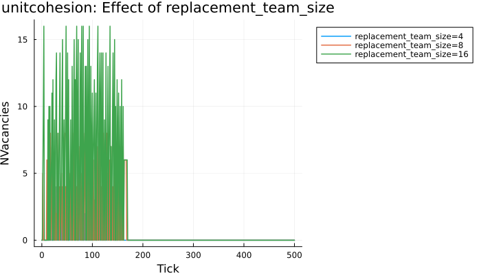

## Overview

This vignette demonstrates the **Unit Cohesion** model implemented in [ArkModelZoo.jl](https://github.com/sdwfrost/ArkModelZoo.jl) using the Ark.jl ECS framework.

## Parameters

| Parameter | Type | Default | Description |
|-----------|------|---------|-------------|
| `grid_width` | `Int` | `40` | grid width |
| `grid_height` | `Int` | `25` | grid height |
| `replacement_team_size` | `Int` | `8` | replacement team size |
| `initial_lifespan` | `Int` | `156` | initial lifespan |
| `replacement_lifespan` | `Int` | `162` | replacement lifespan |
| `replacement_age` | `Int` | `6` | replacement age |
| `max_ticks` | `Int` | `500` | max ticks |

## Source Code

The Julia code to run this model:

```julia
using ArkModelZoo
_, trajectory = run_unitcohesion()
```

## Time Series

{width=100%}

## Ensemble Runs

Ten replicates with different random seeds, showing mean ± standard deviation.

{width=100%}

## Parameter Sensitivity

Varying `replacement_team_size`.

{width=100%}


## Appendix: Source Code

This model is implemented in the [Ark.jl](https://github.com/sdwfrost/Ark.jl) Entity-Component-System (ECS) framework. The code is split into five files, each with a distinct role:

- **Parameters**: a mutable struct holding all configurable values.
- **Components**: lightweight data types attached to individual entities (agents).
- **Resources**: world-level shared state accessible to all systems.
- **Systems**: functions that operate on entities each tick, defining model behavior.
- **Model**: wiring that assembles the world, registers resources and systems, and provides the run entry point.

### Parameters (`parameters.jl`)

The parameter struct uses `@kwdef` so that every field has a default value and can be overridden by keyword. These defaults match the original NetLogo model's slider settings.

```julia
Base.@kwdef mutable struct UnitCohesionParams
    grid_width::Int = 40
    grid_height::Int = 25
    replacement_team_size::Int = 8
    initial_lifespan::Int = 156
    replacement_lifespan::Int = 162
    replacement_age::Int = 6
    max_ticks::Int = 500
    seed::Int = 42
end
```

### Components (`components.jl`)

Components are lightweight data types attached to individual entities (agents). Mutable structs hold per-entity state, while empty tag structs act as markers for the ECS query system to efficiently filter entities.

```julia
struct UnitCohesionDummy end
```

### Resources (`resources.jl`)

Resources are world-level singletons shared across all systems, used for global state and aggregate statistics.

```julia
mutable struct UnitCohesionGrid
    width::Int
    height::Int
    age::Matrix{Int}    # -1 = empty, >= 0 = turtle age
    lifespan::Int       # global lifespan (shared by all turtles)
end

function UnitCohesionGrid(w::Int, h::Int, lifespan::Int)
    UnitCohesionGrid(w, h, fill(-1, w, h), lifespan)
end

mutable struct UnitCohesionStats
    n_vacancies::Int
end
UnitCohesionStats() = UnitCohesionStats(0)
```

### Systems (`systems.jl`)

Systems contain the model logic and execute in a defined order each tick. Each system struct implements either `initialize!` (run once at setup) or `update!` (run every tick).

```julia
# --- Initialization ---

struct InitUnitCohesionSystem <: System end

function initialize!(::InitUnitCohesionSystem, world::World)
    params = get_resource(world, UnitCohesionParams)
    rng = get_resource(world, RNGResource).rng
    grid = get_resource(world, UnitCohesionGrid)
    stats = get_resource(world, UnitCohesionStats)

    w = params.grid_width
    h = params.grid_height

    # ask patches [ sprout 1 [ set age random 156 ] ]
    for x in 1:w, y in 1:h
        grid.age[x, y] = rand(rng, 0:155)
    end
    grid.lifespan = params.initial_lifespan

    total = w * h
    n_turtles = count(>=(0), grid.age)
    stats.n_vacancies = total - n_turtles
    return nothing
end

# --- Aging + Replacement ---

struct UnitCohesionUpdateSystem <: System
    occupied_buf::Vector{Tuple{Int,Int}}
end
UnitCohesionUpdateSystem() = UnitCohesionUpdateSystem(Tuple{Int,Int}[])

function update!(system::UnitCohesionUpdateSystem, world::World)
    params = get_resource(world, UnitCohesionParams)
    rng = get_resource(world, RNGResource).rng
    grid = get_resource(world, UnitCohesionGrid)
    stats = get_resource(world, UnitCohesionStats)

    w = params.grid_width
    h = params.grid_height
    total = w * h
    ages = grid.age

    # ask turtles [get-older] — random order
    empty!(system.occupied_buf)
    for x in 1:w, y in 1:h
        if ages[x, y] >= 0
            push!(system.occupied_buf, (x, y))
        end
    end
    shuffle!(rng, system.occupied_buf)

    for (x, y) in system.occupied_buf
        ages[x, y] += 1
        if ages[x, y] > grid.lifespan
            ages[x, y] = -1  # die
        end
    end

    # if vacancies > replacement-team-size, fill ALL empty patches
    n_turtles = count(>=(0), ages)
    vacancies = total - n_turtles

    if vacancies > params.replacement_team_size
        for x in 1:w, y in 1:h
            if ages[x, y] < 0
                ages[x, y] = params.replacement_age
            end
        end
        grid.lifespan = params.replacement_lifespan
        n_turtles = total
    end

    stats.n_vacancies = total - n_turtles
    return nothing
end

# --- Termination ---

struct UnitCohesionTerminationSystem <: System end

function update!(::UnitCohesionTerminationSystem, world::World)
    params = get_resource(world, UnitCohesionParams)
    tick = get_resource(world, Tick)
    if tick.tick + 1 >= params.max_ticks
        get_resource(world, Terminate).stop = true
    end
    return nothing
end
```

### Model (`model.jl`)

The model file assembles all pieces: it creates the ECS `World` with the required component types, registers resources, builds the `Scheduler` with systems in execution order, and exposes the public `run` entry point. The observer pattern records the trajectory each tick.

```julia
function unitcohesion_world(; initial_capacity::Int = 128)
    return World(
        UnitCohesionDummy;
        initial_capacity = initial_capacity,
        allow_mutable = true,
    )
end

function unitcohesion_systems()
    return (
        InitUnitCohesionSystem(),
        UnitCohesionUpdateSystem(),
        UnitCohesionTerminationSystem(),
    )
end

function unitcohesion_model(params::UnitCohesionParams = UnitCohesionParams())
    world = unitcohesion_world()
    _add_standard_resources!(world, params)
    add_resource!(world, UnitCohesionGrid(params.grid_width, params.grid_height, params.initial_lifespan))
    add_resource!(world, UnitCohesionStats())
    scheduler = Scheduler(world, unitcohesion_systems())
    initialize!(scheduler)
    return scheduler
end

struct UnitCohesionObserver end

function unitcohesion_headers(::UnitCohesionObserver)
    return ["NVacancies"]
end

function unitcohesion_values(::UnitCohesionObserver, world::World)
    stats = get_resource(world, UnitCohesionStats)
    return Float64[stats.n_vacancies]
end

function run_unitcohesion(; params::UnitCohesionParams = UnitCohesionParams(), observe::Bool = true)
    return _run_model(unitcohesion_model, UnitCohesionObserver(), unitcohesion_values; params, observe)
end
```
