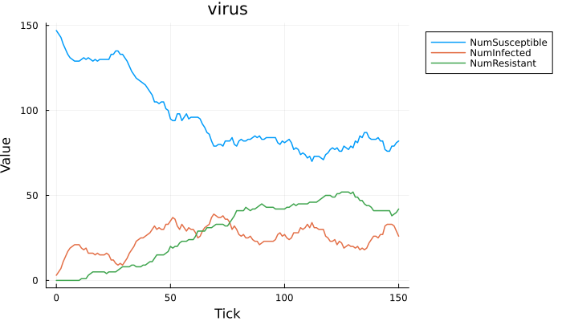
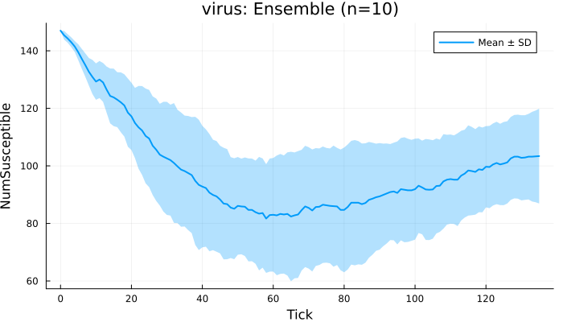
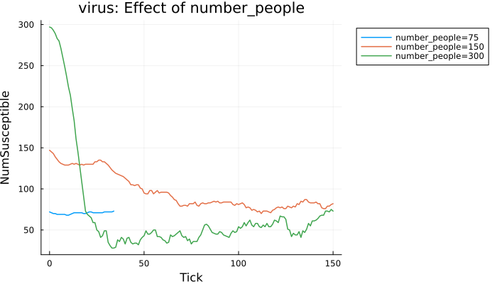

## Overview

### WHAT IS IT?

This model simulates the transmission and perpetuation of a virus in a human population.

Ecological biologists have suggested a number of factors which may influence the survival of a directly transmitted virus within a population. (Yorke, et al. "Seasonality and the requirements for perpetuation and eradication of viruses in populations." Journal of Epidemiology, volume 109, pages 103-123)

### HOW IT WORKS

The model is initialized with 150 people, of which 10 are infected.  People move randomly about the world in one of three states: healthy but susceptible to infection (green), sick and infectious (red), and healthy and immune (gray). People may die of infection or old age.  When the population dips below the environment's "carrying capacity" (set at 300 in this model) healthy people may produce healthy (but susceptible) offspring.

Some of these factors are summarized below with an explanation of how each one is treated in this model.

### THINGS TO NOTICE

The factors controlled by the three sliders interact to influence how likely the virus is to thrive in this population.  Notice that in all cases, these factors must create a balance in which an adequate number of potential hosts remain available to the virus and in which the virus can adequately access those hosts.

Often there will initially be an explosion of infection since no one in the population is immune.  This approximates the initial "outbreak" of a viral infection in a population, one that often has devastating consequences for the humans concerned. Soon, however, the virus becomes less common as the population dynamics change.  What ultimately happens to the virus is determined by the factors controlled by the sliders.

Notice that viruses that are too successful at first (infecting almost everyone) may not survive in the long term.  Since everyone infected generally dies or becomes immune as a result, the potential number of hosts is often limited.  The exception to the above is when the DURATION slider is set so high that population turnover (reproduction) can keep up and provide new hosts.

### THINGS TO TRY

Think about how different slider values might approximate the dynamics of real-life viruses.  The famous Ebola virus in central Africa has a very short duration, a very high infectiousness value, and an extremely low recovery rate. For all the fear this virus has raised, how successful is it?  Set the sliders appropriately and watch what happens.

The HIV virus, which causes AIDS, has an extremely long duration, an extremely low recovery rate, but an extremely low infectiousness value.  How does a virus with these slider values fare in this model?

### EXTENDING THE MODEL

Add additional sliders controlling the carrying capacity of the world (how many people can be in the world at one time), the average lifespan of the people and their birth-rate.

Build a similar model simulating viral infection of a non-human host with very different reproductive rates, lifespans, and population densities.

Add a slider controlling how long immunity lasts. You could also make immunity imperfect, so that immune turtles still have a small chance of getting infected. This chance could get higher over time.

### RELATED MODELS

* HIV
* Virus on a Network

### CREDITS AND REFERENCES

This model can show an alternate visualization of the Virus model using circles to represent the people. It uses visualization techniques as recommended in the paper:

Kornhauser, D., Wilensky, U., & Rand, W. (2009). Design guidelines for agent based model visualization. Journal of Artificial Societies and Social Simulation, JASSS, 12(2), 1.

### HOW TO CITE

If you mention this model or the NetLogo software in a publication, we ask that you include the citations below.

For the model itself:

* Wilensky, U. (1998).  NetLogo Virus model.  http://ccl.northwestern.edu/netlogo/models/Virus.  Center for Connected Learning and Computer-Based Modeling, Northwestern University, Evanston, IL.

Please cite the NetLogo software as:

* Wilensky, U. (1999). NetLogo. http://ccl.northwestern.edu/netlogo/. Center for Connected Learning and Computer-Based Modeling, Northwestern University, Evanston, IL.

### COPYRIGHT AND LICENSE

Copyright 1998 Uri Wilensky.


This model is licensed under the Creative Commons Attribution-NonCommercial-ShareAlike 3.0 License.  To view a copy of this license, visit https://creativecommons.org/licenses/by-nc-sa/3.0/ or send a letter to Creative Commons, 559 Nathan Abbott Way, Stanford, California 94305, USA.

NetLogo itself is free software for non-commercial use under the terms of the GNU General Public License ([see full license information here](https://ccl.northwestern.edu/netlogo/docs/copyright.html)).

To inquire about commercial licenses for either NetLogo or specific models from the models library, please contact netlogo-commercial-admin@ccl.northwestern.edu.

This model was created as part of the project: CONNECTED MATHEMATICS: MAKING SENSE OF COMPLEX PHENOMENA THROUGH BUILDING OBJECT-BASED PARALLEL MODELS (OBPML).  The project gratefully acknowledges the support of the National Science Foundation (Applications of Advanced Technologies Program) -- grant numbers RED #9552950 and REC #9632612.

This model was converted to NetLogo as part of the projects: PARTICIPATORY SIMULATIONS: NETWORK-BASED DESIGN FOR SYSTEMS LEARNING IN CLASSROOMS and/or INTEGRATED SIMULATION AND MODELING ENVIRONMENT. The project gratefully acknowledges the support of the National Science Foundation (REPP & ROLE programs) -- grant numbers REC #9814682 and REC-0126227. Converted from StarLogoT to NetLogo, 2001.

<!-- 1998 2001 -->

## Parameters

| Parameter | Type | Default | Description |
|-----------|------|---------|-------------|
| `number_people` | `Int` | `150` | number people |
| `initial_infected` | `Int` | `3` | initial infected |
| `virus_spread_chance` | `Float64` | `0.10` | virus spread chance |
| `virus_check_freq` | `Int` | `10` | virus check freq |
| `recovery_chance` | `Float64` | `0.25` | recovery chance |
| `lose_immunity_chance` | `Float64` | `0.01` | lose immunity chance |
| `link_radius` | `Float64` | `3.0` | link radius |
| `world_width` | `Int` | `33` | NetLogo default: -16 to 16 |
| `world_height` | `Int` | `33` | world height |
| `max_ticks` | `Int` | `150` | max ticks |

## Source Code

The Julia code to run this model:

```julia
using ArkModelZoo
_, trajectory = run_virus()
```

## Time Series

{width=100%}

## Ensemble Runs

Ten replicates with different random seeds, showing mean ± standard deviation.

{width=100%}

## Parameter Sensitivity

Varying `number_people`.

{width=100%}


## Appendix: Source Code

This model is implemented in the [Ark.jl](https://github.com/sdwfrost/Ark.jl) Entity-Component-System (ECS) framework. The code is split into five files, each with a distinct role:

- **Parameters**: a mutable struct holding all configurable values.
- **Components**: lightweight data types attached to individual entities (agents).
- **Resources**: world-level shared state accessible to all systems.
- **Systems**: functions that operate on entities each tick, defining model behavior.
- **Model**: wiring that assembles the world, registers resources and systems, and provides the run entry point.

### Parameters (`parameters.jl`)

The parameter struct uses `@kwdef` so that every field has a default value and can be overridden by keyword. These defaults match the original NetLogo model's slider settings.

```julia
# Parameters defined in resources.jl (VirusParams).
# This file exists for consistency with other models.
```

### Components (`components.jl`)

Components are lightweight data types attached to individual entities (agents). Mutable structs hold per-entity state, while empty tag structs act as markers for the ECS query system to efficiently filter entities.

```julia
# Position on continuous space
mutable struct VPosition
    x::Float64
    y::Float64
end
VPosition() = VPosition(0.0, 0.0)

# Heading in degrees (0 = north, clockwise)
mutable struct VHeading
    angle::Float64
end
VHeading() = VHeading(0.0)

# Health state: susceptible, infected, or resistant
@enum VHealthStatus VSusceptible=1 VInfected=2 VResistant=3

mutable struct VirusState
    status::VHealthStatus
end
VirusState() = VirusState(VSusceptible)

# Virus timer (ticks since infection)
mutable struct VirusTimer
    timer::Int
end
VirusTimer() = VirusTimer(0)
```

### Resources (`resources.jl`)

Resources are world-level singletons shared across all systems, used for global state and aggregate statistics.

```julia
Base.@kwdef mutable struct VirusParams
    number_people::Int = 150
    initial_infected::Int = 3
    virus_spread_chance::Float64 = 0.10
    virus_check_freq::Int = 10
    recovery_chance::Float64 = 0.25
    lose_immunity_chance::Float64 = 0.01
    link_radius::Float64 = 3.0
    world_width::Int = 33          # NetLogo default: -16 to 16
    world_height::Int = 33
    max_ticks::Int = 150
    seed::Int = 42
end

mutable struct VirusStats
    num_susceptible::Int
    num_infected::Int
    num_resistant::Int
end
VirusStats() = VirusStats(0, 0, 0)

# Static contact network built at initialization
mutable struct VirusNetwork
    neighbors::Dict{Entity, Vector{Entity}}
end
VirusNetwork() = VirusNetwork(Dict{Entity, Vector{Entity}}())
```

### Systems (`systems.jl`)

Systems contain the model logic and execute in a defined order each tick. Each system struct implements either `initialize!` (run once at setup) or `update!` (run every tick).

```julia
# Virus on a Network – ECS systems matching the NetLogo reference.
# Execution order: init → spread+recover → resistance → stats → termination
#
# The spread and recovery logic are combined in VirusSpreadSystem because
# NetLogo executes them in a single `ask turtles with [infected?]` block
# where each turtle spreads, increments its timer, and checks recovery
# before the next turtle is processed.

# --- Initialization ---
# NetLogo: create-turtles 150 [...]; ask turtles [create-links-with other turtles in-radius 3];
#          ask n-of 3 turtles [become-infected]; update-counts

struct InitVirusSystem <: System end

function initialize!(::InitVirusSystem, world::World)
    params = get_resource(world, VirusParams)
    rng = get_resource(world, RNGResource).rng
    network = get_resource(world, VirusNetwork)
    stats = get_resource(world, VirusStats)
    wf = Float64(params.world_width)
    hf = Float64(params.world_height)

    # Create turtles with random positions and headings
    entities = Entity[]
    positions = Tuple{Float64,Float64}[]
    for _ in 1:params.number_people
        x = rand(rng) * wf
        y = rand(rng) * hf
        heading = Float64(rand(rng, 0:359))
        e = new_entity!(world, (
            VPosition(x, y),
            VHeading(heading),
            VirusState(VSusceptible),
            VirusTimer(0),
        ))
        push!(entities, e)
        push!(positions, (x, y))
    end

    # Build static contact network (undirected): link all pairs within radius
    for i in 1:params.number_people
        network.neighbors[entities[i]] = Entity[]
    end
    r2 = params.link_radius * params.link_radius
    for i in 1:params.number_people
        xi, yi = positions[i]
        for j in (i + 1):params.number_people
            dx = abs(xi - positions[j][1])
            dx = min(dx, wf - dx)
            dy = abs(yi - positions[j][2])
            dy = min(dy, hf - dy)
            if dx * dx + dy * dy <= r2
                push!(network.neighbors[entities[i]], entities[j])
                push!(network.neighbors[entities[j]], entities[i])
            end
        end
    end

    # Infect initial turtles: ask n-of initial_infected turtles [become-infected]
    shuffled = copy(entities)
    Random.shuffle!(rng, shuffled)
    for i in 1:params.initial_infected
        state, timer = get_components(world, shuffled[i], (VirusState, VirusTimer))
        state.status = VInfected
        timer.timer = 0
    end

    # Initial counts
    stats.num_susceptible = params.number_people - params.initial_infected
    stats.num_infected = params.initial_infected
    stats.num_resistant = 0
    return nothing
end

# --- Spread and Recovery (combined per NetLogo semantics) ---
# NetLogo: ask turtles with [infected?] [
#   ask link-neighbors with [not resistant? and not infected?] [
#     if random-float 1.0 < 0.10 [ become-infected ]
#   ]
#   set virus-timer virus-timer + 1
#   if virus-timer > 10 [
#     ifelse random-float 1.0 < 0.25 [ become-resistant ] [ become-susceptible ]
#   ]
# ]

struct VirusSpreadSystem <: System
    infected_snapshot::Vector{Entity}
end
VirusSpreadSystem() = VirusSpreadSystem(Entity[])

function update!(system::VirusSpreadSystem, world::World)
    params = get_resource(world, VirusParams)
    rng = get_resource(world, RNGResource).rng
    network = get_resource(world, VirusNetwork)

    # Snapshot currently infected entities (NetLogo fixes agentset at ask start)
    empty!(system.infected_snapshot)
    for (eids, states) in Query(world, (VirusState,))
        @inbounds for i in eachindex(states)
            if states[i].status == VInfected
                push!(system.infected_snapshot, eids[i])
            end
        end
    end

    # NetLogo ask shuffles the agentset
    Random.shuffle!(rng, system.infected_snapshot)

    # Process each infected entity
    for eid in system.infected_snapshot
        state, timer = get_components(world, eid, (VirusState, VirusTimer))

        # 1. Spread to susceptible link-neighbors
        neighbors = get(network.neighbors, eid, Entity[])
        for neighbor in neighbors
            nstate, ntimer = get_components(world, neighbor, (VirusState, VirusTimer))
            if nstate.status == VSusceptible
                if rand(rng) < params.virus_spread_chance
                    nstate.status = VInfected
                    ntimer.timer = 0
                end
            end
        end

        # 2. Increment virus timer
        timer.timer += 1

        # 3. Check recovery (timer > virus_check_freq)
        if timer.timer > params.virus_check_freq
            if rand(rng) < params.recovery_chance
                state.status = VResistant
            else
                state.status = VSusceptible
            end
            timer.timer = 0
        end
    end
    return nothing
end

# --- Resistance Loss ---
# NetLogo: ask turtles with [resistant?] [
#   if random-float 1.0 < 0.01 [ become-susceptible ]
# ]

struct VirusResistanceSystem <: System end

function update!(::VirusResistanceSystem, world::World)
    params = get_resource(world, VirusParams)
    rng = get_resource(world, RNGResource).rng

    for (_, states, timers) in Query(world, (VirusState, VirusTimer))
        @inbounds for i in eachindex(states)
            if states[i].status == VResistant
                if rand(rng) < params.lose_immunity_chance
                    states[i].status = VSusceptible
                    timers[i].timer = 0
                end
            end
        end
    end
    return nothing
end

# --- Statistics ---
# NetLogo: update-counts

struct VirusStatsSystem <: System end

function update!(::VirusStatsSystem, world::World)
    stats = get_resource(world, VirusStats)
    ns = 0; ni = 0; nr = 0

    for (_, states) in Query(world, (VirusState,))
        @inbounds for i in eachindex(states)
            s = states[i].status
            if s == VSusceptible
                ns += 1
            elseif s == VInfected
                ni += 1
            else
                nr += 1
            end
        end
    end

    stats.num_susceptible = ns
    stats.num_infected = ni
    stats.num_resistant = nr
    return nothing
end

# --- Termination ---
# NetLogo: if num-infected = 0 [ stop ]

struct VirusTerminationSystem <: System end

function update!(::VirusTerminationSystem, world::World)
    params = get_resource(world, VirusParams)
    tick = get_resource(world, Tick)
    stats = get_resource(world, VirusStats)
    if stats.num_infected == 0 || tick.tick + 1 >= params.max_ticks
        get_resource(world, Terminate).stop = true
    end
    return nothing
end
```

### Model (`model.jl`)

The model file assembles all pieces: it creates the ECS `World` with the required component types, registers resources, builds the `Scheduler` with systems in execution order, and exposes the public `run` entry point. The observer pattern records the trajectory each tick.

```julia
function virus_world(; initial_capacity::Int = 512)
    return World(
        VPosition,
        VHeading,
        VirusState,
        VirusTimer;
        initial_capacity = initial_capacity,
        allow_mutable = true,
    )
end

function virus_systems()
    return (
        InitVirusSystem(),
        VirusSpreadSystem(),
        VirusResistanceSystem(),
        VirusStatsSystem(),
        VirusTerminationSystem(),
    )
end

function virus_model(params::VirusParams = VirusParams())
    world = virus_world()
    _add_standard_resources!(world, params)
    add_resource!(world, VirusStats())
    add_resource!(world, VirusNetwork())
    scheduler = Scheduler(world, virus_systems())
    initialize!(scheduler)
    return scheduler
end

struct VirusObserver end

function virus_headers(::VirusObserver)
    return ["NumSusceptible", "NumInfected", "NumResistant"]
end

function virus_values(::VirusObserver, world::World)
    stats = get_resource(world, VirusStats)
    return Float64[stats.num_susceptible, stats.num_infected, stats.num_resistant]
end

function run_virus(; params::VirusParams = VirusParams(), observe::Bool = true)
    return _run_model(virus_model, VirusObserver(), virus_values; params, observe)
end
```
