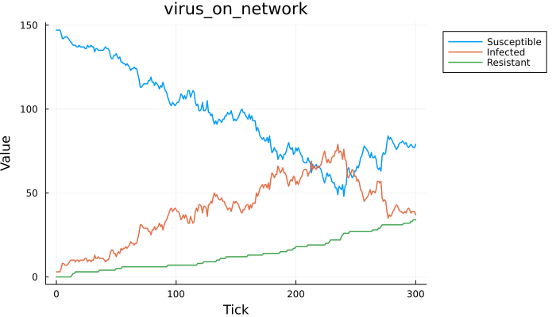
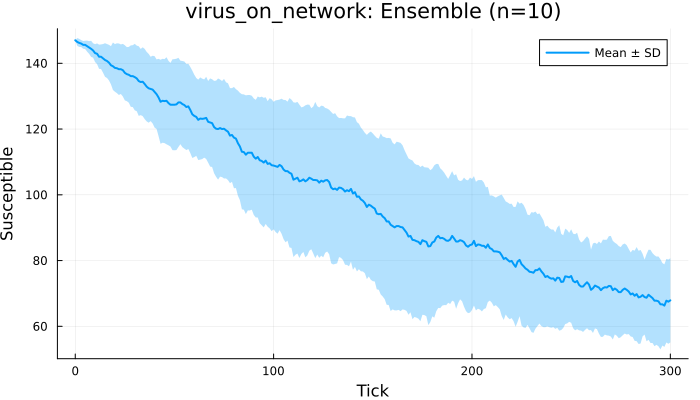
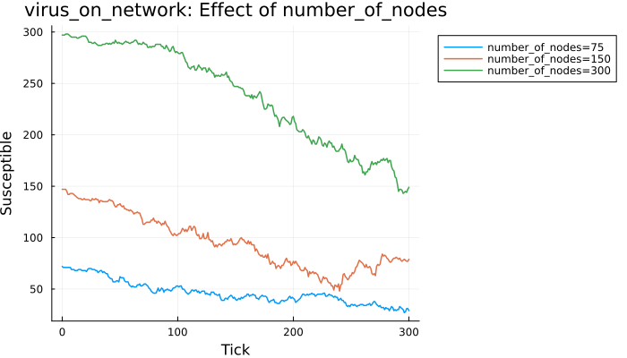

# Virus on a Network


- [Overview](#overview)
  - [WHAT IS IT?](#what-is-it)
  - [HOW IT WORKS](#how-it-works)
  - [THINGS TO NOTICE](#things-to-notice)
  - [THINGS TO TRY](#things-to-try)
  - [EXTENDING THE MODEL](#extending-the-model)
  - [RELATED MODELS](#related-models)
  - [NETLOGO FEATURES](#netlogo-features)
  - [HOW TO CITE](#how-to-cite)
  - [COPYRIGHT AND LICENSE](#copyright-and-license)
- [Parameters](#parameters)
- [Source Code](#source-code)
- [Time Series](#time-series)
- [Ensemble Runs](#ensemble-runs)
- [Parameter Sensitivity](#parameter-sensitivity)
- [Appendix: Source Code](#appendix-source-code)
  - [Parameters (`parameters.jl`)](#parameters-parametersjl)
  - [Components (`components.jl`)](#components-componentsjl)
  - [Resources (`resources.jl`)](#resources-resourcesjl)
  - [Systems (`systems.jl`)](#systems-systemsjl)
  - [Model (`model.jl`)](#model-modeljl)

## Overview

### WHAT IS IT?

This model demonstrates the spread of a virus through a network.
Although the model is somewhat abstract, one interpretation is that each
node represents a computer, and we are modeling the progress of a
computer virus (or worm) through this network. Each node may be in one
of three states: susceptible, infected, or resistant. In the academic
literature such a model is sometimes referred to as an SIR model for
epidemics.

### HOW IT WORKS

Each time step (tick), each infected node (colored red) attempts to
infect all of its neighbors. Susceptible neighbors (colored blue) will
be infected with a probability given by the VIRUS-SPREAD-CHANCE slider.
This might correspond to the probability that someone on the susceptible
system actually executes the infected email attachment. Resistant nodes
(colored gray) cannot be infected. This might correspond to up-to-date
antivirus software and security patches that make a computer immune to
this particular virus.

Infected nodes are not immediately aware that they are infected. Only
every so often (determined by the VIRUS-CHECK-FREQUENCY slider) do the
nodes check whether they are infected by a virus. This might correspond
to a regularly scheduled virus-scan procedure, or simply a human
noticing something fishy about how the computer is behaving. When the
virus has been detected, there is a probability that the virus will be
removed (determined by the RECOVERY-CHANCE slider).

If a node does recover, there is some probability that it will become
resistant to this virus in the future (given by the
GAIN-RESISTANCE-CHANCE slider).

When a node becomes resistant, the links between it and its neighbors
are darkened, since they are no longer possible vectors for spreading
the virus.

### THINGS TO NOTICE

At the end of the run, after the virus has died out, some nodes are
still susceptible, while others have become immune. What is the ratio of
the number of immune nodes to the number of susceptible nodes? How is
this affected by changing the AVERAGE-NODE-DEGREE of the network?

### THINGS TO TRY

Set GAIN-RESISTANCE-CHANCE to 0%. Under what conditions will the virus
still die out? How long does it take? What conditions are required for
the virus to live? If the RECOVERY-CHANCE is bigger than 0, even if the
VIRUS-SPREAD-CHANCE is high, do you think that if you could run the
model forever, the virus could stay alive?

### EXTENDING THE MODEL

The real computer networks on which viruses spread are generally not
based on spatial proximity, like the networks found in this model. Real
computer networks are more often found to exhibit a “scale-free”
link-degree distribution, somewhat similar to networks created using the
Preferential Attachment model. Try experimenting with various
alternative network structures, and see how the behavior of the virus
differs.

Suppose the virus is spreading by emailing itself out to everyone in the
computer’s address book. Since being in someone’s address book is not a
symmetric relationship, change this model to use directed links instead
of undirected links.

Can you model multiple viruses at the same time? How would they
interact? Sometimes if a computer has a piece of malware installed, it
is more vulnerable to being infected by more malware.

Try making a model similar to this one, but where the virus has the
ability to mutate itself. Such self-modifying viruses are a considerable
threat to computer security, since traditional methods of virus
signature identification may not work against them. In your model, nodes
that become immune may be reinfected if the virus has mutated to become
significantly different than the variant that originally infected the
node.

### RELATED MODELS

Virus, Disease, Preferential Attachment, Diffusion on a Directed Network

### NETLOGO FEATURES

Links are used for modeling the network. The `layout-spring` primitive
is used to position the nodes and links such that the structure of the
network is visually clear.

Though it is not used in this model, there exists a network extension
for NetLogo that you can download at:
https://github.com/NetLogo/NW-Extension.

### HOW TO CITE

If you mention this model or the NetLogo software in a publication, we
ask that you include the citations below.

For the model itself:

- Stonedahl, F. and Wilensky, U. (2008). NetLogo Virus on a Network
  model. http://ccl.northwestern.edu/netlogo/models/VirusonaNetwork.
  Center for Connected Learning and Computer-Based Modeling,
  Northwestern University, Evanston, IL.

Please cite the NetLogo software as:

- Wilensky, U. (1999). NetLogo. http://ccl.northwestern.edu/netlogo/.
  Center for Connected Learning and Computer-Based Modeling,
  Northwestern University, Evanston, IL.

### COPYRIGHT AND LICENSE

Copyright 2008 Uri Wilensky.


This model is licensed under the Creative Commons
Attribution-NonCommercial-ShareAlike 3.0 License. To view a copy of this
license, visit https://creativecommons.org/licenses/by-nc-sa/3.0/ or
send a letter to Creative Commons, 559 Nathan Abbott Way, Stanford,
California 94305, USA.

NetLogo itself is free software for non-commercial use under the terms
of the GNU General Public License ([see full license information
here](https://ccl.northwestern.edu/netlogo/docs/copyright.html)).

To inquire about commercial licenses for either NetLogo or specific
models from the models library, please contact
netlogo-commercial-admin@ccl.northwestern.edu.

<!-- 2008 Cite: Stonedahl, F. -->

## Parameters

| Parameter                | Type      | Default | Description           |
|--------------------------|-----------|---------|-----------------------|
| `number_of_nodes`        | `Int`     | `150`   | number of nodes       |
| `average_node_degree`    | `Int`     | `6`     | average node degree   |
| `initial_outbreak_size`  | `Int`     | `3`     | initial outbreak size |
| `virus_spread_chance`    | `Float64` | `2.5`   | percent               |
| `virus_check_frequency`  | `Int`     | `1`     | ticks                 |
| `recovery_chance`        | `Float64` | `5.0`   | percent               |
| `gain_resistance_chance` | `Float64` | `5.0`   | percent               |
| `max_ticks`              | `Int`     | `300`   | max ticks             |

## Source Code

The Julia code to run this model:

``` julia
using ArkModelZoo
_, trajectory = run_virus_on_network()
```

## Time Series



## Ensemble Runs

Ten replicates with different random seeds, showing mean ± standard
deviation.



## Parameter Sensitivity

Varying `number_of_nodes`.



## Appendix: Source Code

This model is implemented in the
[Ark.jl](https://github.com/sdwfrost/Ark.jl) Entity-Component-System
(ECS) framework. The code is split into five files, each with a distinct
role:

- **Parameters**: a mutable struct holding all configurable values.
- **Components**: lightweight data types attached to individual entities
  (agents).
- **Resources**: world-level shared state accessible to all systems.
- **Systems**: functions that operate on entities each tick, defining
  model behavior.
- **Model**: wiring that assembles the world, registers resources and
  systems, and provides the run entry point.

### Parameters (`parameters.jl`)

The parameter struct uses `@kwdef` so that every field has a default
value and can be overridden by keyword. These defaults match the
original NetLogo model’s slider settings.

``` julia
Base.@kwdef mutable struct VONParams
    number_of_nodes::Int = 150
    average_node_degree::Int = 6
    initial_outbreak_size::Int = 3
    virus_spread_chance::Float64 = 2.5   # percent
    virus_check_frequency::Int = 1       # ticks
    recovery_chance::Float64 = 5.0       # percent
    gain_resistance_chance::Float64 = 5.0 # percent
    max_ticks::Int = 300
    seed::Int = 42
end
```

### Components (`components.jl`)

Components are lightweight data types attached to individual entities
(agents). Mutable structs hold per-entity state, while empty tag structs
act as markers for the ECS query system to efficiently filter entities.

``` julia
mutable struct VONState
    node_id::Int
    infected::Bool
    resistant::Bool
    virus_check_timer::Int
end
VONState() = VONState(0, false, false, 0)
```

### Resources (`resources.jl`)

Resources are world-level singletons shared across all systems, used for
global state and aggregate statistics.

``` julia
mutable struct VONNetwork
    graph::NwGraph
    node_to_entity::Vector{Entity}
end

VONNetwork() = VONNetwork(NwGraph(), Entity[])

mutable struct VONStats
    num_susceptible::Int
    num_infected::Int
    num_resistant::Int
end
VONStats() = VONStats(0, 0, 0)
```

### Systems (`systems.jl`)

Systems contain the model logic and execute in a defined order each
tick. Each system struct implements either `initialize!` (run once at
setup) or `update!` (run every tick).

``` julia
struct InitVONSystem <: System end

function initialize!(::InitVONSystem, world::World)
    params = get_resource(world, VONParams)
    rng = get_resource(world, RNGResource).rng
    net = get_resource(world, VONNetwork)
    n = params.number_of_nodes

    # Build spatially-clustered network: connect nearest non-neighbors
    num_links = div(params.average_node_degree * n, 2)
    g = NwGraph(n)
    # Assign random positions for spatial clustering
    pos_x = [rand(rng) for _ in 1:n]
    pos_y = [rand(rng) for _ in 1:n]
    for _ in 1:num_links
        # Pick random node, connect to nearest non-neighbor
        i = rand(rng, 1:n)
        best_j = 0
        best_dist = Inf
        for j in 1:n
            j == i && continue
            nw_has_edge(g, i, j) && continue
            d = (pos_x[i] - pos_x[j])^2 + (pos_y[i] - pos_y[j])^2
            if d < best_dist
                best_dist = d
                best_j = j
            end
        end
        if best_j > 0
            nw_add_edge!(g, i, best_j)
        end
    end
    net.graph = g

    # Create entities for each node
    net.node_to_entity = Vector{Entity}(undef, n)
    for i in 1:n
        timer = rand(rng, 0:max(params.virus_check_frequency - 1, 0))
        eid = new_entity!(world, (VONState(i, false, false, timer),))
        net.node_to_entity[i] = eid
    end

    # Infect initial outbreak
    outbreak_ids = Random.shuffle!(rng, collect(1:n))[1:min(params.initial_outbreak_size, n)]
    for i in outbreak_ids
        st = get_components(world, net.node_to_entity[i], (VONState,))[1]
        st.infected = true
    end

    _von_update_stats!(world)
    return nothing
end

struct VONGoSystem <: System end

function update!(::VONGoSystem, world::World)
    params = get_resource(world, VONParams)
    rng = get_resource(world, RNGResource).rng
    net = get_resource(world, VONNetwork)

    # Increment virus check timers (shuffled ask)
    all_nodes = collect(1:net.graph.n)
    Random.shuffle!(rng, all_nodes)
    for i in all_nodes
        st = get_components(world, net.node_to_entity[i], (VONState,))[1]
        st.virus_check_timer += 1
        if st.virus_check_timer >= params.virus_check_frequency
            st.virus_check_timer = 0
        end
    end

    # Spread virus
    Random.shuffle!(rng, all_nodes)
    for i in all_nodes
        st = get_components(world, net.node_to_entity[i], (VONState,))[1]
        !st.infected && continue
        neighbors = collect(nw_neighbors(net.graph, i))
        Random.shuffle!(rng, neighbors)
        for j in neighbors
            nst = get_components(world, net.node_to_entity[j], (VONState,))[1]
            nst.resistant && continue
            if rand(rng) * 100.0 < params.virus_spread_chance
                nst.infected = true
            end
        end
    end

    # Virus checks
    Random.shuffle!(rng, all_nodes)
    for i in all_nodes
        st = get_components(world, net.node_to_entity[i], (VONState,))[1]
        (!st.infected || st.virus_check_timer != 0) && continue
        if rand(rng, 0:99) < params.recovery_chance
            if rand(rng, 0:99) < params.gain_resistance_chance
                st.infected = false
                st.resistant = true
            else
                st.infected = false
            end
        end
    end

    _von_update_stats!(world)
    return nothing
end

function _von_update_stats!(world::World)
    stats = get_resource(world, VONStats)
    ns = 0; ni = 0; nr = 0
    for (_, states) in Query(world, (VONState,))
        @inbounds for k in eachindex(states)
            s = states[k]
            if s.resistant
                nr += 1
            elseif s.infected
                ni += 1
            else
                ns += 1
            end
        end
    end
    stats.num_susceptible = ns
    stats.num_infected = ni
    stats.num_resistant = nr
end

struct VONTerminationSystem <: System end

function update!(::VONTerminationSystem, world::World)
    params = get_resource(world, VONParams)
    stats = get_resource(world, VONStats)
    tick = get_resource(world, Tick)
    if stats.num_infected == 0 || tick.tick + 1 >= params.max_ticks
        get_resource(world, Terminate).stop = true
    end
    return nothing
end
```

### Model (`model.jl`)

The model file assembles all pieces: it creates the ECS `World` with the
required component types, registers resources, builds the `Scheduler`
with systems in execution order, and exposes the public `run` entry
point. The observer pattern records the trajectory each tick.

``` julia
function von_world(; initial_capacity::Int = 1024)
    return World(VONState; initial_capacity = initial_capacity, allow_mutable = true)
end

function von_systems()
    return (InitVONSystem(), VONGoSystem(), VONTerminationSystem())
end

function von_model(params::VONParams = VONParams())
    world = von_world()
    _add_standard_resources!(world, params)
    add_resource!(world, VONNetwork())
    add_resource!(world, VONStats())
    scheduler = Scheduler(world, von_systems())
    initialize!(scheduler)
    return scheduler
end

struct VONObserver end

function von_headers(::VONObserver)
    return ["Susceptible", "Infected", "Resistant"]
end

function von_values(::VONObserver, world::World)
    stats = get_resource(world, VONStats)
    return Float64[stats.num_susceptible, stats.num_infected, stats.num_resistant]
end

function run_virus_on_network(; params::VONParams = VONParams(), observe::Bool = true)
    return _run_model(von_model, VONObserver(), von_values; params, observe)
end
```
