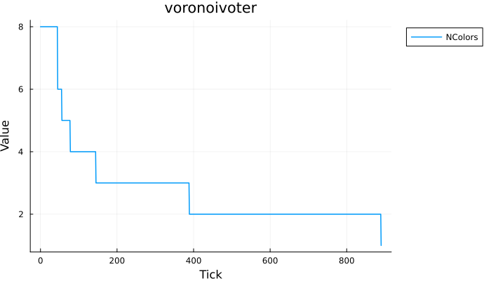
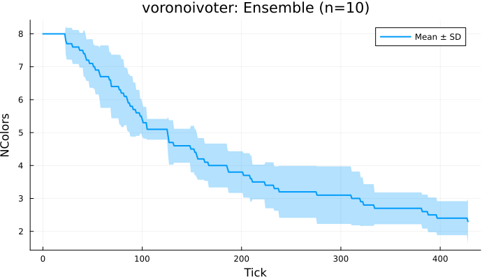
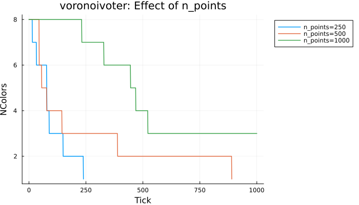

# Voronoi Voter


- [Overview](#overview)
  - [WHAT IS IT?](#what-is-it)
  - [HOW IT WORKS](#how-it-works)
  - [THINGS TO NOTICE](#things-to-notice)
  - [THINGS TO TRY](#things-to-try)
  - [EXTENDING THE MODEL](#extending-the-model)
  - [NETLOGO FEATURES](#netlogo-features)
  - [RELATED MODELS](#related-models)
  - [CREDITS AND REFERENCES](#credits-and-references)
  - [HOW TO CITE](#how-to-cite)
  - [COPYRIGHT AND LICENSE](#copyright-and-license)
- [Parameters](#parameters)
- [Source Code](#source-code)
- [Time Series](#time-series)
- [Ensemble Runs](#ensemble-runs)
- [Parameter Sensitivity](#parameter-sensitivity)
- [Appendix: Source Code](#appendix-source-code)
  - [Parameters (`parameters.jl`)](#parameters-parametersjl)
  - [Components (`components.jl`)](#components-componentsjl)
  - [Resources (`resources.jl`)](#resources-resourcesjl)
  - [Systems (`systems.jl`)](#systems-systemsjl)
  - [Model (`model.jl`)](#model-modeljl)

## Overview

### WHAT IS IT?

This model draws a Voronoi diagram of polygons around a set of points.
These diagrams resemble many phenomena in the world including cells,
forest canopies, territories of animals, fur and shell patterns, crystal
growth and grain growth, cracks in dried mud and other geological
phenomena, road networks, and so on. Voronoi diagrams are useful in
computer graphics, vision and path planning for robots, marketing, and
other applications.

### HOW IT WORKS

First the points are placed randomly. Then the polygons are drawn
according to the following rules. Each point is enclosed inside exactly
one polygon. All of the points inside the polygon are closer to that
point than they are to any of the other points.

Instead of calculating the mathematically exact coordinates of the
polygons, this model constructs an approximation using a grid. Each grid
cell (each “patch”, in NetLogo terminology) is colored according to
which point it is closest to.

### THINGS TO NOTICE

The line segment separating two points is exactly midway between them.

How many sides do the polygons typically have? (You may want to ignore
the polygons around the edges.)

Where different colors touch, there is usually a “Y”. When do you get a
“T” or an “X” instead?

### THINGS TO TRY

Experiment with the effect of moving the points around. Moving the
points slowly is best. (If you move them too fast, the model will have
trouble keeping up and it won’t be easy to see what’s going on.)

Align two points so they have the exact same x coordinate or y
coordinate. Is the line between them always perfectly smooth? (To see
the effect, you may have to move the points closer or farther away from
each other. Look closely.) Also try putting two points exactly on top of
each other. What happens? Both effects occur because when a grid square
(“patch”) is equally distant from two differently colored points,
NetLogo resolves the tie randomly.

### EXTENDING THE MODEL

Instead of placing the points completely randomly, have them move away
from each other until they are roughly equidistant from each other. This
makes all the polygons roughly the same size.

Edit the view and turn wrapping on in both directions, and click SETUP.
The model may seem to be working, but there is a problem. If you turn on
SHOW-UPDATES?, you can see that the update rectangle keeps going
forever, continually refreshing the grid colors. Fix the model to work
with wrapping, so that update stops as soon as the whole screen has been
redrawn.

Instead of using the patches to display Voronoi polygons, find the
boundaries by using turtles. Create a large batch of turtles at each
point (colored the same color as the point), each turtle facing a
different angle. Have the turtles walk outward from their points at a
uniform rate. Stop the turtles when they run into a turtle of a
different color.

Instead of using a patch-based approximation, calculate the exact
positions of the sides of the polygons. (There are numerous published
algorithms for calculating this information.) Then display the polygons
using turtles with the “line” shape.

### NETLOGO FEATURES

The core procedure for drawing the polygons is called `recolor`. It is
only one line long! It puts the `min-one-of` and `distance` reporters to
good use.

The `mouse-down?`, `mouse-xcor`, and `mouse-ycor` primitives are used so
the user can interact with the model.

Because the number of patches is so large, it takes a while to update
them all when a point moves. So we use moving turtles to recolor the
patches; the moving turtles start where the mouse is, and move outwards
in a square, since near the mouse is where the user will be looking
first. See the Code tab for the details on how it works.

### RELATED MODELS

- MaterialSim Grain Growth
- Fur
- Honeycomb
- Scatter

### CREDITS AND REFERENCES

For more information on Voronoi diagrams, see
https://en.wikipedia.org/wiki/Voronoi. (There are also many other sites
on this topic on the web.)

Thanks to John Jungck from Beloit College for inspiring this model with
his talk at Northwestern University about Voronoi structures in nature.

Thanks to Josh Unterman and Seth Tisue for their work on this model.

### HOW TO CITE

If you mention this model or the NetLogo software in a publication, we
ask that you include the citations below.

For the model itself:

- Wilensky, U. (2006). NetLogo Voronoi model.
  http://ccl.northwestern.edu/netlogo/models/Voronoi. Center for
  Connected Learning and Computer-Based Modeling, Northwestern
  University, Evanston, IL.

Please cite the NetLogo software as:

- Wilensky, U. (1999). NetLogo. http://ccl.northwestern.edu/netlogo/.
  Center for Connected Learning and Computer-Based Modeling,
  Northwestern University, Evanston, IL.

### COPYRIGHT AND LICENSE

Copyright 2006 Uri Wilensky.


This model is licensed under the Creative Commons
Attribution-NonCommercial-ShareAlike 3.0 License. To view a copy of this
license, visit https://creativecommons.org/licenses/by-nc-sa/3.0/ or
send a letter to Creative Commons, 559 Nathan Abbott Way, Stanford,
California 94305, USA.

NetLogo itself is free software for non-commercial use under the terms
of the GNU General Public License ([see full license information
here](https://ccl.northwestern.edu/netlogo/docs/copyright.html)).

To inquire about commercial licenses for either NetLogo or specific
models from the models library, please contact
netlogo-commercial-admin@ccl.northwestern.edu.

<!-- 2006 -->

## Parameters

| Parameter   | Type  | Default | Description              |
|-------------|-------|---------|--------------------------|
| `n_points`  | `Int` | `500`   | n points                 |
| `n_palette` | `Int` | `8`     | n palette                |
| `grid_size` | `Int` | `201`   | 201×201 grid (-100..100) |
| `max_ticks` | `Int` | `1000`  | max ticks                |

## Source Code

The Julia code to run this model:

``` julia
using ArkModelZoo
_, trajectory = run_voronoivoter()
```

## Time Series



## Ensemble Runs

Ten replicates with different random seeds, showing mean ± standard
deviation.



## Parameter Sensitivity

Varying `n_points`.



## Appendix: Source Code

This model is implemented in the
[Ark.jl](https://github.com/sdwfrost/Ark.jl) Entity-Component-System
(ECS) framework. The code is split into five files, each with a distinct
role:

- **Parameters**: a mutable struct holding all configurable values.
- **Components**: lightweight data types attached to individual entities
  (agents).
- **Resources**: world-level shared state accessible to all systems.
- **Systems**: functions that operate on entities each tick, defining
  model behavior.
- **Model**: wiring that assembles the world, registers resources and
  systems, and provides the run entry point.

### Parameters (`parameters.jl`)

The parameter struct uses `@kwdef` so that every field has a default
value and can be overridden by keyword. These defaults match the
original NetLogo model’s slider settings.

``` julia
Base.@kwdef mutable struct VoronoiVoterParams
    n_points::Int = 500
    n_palette::Int = 8
    grid_size::Int = 201   # 201×201 grid (-100..100)
    max_ticks::Int = 1000
    seed::Int = 42
end
```

### Components (`components.jl`)

Components are lightweight data types attached to individual entities
(agents). Mutable structs hold per-entity state, while empty tag structs
act as markers for the ECS query system to efficiently filter entities.

``` julia
mutable struct VoterPoint
    x::Float64
    y::Float64
    color_id::Int
end
VoterPoint() = VoterPoint(0.0, 0.0, 1)
```

### Resources (`resources.jl`)

Resources are world-level singletons shared across all systems, used for
global state and aggregate statistics.

``` julia
mutable struct VoronoiNetwork
    neighbors::Dict{Int, Vector{Int}}  # index-based adjacency
end
VoronoiNetwork() = VoronoiNetwork(Dict{Int, Vector{Int}}())

mutable struct VoronoiGrid
    width::Int
    height::Int
    owner::Matrix{Int}  # which point index owns each patch
end
function VoronoiGrid(w::Int, h::Int)
    VoronoiGrid(w, h, zeros(Int, w, h))
end

mutable struct VoronoiStats
    n_colors::Int
end
VoronoiStats() = VoronoiStats(0)
```

### Systems (`systems.jl`)

Systems contain the model logic and execute in a defined order each
tick. Each system struct implements either `initialize!` (run once at
setup) or `update!` (run every tick).

``` julia
# --- Initialization ---

struct InitVoronoiVoterSystem <: System end

function initialize!(::InitVoronoiVoterSystem, world::World)
    params = get_resource(world, VoronoiVoterParams)
    rng = get_resource(world, RNGResource).rng
    vgrid = get_resource(world, VoronoiGrid)
    network = get_resource(world, VoronoiNetwork)
    stats = get_resource(world, VoronoiStats)
    w, h = vgrid.width, vgrid.height

    # Create points as entities and store references by index
    point_entities = Entity[]
    point_xs = Float64[]
    point_ys = Float64[]
    for i in 1:params.n_points
        x = rand(rng) * w
        y = rand(rng) * h
        color_id = rand(rng, 1:params.n_palette)
        e = new_entity!(world, (VoterPoint(x, y, color_id),))
        push!(point_entities, e)
        push!(point_xs, x)
        push!(point_ys, y)
    end

    # Assign each patch to nearest point (Voronoi tessellation)
    for px in 1:w, py in 1:h
        best_idx = 1
        best_dist = Inf
        for i in 1:params.n_points
            dx = abs(Float64(px) - point_xs[i])
            dy = abs(Float64(py) - point_ys[i])
            dx = min(dx, w - dx)
            dy = min(dy, h - dy)
            d = dx * dx + dy * dy
            if d < best_dist
                best_dist = d
                best_idx = i
            end
        end
        vgrid.owner[px, py] = best_idx
    end

    # Compute adjacency: two points are neighbors if their Voronoi cells share adjacent patches
    for i in 1:params.n_points
        network.neighbors[i] = Int[]
    end
    for px in 1:w, py in 1:h
        owner_idx = vgrid.owner[px, py]
        for (dx, dy) in ((1, 0), (-1, 0), (0, 1), (0, -1))
            nx = mod1(px + dx, w)
            ny = mod1(py + dy, h)
            nbr_idx = vgrid.owner[nx, ny]
            if nbr_idx != owner_idx && !(nbr_idx in network.neighbors[owner_idx])
                push!(network.neighbors[owner_idx], nbr_idx)
            end
        end
    end

    # Count distinct colors
    colors_set = Set{Int}()
    for i in 1:params.n_points
        vp = get_components(world, point_entities[i], (VoterPoint,))[1]
        push!(colors_set, vp.color_id)
    end
    stats.n_colors = length(colors_set)

    # Store entity list in a resource for fast indexed access
    add_resource!(world, VoronoiEntityList(point_entities))

    return nothing
end

# Entity list resource for indexed access
mutable struct VoronoiEntityList
    entities::Vector{Entity}
end

# --- Voter Update ---

struct VoronoiVoterUpdateSystem <: System end

function update!(::VoronoiVoterUpdateSystem, world::World)
    params = get_resource(world, VoronoiVoterParams)
    rng = get_resource(world, RNGResource).rng
    network = get_resource(world, VoronoiNetwork)
    elist = get_resource(world, VoronoiEntityList)
    n = params.n_points

    for _ in 1:n
        idx = rand(rng, 1:n)
        nbrs = network.neighbors[idx]
        isempty(nbrs) && continue
        nbr_idx = nbrs[rand(rng, 1:length(nbrs))]
        vp_nbr = get_components(world, elist.entities[nbr_idx], (VoterPoint,))[1]
        vp = get_components(world, elist.entities[idx], (VoterPoint,))[1]
        vp.color_id = vp_nbr.color_id
    end
    return nothing
end

# --- Stats ---

struct VoronoiStatsSystem <: System end

function update!(::VoronoiStatsSystem, world::World)
    stats = get_resource(world, VoronoiStats)
    elist = get_resource(world, VoronoiEntityList)
    world_ref = world
    colors_set = Set{Int}()
    for e in elist.entities
        vp = get_components(world_ref, e, (VoterPoint,))[1]
        push!(colors_set, vp.color_id)
    end
    stats.n_colors = length(colors_set)
    return nothing
end

# --- Termination ---

struct VoronoiTerminationSystem <: System end

function update!(::VoronoiTerminationSystem, world::World)
    stats = get_resource(world, VoronoiStats)
    params = get_resource(world, VoronoiVoterParams)
    tick = get_resource(world, Tick)
    if stats.n_colors <= 1 || tick.tick + 1 >= params.max_ticks
        get_resource(world, Terminate).stop = true
    end
    return nothing
end
```

### Model (`model.jl`)

The model file assembles all pieces: it creates the ECS `World` with the
required component types, registers resources, builds the `Scheduler`
with systems in execution order, and exposes the public `run` entry
point. The observer pattern records the trajectory each tick.

``` julia
function voronoivoter_world(; initial_capacity::Int = 1024)
    return World(
        VoterPoint;
        initial_capacity = initial_capacity,
        allow_mutable = true,
    )
end

function voronoivoter_systems()
    return (
        InitVoronoiVoterSystem(),
        VoronoiVoterUpdateSystem(),
        VoronoiStatsSystem(),
        VoronoiTerminationSystem(),
    )
end

function voronoivoter_model(params::VoronoiVoterParams = VoronoiVoterParams())
    world = voronoivoter_world()
    _add_standard_resources!(world, params)
    add_resource!(world, VoronoiGrid(params.grid_size, params.grid_size))
    add_resource!(world, VoronoiNetwork())
    add_resource!(world, VoronoiStats())
    scheduler = Scheduler(world, voronoivoter_systems())
    initialize!(scheduler)
    return scheduler
end

struct VoronoiVoterObserver end

function voronoivoter_headers(::VoronoiVoterObserver)
    return ["NColors"]
end

function voronoivoter_values(::VoronoiVoterObserver, world::World)
    stats = get_resource(world, VoronoiStats)
    return Float64[stats.n_colors]
end

function run_voronoivoter(; params::VoronoiVoterParams = VoronoiVoterParams(), observe::Bool = true)
    return _run_model(voronoivoter_model, VoronoiVoterObserver(), voronoivoter_values; params, observe)
end
```
