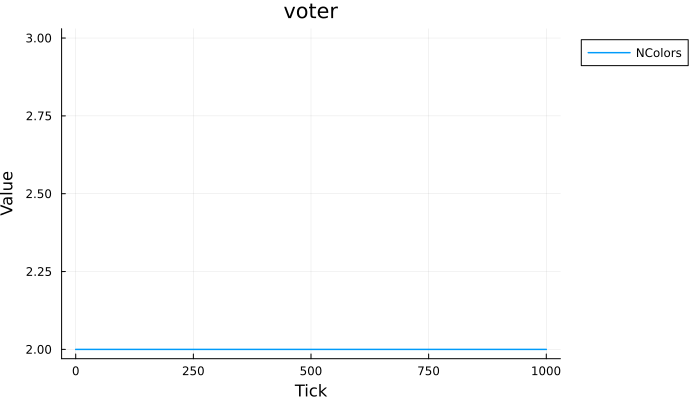
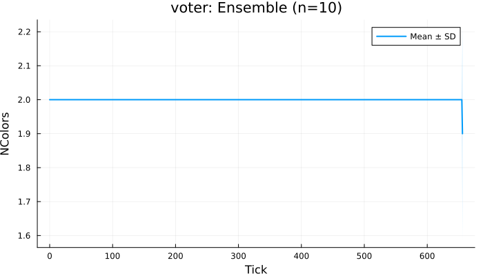

## Overview

This vignette demonstrates the **Voter Model** model implemented in [ArkModelZoo.jl](https://github.com/sdwfrost/ArkModelZoo.jl) using the Ark.jl ECS framework.

## Parameters

| Parameter | Type | Default | Description |
|-----------|------|---------|-------------|
| `grid_width` | `Int` | `50` | grid width |
| `grid_height` | `Int` | `50` | grid height |
| `max_ticks` | `Int` | `1000` | max ticks |

## Source Code

The Julia code to run this model:

```julia
using ArkModelZoo
_, trajectory = run_voter()
```

## Time Series

{width=100%}

## Ensemble Runs

Ten replicates with different random seeds, showing mean ± standard deviation.

{width=100%}


## Appendix: Source Code

This model is implemented in the [Ark.jl](https://github.com/sdwfrost/Ark.jl) Entity-Component-System (ECS) framework. The code is split into five files, each with a distinct role:

- **Parameters**: a mutable struct holding all configurable values.
- **Components**: lightweight data types attached to individual entities (agents).
- **Resources**: world-level shared state accessible to all systems.
- **Systems**: functions that operate on entities each tick, defining model behavior.
- **Model**: wiring that assembles the world, registers resources and systems, and provides the run entry point.

### Parameters (`parameters.jl`)

The parameter struct uses `@kwdef` so that every field has a default value and can be overridden by keyword. These defaults match the original NetLogo model's slider settings.

```julia
Base.@kwdef mutable struct VoterParams
    grid_width::Int = 50
    grid_height::Int = 50
    max_ticks::Int = 1000
    seed::Int = 42
end
```

### Components (`components.jl`)

Components are lightweight data types attached to individual entities (agents). Mutable structs hold per-entity state, while empty tag structs act as markers for the ECS query system to efficiently filter entities.

```julia
# Voter model has no entity components — purely patch-based
struct VoterDummy end
```

### Resources (`resources.jl`)

Resources are world-level singletons shared across all systems, used for global state and aggregate statistics.

```julia
mutable struct VoterGrid
    width::Int
    height::Int
    colors::Matrix{Int}  # 0 or 1 (two colors from pcolors list)
end
VoterGrid(w, h) = VoterGrid(w, h, zeros(Int, w, h))

mutable struct VoterStats
    n_colors::Int
end
VoterStats() = VoterStats(0)
```

### Systems (`systems.jl`)

Systems contain the model logic and execute in a defined order each tick. Each system struct implements either `initialize!` (run once at setup) or `update!` (run every tick).

```julia
# --- Initialization ---

struct InitVoterSystem <: System end

function initialize!(::InitVoterSystem, world::World)
    params = get_resource(world, VoterParams)
    rng = get_resource(world, RNGResource).rng
    grid = get_resource(world, VoterGrid)
    stats = get_resource(world, VoterStats)

    # Each patch gets random color 0 or 1 (representing two colors from pcolors)
    for x in 1:grid.width, y in 1:grid.height
        grid.colors[x, y] = rand(rng, 0:1)
    end

    # Count unique colors
    stats.n_colors = length(unique(grid.colors))
    return nothing
end

# --- Voter Update ---
# NetLogo: repeat N [ ask one-of patches [ set pcolor [pcolor] of one-of neighbors4 ] ]
# N individual random patch selections per tick; each copies a random Von Neumann neighbor's color.

struct VoterUpdateSystem <: System end

function update!(::VoterUpdateSystem, world::World)
    grid = get_resource(world, VoterGrid)
    rng = get_resource(world, RNGResource).rng
    w, h = grid.width, grid.height
    n = w * h

    for _ in 1:n
        # Pick a random patch
        x = rand(rng, 1:w)
        y = rand(rng, 1:h)

        # Pick a random Von Neumann neighbor (toroidal wrapping)
        dir = rand(rng, 1:4)
        nx, ny = if dir == 1
            (mod1(x - 1, w), y)       # left
        elseif dir == 2
            (mod1(x + 1, w), y)       # right
        elseif dir == 3
            (x, mod1(y - 1, h))       # down
        else
            (x, mod1(y + 1, h))       # up
        end

        grid.colors[x, y] = grid.colors[nx, ny]
    end
    return nothing
end

# --- Stats ---

struct VoterStatsSystem <: System end

function update!(::VoterStatsSystem, world::World)
    grid = get_resource(world, VoterGrid)
    stats = get_resource(world, VoterStats)
    stats.n_colors = length(unique(grid.colors))
    return nothing
end

# --- Termination ---

struct VoterTerminationSystem <: System end

function update!(::VoterTerminationSystem, world::World)
    stats = get_resource(world, VoterStats)
    params = get_resource(world, VoterParams)
    tick = get_resource(world, Tick)

    if stats.n_colors == 1 || tick.tick + 1 >= params.max_ticks
        get_resource(world, Terminate).stop = true
    end
    return nothing
end
```

### Model (`model.jl`)

The model file assembles all pieces: it creates the ECS `World` with the required component types, registers resources, builds the `Scheduler` with systems in execution order, and exposes the public `run` entry point. The observer pattern records the trajectory each tick.

```julia
function voter_world(; initial_capacity::Int = 128)
    return World(
        VoterDummy;
        initial_capacity = initial_capacity,
        allow_mutable = true,
    )
end

function voter_systems()
    return (
        InitVoterSystem(),
        VoterUpdateSystem(),
        VoterStatsSystem(),
        VoterTerminationSystem(),
    )
end

function voter_model(params::VoterParams = VoterParams())
    world = voter_world()
    _add_standard_resources!(world, params)
    add_resource!(world, VoterGrid(params.grid_width, params.grid_height))
    add_resource!(world, VoterStats())
    scheduler = Scheduler(world, voter_systems())
    initialize!(scheduler)
    return scheduler
end

struct VoterObserver end

function voter_headers(::VoterObserver)
    return ["NColors"]
end

function voter_values(::VoterObserver, world::World)
    stats = get_resource(world, VoterStats)
    return Float64[stats.n_colors]
end

function run_voter(; params::VoterParams = VoterParams(), observe::Bool = true)
    return _run_model(voter_model, VoterObserver(), voter_values; params, observe)
end
```
