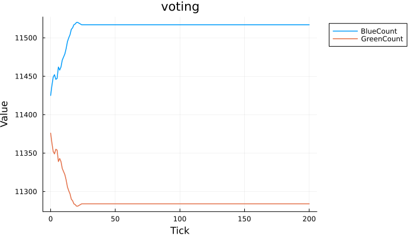
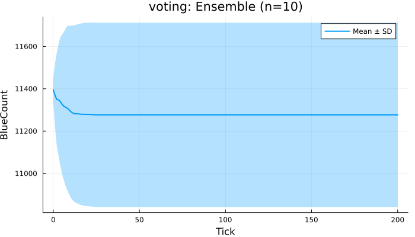

## Overview

### WHAT IS IT?

This model is a simple cellular automaton that simulates voting distribution by having each patch take a "vote" of its eight surrounding neighbors, then perhaps change its own vote according to the outcome.

### THINGS TO NOTICE

Watch how any setup quickly settles to a static state when both switches are off.

Watch what happens when only the CHANGE-VOTE-IF-TIED? switch is on.  How is the result different?

Watch what happens when only the AWARD-CLOSE-CALLS-TO-LOSER? switch is on.  How is the result different?

What happens when both switches are on?

### EXTENDING THE MODEL

Try other voting rules.

Start with a nonrandom green-and-blue pattern. For example, one could make half of the world blue and half green.

Can you enhance the model to incorporate multiple colors and multiple votes?  One might interpret shades of color to represent the degree of a patch's opinion about an issue: strongly against, against, neutral, etc.  Each patch could have more than two choices and weighted votes: blue patches' vote could count twice, etc.

### RELATED MODELS

Ising (a physics model, but the rules are very similar)

### CREDITS AND REFERENCES

This model is described in Rudy Rucker's "Artificial Life Lab", published in 1993 by Waite Group Press.

### HOW TO CITE

If you mention this model or the NetLogo software in a publication, we ask that you include the citations below.

For the model itself:

* Wilensky, U. (1998).  NetLogo Voting model.  http://ccl.northwestern.edu/netlogo/models/Voting.  Center for Connected Learning and Computer-Based Modeling, Northwestern University, Evanston, IL.

Please cite the NetLogo software as:

* Wilensky, U. (1999). NetLogo. http://ccl.northwestern.edu/netlogo/. Center for Connected Learning and Computer-Based Modeling, Northwestern University, Evanston, IL.

### COPYRIGHT AND LICENSE

Copyright 1998 Uri Wilensky.


This model is licensed under the Creative Commons Attribution-NonCommercial-ShareAlike 3.0 License.  To view a copy of this license, visit https://creativecommons.org/licenses/by-nc-sa/3.0/ or send a letter to Creative Commons, 559 Nathan Abbott Way, Stanford, California 94305, USA.

NetLogo itself is free software for non-commercial use under the terms of the GNU General Public License ([see full license information here](https://ccl.northwestern.edu/netlogo/docs/copyright.html)).

To inquire about commercial licenses for either NetLogo or specific models from the models library, please contact netlogo-commercial-admin@ccl.northwestern.edu.

This model was created as part of the project: CONNECTED MATHEMATICS: MAKING SENSE OF COMPLEX PHENOMENA THROUGH BUILDING OBJECT-BASED PARALLEL MODELS (OBPML).  The project gratefully acknowledges the support of the National Science Foundation (Applications of Advanced Technologies Program) -- grant numbers RED #9552950 and REC #9632612.

This model was converted to NetLogo as part of the projects: PARTICIPATORY SIMULATIONS: NETWORK-BASED DESIGN FOR SYSTEMS LEARNING IN CLASSROOMS and/or INTEGRATED SIMULATION AND MODELING ENVIRONMENT. The project gratefully acknowledges the support of the National Science Foundation (REPP & ROLE programs) -- grant numbers REC #9814682 and REC-0126227. Converted from StarLogoT to NetLogo, 2001.

<!-- 1998 2001 -->

## Parameters

| Parameter | Type | Default | Description |
|-----------|------|---------|-------------|
| `grid_width` | `Int` | `151` | -75..75 = 151 patches |
| `grid_height` | `Int` | `151` | grid height |
| `change_vote_if_tied` | `Bool` | `false` | change vote if tied |
| `award_close_calls_to_loser` | `Bool` | `false` | award close calls to loser |
| `max_ticks` | `Int` | `200` | max ticks |

## Source Code

The Julia code to run this model:

```julia
using ArkModelZoo
_, trajectory = run_voting()
```

## Time Series

{width=100%}

## Ensemble Runs

Ten replicates with different random seeds, showing mean ± standard deviation.

{width=100%}


## Appendix: Source Code

This model is implemented in the [Ark.jl](https://github.com/sdwfrost/Ark.jl) Entity-Component-System (ECS) framework. The code is split into five files, each with a distinct role:

- **Parameters**: a mutable struct holding all configurable values.
- **Components**: lightweight data types attached to individual entities (agents).
- **Resources**: world-level shared state accessible to all systems.
- **Systems**: functions that operate on entities each tick, defining model behavior.
- **Model**: wiring that assembles the world, registers resources and systems, and provides the run entry point.

### Parameters (`parameters.jl`)

The parameter struct uses `@kwdef` so that every field has a default value and can be overridden by keyword. These defaults match the original NetLogo model's slider settings.

```julia
Base.@kwdef mutable struct VOTParams
    grid_width::Int = 151         # -75..75 = 151 patches
    grid_height::Int = 151
    change_vote_if_tied::Bool = false
    award_close_calls_to_loser::Bool = false
    max_ticks::Int = 200
    seed::Int = 42
end
```

### Components (`components.jl`)

Components are lightweight data types attached to individual entities (agents). Mutable structs hold per-entity state, while empty tag structs act as markers for the ECS query system to efficiently filter entities.

```julia
# Voting is purely patch-based; no ECS agent components needed.
```

### Resources (`resources.jl`)

Resources are world-level singletons shared across all systems, used for global state and aggregate statistics.

```julia
mutable struct VOTGrid
    width::Int
    height::Int
    vote::Matrix{Int}        # 0 or 1
    total::Matrix{Int}       # sum of neighbor votes
end

function VOTGrid(w::Int, h::Int)
    VOTGrid(w, h, zeros(Int, w, h), zeros(Int, w, h))
end

mutable struct VOTStats
    blue_count::Int    # vote = 1
    green_count::Int   # vote = 0
end
VOTStats() = VOTStats(0, 0)
```

### Systems (`systems.jl`)

Systems contain the model logic and execute in a defined order each tick. Each system struct implements either `initialize!` (run once at setup) or `update!` (run every tick).

```julia
# --- Initialization ---

struct InitVOTSystem <: System end

function initialize!(::InitVOTSystem, world::World)
    rng = get_resource(world, RNGResource).rng
    grid = get_resource(world, VOTGrid)
    w, h = grid.width, grid.height

    for x in 1:w, y in 1:h
        grid.vote[x, y] = rand(rng, 0:1)
    end

    _vot_update_stats!(world)
    return nothing
end

# --- Go ---

struct VOTGoSystem <: System end

function update!(::VOTGoSystem, world::World)
    params = get_resource(world, VOTParams)
    grid = get_resource(world, VOTGrid)
    w, h = grid.width, grid.height

    # Phase 1: compute totals (sum of 8 neighbors' votes)
    for x in 1:w, y in 1:h
        grid.total[x, y] = moore_neighbor_sum(grid.vote, x, y, w, h)
    end

    # Phase 2: update votes based on totals
    for x in 1:w, y in 1:h
        t = grid.total[x, y]
        if t > 5
            grid.vote[x, y] = 1
        elseif t < 3
            grid.vote[x, y] = 0
        elseif t == 4
            if params.change_vote_if_tied
                grid.vote[x, y] = 1 - grid.vote[x, y]
            end
        elseif t == 5
            if params.award_close_calls_to_loser
                grid.vote[x, y] = 0
            else
                grid.vote[x, y] = 1
            end
        elseif t == 3
            if params.award_close_calls_to_loser
                grid.vote[x, y] = 1
            else
                grid.vote[x, y] = 0
            end
        end
    end

    _vot_update_stats!(world)
    return nothing
end

function _vot_update_stats!(world::World)
    grid = get_resource(world, VOTGrid)
    stats = get_resource(world, VOTStats)
    blue = 0
    green = 0
    for x in 1:grid.width, y in 1:grid.height
        if grid.vote[x, y] == 1
            blue += 1
        else
            green += 1
        end
    end
    stats.blue_count = blue
    stats.green_count = green
end

# --- Termination ---

struct VOTTerminationSystem <: System end

function update!(::VOTTerminationSystem, world::World)
    params = get_resource(world, VOTParams)
    tick = get_resource(world, Tick)
    if tick.tick + 1 >= params.max_ticks
        get_resource(world, Terminate).stop = true
    end
    return nothing
end
```

### Model (`model.jl`)

The model file assembles all pieces: it creates the ECS `World` with the required component types, registers resources, builds the `Scheduler` with systems in execution order, and exposes the public `run` entry point. The observer pattern records the trajectory each tick.

```julia
function vot_world(; initial_capacity::Int = 64)
    return World(; initial_capacity = initial_capacity, allow_mutable = true)
end

function vot_systems()
    return (
        InitVOTSystem(),
        VOTGoSystem(),
        VOTTerminationSystem(),
    )
end

function vot_model(params::VOTParams = VOTParams())
    world = vot_world()
    _add_standard_resources!(world, params)
    add_resource!(world, VOTGrid(params.grid_width, params.grid_height))
    add_resource!(world, VOTStats())
    scheduler = Scheduler(world, vot_systems())
    initialize!(scheduler)
    return scheduler
end

struct VOTObserver end

function vot_headers(::VOTObserver)
    return ["BlueCount", "GreenCount"]
end

function vot_values(::VOTObserver, world::World)
    stats = get_resource(world, VOTStats)
    return Float64[Float64(stats.blue_count), Float64(stats.green_count)]
end

function run_voting(; params::VOTParams = VOTParams(), observe::Bool = true)
    return _run_model(vot_model, VOTObserver(), vot_values; params, observe)
end
```
