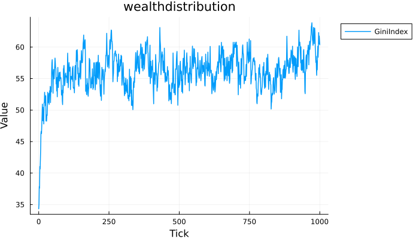
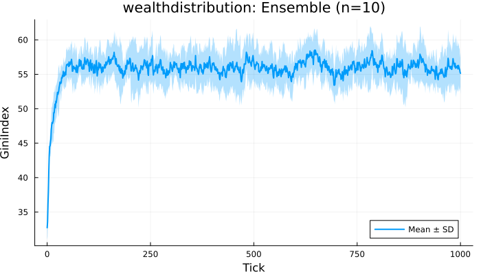
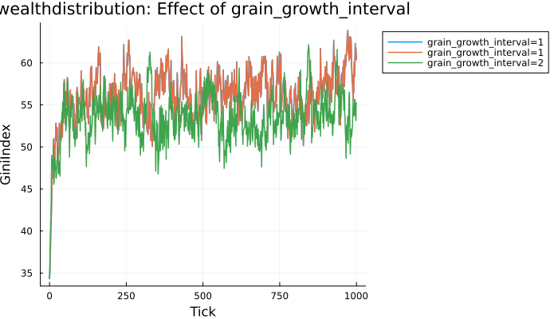

# Wealth Distribution


- [Overview](#overview)
  - [WHAT IS IT?](#what-is-it)
  - [HOW IT WORKS](#how-it-works)
  - [THINGS TO NOTICE](#things-to-notice)
  - [THINGS TO TRY](#things-to-try)
  - [EXTENDING THE MODEL](#extending-the-model)
  - [NETLOGO FEATURES](#netlogo-features)
  - [CREDITS AND REFERENCES](#credits-and-references)
  - [HOW TO CITE](#how-to-cite)
  - [COPYRIGHT AND LICENSE](#copyright-and-license)
- [Parameters](#parameters)
- [Source Code](#source-code)
- [Time Series](#time-series)
- [Ensemble Runs](#ensemble-runs)
- [Parameter Sensitivity](#parameter-sensitivity)
- [Appendix: Source Code](#appendix-source-code)
  - [Parameters (`parameters.jl`)](#parameters-parametersjl)
  - [Components (`components.jl`)](#components-componentsjl)
  - [Resources (`resources.jl`)](#resources-resourcesjl)
  - [Systems (`systems.jl`)](#systems-systemsjl)
  - [Model (`model.jl`)](#model-modeljl)

## Overview

### WHAT IS IT?

This model simulates the distribution of wealth. “The rich get richer
and the poor get poorer” is a familiar saying that expresses inequity in
the distribution of wealth. In this simulation, we see Pareto’s law, in
which there are a large number of “poor” or red people, fewer “middle
class” or green people, and many fewer “rich” or blue people.

### HOW IT WORKS

This model is adapted from Epstein & Axtell’s “Sugarscape” model. It
uses grain instead of sugar. Each patch has an amount of grain and a
grain capacity (the amount of grain it can grow). People collect grain
from the patches, and eat the grain to survive. How much grain each
person accumulates is his or her wealth.

The model begins with a roughly equal wealth distribution. The people
then wander around the landscape gathering as much grain as they can.
Each person attempts to move in the direction where the most grain lies.
Each time tick, each person eats a certain amount of grain. This amount
is called their metabolism. People also have a life expectancy. When
their lifespan runs out, or they run out of grain, they die and produce
a single offspring. The offspring has a random metabolism and a random
amount of grain, ranging from the poorest person’s amount of grain to
the richest person’s amount of grain. (There is no inheritance of
wealth.)

To observe the equity (or the inequity) of the distribution of wealth, a
graphical tool called the Lorenz curve is utilized. We rank the
population by their wealth and then plot the percentage of the
population that owns each percentage of the wealth (e.g. 30% of the
wealth is owned by 50% of the population). Hence the ranges on both axes
are from 0% to 100%.

Another way to understand the Lorenz curve is to imagine a society of
100 people with a fixed amount of wealth available. Each individual is
1% of the population. Rank the individuals in order of their wealth from
greatest to least: the poorest individual would have the lowest ranking
of 1 and so forth. Then plot the proportion of the rank of an individual
on the y-axis and the portion of wealth owned by this particular
individual and all the individuals with lower rankings on the x-axis.
For example, individual Y with a ranking of 20 (20th poorest in society)
would have a percentage ranking of 20% in a society of 100 people (or
100 rankings) — this is the point on the y-axis. The corresponding plot
on the x-axis is the proportion of the wealth that this individual with
ranking 20 owns along with the wealth owned by all the individuals with
lower rankings (from rankings 1 to 19). A straight line with a 45 degree
incline at the origin (or slope of 1) is a Lorenz curve that represents
perfect equality — everyone holds an equal part of the available wealth.
On the other hand, should only one family or one individual hold all of
the wealth in the population (i.e. perfect inequity), then the Lorenz
curve will be a backwards “L” where 100% of the wealth is owned by the
last percentage proportion of the population. In practice, the Lorenz
curve actually falls somewhere between the straight 45 degree line and
the backwards “L”.

For a numerical measurement of the inequity in the distribution of
wealth, the Gini index (or Gini coefficient) is derived from the Lorenz
curve. To calculate the Gini index, find the area between the 45 degree
line of perfect equality and the Lorenz curve. Divide this quantity by
the total area under the 45 degree line of perfect equality (this number
is always 0.5 — the area of 45-45-90 triangle with sides of length 1).
If the Lorenz curve is the 45 degree line then the Gini index would be
0; there is no area between the Lorenz curve and the 45 degree line. If,
however, the Lorenz curve is a backwards “L”, then the Gini-Index would
be 1 — the area between the Lorenz curve and the 45 degree line is 0.5;
this quantity divided by 0.5 is 1. Hence, equality in the distribution
of wealth is measured on a scale of 0 to 1 — more inequity as one
travels up the scale. Another way to understand (and equivalently
compute) the Gini index, without reference to the Lorenz curve, is to
think of it as the mean difference in wealth between all possible pairs
of people in the population, expressed as a proportion of the average
wealth (see Deltas, 2003 for more).

### THINGS TO NOTICE

Notice the distribution of wealth. Are the classes equal?

This model usually demonstrates Pareto’s Law, in which most of the
people are poor, fewer are middle class, and very few are rich. Why does
this happen?

Do poor families seem to stay poor? What about the rich and the middle
class people?

Watch the CLASS PLOT to see how long it takes for the classes to reach
stable values.

As time passes, does the distribution get more equalized or more skewed?
(Hint: observe the Gini index plot.)

Try to find resources from the U.S. Government Census Bureau for the
U.S.’s Gini coefficient. Are the Gini coefficients that you calculate
from the model comparable to those of the Census Bureau? Why or why not?

Is there a trend in the plotting of the Gini index with respect to time?
Does the plot oscillate? Or does it stabilize to a certain number?

### THINGS TO TRY

Are there any settings that do not result in a demonstration of Pareto’s
Law?

Play with the NUM-GRAIN-GROWN slider, and see how this affects the
distribution of wealth.

How much does the LIFE-EXPECTANCY-MAX matter?

Change the value of the MAX-GRAIN variable (in the `setup` procedure in
the Code tab). Do outcomes differ?

Experiment with the PERCENT-BEST-LAND and NUM-PEOPLE sliders. How do
these affect the outcome of the distribution of wealth?

Try having all the people start in one location. See what happens.

Try setting everyone’s initial wealth as being equal. Does the initial
endowment of an individual still arrive at an unequal distribution in
wealth? Is it less so when setting random initial wealth for each
individual?

Try setting all the individual’s wealth and vision to being equal. Do
you still arrive at an unequal distribution of wealth? Is it more equal
in the measure of the Gini index than with random endowments of vision?

### EXTENDING THE MODEL

Have each newborn inherit a percentage of the wealth of its parent.

Add a switch or slider which has the patches grow back all or a
percentage of their grain capacity, rather than just one unit of grain.

Allow the grain to give an advantage or disadvantage to its carrier,
such as every time some grain is eaten or harvested, pollution is
created.

Would this model be the same if the wealth were randomly distributed (as
opposed to a gradient)? Try different landscapes, making SETUP buttons
for each new landscape.

Try allowing metabolism or vision or another characteristic to be
inherited. Will we see any sort of evolution? Will the “fittest”
survive? If not, why not?

We said above that “there is no inheritance of wealth” in the model, but
that is not entirely true. New turtles are born in the same location as
their parents. If grain is plentiful relative to the population at this
location, they inherit a good starting situation. Try moving the turtles
to a random patch when they are born. Does that lead to a more equitable
distribution of wealth?

Try adding in seasons into the model. That is to say have the grain grow
better in a section of the landscape during certain times and worse at
others.

How could you change the model to achieve wealth equality?

The way the procedures are set up now, one person will sometimes follow
another. You can see this by setting the number of people relatively
low, such as 50 or 100, and having a long life expectancy. Why does this
phenomenon happen? Try adding code to prevent this from occurring.
(Hint: When and how do people check to see which direction they should
move in?)

### NETLOGO FEATURES

Examine how the landscape of color is created — note the use of the
`scale-color` reporter. Each patch is given a value, and `scale-color`
reports a color for each patch that is scaled according to its value.

Note the use of lists in drawing the Lorenz Curve and computing the Gini
index.

### CREDITS AND REFERENCES

This model is based on a model described in Epstein, J. & Axtell R.
(1996). Growing Artificial Societies: Social Science from the Bottom Up.
Washington, DC: Brookings Institution Press.

For an explanation of Pareto’s Law, see
https://en.wikipedia.org/wiki/Pareto_principle.

For more on the calculation of the Gini index see:

- Deltas, George (2003). The Small-Sample Bias of the Gini Coefficient:
  Results and Implications for Empirical Research. The Review of
  Economics and Statistics, February 2003, 85(1): 226-234.

In particular, note that if one is calculating the Gini index of a
sample for the purpose of estimating the value for a larger population,
a small correction factor to the method used here may be needed for
small samples.

### HOW TO CITE

If you mention this model or the NetLogo software in a publication, we
ask that you include the citations below.

For the model itself:

- Wilensky, U. (1998). NetLogo Wealth Distribution model.
  http://ccl.northwestern.edu/netlogo/models/WealthDistribution. Center
  for Connected Learning and Computer-Based Modeling, Northwestern
  University, Evanston, IL.

Please cite the NetLogo software as:

- Wilensky, U. (1999). NetLogo. http://ccl.northwestern.edu/netlogo/.
  Center for Connected Learning and Computer-Based Modeling,
  Northwestern University, Evanston, IL.

### COPYRIGHT AND LICENSE

Copyright 1998 Uri Wilensky.


This model is licensed under the Creative Commons
Attribution-NonCommercial-ShareAlike 3.0 License. To view a copy of this
license, visit https://creativecommons.org/licenses/by-nc-sa/3.0/ or
send a letter to Creative Commons, 559 Nathan Abbott Way, Stanford,
California 94305, USA.

NetLogo itself is free software for non-commercial use under the terms
of the GNU General Public License ([see full license information
here](https://ccl.northwestern.edu/netlogo/docs/copyright.html)).

To inquire about commercial licenses for either NetLogo or specific
models from the models library, please contact
netlogo-commercial-admin@ccl.northwestern.edu.

This model was created as part of the project: CONNECTED MATHEMATICS:
MAKING SENSE OF COMPLEX PHENOMENA THROUGH BUILDING OBJECT-BASED PARALLEL
MODELS (OBPML). The project gratefully acknowledges the support of the
National Science Foundation (Applications of Advanced Technologies
Program) – grant numbers RED \#9552950 and REC \#9632612.

This model was converted to NetLogo as part of the projects:
PARTICIPATORY SIMULATIONS: NETWORK-BASED DESIGN FOR SYSTEMS LEARNING IN
CLASSROOMS and/or INTEGRATED SIMULATION AND MODELING ENVIRONMENT. The
project gratefully acknowledges the support of the National Science
Foundation (REPP & ROLE programs) – grant numbers REC \#9814682 and
REC-0126227. Converted from StarLogoT to NetLogo, 2001.

<!-- 1998 2001 -->

## Parameters

| Parameter               | Type      | Default | Description           |
|-------------------------|-----------|---------|-----------------------|
| `grid_width`            | `Int`     | `31`    | -15..15 → 31          |
| `grid_height`           | `Int`     | `31`    | grid height           |
| `grain_growth_interval` | `Int`     | `1`     | grain growth interval |
| `life_expectancy_max`   | `Int`     | `83`    | life expectancy max   |
| `life_expectancy_min`   | `Int`     | `1`     | life expectancy min   |
| `max_vision`            | `Int`     | `5`     | max vision            |
| `metabolism_max`        | `Int`     | `15`    | metabolism max        |
| `num_grain_grown`       | `Int`     | `4`     | num grain grown       |
| `num_people`            | `Int`     | `250`   | num people            |
| `percent_best_land`     | `Float64` | `10.0`  | percent best land     |
| `max_grain`             | `Int`     | `50`    | max grain             |
| `max_ticks`             | `Int`     | `1000`  | max ticks             |

## Source Code

The Julia code to run this model:

``` julia
using ArkModelZoo
_, trajectory = run_wealthdistribution()
```

## Time Series



## Ensemble Runs

Ten replicates with different random seeds, showing mean ± standard
deviation.



## Parameter Sensitivity

Varying `grain_growth_interval`.



## Appendix: Source Code

This model is implemented in the
[Ark.jl](https://github.com/sdwfrost/Ark.jl) Entity-Component-System
(ECS) framework. The code is split into five files, each with a distinct
role:

- **Parameters**: a mutable struct holding all configurable values.
- **Components**: lightweight data types attached to individual entities
  (agents).
- **Resources**: world-level shared state accessible to all systems.
- **Systems**: functions that operate on entities each tick, defining
  model behavior.
- **Model**: wiring that assembles the world, registers resources and
  systems, and provides the run entry point.

### Parameters (`parameters.jl`)

The parameter struct uses `@kwdef` so that every field has a default
value and can be overridden by keyword. These defaults match the
original NetLogo model’s slider settings.

``` julia
Base.@kwdef mutable struct WDParams
    grid_width::Int = 31            # -15..15 → 31
    grid_height::Int = 31
    grain_growth_interval::Int = 1
    life_expectancy_max::Int = 83
    life_expectancy_min::Int = 1
    max_vision::Int = 5
    metabolism_max::Int = 15
    num_grain_grown::Int = 4
    num_people::Int = 250
    percent_best_land::Float64 = 10.0
    max_grain::Int = 50
    max_ticks::Int = 1000
    seed::Int = 42
end
```

### Components (`components.jl`)

Components are lightweight data types attached to individual entities
(agents). Mutable structs hold per-entity state, while empty tag structs
act as markers for the ECS query system to efficiently filter entities.

``` julia
# Grid position (integer coords, 1-based)
mutable struct WDPosition
    x::Int
    y::Int
end
WDPosition() = WDPosition(1, 1)

# Heading: 0=North, 90=East, 180=South, 270=West
mutable struct WDHeading
    heading::Int
end
WDHeading() = WDHeading(0)

mutable struct WDTurtle
    age::Int
    wealth::Int
    life_expectancy::Int
    metabolism::Int
    vision::Int
end
WDTurtle() = WDTurtle(0, 0, 0, 0, 0)

struct WDTag end
```

### Resources (`resources.jl`)

Resources are world-level singletons shared across all systems, used for
global state and aggregate statistics.

``` julia
mutable struct WDGrid
    width::Int
    height::Int
    grain_here::Matrix{Float64}
    max_grain_here::Matrix{Float64}
end

function WDGrid(width::Int, height::Int)
    WDGrid(width, height, zeros(Float64, width, height), zeros(Float64, width, height))
end

mutable struct WDStats
    gini_index_reserve::Float64
end
WDStats() = WDStats(0.0)
```

### Systems (`systems.jl`)

Systems contain the model logic and execute in a defined order each
tick. Each system struct implements either `initialize!` (run once at
setup) or `update!` (run every tick).

``` julia
# --- Initialization ---

struct InitWDSystem <: System end

function initialize!(::InitWDSystem, world::World)
    params = get_resource(world, WDParams)
    rng = get_resource(world, RNGResource).rng
    grid = get_resource(world, WDGrid)
    w, h = grid.width, grid.height

    # setup-patches: assign best land, diffuse grain
    for x in 1:w, y in 1:h
        grid.max_grain_here[x, y] = 0.0
        if rand(rng) * 100.0 <= params.percent_best_land
            grid.max_grain_here[x, y] = Float64(params.max_grain)
            grid.grain_here[x, y] = Float64(params.max_grain)
        end
    end

    # repeat 5 [ ask patches with [max-grain-here != 0] [set grain-here max-grain-here]; diffuse grain-here 0.25 ]
    for _ in 1:5
        for x in 1:w, y in 1:h
            if grid.max_grain_here[x, y] != 0.0
                grid.grain_here[x, y] = grid.max_grain_here[x, y]
            end
        end
        diffuse!(grid.grain_here, 0.25, w, h)
    end

    # repeat 10 [ diffuse grain-here 0.25 ]
    for _ in 1:10
        diffuse!(grid.grain_here, 0.25, w, h)
    end

    # ask patches [ set grain-here floor grain-here; set max-grain-here grain-here ]
    for x in 1:w, y in 1:h
        grid.grain_here[x, y] = floor(grid.grain_here[x, y])
        grid.max_grain_here[x, y] = grid.grain_here[x, y]
    end

    # setup-turtles
    for _ in 1:params.num_people
        px = rand(rng, 1:w)
        py = rand(rng, 1:h)
        heading = rand(rng, [0, 90, 180, 270])
        le = params.life_expectancy_min + rand(rng, 0:(params.life_expectancy_max - params.life_expectancy_min))
        met = 1 + rand(rng, 0:params.metabolism_max - 1)
        wealth = met + rand(rng, 0:49)
        vis = 1 + rand(rng, 0:params.max_vision - 1)
        age = rand(rng, 0:le - 1)
        new_entity!(world, (
            WDPosition(px, py),
            WDHeading(heading),
            WDTurtle(age, wealth, le, met, vis),
            WDTag(),
        ))
    end

    # Initial Gini
    update!(WDGiniSystem(), world)
    return nothing
end

# --- Turn Towards Grain ---
# Each turtle looks N/E/S/W along its vision and picks the direction with most total grain

struct WDTurnSystem <: System end

function update!(::WDTurnSystem, world::World)
    rng = get_resource(world, RNGResource).rng
    grid = get_resource(world, WDGrid)
    w, h = grid.width, grid.height

    for (eids, positions, headings, turtles) in Query(world, (WDPosition, WDHeading, WDTurtle); with=(WDTag,))
        indices = collect(eachindex(positions))
        Random.shuffle!(rng, indices)
        @inbounds for i in indices
            pos = positions[i]
            vis = turtles[i].vision
            best_dir = 0
            best_amount = _wd_grain_ahead(grid, pos.x, pos.y, 0, vis, w, h)
            for dir in (90, 180, 270)
                amt = _wd_grain_ahead(grid, pos.x, pos.y, dir, vis, w, h)
                if amt > best_amount
                    best_dir = dir
                    best_amount = amt
                end
            end
            headings[i].heading = best_dir
        end
    end
    return nothing
end

function _wd_grain_ahead(grid::WDGrid, x::Int, y::Int, heading::Int, vision::Int, w::Int, h::Int)
    total = 0.0
    dx, dy = _wd_heading_delta(heading)
    cx, cy = x, y
    for _ in 1:vision
        cx = mod1(cx + dx, w)
        cy = mod1(cy + dy, h)
        total += grid.grain_here[cx, cy]
    end
    return total
end

function _wd_heading_delta(heading::Int)
    if heading == 0
        return (0, 1)   # North: y+1
    elseif heading == 90
        return (1, 0)   # East: x+1
    elseif heading == 180
        return (0, -1)  # South: y-1
    else  # 270
        return (-1, 0)  # West: x-1
    end
end

# --- Harvest ---
# First pass: all turtles gain floor(grain / num_turtles_here)
# Second pass: all turtles zero the grain on their patch

struct WDHarvestSystem <: System end

function update!(::WDHarvestSystem, world::World)
    grid = get_resource(world, WDGrid)

    # Build count of turtles per cell
    w, h = grid.width, grid.height
    counts = zeros(Int, w, h)
    for (_, positions) in Query(world, (WDPosition,); with=(WDTag,))
        @inbounds for i in eachindex(positions)
            counts[positions[i].x, positions[i].y] += 1
        end
    end

    # First pass: distribute grain
    for (_, positions, _, turtles) in Query(world, (WDPosition, WDHeading, WDTurtle); with=(WDTag,))
        @inbounds for i in eachindex(positions)
            px, py = positions[i].x, positions[i].y
            c = counts[px, py]
            if c > 0
                turtles[i].wealth = floor(Int, turtles[i].wealth + grid.grain_here[px, py] / c)
            end
        end
    end

    # Second pass: zero grain
    for (_, positions) in Query(world, (WDPosition,); with=(WDTag,))
        @inbounds for i in eachindex(positions)
            grid.grain_here[positions[i].x, positions[i].y] = 0.0
        end
    end
    return nothing
end

# --- Move, Eat, Age, Die ---
# fd 1 in heading direction, subtract metabolism, increment age, if dead: reset

struct WDMoveEatAgeDieSystem <: System end

function update!(::WDMoveEatAgeDieSystem, world::World)
    params = get_resource(world, WDParams)
    rng = get_resource(world, RNGResource).rng
    grid = get_resource(world, WDGrid)
    w, h = grid.width, grid.height

    for (eids, positions, headings, turtles) in Query(world, (WDPosition, WDHeading, WDTurtle); with=(WDTag,))
        indices = collect(eachindex(positions))
        Random.shuffle!(rng, indices)
        @inbounds for i in indices
            # fd 1
            dx, dy = _wd_heading_delta(headings[i].heading)
            positions[i].x = mod1(positions[i].x + dx, w)
            positions[i].y = mod1(positions[i].y + dy, h)

            # Consume metabolism
            turtles[i].wealth -= turtles[i].metabolism
            turtles[i].age += 1

            # Death check: reset turtle stats (constant population)
            # NetLogo: set-initial-turtle-vars — does NOT relocate, turtle stays
            if turtles[i].wealth < 0 || turtles[i].age >= turtles[i].life_expectancy
                headings[i].heading = rand(rng, [0, 90, 180, 270])
                turtles[i].life_expectancy = params.life_expectancy_min + rand(rng, 0:(params.life_expectancy_max - params.life_expectancy_min))
                turtles[i].metabolism = 1 + rand(rng, 0:params.metabolism_max - 1)
                turtles[i].wealth = turtles[i].metabolism + rand(rng, 0:49)
                turtles[i].vision = 1 + rand(rng, 0:params.max_vision - 1)
                turtles[i].age = rand(rng, 0:turtles[i].life_expectancy - 1)
            end
        end
    end
    return nothing
end

# --- Grow Grain ---

struct WDGrowGrainSystem <: System end

function update!(::WDGrowGrainSystem, world::World)
    params = get_resource(world, WDParams)
    tick = get_resource(world, Tick)
    grid = get_resource(world, WDGrid)

    # NetLogo: if ticks mod grain-growth-interval = 0
    if tick.tick % params.grain_growth_interval == 0
        for x in 1:grid.width, y in 1:grid.height
            if grid.grain_here[x, y] < grid.max_grain_here[x, y]
                grid.grain_here[x, y] = min(
                    grid.grain_here[x, y] + params.num_grain_grown,
                    grid.max_grain_here[x, y]
                )
            end
        end
    end
    return nothing
end

# --- Gini Computation ---

struct WDGiniSystem <: System end

function update!(::WDGiniSystem, world::World)
    params = get_resource(world, WDParams)
    stats = get_resource(world, WDStats)

    # Collect all wealths
    wealths = Int[]
    for (_, _, _, turtles) in Query(world, (WDPosition, WDHeading, WDTurtle); with=(WDTag,))
        @inbounds for i in eachindex(turtles)
            push!(wealths, turtles[i].wealth)
        end
    end

    sort!(wealths)
    n = length(wealths)
    total_wealth = sum(wealths)

    gini = 0.0
    wealth_sum_so_far = 0.0
    for idx in 1:n
        wealth_sum_so_far += wealths[idx]
        gini += (idx / n) - (wealth_sum_so_far / total_wealth)
    end

    stats.gini_index_reserve = gini
    return nothing
end

# --- Termination ---

struct WDTerminationSystem <: System end

function update!(::WDTerminationSystem, world::World)
    params = get_resource(world, WDParams)
    tick = get_resource(world, Tick)
    if tick.tick + 1 >= params.max_ticks
        get_resource(world, Terminate).stop = true
    end
    return nothing
end
```

### Model (`model.jl`)

The model file assembles all pieces: it creates the ECS `World` with the
required component types, registers resources, builds the `Scheduler`
with systems in execution order, and exposes the public `run` entry
point. The observer pattern records the trajectory each tick.

``` julia
function wealthdistribution_world(; initial_capacity::Int = 4096)
    return World(
        WDPosition,
        WDHeading,
        WDTurtle,
        WDTag;
        initial_capacity = initial_capacity,
        allow_mutable = true,
    )
end

function wealthdistribution_systems()
    return (
        InitWDSystem(),
        WDTurnSystem(),
        WDHarvestSystem(),
        WDMoveEatAgeDieSystem(),
        WDGrowGrainSystem(),
        WDGiniSystem(),
        WDTerminationSystem(),
    )
end

function wealthdistribution_model(params::WDParams = WDParams())
    world = wealthdistribution_world()
    _add_standard_resources!(world, params)
    add_resource!(world, WDGrid(params.grid_width, params.grid_height))
    add_resource!(world, WDStats())
    scheduler = Scheduler(world, wealthdistribution_systems())
    initialize!(scheduler)
    return scheduler
end

struct WDObserver end

function wealthdistribution_headers(::WDObserver)
    return ["GiniIndex"]
end

function wealthdistribution_values(::WDObserver, world::World)
    stats = get_resource(world, WDStats)
    return Float64[stats.gini_index_reserve]
end

function run_wealthdistribution(; params::WDParams = WDParams(), observe::Bool = true)
    return _run_model(wealthdistribution_model, WDObserver(), wealthdistribution_values; params, observe)
end
```
