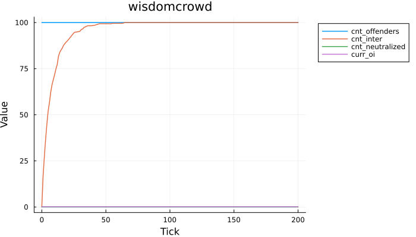
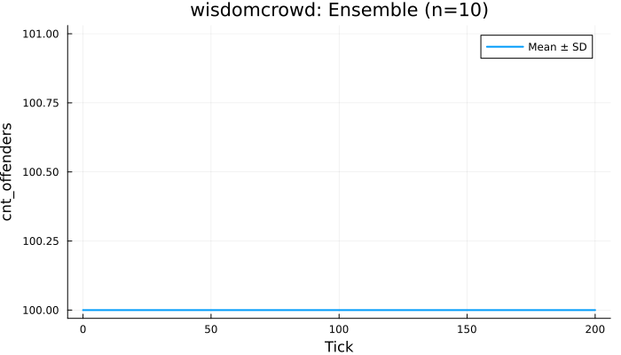
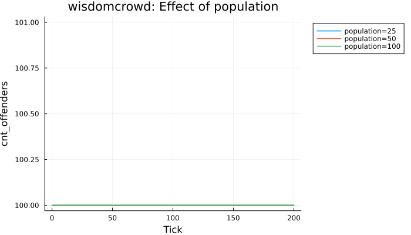

## Overview

### WHAT IS IT?

A model of bystanders' effect on volunteering (in case of an observed crime or critical situation) is extended to incorporate the possibility of a sense of guilt (after nonintervention). Based on sound theoretical and experimental foundations, an existing model of the spread of unpopular norms is used to allow dispersion of an unpopular norm (a mild crime) so that a population of agents may follow or accept it. The question asked is why a society (as a whole) is not able to overturn an unpopular norm through interventions. The model and simulation reveal that a sense of guilt of bystanders improves the volunteering tendency. The simulation results also provide pieces of evidence of clear differentiation between the individual and societal perception of a crime. This is an important result as it suggests that, in a certain situation and community, we can predict how people will react against an unpopular norm.

### HOW IT WORKS

A model to study dynamics of co-evolution of the spread of Unpopular norms and guilt-driven volunteering (to intervene). In addition to the time dynamics, we have also introduced spatial dynamics, which allow the agents to have the capability to move (along with their states). The form of mobility introduced is random-walk.

### THINGS TO NOTICE

#### UN alone

1. As the radius of interaction increase, the DBs who end up complying the UN increase. 
2. Within a radius, as the initial \% age of TBs increase, the DBs who end up complying the UN increase. 
3. Compliance jumps to highest level right at the start and then keep fluctuating across this highest level.
4. As the population density increases, the DBs who end up complying the UN increase.

#### VD alone

1. As the radius of interaction increase, the believers who end up as being neutralized by the volunteering effect decrease substantially. 
2. Within a radius, as the initial \% age of TBs increase, the neutralization is rather unclear (no relationship can be drawn). 
3. Neutralization happens progressively (and in phases) with time and then stays constant.
4. As the population density increases, neutralization tendency decreases.  

#### Combined

A sense of guilt of bystanders improves the volunteering tendency as the spread of UN happens.

### CREDITS AND REFERENCES

To appear: "When the Wisdom of Crowd is able to overturn an Unpopular Norm? Lessons learned from an Agent-Based Simulation" in ACM SIGSIM PADS 2021 scheduled on June 2021 (https://www.acm-sigsim-pads.org/).

## Parameters

| Parameter | Type | Default | Description |
|-----------|------|---------|-------------|
| `population` | `Int` | `50` | population |
| `tb_perc` | `Int` | `15` | tb perc |
| `K` | `Float64` | `0.5` | K |
| `threshold` | `Float64` | `0.5` | threshold |
| `radius` | `Float64` | `2.0` | radius |
| `crime_intensity` | `Int` | `3` | crime intensity |
| `alpha` | `Float64` | `0.5` | alpha |
| `norm` | `Float64` | `0.5` | norm |
| `mobility` | `Bool` | `true` | mobility |
| `incorporate_guilt` | `Bool` | `false` | incorporate guilt |
| `max_ticks` | `Int` | `200` | max ticks |

## Source Code

The Julia code to run this model:

```julia
using ArkModelZoo
_, trajectory = run_wisdomcrowd()
```

## Time Series

{width=100%}

## Ensemble Runs

Ten replicates with different random seeds, showing mean ± standard deviation.

{width=100%}

## Parameter Sensitivity

Varying `population`.

{width=100%}


## Appendix: Source Code

This model is implemented in the [Ark.jl](https://github.com/sdwfrost/Ark.jl) Entity-Component-System (ECS) framework. The code is split into five files, each with a distinct role:

- **Parameters**: a mutable struct holding all configurable values.
- **Components**: lightweight data types attached to individual entities (agents).
- **Resources**: world-level shared state accessible to all systems.
- **Systems**: functions that operate on entities each tick, defining model behavior.
- **Model**: wiring that assembles the world, registers resources and systems, and provides the run entry point.

### Parameters (`parameters.jl`)

The parameter struct uses `@kwdef` so that every field has a default value and can be overridden by keyword. These defaults match the original NetLogo model's slider settings.

```julia
Base.@kwdef mutable struct WCParams
    population::Int = 50
    tb_perc::Int = 15
    K::Float64 = 0.5
    threshold::Float64 = 0.5
    radius::Float64 = 2.0
    crime_intensity::Int = 3
    alpha::Float64 = 0.5
    norm::Float64 = 0.5
    mobility::Bool = true
    incorporate_guilt::Bool = false
    max_ticks::Int = 200
    seed::Int = 42
end
```

### Components (`components.jl`)

Components are lightweight data types attached to individual entities (agents). Mutable structs hold per-entity state, while empty tag structs act as markers for the ECS query system to efficiently filter entities.

```julia
struct WCDummy end
```

### Resources (`resources.jl`)

Resources are world-level singletons shared across all systems, used for global state and aggregate statistics.

```julia
mutable struct WCState
    n_agents::Int
    x::Vector{Float64}
    y::Vector{Float64}
    heading::Vector{Float64}
    belief::Vector{Int}          # 1 (believer) or -1 (disbeliever)
    compliance::Vector{Int}      # 1 or -1
    strength::Vector{Float64}
    complying_for::Vector{Int}
    property::Vector{Symbol}     # :offender, :bystanders, :intervener, :neutralized
    offender_index::Vector{Float64}
    perform_intervention::Vector{Bool}
    my_thresholds::Vector{Float64}
    seriousness::Vector{Float64}
    n_believers::Int
    n_disbelievers::Int
end

function WCState()
    WCState(0,
        Float64[], Float64[], Float64[],
        Int[], Int[], Float64[], Int[],
        Symbol[], Float64[], Bool[], Float64[], Float64[],
        0, 0)
end

mutable struct WCStats
    cnt_offenders::Float64
    cnt_inter::Float64
    cnt_neutralized::Float64
    curr_oi::Float64
end
WCStats() = WCStats(0.0, 0.0, 0.0, 0.0)
```

### Systems (`systems.jl`)

Systems contain the model logic and execute in a defined order each tick. Each system struct implements either `initialize!` (run once at setup) or `update!` (run every tick).

```julia
# --- Constants ---

const _WC_SPAN = 33
const _WC_HALF = 16.5

# --- Helpers ---

function _wc_wrap(v::Float64)
    return mod(v + _WC_HALF, Float64(_WC_SPAN)) - _WC_HALF
end

function _wc_dist(x1::Float64, y1::Float64, x2::Float64, y2::Float64)
    dx = abs(x1 - x2)
    if dx > _WC_HALF
        dx = Float64(_WC_SPAN) - dx
    end
    dy = abs(y1 - y2)
    if dy > _WC_HALF
        dy = Float64(_WC_SPAN) - dy
    end
    return sqrt(dx * dx + dy * dy)
end

function _wc_random_walk!(rng, state::WCState, idx::Int)
    state.heading[idx] = mod(state.heading[idx] + Float64(rand(rng, 0:359)), 360.0)
    θ = deg2rad(state.heading[idx])
    state.x[idx] = _wc_wrap(state.x[idx] + sin(θ))
    state.y[idx] = _wc_wrap(state.y[idx] + cos(θ))
end

function _wc_draw_graphs!(state::WCState, stats::WCStats)
    n = state.n_agents
    n_bel = state.n_believers
    n_dis = state.n_disbelievers

    oi_sum = 0.0
    n_off = 0
    n_inter = 0
    n_neut = 0
    for i in 1:n
        p = state.property[i]
        if p === :offender
            oi_sum += state.offender_index[i]
            n_off += 1
        elseif p === :intervener
            n_inter += 1
        elseif p === :neutralized
            n_neut += 1
        end
    end

    stats.curr_oi = oi_sum / n
    stats.cnt_inter = Float64(n_inter) / Float64(n_dis) * 100.0
    stats.cnt_offenders = Float64(n_off) / Float64(n_bel) * 100.0
    stats.cnt_neutralized = Float64(n_neut) / Float64(n_bel) * 100.0
end

function _wc_applyrules!(state::WCState, params::WCParams, intervener::Int, offender::Int, neighbor_list::Vector{Int})
    m = count(i -> state.perform_intervention[i], neighbor_list)
    n_nbrs = length(neighbor_list)

    # Audience inhibition: if no one else is helping, all neighbors inhibit
    intervention_eval_neg = (m == 0)
    audience_inhibition = intervention_eval_neg ? Float64(n_nbrs) : Float64(n_nbrs - m)

    # Intervention cost
    intervention_cost = Float64(n_nbrs - m)

    # Personal responsibility
    thresh = state.my_thresholds[intervener]
    personal_responsibility = (intervention_cost < thresh && audience_inhibition < thresh)

    # Seriousness (persistent per-agent, updated each evaluation)
    y = Float64(n_nbrs - m)
    if y == 0.0
        y = 0.001
    end
    seriousness = state.seriousness[intervener] / (y ^ params.alpha)
    state.seriousness[intervener] = seriousness

    # Emergency & intention
    emergency = seriousness > params.norm
    intention_help = personal_responsibility && emergency

    # Decision (capability/resources/opportunity always true in this model)
    if intention_help
        state.perform_intervention[intervener] = true
    else
        state.perform_intervention[intervener] = false
        if params.incorporate_guilt
            guilt = Float64(params.crime_intensity) - (Float64(m) / Float64(n_nbrs))
            state.my_thresholds[intervener] += guilt
        end
    end

    # Effect on offender
    if state.perform_intervention[intervener]
        state.offender_index[offender] -= Float64(m) / Float64(params.crime_intensity)
        if state.offender_index[offender] <= 0.0
            state.property[offender] = :neutralized
        end
    end
end

function _wc_vd!(rng, state::WCState, params::WCParams)
    # Iterate over offenders in random order (NetLogo ask shuffle)
    offenders = [i for i in 1:state.n_agents if state.property[i] === :offender]
    shuffle!(rng, offenders)

    for off in offenders
        if state.offender_index[off] <= 0.0
            continue
        end

        # Find non-offenders within radius with complying_for < crime_intensity
        ox, oy = state.x[off], state.y[off]
        in_range = Int[]
        for i in 1:state.n_agents
            if i != off &&
               state.property[i] !== :offender &&
               state.complying_for[i] < params.crime_intensity &&
               _wc_dist(ox, oy, state.x[i], state.y[i]) <= params.radius
                push!(in_range, i)
            end
        end

        if !isempty(in_range)
            interv = in_range[rand(rng, 1:length(in_range))]
            state.property[interv] = :intervener

            # Neighbor-list: non-offenders within radius of the INTERVENER (includes self)
            ix, iy = state.x[interv], state.y[interv]
            nbrs = Int[]
            for i in 1:state.n_agents
                if state.property[i] !== :offender &&
                   _wc_dist(ix, iy, state.x[i], state.y[i]) <= params.radius
                    push!(nbrs, i)
                end
            end

            _wc_applyrules!(state, params, interv, off, nbrs)
        end
    end
end

# --- Systems ---

struct InitWCSystem <: System end

function initialize!(::InitWCSystem, world::World)
    params = get_resource(world, WCParams)
    rng = get_resource(world, RNGResource).rng
    state = get_resource(world, WCState)
    stats = get_resource(world, WCStats)

    n_patches = _WC_SPAN * _WC_SPAN
    total = div(params.population * n_patches, 100)
    n_bel = div(total * params.tb_perc, 100)
    n_dis = total - n_bel
    n = n_bel + n_dis

    state.n_agents = n
    state.n_believers = n_bel
    state.n_disbelievers = n_dis

    # Place agents at unique patches (shuffle all coordinates, take first n)
    patches = [(x, y) for x in -16:16 for y in -16:16]
    shuffle!(rng, patches)

    state.x = [Float64(patches[i][1]) for i in 1:n]
    state.y = [Float64(patches[i][2]) for i in 1:n]
    state.heading = zeros(Float64, n)
    state.belief = zeros(Int, n)
    state.compliance = zeros(Int, n)
    state.strength = zeros(Float64, n)
    state.complying_for = zeros(Int, n)
    state.property = fill(:bystanders, n)
    state.offender_index = zeros(Float64, n)
    state.perform_intervention = falses(n)
    state.my_thresholds = zeros(Float64, n)
    state.seriousness = fill(Float64(params.crime_intensity) / 3.0, n)

    # Believers (indices 1..n_bel)
    for i in 1:n_bel
        state.heading[i] = 0.0
        state.belief[i] = 1
        state.compliance[i] = 1
        state.strength[i] = 1.0
        state.property[i] = :offender
        state.offender_index[i] = 1.0
    end

    # Disbelievers (indices n_bel+1..n)
    for i in (n_bel + 1):n
        state.heading[i] = 180.0
        state.belief[i] = -1
        state.compliance[i] = -1
        state.strength[i] = rand(rng) * 0.3
        state.my_thresholds[i] = params.threshold
    end

    _wc_draw_graphs!(state, stats)
    return nothing
end

struct WCGoSystem <: System end

function update!(::WCGoSystem, world::World)
    params = get_resource(world, WCParams)
    rng = get_resource(world, RNGResource).rng
    state = get_resource(world, WCState)
    stats = get_resource(world, WCStats)

    # Gerritsen model: reportdata (no-op) → VD → draw-graphs → random-walk
    _wc_vd!(rng, state, params)
    _wc_draw_graphs!(state, stats)

    if params.mobility
        for i in 1:state.n_agents
            _wc_random_walk!(rng, state, i)
        end
    end

    return nothing
end

struct WCTerminationSystem <: System end

function update!(::WCTerminationSystem, world::World)
    params = get_resource(world, WCParams)
    tick = get_resource(world, Tick)
    if tick.tick + 1 >= params.max_ticks
        get_resource(world, Terminate).stop = true
    end
    return nothing
end
```

### Model (`model.jl`)

The model file assembles all pieces: it creates the ECS `World` with the required component types, registers resources, builds the `Scheduler` with systems in execution order, and exposes the public `run` entry point. The observer pattern records the trajectory each tick.

```julia
function wisdomcrowd_world(; initial_capacity::Int = 1024)
    return World(WCDummy; initial_capacity=initial_capacity, allow_mutable=true)
end

function wisdomcrowd_systems()
    return (
        InitWCSystem(),
        WCGoSystem(),
        WCTerminationSystem(),
    )
end

function wisdomcrowd_model(params::WCParams = WCParams())
    world = wisdomcrowd_world()
    _add_standard_resources!(world, params)
    add_resource!(world, WCState())
    add_resource!(world, WCStats())
    scheduler = Scheduler(world, wisdomcrowd_systems())
    initialize!(scheduler)
    return scheduler
end

struct WisdomCrowdObserver end

function wisdomcrowd_headers(::WisdomCrowdObserver)
    return ["cnt_offenders", "cnt_inter", "cnt_neutralized", "curr_oi"]
end

function wisdomcrowd_values(::WisdomCrowdObserver, world::World)
    stats = get_resource(world, WCStats)
    return Float64[stats.cnt_offenders, stats.cnt_inter, stats.cnt_neutralized, stats.curr_oi]
end

function run_wisdomcrowd(; params::WCParams = WCParams(), observe::Bool = true)
    return _run_model(wisdomcrowd_model, WisdomCrowdObserver(), wisdomcrowd_values; params, observe)
end
```
