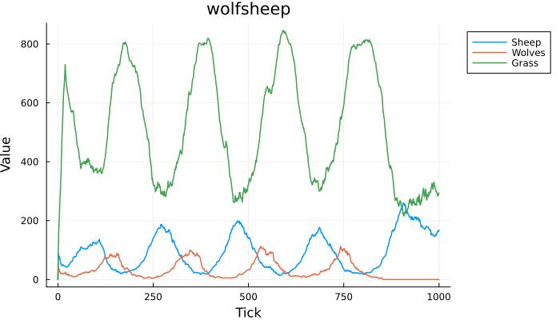
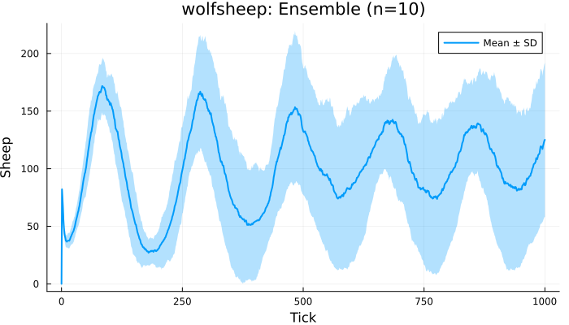
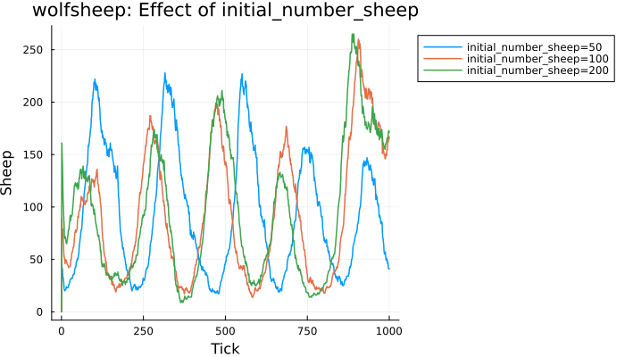

# Wolf Sheep Predation


- [Overview](#overview)
  - [WHAT IS IT?](#what-is-it)
  - [HOW IT WORKS](#how-it-works)
  - [THINGS TO NOTICE](#things-to-notice)
  - [THINGS TO TRY](#things-to-try)
  - [EXTENDING THE MODEL](#extending-the-model)
  - [NETLOGO FEATURES](#netlogo-features)
  - [RELATED MODELS](#related-models)
  - [CREDITS AND REFERENCES](#credits-and-references)
  - [HOW TO CITE](#how-to-cite)
- [Parameters](#parameters)
- [Source Code](#source-code)
- [Time Series](#time-series)
- [Ensemble Runs](#ensemble-runs)
- [Parameter Sensitivity](#parameter-sensitivity)
- [Appendix: Source Code](#appendix-source-code)
  - [Parameters (`parameters.jl`)](#parameters-parametersjl)
  - [Components (`components.jl`)](#components-componentsjl)
  - [Resources (`resources.jl`)](#resources-resourcesjl)
  - [Systems (`systems.jl`)](#systems-systemsjl)
  - [Model (`model.jl`)](#model-modeljl)

## Overview

### WHAT IS IT?

This model explores the stability of predator-prey ecosystems. Such a
system is called unstable if it tends to result in extinction for one or
more species involved. In contrast, a system is stable if it tends to
maintain itself over time, despite fluctuations in population sizes.

### HOW IT WORKS

There are two main variations to this model.

In the first variation, wolves and sheep wander randomly around the
landscape, while the wolves look for sheep to prey on. Each step costs
the wolves energy, and they must eat sheep in order to replenish their
energy - when they run out of energy they die. To allow the population
to continue, each wolf or sheep has a fixed probability of reproducing
at each time step. This variation produces interesting population
dynamics, but is ultimately unstable.

The second variation includes grass (green) in addition to wolves and
sheep. The behavior of the wolves is identical to the first variation,
however this time the sheep must eat grass in order to maintain their
energy - when they run out of energy they die. Once grass is eaten it
will only regrow after a fixed amount of time. This variation is more
complex than the first, but it is generally stable.

The construction of this model is described in two papers by Wilensky &
Reisman referenced below.

### THINGS TO NOTICE

When grass is not included, watch as the sheep and wolf populations
fluctuate. Notice that increases and decreases in the sizes of each
population are related. In what way are they related? What eventually
happens?

Once grass is added, notice the green line added to the population plot
representing fluctuations in the amount of grass. How do the sizes of
the three populations appear to relate now? What is the explanation for
this?

Why do you suppose that some variations of the model might be stable
while others are not?

### THINGS TO TRY

Try adjusting the parameters under various settings. How sensitive is
the stability of the model to the particular parameters?

Can you find any parameters that generate a stable ecosystem that
includes only wolves and sheep?

Try setting GRASS? to TRUE, but setting INITIAL-NUMBER-WOLVES to 0. This
gives a stable ecosystem with only sheep and grass. Why might this be
stable while the variation with only sheep and wolves is not?

Notice that under stable settings, the populations tend to fluctuate at
a predictable pace. Can you find any parameters that will speed this up
or slow it down?

Try changing the reproduction rules – for example, what would happen if
reproduction depended on energy rather than being determined by a fixed
probability?

### EXTENDING THE MODEL

There are a number ways to alter the model so that it will be stable
with only wolves and sheep (no grass). Some will require new elements to
be coded in or existing behaviors to be changed. Can you develop such a
version?

### NETLOGO FEATURES

Note the use of breeds to model two different kinds of “turtles”: wolves
and sheep. Note the use of patches to model grass.

Note use of the ONE-OF agentset reporter to select a random sheep to be
eaten by a wolf.

### RELATED MODELS

Look at Rabbits Grass Weeds for another model of interacting populations
with different rules.

### CREDITS AND REFERENCES

Wilensky, U. & Reisman, K. (1999). Connected Science: Learning Biology
through Constructing and Testing Computational Theories – an Embodied
Modeling Approach. International Journal of Complex Systems, M. 234,
pp. 1 - 12. (This model is a slightly extended version of the model
described in the paper.)

Wilensky, U. & Reisman, K. (2006). Thinking like a Wolf, a Sheep or a
Firefly: Learning Biology through Constructing and Testing Computational
Theories – an Embodied Modeling Approach. Cognition & Instruction,
24(2), pp. 171-209. http://ccl.northwestern.edu/papers/wolfsheep.pdf

### HOW TO CITE

If you mention this model in an academic publication, we ask that you
include these citations for the model itself and for the NetLogo
software: - Wilensky, U. (1997). NetLogo Wolf Sheep Predation model.
http://ccl.northwestern.edu/netlogo/models/WolfSheepPredation. Center
for Connected Learning and Computer-Based Modeling, Northwestern
University, Evanston, IL. - Wilensky, U. (1999). NetLogo.
http://ccl.northwestern.edu/netlogo/. Center for Connected Learning and
Computer-Based Modeling, Northwestern University, Evanston, IL.

In other publications, please use: - Copyright 1997 Uri Wilensky. All
rights reserved. See
http://ccl.northwestern.edu/netlogo/models/WolfSheepPredation for terms
of use.

## Parameters

| Parameter               | Type      | Default | Description             |
|-------------------------|-----------|---------|-------------------------|
| `initial_number_sheep`  | `Int`     | `100`   | initial number sheep    |
| `initial_number_wolves` | `Int`     | `50`    | initial number wolves   |
| `sheep_gain_from_food`  | `Float64` | `4.0`   | sheep gain from food    |
| `wolf_gain_from_food`   | `Float64` | `20.0`  | wolf gain from food     |
| `sheep_reproduce`       | `Float64` | `4.0`   | percent chance per tick |
| `wolf_reproduce`        | `Float64` | `5.0`   | percent chance per tick |
| `grass_regrowth_time`   | `Int`     | `20`    | matches NetLogo default |
| `grass_enabled`         | `Bool`    | `true`  | grass enabled           |
| `grid_width`            | `Int`     | `33`    | matches NetLogo -16..16 |
| `grid_height`           | `Int`     | `33`    | grid height             |
| `max_ticks`             | `Int`     | `1000`  | max ticks               |

## Source Code

The Julia code to run this model:

``` julia
using ArkModelZoo
_, trajectory = run_wolfsheep()
```

## Time Series



## Ensemble Runs

Ten replicates with different random seeds, showing mean ± standard
deviation.



## Parameter Sensitivity

Varying `initial_number_sheep`.



## Appendix: Source Code

This model is implemented in the
[Ark.jl](https://github.com/sdwfrost/Ark.jl) Entity-Component-System
(ECS) framework. The code is split into five files, each with a distinct
role:

- **Parameters**: a mutable struct holding all configurable values.
- **Components**: lightweight data types attached to individual entities
  (agents).
- **Resources**: world-level shared state accessible to all systems.
- **Systems**: functions that operate on entities each tick, defining
  model behavior.
- **Model**: wiring that assembles the world, registers resources and
  systems, and provides the run entry point.

### Parameters (`parameters.jl`)

The parameter struct uses `@kwdef` so that every field has a default
value and can be overridden by keyword. These defaults match the
original NetLogo model’s slider settings.

``` julia
Base.@kwdef mutable struct WolfSheepParams
    initial_number_sheep::Int = 100
    initial_number_wolves::Int = 50
    sheep_gain_from_food::Float64 = 4.0
    wolf_gain_from_food::Float64 = 20.0
    sheep_reproduce::Float64 = 4.0    # percent chance per tick
    wolf_reproduce::Float64 = 5.0     # percent chance per tick
    grass_regrowth_time::Int = 20     # matches NetLogo default
    grass_enabled::Bool = true
    grid_width::Int = 33              # matches NetLogo -16..16
    grid_height::Int = 33
    max_ticks::Int = 1000
    seed::Int = 42
end
```

### Components (`components.jl`)

Components are lightweight data types attached to individual entities
(agents). Mutable structs hold per-entity state, while empty tag structs
act as markers for the ECS query system to efficiently filter entities.

``` julia
# Continuous position on the grid
mutable struct WSPosition
    x::Float64
    y::Float64
end
WSPosition() = WSPosition(0.0, 0.0)

# Energy level (wolves and sheep both have energy)
mutable struct Energy
    energy::Float64
end
Energy() = Energy(0.0)

# Persistent heading (degrees, 0=north, clockwise)
mutable struct WSHeading
    angle::Float64
end
WSHeading() = WSHeading(0.0)

# Tag components for breed dispatch
struct Wolf end
struct Sheep end
```

### Resources (`resources.jl`)

Resources are world-level singletons shared across all systems, used for
global state and aggregate statistics.

``` julia
# Grid of grass state: countdown[x,y] <= 0 means green (alive), > 0 means brown (regrowing)
mutable struct GrassGrid
    width::Int
    height::Int
    countdown::Matrix{Int}
end

function GrassGrid(width::Int, height::Int)
    GrassGrid(width, height, zeros(Int, width, height))
end

mutable struct WSPopulationStats
    sheep_count::Int
    wolf_count::Int
    grass_count::Int
end
WSPopulationStats() = WSPopulationStats(0, 0, 0)
```

### Systems (`systems.jl`)

Systems contain the model logic and execute in a defined order each
tick. Each system struct implements either `initialize!` (run once at
setup) or `update!` (run every tick).

``` julia
# Wolf-Sheep Predation systems
# Matches NetLogo execution order:
#   ask sheep [ move; energy-=1; eat-grass; maybe-reproduce 4; if energy<=0 die ]
#   ask wolves [ move; energy-=1; eat-sheep; maybe-reproduce 5; if energy<=0 die ]
#   ask patches [ grow-grass ]
#   update-counts

# --- Initialization ---

struct InitWolfSheepSystem <: System end

function initialize!(::InitWolfSheepSystem, world::World)
    params = get_resource(world, WolfSheepParams)
    rng = get_resource(world, RNGResource).rng
    grass_grid = get_resource(world, GrassGrid)
    w, h = grass_grid.width, grass_grid.height

    # Initialize grass: countdown = random 0..(regrowth_time-1)
    if params.grass_enabled
        for x in 1:w, y in 1:h
            grass_grid.countdown[x, y] = rand(rng, 0:params.grass_regrowth_time-1)
        end
    end

    # Create sheep — energy = random 0..9, heading = random integer 0..359
    for _ in 1:params.initial_number_sheep
        x = rand(rng) * w
        y = rand(rng) * h
        e = Float64(rand(rng, 0:9))
        new_entity!(world, (WSPosition(x, y), Energy(e), WSHeading(Float64(rand(rng, 0:359))), Sheep()))
    end

    # Create wolves — energy = random 0..9, heading = random integer 0..359
    for _ in 1:params.initial_number_wolves
        x = rand(rng) * w
        y = rand(rng) * h
        e = Float64(rand(rng, 0:9))
        new_entity!(world, (WSPosition(x, y), Energy(e), WSHeading(Float64(rand(rng, 0:359))), Wolf()))
    end
    return nothing
end

# --- Shared movement helper ---
# NetLogo: rt random 50 - 25; fd 1 — persistent heading, ±25 degree turn, forward 1

function _ws_move!(rng, pos::WSPosition, heading::WSHeading, w::Int, h::Int)
    heading.angle += Float64(rand(rng, 0:49) - 25)
    θ = deg2rad(heading.angle)
    pos.x = mod(pos.x + sin(θ), Float64(w))
    pos.y = mod(pos.y + cos(θ), Float64(h))
end

# --- Sheep Phase ---
# All sheep: move, energy-=1, eat-grass, maybe-reproduce, die-check

mutable struct SheepPhaseSystem <: System
    new_sheep::Vector{Tuple{Float64, Float64, Float64, Float64}}  # x, y, energy, heading
end
SheepPhaseSystem() = SheepPhaseSystem(Tuple{Float64,Float64,Float64,Float64}[])

function update!(system::SheepPhaseSystem, world::World)
    params = get_resource(world, WolfSheepParams)
    rng = get_resource(world, RNGResource).rng
    grass_grid = get_resource(world, GrassGrid)
    w, h = grass_grid.width, grass_grid.height

    empty!(system.new_sheep)
    to_remove = Entity[]

    # NetLogo `ask` shuffles agentset each tick — randomize processing order
    for (eids, positions, energies, headings) in Query(world, (WSPosition, Energy, WSHeading); with=(Sheep,))
        indices = collect(eachindex(positions))
        Random.shuffle!(rng, indices)
        @inbounds for i in indices
            # Move + lose energy
            _ws_move!(rng, positions[i], headings[i], w, h)
            energies[i].energy -= 1.0

            # Eat grass
            if params.grass_enabled
                gx = clamp(floor(Int, positions[i].x) + 1, 1, w)
                gy = clamp(floor(Int, positions[i].y) + 1, 1, h)
                if grass_grid.countdown[gx, gy] <= 0
                    energies[i].energy += params.sheep_gain_from_food
                    grass_grid.countdown[gx, gy] = params.grass_regrowth_time
                end
            end

            # Maybe reproduce
            if rand(rng, 0:99) < round(Int, params.sheep_reproduce)
                energies[i].energy /= 2.0
                push!(system.new_sheep, (positions[i].x, positions[i].y,
                      energies[i].energy, headings[i].angle))
            end

            # Die check
            if energies[i].energy <= 0.0
                push!(to_remove, eids[i])
            end
        end
    end

    # Remove dead sheep
    for e in to_remove
        is_alive(world, e) && remove_entity!(world, e)
    end

    # Spawn offspring — NetLogo: hatch 1 [ rt random 360; fd 1 ] (integer turn)
    for (x, y, e, h_angle) in system.new_sheep
        new_heading = h_angle + Float64(rand(rng, 0:359))
        θ = deg2rad(new_heading)
        nx = mod(x + sin(θ), Float64(w))
        ny = mod(y + cos(θ), Float64(h))
        new_entity!(world, (WSPosition(nx, ny), Energy(e), WSHeading(new_heading), Sheep()))
    end
    return nothing
end

# --- Wolf Phase ---
# All wolves: move, energy-=1, eat-sheep, maybe-reproduce, die-check

mutable struct WolfPhaseSystem <: System
    sheep_by_cell::Dict{Tuple{Int,Int}, Vector{Entity}}
    new_wolves::Vector{Tuple{Float64, Float64, Float64, Float64}}
end
WolfPhaseSystem() = WolfPhaseSystem(
    Dict{Tuple{Int,Int}, Vector{Entity}}(),
    Tuple{Float64,Float64,Float64,Float64}[]
)

function update!(system::WolfPhaseSystem, world::World)
    params = get_resource(world, WolfSheepParams)
    rng = get_resource(world, RNGResource).rng
    grass_grid = get_resource(world, GrassGrid)
    w, h = grass_grid.width, grass_grid.height

    empty!(system.new_wolves)

    # Build sheep spatial index (after sheep phase, dead sheep already removed)
    empty!(system.sheep_by_cell)
    for (eids, positions) in Query(world, (WSPosition,); with=(Sheep,))
        @inbounds for i in eachindex(positions)
            gx = clamp(floor(Int, positions[i].x) + 1, 1, w)
            gy = clamp(floor(Int, positions[i].y) + 1, 1, h)
            key = (gx, gy)
            if !haskey(system.sheep_by_cell, key)
                system.sheep_by_cell[key] = Entity[]
            end
            push!(system.sheep_by_cell[key], eids[i])
        end
    end

    to_remove_wolves = Entity[]
    to_remove_sheep = Entity[]

    for (eids, positions, energies, headings) in Query(world, (WSPosition, Energy, WSHeading); with=(Wolf,))
        indices = collect(eachindex(positions))
        Random.shuffle!(rng, indices)
        @inbounds for i in indices
            # Move + lose energy
            _ws_move!(rng, positions[i], headings[i], w, h)
            energies[i].energy -= 1.0

            # Eat sheep
            gx = clamp(floor(Int, positions[i].x) + 1, 1, w)
            gy = clamp(floor(Int, positions[i].y) + 1, 1, h)
            key = (gx, gy)
            sheep_list = get(system.sheep_by_cell, key, nothing)
            if sheep_list !== nothing && !isempty(sheep_list)
                idx = rand(rng, 1:length(sheep_list))
                prey = sheep_list[idx]
                push!(to_remove_sheep, prey)
                deleteat!(sheep_list, idx)
                energies[i].energy += params.wolf_gain_from_food
            end

            # Maybe reproduce
            if rand(rng, 0:99) < round(Int, params.wolf_reproduce)
                energies[i].energy /= 2.0
                push!(system.new_wolves, (positions[i].x, positions[i].y,
                      energies[i].energy, headings[i].angle))
            end

            # Die check
            if energies[i].energy <= 0.0
                push!(to_remove_wolves, eids[i])
            end
        end
    end

    # Remove eaten sheep and dead wolves
    for e in to_remove_sheep
        is_alive(world, e) && remove_entity!(world, e)
    end
    for e in to_remove_wolves
        is_alive(world, e) && remove_entity!(world, e)
    end

    # Spawn wolf offspring — NetLogo: hatch 1 [ rt random 360; fd 1 ] (integer turn)
    for (x, y, e, h_angle) in system.new_wolves
        new_heading = h_angle + Float64(rand(rng, 0:359))
        θ = deg2rad(new_heading)
        nx = mod(x + sin(θ), Float64(w))
        ny = mod(y + cos(θ), Float64(h))
        new_entity!(world, (WSPosition(nx, ny), Energy(e), WSHeading(new_heading), Wolf()))
    end
    return nothing
end

# --- Grass Growth ---

struct GrassGrowthSystem <: System end

function update!(::GrassGrowthSystem, world::World)
    params = get_resource(world, WolfSheepParams)
    !params.grass_enabled && return nothing
    grass_grid = get_resource(world, GrassGrid)

    for x in 1:grass_grid.width, y in 1:grass_grid.height
        if grass_grid.countdown[x, y] > 0
            grass_grid.countdown[x, y] -= 1
        end
    end
    return nothing
end

# --- Count Population ---

struct CountWSPopulationSystem <: System end

function update!(::CountWSPopulationSystem, world::World)
    params = get_resource(world, WolfSheepParams)
    stats = get_resource(world, WSPopulationStats)

    sheep_count = 0
    for (eids, _) in Query(world, (WSPosition,); with=(Sheep,))
        sheep_count += length(eids)
    end

    wolf_count = 0
    for (eids, _) in Query(world, (WSPosition,); with=(Wolf,))
        wolf_count += length(eids)
    end

    grass_count = 0
    if params.grass_enabled
        grass_grid = get_resource(world, GrassGrid)
        for x in 1:grass_grid.width, y in 1:grass_grid.height
            if grass_grid.countdown[x, y] <= 0
                grass_count += 1
            end
        end
    end

    stats.sheep_count = sheep_count
    stats.wolf_count = wolf_count
    stats.grass_count = grass_count
    return nothing
end

# --- Termination ---

struct WSTerminationSystem <: System end

function update!(::WSTerminationSystem, world::World)
    stats = get_resource(world, WSPopulationStats)
    params = get_resource(world, WolfSheepParams)
    tick = get_resource(world, Tick)

    if stats.sheep_count == 0 && stats.wolf_count == 0
        get_resource(world, Terminate).stop = true
    elseif tick.tick + 1 >= params.max_ticks
        get_resource(world, Terminate).stop = true
    end
    return nothing
end
```

### Model (`model.jl`)

The model file assembles all pieces: it creates the ECS `World` with the
required component types, registers resources, builds the `Scheduler`
with systems in execution order, and exposes the public `run` entry
point. The observer pattern records the trajectory each tick.

``` julia
function wolfsheep_world(; initial_capacity::Int = 4096)
    return World(
        WSPosition,
        Energy,
        WSHeading,
        Wolf,
        Sheep;
        initial_capacity = initial_capacity,
        allow_mutable = true,
    )
end

function wolfsheep_systems()
    return (
        InitWolfSheepSystem(),
        SheepPhaseSystem(),
        WolfPhaseSystem(),
        GrassGrowthSystem(),
        CountWSPopulationSystem(),
        WSTerminationSystem(),
    )
end

function wolfsheep_model(params::WolfSheepParams = WolfSheepParams())
    world = wolfsheep_world()
    _add_standard_resources!(world, params)
    add_resource!(world, GrassGrid(params.grid_width, params.grid_height))
    add_resource!(world, WSPopulationStats())
    scheduler = Scheduler(world, wolfsheep_systems())
    initialize!(scheduler)
    return scheduler
end

struct WolfSheepObserver end

function wolfsheep_headers(::WolfSheepObserver)
    return ["Sheep", "Wolves", "Grass"]
end

function wolfsheep_values(::WolfSheepObserver, world::World)
    stats = get_resource(world, WSPopulationStats)
    return Float64[stats.sheep_count, stats.wolf_count, stats.grass_count]
end

function run_wolfsheep(; params::WolfSheepParams = WolfSheepParams(), observe::Bool = true)
    return _run_model(wolfsheep_model, WolfSheepObserver(), wolfsheep_values; params, observe)
end
```
